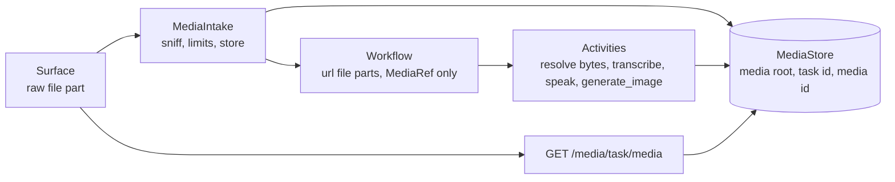

# Capability: media

> Images and audio in both directions, by reference: the bytes live once in a
> task-scoped media store, and every A2A event, workflow payload and model request
> carries a `MediaRef` or a media URL instead.

## What it is

What lets a conversation carry images and audio. The media model, the bounded content
sniffer, the media store with its growing (speech) objects, the intake that validates
and stores every file part, and the effective media capabilities the card and the
surfaces read. Lives in `tiny_harness/harness/media/`; the media route is
`tiny_harness/service/a2a/media_routes.py`.

## Current behaviour

- WHERE `[media]` is absent the instance SHALL be text-only as before: the card is
  unchanged and every file part is refused (`media_off`).
- The accepted input types SHALL be `image/png`, `image/jpeg`, `image/webp`,
  `image/gif`, `audio/wav`, `audio/mpeg`, `audio/mp4`, `audio/ogg` and `audio/webm`
  (`ACCEPTED`); the server-produced speech type is `audio/L16;rate=24000;channels=1`
  (`PCM_MEDIA_TYPE`) and is never accepted as input.
- `MediaIntake.extract` SHALL run on a new turn's message after the access check and
  before redaction, and for each file part, in order: refuse a `url` part without
  fetching it (`url_not_accepted`); refuse a type outside the effective input set
  (`type_not_accepted`); enforce `max_file_bytes` and the running `max_message_bytes`;
  require the sniffed signature to equal the declared type (`type_mismatch`); read an
  image's size from its header only and enforce `max_image_pixels`; count an audio
  file's duration from its container (WAV `data` at a byte rate that matches its format,
  every MP3 frame, the MP4 `stts` that agrees with `stsz` and is no shorter than the
  `mdat` payload at 512 kbit/s, every Ogg page, every WebM cluster) with bounded walks,
  require audio-only tracks, and
  enforce `max_audio_seconds`. All-or-nothing: on any refusal nothing stays stored and
  the request is answered `InvalidParams` with the code and the limit.
- An accepted part SHALL be stored and rewritten to a `url` part
  (`<base>/media/<task_id>/<media_id>`, same type and file name) whose metadata gains
  `mediaId`, `size` and, where known, `durationMs`, `width`, `height`; a surface's
  `voice` and `durationMs` are kept.
- Every other ingress SHALL go through `guard`: a `control` message carrying a file part
  is refused, and push, remote-agent and channel deliveries drop file parts with a note.
- `FileMediaStore` SHALL keep `<root>/<task_id>/<media_id>` with a `.json` ref, write by
  temp file and `os.replace`, validate both ids against `[A-Za-z0-9_-]{1,128}`, and
  mint media ids with 144 random bits. `root` is `[media] dir`, else `media` beside the
  SQLite store (`media-<agent id>` for a non-default agent).
- A growing object (a spoken reply) SHALL be generation-fenced: `begin` starts a new
  generation that fences older writers (`MediaFenced` on their next `append`), and
  `read_stream` follows one generation, ends on `done`, and raises `MediaFailed` on
  `failed` or `MediaInterrupted` when a newer generation starts or nothing grows for
  `idle_timeout`.
- `MediaAttachment.data` SHALL be set only inside an activity; serialising an attachment
  with `data` raises, so no media bytes reach workflow history or an activity payload.
- `capabilities(model_info, stt, tts, image_generator, config)` SHALL compute the
  effective media capabilities once at start: input images always (with `[media]`);
  input audio WHEN `[speech_to_text]` is set, else the model's `audio_input_formats`
  WHEN `audio` is in its `input_modalities`; output `image/png` WHEN an image generator
  exists and `PCM_MEDIA_TYPE` WHEN text-to-speech exists. The card's input and output
  modes, the media extension params, the intake's allow-list and the surfaces' controls
  all read this one value.
- `GET /media/{task_id}/{media_id}` SHALL resolve the participant as the A2A routes do
  and answer `404` (never `403`) WHEN the participant may not read the task, an id is
  malformed or unknown; it SHALL serve only the stored ref's type with
  `X-Content-Type-Options: nosniff`, an inline `Content-Disposition` with a sanitised
  name and `Content-Security-Policy: default-src 'none'`, serve a closed object from its
  file and stream a growing one as it grows, breaking the response WHEN it fails or is
  superseded.
- `resolve_media` SHALL resolve one model request's media newest first within `[media]
  max_request_media_bytes` (default 20 MiB); older media that does not fit SHALL become
  the text `[image <name> shown earlier, not re-sent]` (`not sent: over the request's
  media limit` in the newest message), and an image whose base64 is larger than the
  adapter's `max_image_bytes` SHALL become `[image <name> too large for this model]`.
- WHEN `[media]` is set the request cap SHALL be
  `max(max_request_bytes, ceil(max_message_bytes * 4 / 3) + 65536)`. A new turn's
  message (before intake) and a control SHALL still be refused `InvalidParams`
  (`message_too_large`, limit `max_request_bytes`) WHEN their serialized form, each file
  part counted as 1 KiB, is larger than `max_request_bytes`, so the workflow inbox
  payload stays bounded.
- The retention sweep SHALL delete the media of every task whose record it deletes and
  every object older than `[retention] media`; `tiny-harness tasks purge` deletes the
  task's media too.
- Spans and logs SHALL carry media ids and sizes, never bytes, base64 or a transcript
  outside the message-text rule; the executor's `media.intake` span carries the count,
  the bytes and the refusal code.

## Design

[design.md § Overview](../specs/issue-38/design.md#overview),
[§ Components & interfaces](../specs/issue-38/design.md#components-interfaces),
[§ Security design](../specs/issue-38/design.md#security-design),
[decision-010](../decisions/decision-010.md).

## History

| Work item | What changed | Links |
|-----------|--------------|-------|
| issue-38 | The media model, `sniff`, `FileMediaStore` with fenced growing objects, `MediaIntake` and `guard`, the effective capabilities, the media route, media retention | [spec](../specs/issue-38/), [PR #39](https://github.com/MadaraUchiha-314/tiny-harness/pull/39), [decision-010](../decisions/decision-010.md) |
