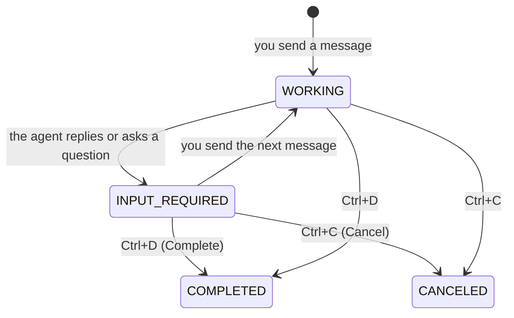

# Use the TUI

The TUI is the terminal user interface of tiny-harness. This page tells you how to talk
to the agent, how to end a conversation and how to use commands.

## The screen

| Area | What it shows |
|------|---------------|
| Top bar | The state of the task, for example `INPUT_REQUIRED · awaiting-next-message` |
| Left | The conversation |
| Right | Three tabs: **Task** (the task and its sub-tasks), **Plan** (the steps of the agent's plan) and **Trace** (what the agent did) |
| Bottom | The message box. It shows the name you send as: `Enter to send as <name>` |

## Keys

| Key | What it does |
|-----|--------------|
| `Enter` | Send the message |
| `Tab` | Go to the next area |
| `F2` | Show the next tab on the right: Task, Plan or Trace |
| `Ctrl+D` | **Complete** the task |
| `Ctrl+C` | **Cancel** the task |
| `F4` | Go back from a sub-task to its parent task |
| `q` | Quit the TUI |

## A conversation

A conversation is a **task**. A task does not end when the agent replies. It waits for
your next message.



- **Continue.** Send another message. The agent remembers the conversation.
- **Complete.** Press `Ctrl+D` when you are satisfied. The task ends as `COMPLETED`.
  If the task has an open sub-task, tiny-harness refuses and names the sub-task.
- **Cancel.** Press `Ctrl+C` to stop the task. The task ends as `CANCELED`.

While the task waits, the top bar tells you why:

- `awaiting-next-message`: the agent replied. Send a message, or complete the task.
- `awaiting-answer`: the agent asked you a question. Answer it.

## Commands

A command is a message that starts with `/`. tiny-harness answers a command itself. The
model does not see it. Type `/` in the message box to see the list.

| Command | What it does |
|---------|--------------|
| `/model` | Show the model of this task and the models you can choose |
| `/model <name>` | Use the model `<name>` for this task |
| `/effort` | Show the reasoning effort of this task |
| `/effort low`, `/effort medium`, `/effort high` | Set the reasoning effort for the next replies |
| `/sub-task <description>` | Start a sub-task: a separate conversation inside this task |
| `/status` | Show the state, model, effort, plan progress and sub-tasks of this task |

A `/word` that is not a command goes to the model as a normal message.

To choose from more than one model, list them in the configuration file. See
[`models`](../configuration/models#models).

## Sub-tasks

A sub-task is a conversation of its own, inside a task. The agent can start sub-tasks.
You can start one with `/sub-task`.

1. Open the **Task** tab (`F2`).
2. Select a sub-task and press `Enter` to open it.
3. Press `F4` to go back to the parent task.

## Connect to a server

By default, the TUI runs the agent inside its own process. You can also connect the TUI
to a tiny-harness server that runs somewhere else:

```sh
tiny-harness tui --url http://agent.example.com:8080
```

The TUI sends your operating system user name as your name. To send a different name,
add `--participant`:

```sh
tiny-harness tui --url http://agent.example.com:8080 --participant alice
```

The name must use printable ASCII characters. The server does not check the name, so
the server must be behind a gateway that checks identity. See
[Deploy](../sdk/deploy#put-a-gateway-in-front).

## Command-line options

| Option | What it does |
|--------|--------------|
| `tiny-harness` | The same as `tiny-harness tui` |
| `--config FILE` | Use `FILE` as the configuration file. tiny-harness then does not read `~/.tiny-harness/` |
| `--version` | Show the version |
| `--help` | Show all options and the configuration file in use |
| `tui --url URL` | Connect to the server at `URL` |
| `tui --participant NAME` | Send messages as `NAME` |

## Problems

| You see | Do this |
|---------|---------|
| `OPENAI_API_KEY` and exit status 2 | Set `OPENAI_API_KEY`, or set `base_url` for a local model. See [Models](../configuration/models) |
| A key name, such as `openai.models`, and exit status 2 | That setting is wrong. Find it in the [configuration guide](../configuration/) |
| `refusing the default configuration` | `~/.tiny-harness` or the file in it is a link, or another user owns it. Fix the owner, or use `--config` |
| No reply, and nothing in the screen | Read `~/.tiny-harness/tiny-harness.log` |
