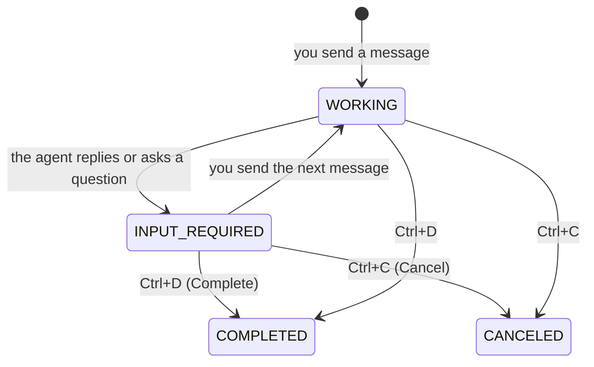

# Use the TUI

The TUI is the terminal user interface of tiny-harness. This page tells you how to talk
to the agent, how to end a conversation, how to use commands, and how to send images
and talk to the agent by voice.

## The screen

| Area | What it shows |
|------|---------------|
| Top bar | The state of the task, for example `INPUT_REQUIRED · awaiting-next-message` |
| Left | The conversation |
| Right | Three tabs: **Task** (the task and its sub-tasks), **Plan** (the steps of the agent's plan) and **Trace** (what the agent did) |
| Bottom | The message box. It shows the name you send as: `Enter to send as <name>` |

## Keys

| Key | What it does |
|-----|--------------|
| `Enter` | Send the message |
| `Tab` | Go to the next area |
| `F2` | Show the next tab on the right: Task, Plan or Trace |
| `Ctrl+D` | **Complete** the task |
| `Ctrl+C` | **Cancel** the task |
| `F4` | Go back from a sub-task to its parent task |
| `F5` | Start a voice message. Press again to stop and send it |
| `F6` | Turn spoken replies on or off |
| `Escape` | Stop a recording without sending it, or stop a spoken reply |
| `Space` (hold, in an empty message box) | Record a voice message while you hold it |
| `q` | Quit the TUI |

## A conversation

A conversation is a **task**. A task does not end when the agent replies. It waits for
your next message.



- **Continue.** Send another message. The agent remembers the conversation.
- **Complete.** Press `Ctrl+D` when you are satisfied. The task ends as `COMPLETED`.
  If the task has an open sub-task, tiny-harness refuses and names the sub-task.
- **Cancel.** Press `Ctrl+C` to stop the task. The task ends as `CANCELED`.

While the task waits, the top bar tells you why:

- `awaiting-next-message`: the agent replied. Send a message, or complete the task.
- `awaiting-answer`: the agent asked you a question. Answer it.

## Commands

A command is a message that starts with `/`. tiny-harness answers a command itself. The
model does not see it. Type `/` in the message box to see the list.

| Command | What it does |
|---------|--------------|
| `/model` | Show the model of this task and the models you can choose |
| `/model <name>` | Use the model `<name>` for this task |
| `/effort` | Show the reasoning effort of this task |
| `/effort low`, `/effort medium`, `/effort high` | Set the reasoning effort for the next replies |
| `/sub-task <description>` | Start a sub-task: a separate conversation inside this task |
| `/status` | Show the state, model, effort, plan progress and sub-tasks of this task |
| `/attach <path>` | Add an image or audio file to your next message. See [Images and voice](#images-and-voice) |

A `/word` that is not a command goes to the model as a normal message.

To choose from more than one model, list them in the configuration file. See
[`models`](../configuration/models#models).

## Sub-tasks

A sub-task is a conversation of its own, inside a task. The agent can start sub-tasks.
You can start one with `/sub-task`.

1. Open the **Task** tab (`F2`).
2. Select a sub-task and press `Enter` to open it.
3. Press `F4` to go back to the parent task.

## Images and voice

The agent can look at images, listen to audio and voice messages, speak its replies and
make images. The server must turn on these features. See
[Images and voice](../configuration/media).

### Start in four steps

1. Install the two optional packages. `voice` records and plays audio. `images` shows
   images in the terminal.

   ```sh
   pip install "tiny-harness[voice,images]"
   ```

   On Linux, `voice` also needs the PortAudio library. Install the `portaudio` package
   of your system (for example, `libportaudio2` on Debian and Ubuntu).

2. Add these sections to the configuration file:

   ```toml
   [media]

   [speech_to_text]

   [text_to_speech]

   [image_generation]
   ```

3. Start the TUI, and attach a photo:

   ```text
   /attach ~/Pictures/room.jpg
   ```

4. Type a question about the photo and press `Enter`.

You see the photo in the conversation, and the agent's answer about it.

### Attach a file

Type `/attach <path>` to add a file to your next message. The file shows above the
message box. Add more files in the same way. Press `Backspace` in an empty message box
to remove the last file. Press `Enter` to send the files with your text. A message can
have files and no text.

The TUI checks the type and the size of each file before it sends it. The agent accepts
PNG, JPEG, WebP and GIF images, and WAV, MP3, M4A, Ogg and WebM audio.

### Images

The TUI shows images in the conversation in terminals that can draw them: kitty,
iTerm2, WezTerm and other terminals with sixel support. In other terminals, and without
the `images` package, it shows one line with the name, the size and the path of a copy:

```text
image · room.jpg · 1024×1024 · saved to ~/.cache/tiny-harness/media/…/….jpg
```

Open the copy in an image viewer. The TUI keeps the copies in
`~/.cache/tiny-harness/media/`.

### Audio files

Each audio file and voice message shows as one line. Select the line and press `Enter`:

- A WAV file plays in the TUI. Its line ends with `⏎ to play`.
- The TUI does not play other types (MP3, M4A, Ogg and WebM, for example a voice
  message from the web UI). Their line ends with `⏎ saves`. Press `Enter` to save a
  copy. The line then shows `saved to <path>`. Open the copy in an audio player.

```text
[audio] note.m4a · 0:12 · saved to ~/.cache/tiny-harness/media/…/….m4a
```

### Talk to the agent

1. Make sure the message box is empty.
2. Hold `Space`. The recording bar shows the time and the sound level.
3. Speak.
4. Release `Space`. The TUI sends the recording.

You see your words as text under the voice message. The TUI does not send a recording
that is shorter than 0.3 seconds or silent.

A short press of `Space` types a space. Most terminals do not report when you release a
key. The TUI sees the release when the key stops repeating. If holding `Space` does not
start a recording, or a recording stops too early, add `--hold-ms` with a larger value,
for example `--hold-ms 800`.

If holding a key is difficult, press `F5` to start a recording and `F5` again to send
it. Press `Escape` to stop a recording without sending it.

### Spoken replies

Press `F6` to turn spoken replies on. The top bar shows `spoken replies: on`. The agent
then speaks each reply. The reply starts to play before the agent has spoken all of it.
Press `Escape` to stop it. The reply also stops when you start a recording or send a
message. Select the reply line and press `Enter` to play it again.

### Media from other tasks

The TUI downloads an image, an audio file or a spoken reply only from the server that it
connects to, and only for the task on the screen. For all other links, the TUI shows
`unavailable (not a medium of this task)` and does not download the file.

### When voice is not available

| You see | The reason | Do this |
|---------|------------|---------|
| `voice input unavailable: install tiny-harness[voice] (PortAudio)` | The `voice` package or the PortAudio library is not installed, or there is no microphone | Do step 1 of [Start in four steps](#start-in-four-steps) |
| `voice output unavailable: install tiny-harness[voice] (PortAudio)` | The same, for the speaker | The same |
| `voice input unavailable: this agent accepts no WAV audio` | The server has no `[speech_to_text]` | Add `[speech_to_text]` to the server's configuration file |

You can always type. Voice problems do not stop the TUI.

## Connect to a server

By default, the TUI runs the agent inside its own process. You can also connect the TUI
to a tiny-harness server that runs somewhere else:

```sh
tiny-harness tui --url http://agent.example.com:8080
```

The TUI sends your operating system user name as your name. To send a different name,
add `--participant`:

```sh
tiny-harness tui --url http://agent.example.com:8080 --participant alice
```

The name must use printable ASCII characters. The server does not check the name, so
the server must be behind a gateway that checks identity. See
[Deploy](../sdk/deploy#put-a-gateway-in-front).

## Command-line options

| Option | What it does |
|--------|--------------|
| `tiny-harness` | The same as `tiny-harness tui` |
| `--config FILE` | Use `FILE` as the configuration file. tiny-harness then does not read `~/.tiny-harness/` |
| `--version` | Show the version |
| `--help` | Show all options and the configuration file in use |
| `tui --url URL` | Connect to the server at `URL` |
| `tui --participant NAME` | Send messages as `NAME` |
| `tui --hold-ms MS` | Hold-to-talk: the longest wait, in milliseconds, for `Space` to repeat. Default `600` |

## Problems

| You see | Do this |
|---------|---------|
| `OPENAI_API_KEY` and exit status 2 | Set `OPENAI_API_KEY`, or set `base_url` for a local model. See [Models](../configuration/models) |
| A key name, such as `openai.models`, and exit status 2 | That setting is wrong. Find it in the [configuration guide](../configuration/) |
| `refusing the default configuration` | `~/.tiny-harness` or the file in it is a link, or another user owns it. Fix the owner, or use `--config` |
| No reply, and nothing in the screen | Read `~/.tiny-harness/tiny-harness.log` |
