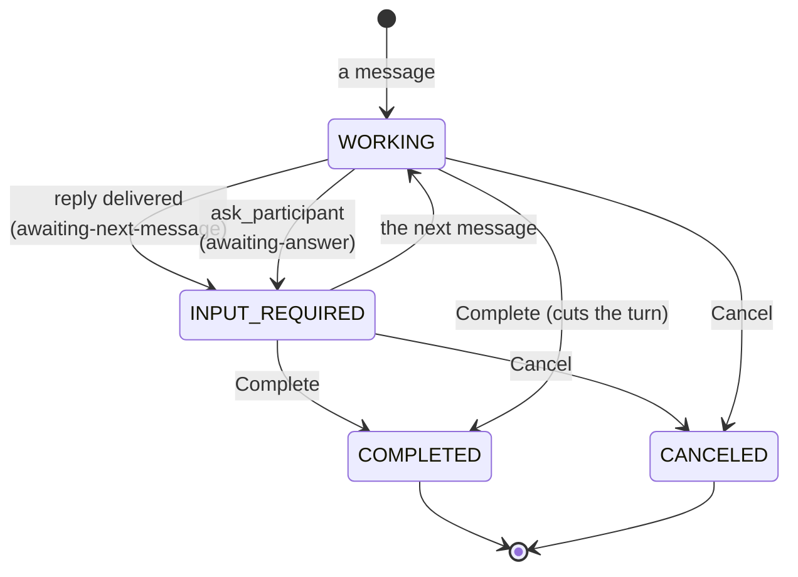
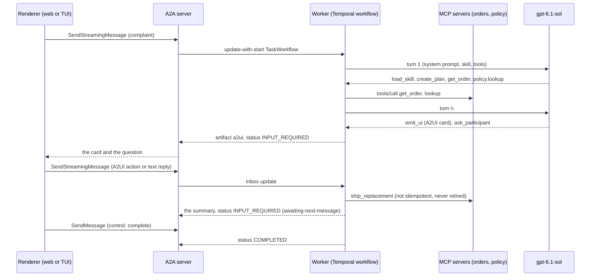

# Getting started

The quickest way to talk to tiny-harness is the installed `tiny-harness` command; the
quickest way to see all of it work is the demo under `examples/demo`: one harness
instance on Temporal Cloud, the `gpt-6.1-sol` model, two MCP servers, a skill, and both
renderers on one task: *"Refund order #48213: the customer says the blender arrived
cracked. Check the order and propose a resolution."*

## From `pip install` to a conversation

The installed package needs no configuration file and no running server:

```sh
pip install tiny_harness
export OPENAI_API_KEY=...   # or point [openai] base_url at a local server
tiny-harness                # the same as `tiny-harness tui`
```

1. **The configuration file.** Without `--config`, the CLI reads
   `~/.tiny-harness/config.toml`. On the first run it creates the directory (`0700`) and
   the file (`0600`) and prints `created default configuration <path>` on stderr. The
   file selects embedded Temporal with persistence on, puts the store, the Temporal
   database and `tiny-harness.log` under `~/.tiny-harness/`, holds no secret, and comments
   every key. It is never rewritten, so edit it freely. A symlinked or foreign-owned
   home or file is refused with exit status 2. `--config FILE` reads that file only and
   never touches `~/.tiny-harness/`; `tiny-harness --help` names the file in effect.
   From Python, `tiny_harness.home.resolve_config_path` and `ensure_default_config` do
   the same; `Settings.load` and `running_harness` never look at the home directory.
2. **The TUI hosts the harness** in its own process (embedded mode, no `--url`), so the
   model provider's key is the only thing it needs.

### The conversation lifecycle

A reply ends a turn, not the task. The task waits in `INPUT_REQUIRED` and the
[status extension](../a2a/ext/status/v1) says why:



- **Keep talking.** The next message continues the same task, with its history.
- **Complete** (`ctrl+d` in the TUI, the *Complete* button in the web renderer) ends it
  `COMPLETED`. A task with an open sub-task refuses and names it. Any A2A client can do
  the same with the [control envelope](../a2a/extensions#completing-a-task).
- **Cancel** (`ctrl+c`, or *Cancel task*) ends it `CANCELED`.
- A watcher can do neither; completing or cancelling a finished task is refused with
  its state.

Sub-tasks the agent spawns itself still complete on their own, so their parent can go on.

### Slash commands

A message that is exactly `/<name> <arguments>` for a registered command runs on the
harness: no model call, a reply on the task, the task's state unchanged. Type `/` in
either renderer for completions.

| Command | Reply |
|---------|-------|
| `/model` | The task's model and the selectable ones (`[openai] models`, default: `model` alone) |
| `/model <name>` | Switches this task and its new sub-tasks to `<name>`; any other name is refused |
| `/effort` | The task's reasoning effort (or the provider default) and `low`, `medium`, `high` |
| `/effort <value>` | Sets the effort sent on every later model call; `[openai] reasoning_effort` is the default |
| `/sub-task <description>` | `Created sub-task <id>.` The sub-task is a conversation of its own; open it from the Task tab (`enter`) or the link, and `f4` or *← Parent* goes back |
| `/status` | Id, name, state and sub-state, model, effort, plan steps done, each sub-task's state |

A watcher can read (`/model`, `/effort`, `/status`) but not change. A `/word` that is not
registered goes to the model as an ordinary message. Code and plugins add commands of
their own; see [plugins](../capabilities/plugins).

## What you need for the demo

- The [local development](local-development) setup (`uv sync`), plus Bun for the web
  renderer.
- A Temporal Cloud namespace reachable with an API key, and an OpenAI key. The demo reads
  both from the environment only; nothing is read from a file. The project keeps them in
  the GNOME keyring:

```sh
export TEMPORAL_API_KEY="$(secret-tool lookup service temporal project tiny-harness)"
export OPENAI_API_KEY="$(secret-tool lookup service openai project tiny-harness)"
```

A missing variable stops the process at startup with the variable's name; there is no
anonymous or local fallback.

### No Temporal account: embedded mode

Every configuration can run with an **embedded Temporal** instead:
`[temporal] mode = "embedded"`, no `address`, and no `TEMPORAL_API_KEY` (it is refused in
that mode, so an embedded run is never confused with a Cloud one). The harness starts the
Temporal CLI dev server through the Temporal SDK, bound to `127.0.0.1` and persisted to
`temporal.sqlite3` beside the store, and stops it when the process exits. The first run
downloads the CLI once into `~/.cache/tiny-harness/temporal` (or set
`temporal.embedded.binary_path` to an installed `temporal`).

```sh
unset TEMPORAL_API_KEY
uv run python -m examples.demo examples/demo/config.embedded.toml   # server + worker + Temporal
uv run tiny-harness --config examples/demo/config.embedded.toml tui # or the TUI hosting all three
```

`tiny-harness tui` with no `--url` in embedded mode starts the harness in its own process
and writes the harness's logs to `tiny-harness.log` beside the store, so they never draw
over the TUI. The same configuration drives the programmatic entry point,
`tiny_harness.service.running_harness(settings)`. Embedded mode is for development and
single-host use; see [deployment](deployment#embedded-temporal-is-not-a-production-deployment).

### No OpenAI account: any OpenAI-compatible server

The OpenAI adapter talks to any server that implements OpenAI's API. Set
`[openai] base_url` to the server (`http://127.0.0.1:11434/v1` for a local Ollama,
`https://openrouter.ai/api/v1` for OpenRouter), `model` to a name that server knows, and
`api` to `"chat_completions"` when the server implements only Chat Completions (the
default, `"responses"`, is OpenAI's Responses API). `OPENAI_API_KEY` becomes optional
with a `base_url` — a local Ollama needs none — and when it is set it is sent to that
server. Set `context_window_tokens` to the window the server actually gives the model,
so compaction triggers in time.

`examples/demo/config.ollama.toml` combines this with embedded Temporal, so the whole
demo runs **offline**:

```sh
OLLAMA_CONTEXT_LENGTH=16384 ollama serve &    # MUST match context_window_tokens
ollama pull qwen3:8b                          # once, with a network; any tool-calling model
unset OPENAI_API_KEY TEMPORAL_API_KEY
uv run python -m examples.demo examples/demo/config.ollama.toml
```

A fully offline run also needs what the first embedded run downloads — the Temporal CLI
(or `temporal.embedded.binary_path`) — and the demo's MCP servers' environment
(`uv sync`) already on disk. The startup log names where model calls go:
`model endpoint http://127.0.0.1:11434 api=chat_completions model=qwen3:8b`.

## Run the demo

```sh
bun install --cwd renderers/web && bun run --cwd renderers/web build   # the web renderer
uv run python -m examples.demo                                         # server + worker
```

The process prints the two surfaces:

- **Web renderer** at `http://127.0.0.1:8080/ui/`: type the complaint in the composer and
  watch the stream.
- **TUI** in another terminal: `uv run tiny-harness tui --url http://127.0.0.1:8080`. It
  sends as your OS user name; `--participant <id>` asserts another id. The id is
  self-asserted, like the web renderer's `?participant=`.

Both are A2A clients of the same server through the official SDKs (`a2a-sdk` for the
TUI, `@a2a-js/sdk` for the web), so a task started in one shows up in the other. The web
renderer is also hosted on this site at [`/ui/`](https://madarauchiha-314.github.io/tiny-harness/ui/):
enter a harness URL in its header (or open it with `?server=<url>`) and it talks to that
harness directly, provided the harness allows the site's origin in `cors_origins`.

## What happens



1. The task is **SUBMITTED** then **WORKING**; the agent loads the `support-agent` skill,
   creates a plan and calls the `orders` and `policy` MCP tools.
2. An **A2UI card** arrives as an artifact: the resolution options and a *Confirm* button
   rendered by the official A2UI renderer in the web renderer and mapped to Textual widgets
   in the TUI.
3. The agent asks the reporter (`ask_participant`) and the task waits in
   **INPUT_REQUIRED**. Press the button or answer in text.
4. The agent ships the replacement or issues the refund, replies with a two-sentence
   summary, and the task waits in **INPUT_REQUIRED · awaiting-next-message**.
5. Ask a follow-up, send `/status`, or press **Complete**: the task reaches
   **COMPLETED**.

Every span of the run is appended to `examples/demo/.state/trace.jsonl` (one JSON object
per line, secrets redacted) and the SQLite store sits beside it. Delete `.state/` to start
over.

## Run the same flow as a test

```sh
uv run pytest tests/e2e -q -m e2e                      # the demo, then the two crash scenarios
uv run pytest tests/e2e -q -m e2e -k crash_recovery    # only the kill -9 scenarios
```

`tests/e2e/test_demo.py` drives the conversation through the A2A client (it presses the
card's button for the first question, then completes the parked task) and asserts the
states, the ledger of the orders server and the trace. The offline Ollama test
(`tests/e2e/test_demo_ollama.py`) also sends a second message to the parked task and
`/status`, and checks that the command made no model call. `tests/e2e/test_crash_recovery.py` runs the server and the worker
as separate processes, kills the worker with `SIGKILL` during an idempotent tool call and
again while the task waits for input, restarts it, and reads Temporal's history to prove
no LLM call ran twice. Each run gets its own task queue, port and state directory under
`~/.cache/tiny-harness-logs/e2e/`. Set `TINY_HARNESS_E2E_EVIDENCE=<dir>` to also copy the
redacted transcript, final task, trace and history summaries there. Without the secrets,
the tests skip with the missing variable's name.

## Next

- [Deployment](deployment): running the server and workers for real, the perimeter they
  need, and what is retained where.
- [Capabilities](../capabilities/capabilities): the current behaviour, one page per
  requirement group.
- [The A2A extensions](../a2a/extensions): what the task and channel data parts carry,
  the status sub-states, the commands on the card and the control envelope.
