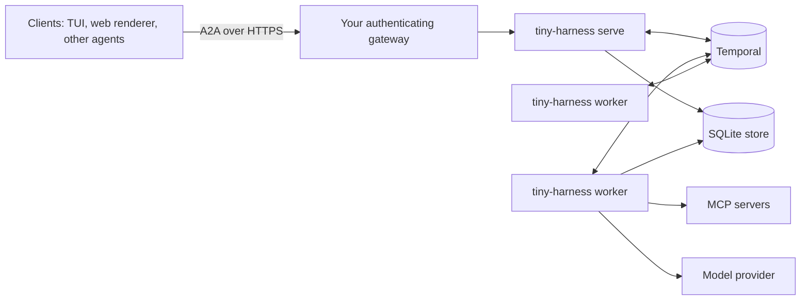

# Deploy

This page tells you how to run tiny-harness for real users. Read the
[SDK quickstart](./) first.

## Checklist

1. Use **remote Temporal** (Temporal Cloud or your own cluster). Do not use embedded
   Temporal in production. See [why](#embedded-temporal-is-not-for-production).
2. Put an **authenticating gateway** in front of the server. See
   [Put a gateway in front](#put-a-gateway-in-front).
3. Keep secrets in a secret manager. Give them to the processes as environment
   variables. See [Secrets](../configuration/#secrets).
4. Run one or more **servers** and one or more **workers**. See [Processes](#processes).
5. Send logs and traces to your monitoring system. See
   [Observability](../configuration/observability).
6. Set how long tiny-harness keeps data. See [Storage](../configuration/storage).

## The parts



| Part | What it does | What it needs |
|------|--------------|---------------|
| **Server** (`tiny-harness serve`) | Receives A2A requests from clients and starts tasks | Temporal and the store. No model key |
| **Worker** (`tiny-harness worker`) | Runs the tasks: model calls, tool calls, saving | Temporal, the store and the model key |
| **Temporal** | Records each step of each task, so a task survives a crash | `TEMPORAL_API_KEY` for Temporal Cloud |
| **Store** | A SQLite file with tasks, plans and messages | A disk that the server and workers share |

## Put a gateway in front

The tiny-harness server does not check who sends a request. It trusts the sender name
in each message. For this reason:

- You **must** put the server behind a reverse proxy or API gateway that authenticates
  each request.
- You **must not** expose the server directly to the internet.
- Your gateway should set the `X-Participant-Id` header to the authenticated user.
  The server uses this header to show each user only their own tasks.

A server without a gateway is not secure.

The agent also sends requests to itself. It does this when it gives a step to a
sub-task, at its own [`base_url`](../configuration/server#base-url), with
`X-Participant-Id: tiny-harness`. Make sure that these requests work and stay safe:

- Use a `base_url` that reaches the server on an internal route, without the gateway.
  Or let the gateway pass the agent's own requests.
- Do **not** make the gateway pass `X-Participant-Id` values that clients send. The
  gateway must always replace the header. If it passes a client's value, any client can
  claim to be the agent and see every task.

The server does protect itself in some ways. It limits the request size
(`max_request_bytes`), limits requests per client (`rate_limit_per_minute`), checks
every user interface action and removes every configured secret from logs, traces and
saved messages.

A web renderer on a different website can connect only when the server lists that
website in `cors_origins`. See [Server](../configuration/server#cors-origins).

## Processes

Start the processes with the CLI:

```sh
tiny-harness --config /etc/tiny-harness/config.toml serve     # one or more, behind the gateway
tiny-harness --config /etc/tiny-harness/config.toml worker    # as many as the load needs
```

Or start them from your own program:

```python
from tiny_harness.service import serve

exit_code = await serve(settings)                     # a server only
exit_code = await serve(settings, with_worker=True)   # a server and a worker
```

- `serve --with-worker` runs a server and a worker in one process.
- `SIGTERM` stops a process in order and lets every running step finish its cleanup.
- The first worker creates a Temporal schedule, `tiny-harness-heartbeat`. Every
  `heartbeat.interval` it checks the channels, updates `GET /_monitor` and deletes old
  data.

The SQLite store allows one writer. The server and all workers must run on one host
and use the same file. To use more than one host, replace the store and the event
bridge with your own implementations. Both are interfaces of the service layer.

### Administration commands

| Command | What it does |
|---------|--------------|
| `tiny-harness tasks purge <task-id>` | Delete one task's data now and stop its workflow. Use it for a deletion request that cannot wait |
| `tiny-harness schedules delete` | Delete the heartbeat schedule |

## Embedded Temporal is not for production

With `[temporal] mode = "embedded"`, tiny-harness starts a Temporal development server
inside its own process. Use it to try tiny-harness, to develop and to test. Do not use it
in production:

- **One process only.** The Temporal server stops when the process stops. You cannot
  start a separate worker, so you cannot add workers for more load.
- **No authentication.** The Temporal server listens on `127.0.0.1` only. But any
  program on the same computer can connect and read every conversation. Use embedded
  Temporal only on a computer that one person uses.
- **No operations tools.** There is no Temporal web interface, no archive and no
  upgrade path for the saved file. If you kill the harness with `kill -9`, the Temporal
  server can continue to run.

tiny-harness writes a warning to the log each time it starts an embedded Temporal
server.

## What tiny-harness keeps, and for how long

| Data | Where | How long |
|------|-------|----------|
| Tasks, plans, channel messages, audit rows, summaries, push settings | The SQLite store | The `[retention]` settings. 30 days by default. See [Storage](../configuration/storage) |
| The history of each task: every model request and tool result | Temporal | The retention setting of your Temporal namespace. Set it in Temporal |
| Traces (no secrets) | Your trace system, Langfuse or `trace_file` | The setting of that system. A `trace_file` grows until you rotate it |
| Logs (JSON lines, no secrets) | Standard output of each process | The setting of your log system |

The personal data in a task is the user names and what the users wrote. The places
above are the only places that keep it.

### Push notification credentials

An A2A client can ask the server to send updates to its own web address. The client
then gives a token for that address. The store keeps the token as the client sent it.
tiny-harness does not encrypt it.

- A new SQLite file is readable only by its owner (`0600`). An existing file keeps its
  mode. Run `chmod 600` on it, and keep its directory and backups private.
- To encrypt the data, put the SQLite file on an encrypted disk, or use a store plugin
  that encrypts.

**Upgrade from version 0.5 or earlier.** Older versions encrypted these tokens with
`TINY_HARNESS_PUSH_KEY`. The new version cannot read them. It deletes each old token
when it reads it and writes a warning. Clients must register their push notifications
again. Remove `TINY_HARNESS_PUSH_KEY` from your environment.
