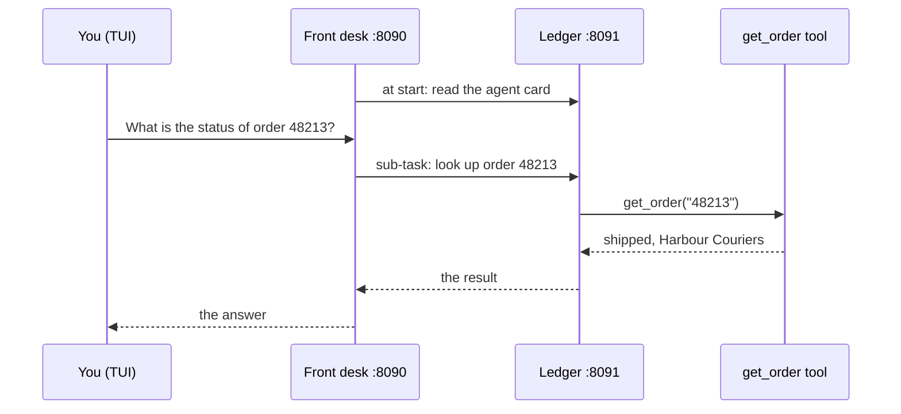

# Example: two agents

The repository contains an example of one agent that gives work to another agent, in
`examples/delegation`. Both agents are tiny-harness:

- The **ledger** knows the orders of a small shop. It has one tool, `get_order`, which
  only reads. Its [`[card]`](../configuration/plugins-and-agents#card) says what it does.
- The **front desk** talks to the customer. It has no tools. It lists the ledger under
  [`agents`](../configuration/plugins-and-agents#agents).

You do not tell the front desk to use the ledger. Its model reads the ledger's card and
decides itself.

## Run it

You need a copy of the repository, [uv](https://docs.astral.sh/uv/) and an OpenAI key.
Both agents use embedded Temporal, so `TEMPORAL_API_KEY` must not be set.

1. Get the code and install it:

   ```sh
   git clone https://github.com/MadaraUchiha-314/tiny-harness.git
   cd tiny-harness
   uv sync
   ```

2. Start the ledger in one terminal. It listens on port 8091:

   ```sh
   OPENAI_API_KEY=sk-... uv run tiny-harness --config examples/delegation/ledger.toml serve
   ```

3. Start the front desk in a second terminal. It listens on port 8090. Start it after
   the ledger, because it reads the ledger's card when it starts:

   ```sh
   OPENAI_API_KEY=sk-... uv run tiny-harness --config examples/delegation/front-desk.toml serve
   ```

4. Open the TUI on the front desk in a third terminal:

   ```sh
   uv run tiny-harness tui --url http://127.0.0.1:8090
   ```

5. Send: *"What is the status of order 48213?"*

## What you see

1. The front desk says that it asks the order ledger.
2. The front desk gives the ledger a sub-task, for example: *"Look up order 48213 and
   report its status, carrier, dates and any refund."*
3. The ledger calls `get_order` and answers.
4. The front desk answers you: order 48213 shipped with Harbour Couriers on 10 October
   2026, and it is due on 14 October 2026. Only the ledger has these facts.

Ask about order 48377 to see a refund.



## The files

| File | What it is |
|------|------------|
| `examples/delegation/ledger.toml` | The ledger's configuration, with its `[card]` |
| `examples/delegation/front-desk.toml` | The front desk's configuration, with `agents` |
| `examples/delegation/ledger/plugin.json` | The ledger's plugin |
| `examples/delegation/ledger/mcp.json`, `mcp_ledger.py` | The `orders` MCP server, which only reads |
| `examples/delegation/ledger/io.github.madarauchiha-314.tiny-harness/prompts/rules.md` | The ledger's prompt text |

The example writes its data to `examples/delegation/.state/`. Delete that folder to
start again.

To give work to an agent that is not tiny-harness, put its address under `agents`. Any
A2A 1.0 agent that needs no authentication works.
