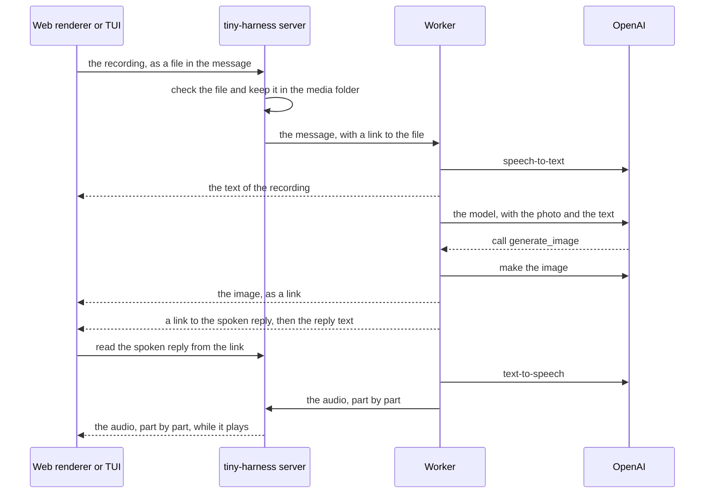

# Example: images and voice

The repository contains a multi-modal example in `examples/multimodal`. The agent is an
interior design helper. You show it a photo of a room. You ask it questions by text, in
an audio file or by voice. It answers by text and by voice, and it makes images of the
changes that it suggests.

The example shows these parts of tiny-harness:

- **Images and audio in messages**, from the web renderer and from the TUI.
- **Speech-to-text** for audio files and voice messages.
- **Spoken replies**, which start to play before the reply audio is complete.
- **The `generate_image` tool**, which shows an image in the conversation.
- **A plugin** with one prompt file that gives the agent its role.

## Run it

You need a copy of the repository, [uv](https://docs.astral.sh/uv/),
[Bun](https://bun.sh/) and an OpenAI key. The example uses embedded Temporal, so you
need no Temporal account. Each conversation costs some cents of OpenAI use.

1. Get the code and install it:

   ```sh
   git clone https://github.com/MadaraUchiha-314/tiny-harness.git
   cd tiny-harness
   uv sync --extra voice --extra images
   ```

2. Build the web renderer:

   ```sh
   bun install --cwd renderers/web && bun run --cwd renderers/web build
   ```

3. Start the example:

   ```sh
   OPENAI_API_KEY=sk-... uv run python -m examples.multimodal
   ```

4. Open the web renderer at `http://127.0.0.1:8080/ui/`. Or open the TUI in a second
   terminal:

   ```sh
   uv run tiny-harness tui --url http://127.0.0.1:8080
   ```

5. Attach `examples/multimodal/fixtures/room.jpg` and ask "Describe this room."

You see the photo in your message, and the agent's description of the room.

The `voice` extra needs the PortAudio library for the TUI. On Debian and Ubuntu, install
`libportaudio2`. The web renderer needs no extra package. It uses the browser's
microphone and speaker.

## What you see

Use the three files in `examples/multimodal/fixtures/`. OpenAI made them, so they contain
no person's photo or voice.

1. **A photo.** Send `room.jpg` with a question. The agent describes the room.
2. **An audio file.** Send `question.wav`. It asks which wall colour makes the room
   brighter. You see the text of the recording under the file. The agent answers.
3. **A voice message.** Hold the microphone button, or `Space` in the TUI. Ask for a
   mock-up of the room with that colour. Release to send. The agent calls
   `generate_image`. A new image shows in the conversation, and the agent speaks its
   reply.
4. **A reference to an earlier image.** Type "Now make the sofa in the first photo
   green." The agent uses the first photo again and makes a new image.

A task that you start in the web renderer also shows in the TUI, with its images and
audio.

The example writes its data to `examples/multimodal/.state/`. The images and audio are
in `.state/media/`. Delete `.state/` to start again.

## The controls

### Web renderer

| Control | What it does |
|---------|--------------|
| Paperclip button | Choose images or audio files for the next message. You can also drop files on the message box, or paste an image |
| × on a file | Remove the file before you send it |
| Microphone button | Hold it to record. Release it to send. With the keyboard, press `Space` or `Enter` to start and again to send |
| Speaker button | Turn spoken replies on or off. It is on when you open the page |
| **Stop** | Stop the reply that the agent speaks |
| **Replay** | Play a spoken reply again from the start |
| An image | Select it to see it at full size |

The browser asks you to allow the microphone the first time. If you refuse, or there is
no microphone, the button says why. You can always type.

### TUI

| Key or command | What it does |
|----------------|--------------|
| `/attach <path>` | Add a file to the next message |
| Hold `Space` in an empty message box | Record while you hold it. Release to send |
| `F5` | Start a recording. Press again to send it |
| `F6` | Turn spoken replies on or off. They are off when the TUI starts |
| `Escape` | Stop a recording without sending it, or stop a spoken reply |

[Use the TUI](../cli/tui#images-and-voice) explains each key.

## How a voice message flows



Files never travel in the task's events. The server keeps each file once, in the media
folder of the task. Events carry a link to the file. A client reads the file from the
server at `/media/<task-id>/<media-id>`, with the same participant check as the task
itself. The [media extension](../a2a/ext/media/v1) describes the messages and the link.

## The files

| File | What it is |
|------|------------|
| `examples/multimodal/config.toml` | Embedded Temporal, OpenAI for the model, speech-to-text, text-to-speech and images |
| `examples/multimodal/plugin.json` | The plugin's name and version |
| `examples/multimodal/io.github.madarauchiha-314.tiny-harness/prompts/rules.md` | The prompt text. It tells the agent to call `generate_image` when you ask to see a change |
| `examples/multimodal/fixtures/` | The photo and the two recordings. `generate.py` makes new ones with OpenAI |
| `examples/multimodal/__main__.py` | The program. It calls `tiny_harness.service.serve` |

[Images and voice](../configuration/media) explains each setting in `config.toml`. To
use your own speech or image service, see
[Use your own media services](extend#use-your-own-media-services).
