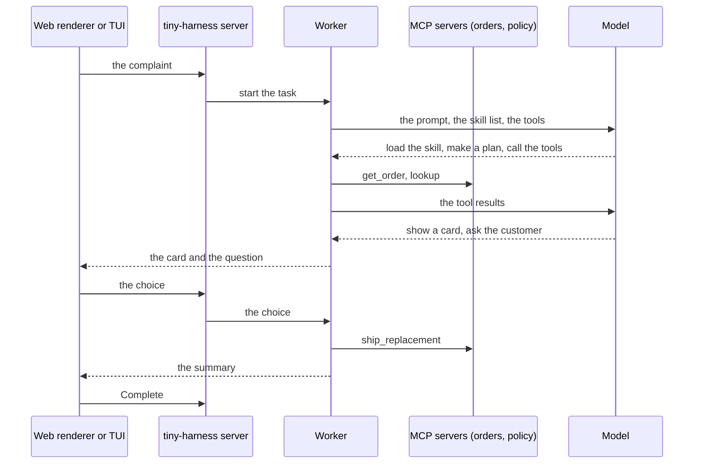

# Example: support agent

The repository contains a complete example in `examples/demo`. It is a support agent
for a small online shop. It shows each part of tiny-harness working together:

- A **plugin** with two MCP servers: `orders` (an order book) and `policy` (the refund
  rules).
- A **skill**, `support-agent`, with the steps to resolve a complaint.
- A **prompt** file that tells the agent about the shop.
- The **web renderer** and the **TUI**, both connected to the same task.

The example task is this complaint: *"Refund order #48213: the customer says the
blender arrived cracked. Check the order and propose a resolution."*

## Run it

You need a copy of the repository, [uv](https://docs.astral.sh/uv/) and
[Bun](https://bun.sh/).

1. Get the code and install it:

   ```sh
   git clone https://github.com/MadaraUchiha-314/tiny-harness.git
   cd tiny-harness
   uv sync
   ```

2. Build the web renderer:

   ```sh
   bun install --cwd renderers/web && bun run --cwd renderers/web build
   ```

3. Choose a configuration and start the example:

   | You have | Run |
   |----------|-----|
   | An OpenAI key only | `OPENAI_API_KEY=sk-... uv run python -m examples.demo examples/demo/config.embedded.toml` |
   | No key: a local Ollama | `uv run python -m examples.demo examples/demo/config.ollama.toml` |
   | An OpenAI key and Temporal Cloud | `uv run python -m examples.demo` (needs `OPENAI_API_KEY` and `TEMPORAL_API_KEY`) |

   For the Ollama configuration, start Ollama first:
   `OLLAMA_CONTEXT_LENGTH=16384 ollama serve &` and `ollama pull qwen3:8b`. For the
   two embedded configurations, `TEMPORAL_API_KEY` must not be set.

4. Open the web renderer at `http://127.0.0.1:8080/ui/`, or open the TUI in a second
   terminal:

   ```sh
   uv run tiny-harness tui --url http://127.0.0.1:8080
   ```

5. Send the complaint above.

## What you see

1. The agent loads the `support-agent` skill, makes a plan and calls the `orders` and
   `policy` tools.
2. A **card** appears with the resolution options and a *Confirm* button.
3. The agent asks you to choose. The task waits in `INPUT_REQUIRED`. Press the button,
   or answer in text.
4. The agent ships a replacement or gives a refund. It replies with a short summary.
5. Ask a follow-up question, send `/status`, or press **Complete**.

A task that you start in the web renderer also shows in the TUI, and the opposite.

The example writes its data to `examples/demo/.state/`. `trace.jsonl` has one line for
each step. Delete `.state/` to start again.

## How the steps flow



## The files

| File | What it is |
|------|------------|
| `examples/demo/plugin.json` | The plugin's name and version |
| `examples/demo/mcp.json` | The two MCP servers |
| `examples/demo/mcp_orders.py`, `mcp_policy.py` | The MCP servers |
| `examples/demo/skills/support-agent/SKILL.md` | The skill |
| `examples/demo/io.github.madarauchiha-314.tiny-harness/prompts/rules.md` | The prompt text about the shop |
| `examples/demo/config*.toml` | The three configurations |
| `examples/demo/__main__.py` | The program. It calls `tiny_harness.service.serve` |

Copy this directory to start your own agent. [Add tools, commands and skills](extend)
explains each file.
