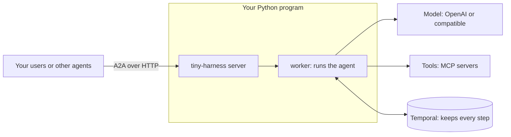

# SDK quickstart

This guide is for Python developers who want to run the agent inside their own
application. If you only want to chat in the terminal, read the
[CLI quickstart](../cli/) instead.

## How it works

Your program starts the harness. The harness serves the agent over
[A2A](https://a2a-protocol.org/), an open HTTP protocol for agents. Your users, your
web page or other agents talk to it with any A2A client.



Temporal records each step of each task. When the process stops in the middle of a
task, the task continues from the last step when the process starts again.

## What you need

- Python 3.14 or later.
- An OpenAI API key, or a local model (see [Models](../configuration/models)).

## Start in four steps

1. Install tiny-harness:

   ```sh
   pip install tiny_harness
   ```

2. Write a configuration file, `config.toml`:

   ```toml
   [temporal]
   mode = "embedded"                   # tiny-harness starts Temporal for you

   [openai]
   model = "gpt-6.1-sol"

   [server]
   bind = "127.0.0.1:8080"             # where the server listens
   base_url = "http://127.0.0.1:8080"  # the address clients use
   ```

3. Write `app.py`:

   ```python
   import asyncio
   from pathlib import Path

   from tiny_harness.config import Settings
   from tiny_harness.service import running_harness


   async def main() -> None:
       settings = Settings.load(Path("config.toml"))
       async with running_harness(settings) as harness:
           print(f"Agent ready at {harness.base_url}")
           await harness.wait()


   asyncio.run(main())
   ```

4. Start it with your key:

   ```sh
   export OPENAI_API_KEY=sk-...
   python app.py
   ```

You see `Agent ready at http://127.0.0.1:8080/`. The first start downloads the Temporal
server one time. Press `Ctrl+C` to stop.

To chat with your agent, open a second terminal and run
`tiny-harness tui --url http://127.0.0.1:8080`.

## Send a message from Python

The harness speaks A2A. This example uses the official A2A Python SDK, `a2a-sdk`. It
is installed with tiny-harness.

```python
import uuid

import httpx
from a2a.client import ClientConfig, create_client
from a2a.types import Message, Part, Role, SendMessageRequest, TaskState


async def ask(base_url: str, text: str, user: str) -> str:
    """Send one message and print the replies. Return the task id."""
    message = Message(
        message_id=uuid.uuid4().hex,
        context_id=uuid.uuid4().hex,
        role=Role.ROLE_USER,
        parts=[Part(text=text)],
    )
    message.metadata.update({"participant_id": user})
    task_id = ""
    async with httpx.AsyncClient(timeout=120, headers={"X-Participant-Id": user}) as http:
        config = ClientConfig(httpx_client=http, streaming=True)
        client = await create_client(base_url, client_config=config)
        async for event in client.send_message(SendMessageRequest(message=message)):
            if event.HasField("status_update"):
                task_id = event.status_update.task_id
                status = event.status_update.status
                for part in status.message.parts:
                    print(TaskState.Name(status.state), part.text)
        await client.close()
    return task_id
```

The output is similar to this:

```text
TASK_STATE_INPUT_REQUIRED Hello, Alice! Nice to meet you.
```

Each message must name its sender, in the `X-Participant-Id` header and in the
`participant_id` metadata. The harness does not check the name. Your gateway must
check it. See [Deploy](deploy#put-a-gateway-in-front).

A reply does not end the task. The task waits for the next message in the state
`INPUT_REQUIRED`. To continue the conversation, send the next message with the same
`task_id` and `context_id`. To end the task, send the message that `complete_message`
builds:

```python
from tiny_harness.service import complete_message

done = complete_message(task_id, participant_id="alice")
async for event in client.send_message(SendMessageRequest(message=done)):
    ...  # the last state is TASK_STATE_COMPLETED
```

## What you can import

| Name | Use it to |
|------|-----------|
| `tiny_harness.config.Settings` | Read and check a configuration file: `Settings.load(path)` |
| `tiny_harness.service.running_harness` | Start the harness inside an `async with` block. Everything stops at the end of the block |
| `tiny_harness.service.Harness` | Add an agent to your own Starlette or FastAPI app. See [Mount agents on your app](mount) |
| `tiny_harness.service.serve` | Run the harness until the process gets a stop signal. Returns the exit status |
| `tiny_harness.service.complete_message` | Build the message that completes a task |
| `tiny_harness.service.temporal_client` | Connect to Temporal only, for administration |

`running_harness` reads only the `Settings` you give it. It does not read
`~/.tiny-harness/`.

## Next steps

- [Add tools, commands and skills](extend): give the agent what it needs for your
  product.
- [Mount agents on your app](mount): serve one or more agents from your own Starlette
  or FastAPI app.
- [Configuration](../configuration/): every setting, in plain words.
- [Deploy](deploy): run the agent for real users.
- [Example: support agent](example): a complete agent with tools, a skill and a web
  user interface.
- [Example: images and voice](example-multimodal): an agent that looks at photos,
  listens, speaks and makes images.
