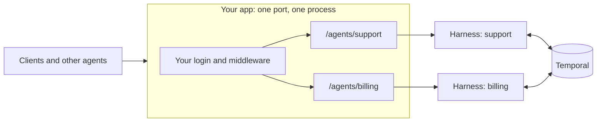

# Mount agents on your app

This guide is for Python developers who already have a Starlette or FastAPI app. It
shows how to add one or more agents to that app. Your app keeps its own server, its own
middleware and its own login. Read the [SDK quickstart](./) first.

## How it works

A `Harness` is one agent. It connects to Temporal, prepares the agent and starts the
worker. It does not open a port. Your app serves the agent at a path that you choose.



## Start in four steps (Starlette)

1. Install tiny-harness:

   ```sh
   pip install tiny_harness
   ```

2. Write `support.toml`. The path in `base_url` is where your app serves the agent:

   ```toml
   [agent]
   id = "support"

   [temporal]
   mode = "embedded"

   [openai]
   model = "gpt-6.1-sol"

   [server]
   base_url = "http://127.0.0.1:8000/agents/support"
   ```

3. Write `app.py`:

   ```python
   from pathlib import Path

   from starlette.applications import Starlette
   from starlette.routing import Mount

   from tiny_harness.config import Settings
   from tiny_harness.service import Harness, harnesses_lifespan

   support = Harness(Settings.load(Path("support.toml")))

   app = Starlette(
       routes=[Mount(support.prefix, app=support.asgi_app())],
       lifespan=harnesses_lifespan(support),
   )
   ```

4. Start your app with your key:

   ```sh
   export OPENAI_API_KEY=sk-...
   uvicorn app:app --port 8000
   ```

Open <http://127.0.0.1:8000/agents/support/.well-known/agent-card.json>. You see the
agent's card. Talk to the agent with
`tiny-harness tui --url http://127.0.0.1:8000/agents/support`.

## FastAPI

Install the FastAPI extra:

```sh
pip install 'tiny_harness[fastapi]'
```

Include one router for each agent:

```python
from pathlib import Path

from fastapi import FastAPI

from tiny_harness.config import Settings
from tiny_harness.fastapi import harness_router
from tiny_harness.service import Harness

support = Harness(Settings.load(Path("support.toml")))

app = FastAPI()
app.include_router(harness_router(support))
```

- The router starts the agent when your app starts. It stops the agent when your app
  stops.
- The agent's routes show in your app's `/docs` page, in a group named
  `A2A: support`.
- Do not give `include_router` a `prefix`. The router already has the agent's path.
  If you add one, the agent refuses every request with the error 500.
- If your app has a `root_path` (for example behind a proxy), put it in `base_url` too.
  Otherwise the agent refuses every request with the error 500, because its card would
  have the wrong address.
- The router does not add CORS and does not serve the web renderer at `/ui`. Add
  `CORSMiddleware` or `StaticFiles` to your app if you need them. tiny-harness writes a
  warning when `cors_origins` or `ui_dir` is set.

## Several agents in one app

Give each agent its own configuration file and its own `[agent] id`. Mount each agent at
its own path. Start all agents with one `harnesses_lifespan`:

```python
names = ["support", "billing", "ledger"]
agents = [Harness(Settings.load(Path(f"{name}.toml"))) for name in names]

app = Starlette(
    routes=[Mount(agent.prefix, app=agent.asgi_app()) for agent in agents],
    lifespan=harnesses_lifespan(*agents),
)
```

tiny-harness keeps the agents apart:

- Each agent uses its own Temporal task queue. The queue is the agent id, unless you
  set [`task_queue`](../configuration/temporal#task-queue).
- An agent answers only for its own tasks. A task id of another agent gets "task not
  found".
- Two agents cannot use the same id, the same task queue or the same
  [`sqlite_path`](../configuration/storage#sqlite-path). The second agent does not start, and the
  error names the agent that has it.
- Agents with the same Temporal settings share one connection. In embedded mode, set
  the same [`database_path`](../configuration/temporal#database-path) in each file to use one
  Temporal server.
- Each log line has an `agent` field with the agent id.

### Let one agent use another

Add the other agent to `[[agents]]` with its full address, path included:

```toml
[[agents]]
id = "billing"
url = "http://127.0.0.1:8000/agents/billing"
```

The `support` agent then sends sub-tasks to `billing` over HTTP, through your app. It
builds the card of `billing` from the `billing` configuration in the same process. It
does not fetch the card, because your app does not listen yet while it starts. A complete example with five agents is in
[`examples/multi_agent`](https://github.com/MadaraUchiha-314/tiny-harness/tree/main/examples/multi_agent).

## Use your own login

By default, the harness reads the user's name from the `X-Participant-Id` header. The
harness does not check that header. When your app has its own login, give the harness a
function that returns the logged-in user:

```python
from starlette.requests import Request


def logged_in_user(request: Request) -> str | None:
    return request.state.user  # set by your login middleware


support = Harness(settings, participant=logged_in_user)
```

With this function:

- The harness ignores the `X-Participant-Id` header.
- A request for which the function returns `None` has no user. The harness refuses to
  start a task for it and shows it no task.
- If the function raises an error, the request fails with the error 500.

Calls from one agent to another carry only `X-Participant-Id`. An agent also calls
itself this way when it gives a step to a sub-task. If your login refuses these calls,
sub-tasks and delegation fail. Let your login accept them, or mount the agents that
work together without the function.

## Options

| `Harness(...)` argument | What it does | Default |
|-------------------------|--------------|---------|
| `prefix` | The path where your app mounts the agent. Use it when `base_url` has no path | The path of `base_url` |
| `participant` | A function that returns the logged-in user | The `X-Participant-Id` header |
| `routes` | A `RouteOptions` that turns off routes or middleware | Everything on |
| `client` | A Temporal client that you already have. The harness does not close it | A new connection |
| `with_worker` | Run the worker in this process | `True` |
| `agent` | An `AgentDescription` for the agent's card: name, description, skills | `[agent]` |
| `plugins`, `commands`, `builtin_commands` | Plugins and commands in code, as for `running_harness` | none |

`RouteOptions` has five switches. Each is `True` by default:

| Switch | Turn it off when |
|--------|------------------|
| `limits` | Your app already limits the request size and the number of requests. Without it, the harness limits neither |
| `cors` | Your app adds its own CORS rules |
| `monitor` | You do not want `GET /_monitor` |
| `push` | You do not want `POST /a2a/push/...`. The agent then watches the tasks of other agents itself |
| `ui` | You do not want the web renderer at `/ui` |

```python
from tiny_harness.service import RouteOptions

support = Harness(settings, routes=RouteOptions(limits=False, cors=False))
```

## What goes wrong

| You see | Why | Do this |
|---------|-----|---------|
| Error 503 `agent support is not started` | The app did not run the lifespan, or it is still starting | Pass `harnesses_lifespan(...)` to your app |
| Error 500 `mounted at '/x' but configured for '/agents/support'` | The mount path is not the path in `base_url` | Mount at `agent.prefix` |
| `HarnessConflictError` at start | Two agents have the same id, task queue or store file | Give each agent its own values |
| `ConfigError` about the prefix | `prefix` and the path of `base_url` are different | Use one of them |

## Next steps

- [Deploy](deploy): run the agents for real users.
- [Agent](../configuration/agent): the `[agent]` section.
- [Plugins and other agents](../configuration/plugins-and-agents): the `[[agents]]`
  table.
