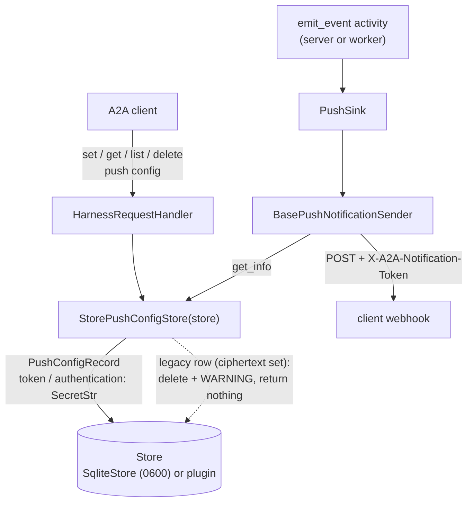

<!-- Written per the `the-loop:writing` skill: front-load each section's
     conclusion, draw it rather than describe it (3+ named parts -> a mermaid
     diagram), and keep the formal registers formal (EARS, abuse cases,
     RFC-2119, API contracts, schema descriptions). No length limit — length
     follows the change; the test is whether a sentence can come out without
     losing information. A gated section stays even when it is empty. -->

# Design: Remove `TINY_HARNESS_PUSH_KEY` from the end-to-end architecture

> Phase 2 of 3 (requirements → design → tasks). Derives from
> [requirements.md](requirements.md). The `design-approval` gate was skipped by
> declaration at phase selection; this document and [testing-plan.md](testing-plan.md)
> are reviewed on PR #24.

## Overview

The change is mostly deletion. `PushTokenCipher`, `Settings.push_key`, its
`SECRET_VARIABLES` row and the `cryptography` dependency go; `StorePushConfigStore`
loses its cipher argument and stores the client's `token` and `authentication` in the
record as supplied. Three small additions carry the requirements the deletion would
otherwise break:

| Addition | Where | Requirement |
|---|---|---|
| Legacy push configs (ciphertext fields set) are dropped on read, with a warning | `StorePushConfigStore` | R4.1, R4.2 |
| A new SQLite file is created `0600` before SQLite opens it | `SqliteStore.__init__` | R3.2 |
| A set `TINY_HARNESS_PUSH_KEY` logs one "set and ignored" warning | `runtime.ignored_environment_warnings` | R1.3 |

The credential fields are `SecretStr` on the record, so a `repr` or log of a record shows
`**********`; they are revealed only when the store serialises the record to JSON.

## Architecture



Nothing changes in the A2A layer, the workflow, Temporal payloads or the redactor's
wiring: `secret_values(settings)` simply has one value fewer. `docs/architecture/architecture.md`
does not mention the key and needs no edit.

## Components & interfaces

### `tiny_harness/config.py`

- Delete `Settings.push_key` and the `(None, "push_key", "TINY_HARNESS_PUSH_KEY", True)`
  row of `SECRET_VARIABLES` (R1.1). `load_settings` then never reads the variable, and
  a missing one is no longer a `ConfigError` (R1.2).
- The settings schema snapshot loses `push_key` from `properties` and `required` (R1.4);
  regenerated with `UPDATE_API_SNAPSHOTS=1`.

### `tiny_harness/service/runtime.py`

- `secret_values` drops `settings.push_key`.
- `ignored_environment_warning(env) -> str | None` becomes
  `ignored_environment_warnings(env) -> tuple[str, ...]`, driven by a table so the two
  ignored variables share one rule (value never echoed):

  ```python
  IGNORED_VARIABLES = (
      ("OPENAI_BASE_URL", "the model endpoint is [openai] base_url"),
      ("TINY_HARNESS_PUSH_KEY", "push-notification credentials are protected at rest by the store"),
  )
  # → "TINY_HARNESS_PUSH_KEY is set and ignored; push-notification credentials are ..."
  ```

  `build_runtime` logs each line at `WARNING` (R1.3). It runs once per server, worker
  and runtime-building CLI command, which is the "once per start" the requirement asks.
  The `OPENAI_BASE_URL` wording is unchanged.

### `tiny_harness/harness/persistence/records.py`

- Delete `PushTokenCipher` and the `cryptography`, `base64`, `os`, `SecretStr`-for-key and
  `ConfigError` imports it alone needed.
- `PushConfigRecord` (see [Data models](#data-models)).
- The module docstring's "one encrypted exception" sentence is rewritten: a push config
  carries the client's callback credential, held as `SecretStr` and protected at rest by
  the store.

### `tiny_harness/harness/persistence/store.py`

- `SqliteStore.__init__`, for a file path: after creating the parent directory, create
  the database file with `os.open(path, O_CREAT | O_EXCL | O_WRONLY, 0o600)` and close
  it, ignoring `FileExistsError` (R3.2). SQLite accepts an empty file as an empty
  database, and its unix VFS gives the `-wal` and `-shm` files the database file's mode.
  An existing file's mode is left alone (out of scope, documented instead).

### `tiny_harness/service/a2a/push.py`

- `StorePushConfigStore.__init__(self, store: Store)` — no cipher (R3.1).
- `set_info` writes `token=SecretStr(config.token)`,
  `authentication=SecretStr(MessageToJson(config.authentication))` when set (R2.1).
- Reading goes through one async helper, `_live(records)`, used by `get_info_for_dispatch`
  (and so `get_info` and the sender) and by `set_info`'s read-back. For each record with
  `legacy` true it awaits `store.delete`, logs
  `push config <config_id> for task <task_id> was stored encrypted by an earlier version; dropped, the client must register it again`
  at `WARNING` and yields nothing; every other record decodes to a
  `TaskPushNotificationConfig` with the revealed `token` and parsed `authentication`
  (R2.1, R2.2, R4.1, R4.2).
- `delete_info` is unchanged (R2.3).

### `tiny_harness/service/process.py`, `tiny_harness/service/commands.py`

- `StorePushConfigStore(runtime.store)`; drop the `PushTokenCipher` import.

### `tiny_harness/service/durable/worker.py`, `pyproject.toml`, `uv.lock`

- Remove `"cryptography"` from `PASSTHROUGH_MODULES` and from `[project].dependencies`;
  `uv lock` (R5.4). Nothing else in `tiny_harness/` imports it (checked with
  `grep -rn cryptography tiny_harness`); it may remain installed as another package's
  transitive dependency, which is not ours to manage.

### Documentation (R4.3, R5)

| File | Edit |
|---|---|
| `README.md` | drop the three `export TINY_HARNESS_PUSH_KEY=…` lines |
| `docs/guide/getting-started.md` | drop the export line |
| `docs/guide/deployment.md` | drop the env-table row; add a "Push-notification credentials" paragraph (stored as supplied; `0600` for a new SQLite file; `chmod 600` an existing one; encrypting `Store` or volume for more) and an "Upgrading from 0.5" note (old push configs are dropped; clients register again) |
| `examples/demo/README.md`, `examples/demo/config*.toml` | drop the export line from each header comment |
| `docs/capabilities/configuration.md` | remove the key from the required secrets |
| `docs/capabilities/persistence.md` | replace the encrypted-exception rule with the new one; history row for issue-23 |
| `tiny_harness/service/cli.py` | docstring: drop the variable from the list of secrets |

Historic specs under `docs/specs/issue-*/` are records of past work and are not edited.

## UI/UX design

None. The change has no user-facing surface beyond configuration and logs, so no design
artifacts are produced.

## Data models

```python
class PushConfigRecord(RecordBase, frozen=True):
    """A push-notification config; ``token`` and ``authentication`` are the client's
    callback credential, kept as supplied and protected at rest by the store."""

    kind: Literal["push_configs"] = "push_configs"
    config_id: str
    url: str
    token: SecretStr = SecretStr("")
    authentication: SecretStr = SecretStr("")   # AuthenticationInfo as proto JSON
    # Written by 0.5.x and earlier; read only to recognise and drop such a row (R4).
    token_ciphertext: str = Field(default="", exclude=True)
    authentication_ciphertext: str = Field(default="", exclude=True)

    @field_serializer("token", "authentication", when_used="json")
    def _reveal(self, value: SecretStr) -> str:
        return value.get_secret_value()

    @property
    def legacy(self) -> bool:
        return bool(self.token_ciphertext or self.authentication_ciphertext)
```

- **Stored JSON** of a new row: `{"id", "context_id", "task_id", "created_at", "kind",
  "config_id", "url", "token", "authentication"}`. `exclude=True` keeps the legacy keys
  out of every new row while still validating them when an old row is read.
- **A legacy row** has `token_ciphertext`/`authentication_ciphertext` and no `token`/
  `authentication`; it validates with `legacy == True`. A legacy row registered with no
  credential at all has neither field set, is not `legacy`, and keeps working: there is
  nothing to lose.
- **No table or schema migration**: `SqliteStore` stores each record as JSON in a
  `push_configs` table whose columns are unchanged.

## Error handling

| Condition | Behaviour |
|---|---|
| `TINY_HARNESS_PUSH_KEY` unset | nothing; it is not read (R1.2) |
| `TINY_HARNESS_PUSH_KEY` set | one `WARNING` per runtime build, value not echoed (R1.3) |
| Legacy row read | row deleted, one `WARNING` naming task and config id, not returned, not delivered (R4) |
| `store.delete` of a legacy row fails | the error propagates as it does for any store failure today; the row is still not returned or delivered, and the next read tries again |
| `SqliteStore` cannot create the file (`PermissionError`, missing parent) | raised from `__init__` as today's `sqlite3.connect` would; startup fails with the path |
| Malformed `authentication` JSON in a new row | not reachable: only `set_info` writes it, from `MessageToJson`. Unchanged from today's decrypt-then-parse path |

## Security design

How each requirements-phase boundary is enforced:

| Boundary / abuse case | Enforcement |
|---|---|
| `Store` → disk (the moved boundary) | `SqliteStore` creates a new file `0600` with `O_EXCL` (no window where it exists with umask permissions; R3.2). The deployment guide names an encrypting `Store` plugin or an encrypted volume for at-rest encryption (R3.3). |
| Abuse 1: another local user reads the store | `0600` on the database file; SQLite gives `-wal`/`-shm` the same mode. |
| Abuse 2: credential in logs, spans, Temporal payloads | `token`/`authentication` are `SecretStr`: `repr`, `str` and `model_dump()` (python mode) show `**********`; only JSON serialisation (the store's write path) reveals them. The record is never a workflow payload: the sink reads it from the store in-process. The new warnings carry only ids. |
| Abuse 3: `TINY_HARNESS_PUSH_KEY` value echoed | the warning text is a constant naming the variable; the value is never read into a variable. |
| Abuse 4: ciphertext sent to the webhook | a `legacy` row never decodes to a `TaskPushNotificationConfig`; it is deleted before the sender sees the list. |
| A2A request → store | unchanged: the a2a-sdk handler validates the config; the task-ownership checks of issue-3 still apply. |
| Fail closed | an uninterpretable (legacy) row is dropped, never best-effort delivered. |

No new dependency; one removed (`cryptography`), shrinking the supply chain. The
redactor still receives every remaining configured secret through `secret_values`.

## Testing strategy

The detailed matrix is [testing-plan.md](testing-plan.md). In short:

- **Unit:** settings load with and without the variable; `ignored_environment_warnings`;
  `PushConfigRecord` JSON round-trip, `repr` masking and legacy detection;
  `SqliteStore` file mode.
- **Integration:** the existing A2A push test, rewritten to assert the credential
  round-trips and reaches the webhook; a new scenario seeding a legacy row and asserting
  it is neither listed nor delivered, and is deleted.
- **Contract:** settings schema and persistence API snapshots regenerated, diff reviewed.
- **Security:** `tests/security/test_push_token.py` rewritten for abuse cases 1, 2 and 4.

## Trade-offs & decisions

- **No replacement cipher.** Keeping a cipher behind an optional key would keep the
  first-class treatment the ticket asks to remove. At-rest protection moves to the
  store, where it already belongs for every other record kind.
- **Drop legacy rows rather than keep the old key around for a migration.** A
  migration needs the very key being removed; push configs live 30 days by default; and
  a client that stops receiving notifications re-registers. Keeping the two legacy
  fields as excluded, read-only fields is the smallest way to recognise those rows; they
  can go once no supported version could have written them.
- **`SecretStr` fields with a JSON-only serializer** over plain `str`: costs one
  serializer and buys masking everywhere a record is printed.
- **`0600` on create only.** Changing an existing file's mode under an operator's feet
  could break a deployment that shares the file deliberately; the guide tells them how.
- **`ignored_environment_warnings` table** over a second ad-hoc `if`: two variables now
  share one rule; renaming the function is internal (not in a public-API snapshot — see
  the contract check in the testing plan).

## Open questions

- The ticket reading raised on [PR #24](https://github.com/MadaraUchiha-314/tiny-harness/pull/24)
  (store-owned encryption, no replacement cipher). Proceeding with it unless redirected.

## Review comments

> Appended by the-loop's `record-feedback` hook when a human gate approves with
> comments (issue-109).
