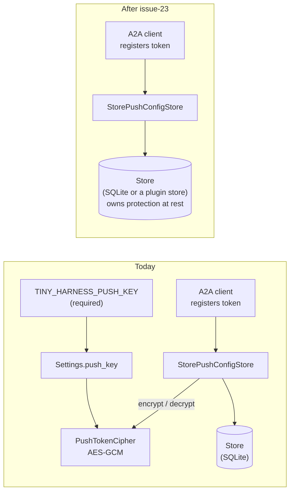

<!-- Written per the `the-loop:writing` skill: front-load each section's
     conclusion, draw it rather than describe it (3+ named parts -> a mermaid
     diagram), and keep the formal registers formal (EARS, abuse cases,
     RFC-2119, API contracts, schema descriptions). No length limit — length
     follows the change; the test is whether a sentence can come out without
     losing information. A gated section stays even when it is empty. -->

# Requirements: Remove `TINY_HARNESS_PUSH_KEY` from the end-to-end architecture

> Phase 1 of 3 (requirements → design → tasks). Following the Kiro spec approach
> (<https://kiro.dev/docs/specs/>). The `requirements-approval` gate was skipped by
> declaration at phase selection; this document is reviewed on the work item's pull
> request.

## Introduction

Every tiny-harness process refuses to start without `TINY_HARNESS_PUSH_KEY`, an AES-GCM
key whose only job is to encrypt the callback credential an A2A client registers for
push notifications before the push-config store writes it to SQLite. The ticket's
position is that encryption at rest is the **store's** concern, not a first-class
setting of the harness, so the key and the cipher behind it go.
Ticket: [MadaraUchiha-314/tiny-harness#23](https://github.com/MadaraUchiha-314/tiny-harness/issues/23).

After this change an operator starts the server and worker with one secret fewer. Push
notifications behave the same for A2A clients: a registered config, its `token` and its
`authentication` round-trip unchanged and are sent with every notification. What
changes is where at-rest protection lives: tiny-harness no longer encrypts the
credential itself. The default SQLite store holds it like any other record and protects
it with file permissions; a deployment that needs encryption at rest gets it from its
`Store` implementation or the disk underneath.

The cost is the security trade-off stated in [Security considerations](#security-considerations),
and a one-time loss: push configs registered under an earlier version cannot be read
without the old key, so those clients register again.

## Requirements

### Requirement 1 — No push key in the configuration

**User story:** As an operator, I want to run tiny-harness without generating and
guarding a push key, so that a deployment has one secret fewer to provision and rotate.

#### Acceptance criteria (EARS)

1. The system SHALL NOT read `TINY_HARNESS_PUSH_KEY`, and `Settings` SHALL have no
   field for it.
2. WHEN the server, the worker or any CLI command starts with `TINY_HARNESS_PUSH_KEY`
   unset THEN the system SHALL start as it would with the key set today, all other
   configuration being valid.
3. WHEN the process starts with `TINY_HARNESS_PUSH_KEY` set THEN the system SHALL log
   one warning that the variable is set and ignored, and SHALL NOT echo its value.
4. The published settings schema (`tests/contract/snapshots/settings.schema.json`) SHALL
   list no `push_key` property and no `push_key` among its required fields.

### Requirement 2 — Push notifications keep working

**User story:** As an A2A client, I want push-notification configs to behave exactly as
before, so that removing the key changes nothing I can observe.

#### Acceptance criteria (EARS)

1. WHEN a client sets a push-notification config with a `token` and an `authentication`
   THEN a later get or list of that config SHALL return the same `url`, `token` and
   `authentication`.
2. WHEN the `emit_event` activity delivers a task event for a task with push configs
   THEN the system SHALL post it to each config's `url` carrying that config's `token`
   and `authentication`, as it does today.
3. WHEN a client deletes a push-notification config THEN the system SHALL remove it from
   the store, as it does today.
4. The system SHALL keep push configs in the configured `Store` under the `push_configs`
   record kind, subject to `[retention] push_configs` as today.

### Requirement 3 — Encryption at rest belongs to the store

**User story:** As an operator with an at-rest encryption requirement, I want the store
to own it, so that I protect push credentials the same way I protect the rest of the
read model.

#### Acceptance criteria (EARS)

1. The system SHALL NOT apply encryption of its own to a push config's `token` or
   `authentication`; it SHALL hand them to the `Store` like any other record field.
2. WHEN `SqliteStore` creates a new database file THEN the system SHALL create it
   readable and writable by its owner only (mode `0600`).
3. The deployment guide SHALL state that the store holds push-notification credentials
   as the client supplied them, and that encryption at rest is provided by the `Store`
   implementation or the volume beneath it.

### Requirement 4 — Push configs written by an earlier version

**User story:** As an operator upgrading from 0.5.x, I want old encrypted push configs
handled predictably, so that an upgrade never sends a garbled credential to a client's
webhook.

#### Acceptance criteria (EARS)

1. WHEN the system reads a push config that an earlier version stored encrypted THEN it
   SHALL treat that config as absent: it SHALL NOT return it from get or list and SHALL
   NOT deliver a notification to it.
2. WHEN the system meets such a config THEN it SHALL delete it and log a warning naming
   the task and config id, never the ciphertext.
3. The deployment guide and the change's commit message SHALL state that push configs
   registered before the upgrade must be registered again (the project keeps no
   changelog file; releases are cut from Conventional Commits).

### Requirement 5 — The architecture and its documentation say the same thing

**User story:** As a reader of the docs, I want no trace of a key that no longer exists,
so that I do not provision a secret nothing reads.

#### Acceptance criteria (EARS)

1. The README, the guides under `docs/guide/`, the demo under `examples/demo/` and the
   capability docs under `docs/capabilities/` SHALL NOT tell an operator to set
   `TINY_HARNESS_PUSH_KEY`.
2. The persistence capability doc SHALL state the new rule: push-config credentials are
   stored as supplied and protected at rest by the store.
3. The end-to-end demo (`tests/e2e/demo.py`) and the test fixtures SHALL run without
   `TINY_HARNESS_PUSH_KEY`.
4. WHERE nothing else in tiny-harness imports `cryptography` THEN the system SHALL drop it
   from the project's direct dependencies and from the worker sandbox's pass-through
   modules.

## Non-functional requirements

- **Compatibility:** no A2A wire change. Agent cards, push-config operations and
  notification payloads are byte-for-byte what they are today.
- **Observability:** the two new warnings (R1.3, R4.2) use the harness's existing
  logger at `WARNING`, the same as `OPENAI_BASE_URL` is reported (issue-19).
- **Versioning:** removing a required environment variable relaxes the contract, but
  dropping stored configs (R4) is a behaviour change an operator must hear about; the
  commit carries a `feat` type and its body says what to do (R4.3).

## Security considerations

This change **removes a defence-in-depth control**: push-notification credentials stop
being encrypted by tiny-harness before they reach the store. It adds no new input, route
or trust boundary.

- **Actors & trust:**
  - *A2A clients* (untrusted): they register push configs whose `token` and
    `authentication` are secrets the client chose to authenticate tiny-harness to the
    client's own webhook. The credential grants access to that webhook, nothing of
    tiny-harness's.
  - *The operator* (trusted): runs the server and worker, owns the store file and its
    volume.
  - *Anyone else with read access to the store file or its backups* (untrusted): today
    they read ciphertext; after this change they read the credentials.
- **Trust boundaries & data:**
  - A2A request → `StorePushConfigStore` → `Store`: unchanged, the client's config
    crosses into the store as today.
  - `Store` → disk: this is where the boundary moves. Protection of the credential at
    rest becomes the `Store` implementation's and the filesystem's (R3), backed by
    owner-only permissions on a new SQLite file (R3.2).
  - Temporal history, logs and traces: unchanged — the credential is read from the
    store only by the A2A push-config handlers and the `emit_event` activity's sink, and
    is never placed in a workflow payload, log field or span.
- **Abuse cases (EARS):**
  1. WHEN a local user other than the store file's owner tries to read a newly created
     SQLite store THEN the operating system SHALL deny it (mode `0600`, R3.2).
  2. WHEN a client registers a push config THEN its `token` and `authentication` SHALL
     NOT appear in any log line, span attribute or Temporal payload.
  3. WHEN `TINY_HARNESS_PUSH_KEY` is still set in the environment THEN its value SHALL
     NOT appear in any log line or error message.
  4. WHEN a push config written by an earlier version is read THEN the system SHALL NOT
     send its ciphertext, or anything derived from it, to the config's `url` (R4.1).
- **Fail closed:** a push config whose stored form the system cannot interpret is not
  delivered and not returned (R4.1). A missing push key is no longer a startup failure,
  because nothing needs it.
- **Accepted risk:** an attacker who obtains the store file (a copied backup, a
  mis-permissioned volume, a pre-existing file whose mode R3.2 does not change) reads
  every live push credential. The credential's blast radius is the client's own webhook,
  and its lifetime is bounded by `[retention] push_configs` (30 days by default). An
  operator who needs more uses an encrypting `Store` or an encrypted volume (R3.3).

## Out of scope

- Making the A2A `PushNotificationConfigStore` itself pluggable, or adopting a2a-sdk's
  `DatabasePushNotificationConfigStore` (which needs SQLAlchemy and its own key).
- Encrypting the SQLite store (SQLCipher or similar).
- Changing the mode of a store file that already exists; the deployment guide covers it.
- Migrating old encrypted push configs: decrypting them would need the key this item
  removes.

## Open questions

- **Reading of the ticket.** "The push notification config store itself can handle
  encryption" is read as: at-rest protection is the job of the `Store` implementation
  (the entity a plugin replaces for a production database) and the volume under it, so
  tiny-harness drops its own cipher without adding another. The alternative —
  replacing the push-config store with a2a-sdk's `DatabasePushNotificationConfigStore`
  and its Fernet key — would trade one key for another and add SQLAlchemy, which is why
  it is out of scope. Raised on the pull request for the approver to confirm or
  redirect.

## Review comments

> Appended by the-loop's `record-feedback` hook when a human gate approves with
> comments (issue-109). Append-only and attributed: an approval never silently
> discards a reviewer's suggestions, and the feedback travels with the document
> it concerns rather than living in a side-channel tracker.
