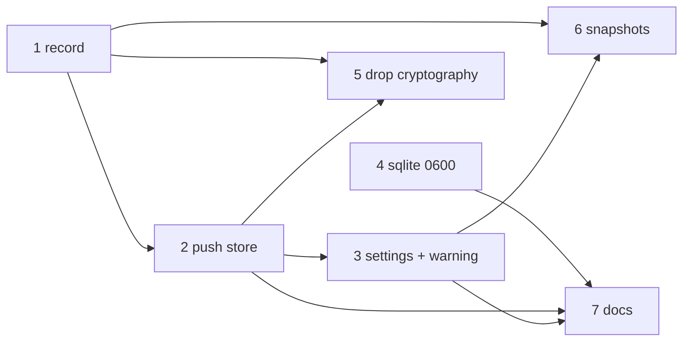

# Tasks: Remove `TINY_HARNESS_PUSH_KEY` from the end-to-end architecture

> Derived from [`requirements.md`](requirements.md), [`design.md`](design.md) and
> [`testing-plan.md`](testing-plan.md). No approval gate follows this file.

## Task list

- [x] 1. `PushConfigRecord` holds the credential as supplied
  - Tests first: `tests/security/test_push_token.py` rewritten — JSON round-trip of
    `token`/`authentication`; stored row has them as supplied and no ciphertext keys;
    `repr`/`str`/`model_dump()` mask them; a record validated from 0.5.x-shaped JSON
    (`token_ciphertext` set) is `legacy`, one with neither field is not.
  - Replace the record's fields per design § Data models; delete `PushTokenCipher` and
    its imports; rewrite the module docstring; drop it from `persistence/__init__.py`.
  - _Depends on:_ none
  - _Requirements:_ R2.1, R3.1, R4.1
  - _Test:_ T1/T8 — `uv run pytest tests/security/test_push_token.py` (red→green)
- [x] 2. `StorePushConfigStore` without a cipher; legacy rows dropped
  - Tests first in `tests/integration/a2a/test_server.py`: rewrite `push notification
    configs receive status updates` (stored token equals the supplied one); add
    `a push config's credentials round-trip through get, list and delete` and `a push
    config stored encrypted by an earlier version is dropped, not delivered` (warning
    names task and config id, no ciphertext; row deleted; nothing posted to its URL).
  - `StorePushConfigStore(store)`; `set_info` writes `SecretStr`s; the async `_live`
    helper drops legacy rows with a warning; update `process.py`, `commands.py`, the
    A2A conftest and `tests/unit/service/test_app_routes.py`.
  - _Depends on:_ 1
  - _Requirements:_ R2.1–R2.4, R3.1, R4.1, R4.2
  - _Test:_ T2/T10 — `uv run pytest tests/integration/a2a` (red→green)
- [x] 3. `Settings` without `push_key`; the ignored-variable warning
  - Tests first: `tests/unit/test_config*.py` load with no `TINY_HARNESS_PUSH_KEY`;
    `tests/unit/service/test_cli.py` no longer expects it among the required secrets;
    `tests/unit/service/test_runtime_model.py` covers `ignored_environment_warnings`
    (push key set → its line, without the value; unset/empty → none; `OPENAI_BASE_URL`
    line unchanged).
  - Remove the field and the `SECRET_VARIABLES` row; `secret_values` drops it;
    `ignored_environment_warnings` table and `build_runtime` loop; `cli.py` docstring.
  - Drop the variable from every test fixture (`tests/integration/*/conftest.py`,
    `test_cli_embedded.py`, `tests/e2e/demo.py` — which now pops it from the demo's
    environment).
  - _Depends on:_ 2
  - _Requirements:_ R1.1–R1.3, R5.3
  - _Test:_ T1 — `uv run pytest tests/unit` (red→green); T2 — `uv run pytest tests/integration/embedded`
- [x] 4. `SqliteStore` creates a new file `0600`
  - Test first in `tests/security/test_push_token.py` (or a sibling store test): a new
    path ends at mode `0600`; an existing file's mode is unchanged.
  - `os.open(..., O_CREAT | O_EXCL | O_WRONLY, 0o600)` before `sqlite3.connect`.
  - _Depends on:_ none
  - _Requirements:_ R3.2
  - _Test:_ T8 — `uv run pytest tests/security` (red→green)
- [ ] 5. Drop the `cryptography` dependency
  - Remove it from `pyproject.toml` and `PASSTHROUGH_MODULES`; `uv lock`.
  - _Depends on:_ 1, 2
  - _Requirements:_ R5.4
  - _Test:_ T2 — `uv run pytest tests/integration` (the worker sandbox still imports
    the workflow); `grep -rn cryptography pyproject.toml tiny_harness` empty
- [ ] 6. Contract snapshots
  - `UPDATE_API_SNAPSHOTS=1 uv run pytest tests/contract`, review the diff: only
    `push_key` (settings schema, config), `PushTokenCipher` and `PushConfigRecord`
    (persistence) change.
  - _Depends on:_ 1, 3
  - _Requirements:_ R1.4
  - _Test:_ T3 — `uv run pytest tests/contract`
- [ ] 7. Documentation and capability docs
  - README, `docs/guide/getting-started.md`, `docs/guide/deployment.md` (env row out;
    push-credential paragraph; upgrade note), `examples/demo/README.md` and the three
    `config*.toml` headers, `docs/capabilities/configuration.md`,
    `docs/capabilities/persistence.md` (rule + history row).
  - _Depends on:_ 2, 3, 4
  - _Requirements:_ R3.3, R4.3, R5.1, R5.2
  - _Test:_ docs/deps grep of the testing plan; T12 markdownlint

## Dependency graph (DAG)

## Checkpoints

- After 2: `uv run pytest tests/integration/a2a tests/security`.
- After 3 and 5: `uv run pytest tests/unit tests/integration`.
- After 7: `uv run pre-commit run --all-files`, then the `verification` node runs the
  testing plan.
