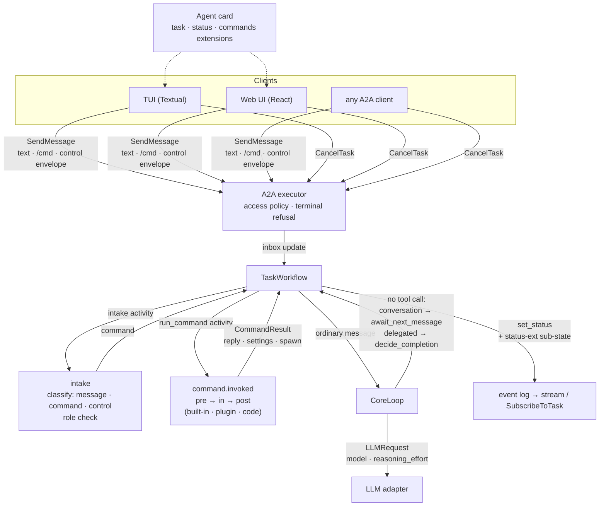
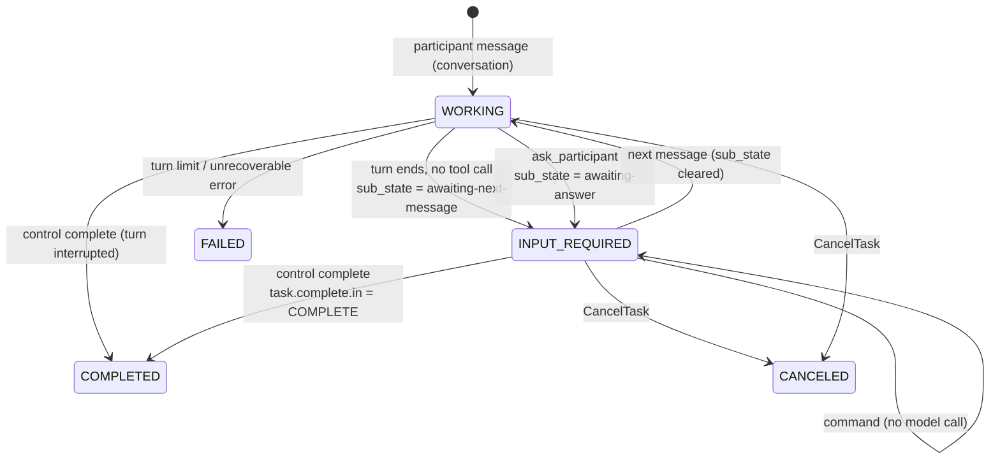
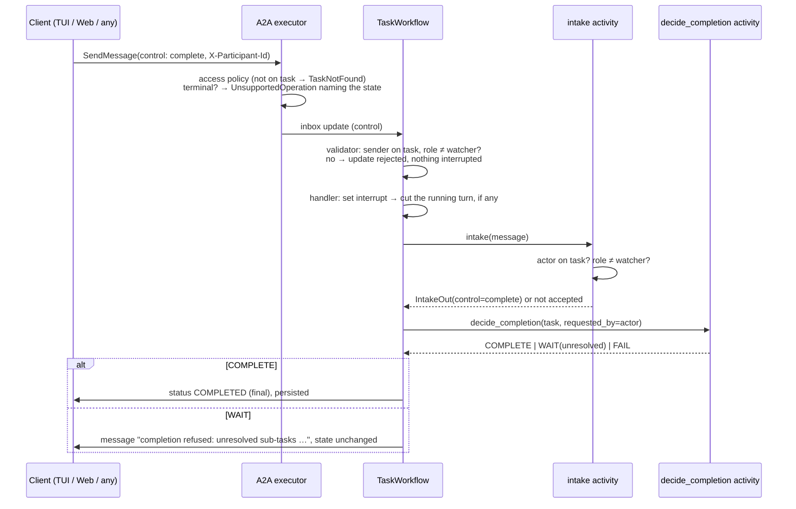
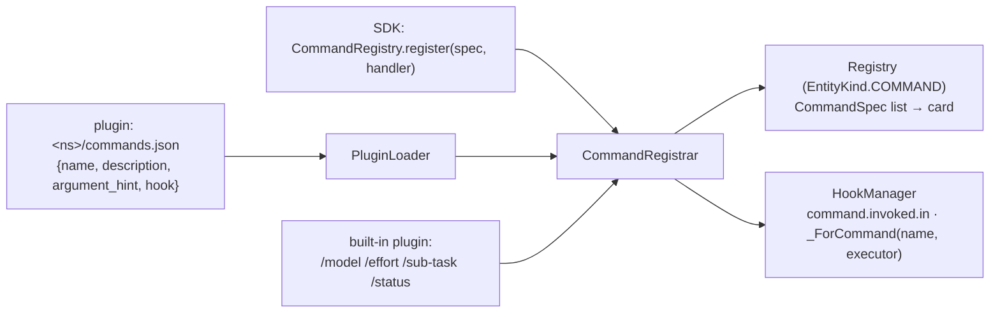
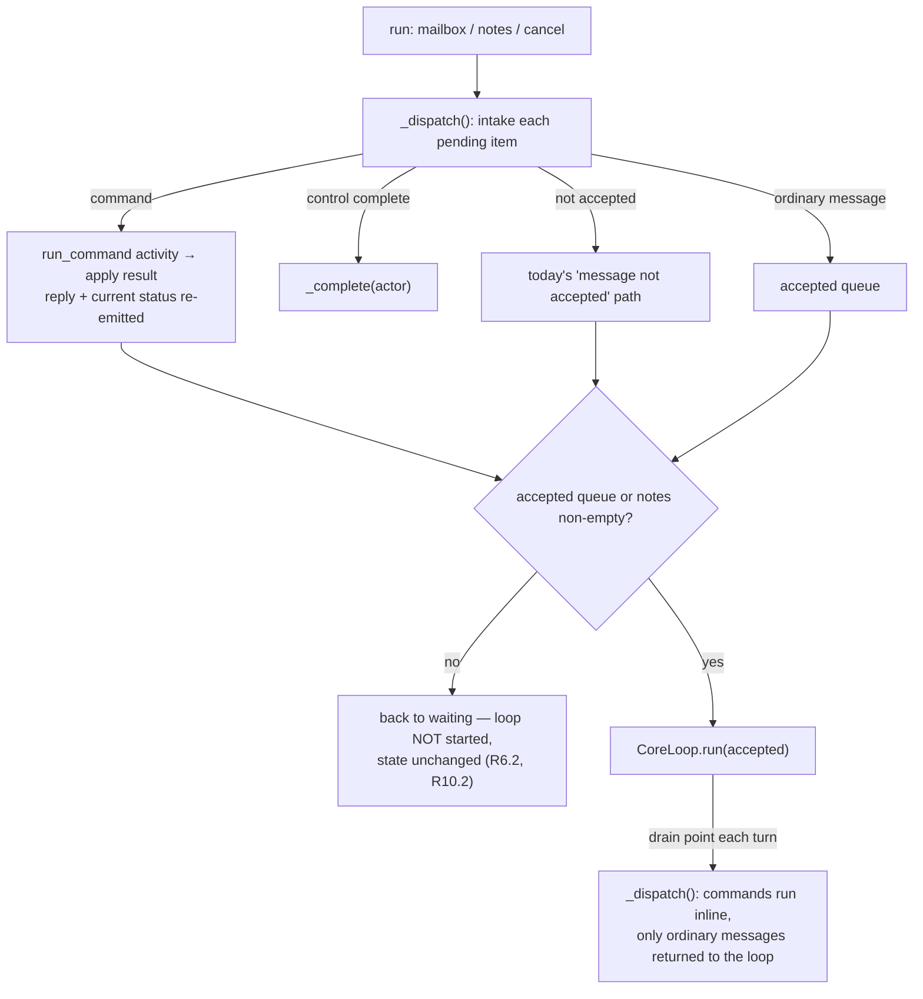

<!-- Written per the `the-loop:writing` skill: front-load each section's
     conclusion, draw it rather than describe it (3+ named parts -> a mermaid
     diagram), and keep the formal registers formal (EARS, abuse cases,
     RFC-2119, API contracts, schema descriptions). No length limit — length
     follows the change; the test is whether a sentence can come out without
     losing information. A gated section stays even when it is empty. -->

# Design: Make the CLI/TUI experience seamless

> Phase 2 of 3 (requirements → design → tasks). Derives from the
> [approved requirements](requirements.md). MUST be reviewed and approved before moving
> to tasks breakdown.

## Overview

The change is in six places, and each one reuses a mechanism the harness already has:

1. **CLI and configuration.** A new module, `tiny_harness/home.py`, resolves the
   configuration file and creates the default one safely. The CLI calls it. `Settings.load`
   is unchanged, so the SDK never touches `~/.tiny-harness` unless asked.
2. **Turn end.** `CoreLoop._finish` stops completing *conversation* tasks. It parks them in
   `INPUT_REQUIRED` with a sub-state carried by a new **status extension**. Agent-spawned
   sub-tasks keep completing.
3. **Participant completion.** A participant completes a task by sending a **control
   envelope**: one more `kind` on the existing `application/vnd.tiny-harness.event+json`
   part. `intake` authorizes it, then the workflow runs the existing `task.complete.in`
   decision and finishes the task.
4. **Commands.** Commands are a new hook operation, `command.invoked`. `intake` recognises
   `/<name>` and the workflow runs it through a new `run_command` activity. The model is
   never called for that message. A handler returns *intents* (a reply, new task
   settings, a sub-task to spawn), and the workflow applies them deterministically.
5. **Model and effort.** Each task's model and reasoning effort live in the task
   extension. `LLMRequest` gains `model` and `reasoning_effort`, and each adapter maps them
   onto its provider's parameter.
6. **Renderers.** The TUI and the Web UI gain Complete, a sub-state badge, `/`
   completion from the agent card, and sub-task navigation.

All five open questions in the requirements were approved as drafted: the reviewer
approved the file without answering them, so each drafted default stands.

- Bare `tiny-harness` starts the TUI.
- The generated file selects embedded Temporal.
- Only a participant ends a conversation task.
- `/model` and `/effort` apply per task and are inherited by new sub-tasks.
- The efforts are `low`, `medium` and `high`.

| Requirement | Where it is met |
|-------------|-----------------|
| R1 bare command, help | `cli.py` parser (optional subcommand, `--help` epilog) |
| R2 config resolution, default file | `tiny_harness/home.py`; `cli.main` |
| R3 a reply does not complete | `CoreLoop._finish`; `TaskExtensionData.lifecycle`; `WorkflowOperations.await_next_message` |
| R4 sub-state extension | `tiny_harness/harness/core/status.py`; `set_status`; card; `docs/a2a/ext/status.json` |
| R5 complete and cancel | control envelope; `intake`; `TaskWorkflow._complete`; TUI and Web UI controls |
| R6 command registry | `tiny_harness/harness/commands/`; `intake`; `run_command` activity; commands extension on the card |
| R6a commands through hooks | `Operation.COMMAND_INVOKED`; plugin `commands.json`; `CommandRegistrar` |
| R7 `/model` | built-in command; `[openai] models`; `LLMRequest.model` |
| R8 `/effort` | built-in command; `[openai] reasoning_effort`; `LLMRequest.reasoning_effort` |
| R9 `/sub-task` | built-in command → `SpawnIntent` → `TaskWorkflow.spawn_child` |
| R10 `/status` | built-in command over a `CommandIn` snapshot |
| R11 SDK parity | `tiny_harness.home` exports; `running_harness(..., plugins=…, commands=…)` |
| Security | `home.py` safe creation; `intake` role checks; selectable-model validation; the hook redactor |

## Architecture



Durable execution is unchanged. Every new behaviour that does I/O or runs hooks is an
activity: `intake` (extended) and `run_command` (new). Everything the workflow decides
(apply settings, spawn, finish) is deterministic workflow code over activity results.

### Task lifecycle



A **delegated** task (`spawn_subtask`) keeps today's diagram: turn end, then
`task.complete.in`, then `COMPLETED`, or a wait for its children.

A **participant** task (`create_task_for_participant`) keeps its rule, "the assignee's
answer completes it", but its message handling goes through the same `_dispatch()` first
(Commands § Dispatch).

- A command runs and replies, and the task stays `INPUT_REQUIRED`. `/status` and
  `/model` are therefore not mistaken for the assignee's answer (`workflows.py:536`).
- A control `complete` runs `_complete`.
- Only an *ordinary* message from the assignee completes the task, as today.

## Components & interfaces

### `tiny_harness/home.py` (new): configuration resolution and the default file

```python
DEFAULT_HOME: Final = Path("~/.tiny-harness")       # expanded at call time
CONFIG_NAME: Final = "config.toml"

class ConfigSource(BaseModel, frozen=True):
    path: Path
    origin: Literal["flag", "default"]

def resolve_config_path(explicit: Path | None, *, home: Path | None = None) -> ConfigSource: ...
def default_config_text(home: Path) -> str: ...
def ensure_default_config(home: Path | None = None) -> tuple[Path, bool]:
    """Create <home>/config.toml if missing; return (path, created). Raises ConfigError."""
```

- **Resolution (R2.1–2.3).** If `explicit` is set, return it with `origin="flag"` and
  touch nothing else. A missing file still fails in `Settings.load` with today's
  `configuration file not found` error. Otherwise return
  `home.expanduser() / "config.toml"` with `origin="default"`.
- **Safe creation (R2.4, abuse cases 7–8).**
  1. `lstat` the home. If it is missing, `os.mkdir(home, 0o700)`. A `FileExistsError`
     race is re-checked rather than trusted.
  2. If the home is a symlink, is not a directory, or is not owned by `os.geteuid()`,
     refuse.
  3. `lstat` the file:
     - A regular file owned by the user is used as is (R2.6). The CLI never rewrites it.
     - A symlink, another type, or another owner is refused.
     - A missing file is written through
       `os.open(path, O_WRONLY | O_CREAT | O_EXCL | O_NOFOLLOW | O_CLOEXEC, 0o600)`.
  4. Every refusal is a `ConfigError(variable=<path>)`, so the CLI exits 2 naming the path.
  5. The created path is printed on stderr: `created default configuration <path>`.
- **The default file (R2.5).** `default_config_text(home)` renders a commented TOML file
  with **absolute** paths under `home`. Relative paths keep resolving against the working
  directory (R2.8), so a relative store path would move with `cwd`. The file contains:

  ```toml
  [temporal]
  mode = "embedded"            # a local Temporal dev server inside this process
  [temporal.embedded]
  persist = true               # tasks survive restarts; database beside the store
  [openai]
  model = "gpt-6.1-sol"        # OPENAI_API_KEY from the environment, or set base_url
  [server]
  bind = "127.0.0.1:8080"
  base_url = "http://127.0.0.1:8080"
  [store]
  sqlite_path = "<home>/tiny-harness.sqlite3"
  ```

  With this file, the Temporal database (`<home>/temporal.sqlite3`) and the TUI log
  (`<home>/tiny-harness.log`) follow `sqlite_path`, as they do today. The file has no
  secret and no `ui_dir`. A unit test loads it with `Settings.load` to keep it valid.

### CLI (`tiny_harness/service/cli.py`)

- **Bare command (R1.2).** `add_subparsers(required=False)`. When `args.command is None`,
  the CLI dispatches to `tui` with `url=None, participant=None`. `tiny-harness tui` and
  bare `tiny-harness` share one code path.
- **Configuration (R2).** `main` calls `resolve_config_path(args.config)`. For
  `origin="default"` it calls `ensure_default_config()` before `Settings.load`. This
  happens for every subcommand, so `serve` and `tasks purge` read the same file the TUI
  does.
- **Help (R1.5).** The parser is built after a `parse_known_args` pre-pass that reads
  only `--config`. Its epilog names the file in effect, e.g.
  `configuration: ~/.tiny-harness/config.toml (default; --config overrides)` or
  `configuration: ./demo.toml (--config)`. `--help` never creates the file.
- Exit codes are unchanged (R1.4): 2 for configuration, 1 for embedded start-up, 130 and
  143 for signals.

### Task lifecycle (`harness/core/task.py`, `harness/core/loop.py`, `service/durable/workflows.py`)

- **`TaskExtensionData` gains three optional fields** (additive to task extension v1; the
  JSON Schema gains them as optional):

  ```python
  lifecycle: Literal["conversation", "delegated"] | None = None
  model: str | None = None
  reasoning_effort: Literal["low", "medium", "high"] | None = None
  ```

  `HarnessTask.lifecycle` reads the field. When it is absent (a task persisted before this
  change), the lifecycle is `delegated` if `parent_tasks` is non-empty and `conversation`
  otherwise.
  - The executor's first-message path sets `conversation`.
  - `spawn_child` sets `delegated` for `spawn_subtask` and `conversation` for `/sub-task`.
  - `spawn_child` also copies the parent's `model` and `reasoning_effort` into **every
    local child** it builds (`workflows.py:798`). That covers agent `spawn_subtask` and
    `/sub-task` children alike, so new sub-tasks inherit the parent's settings (R7.3).
    A remote child gets neither, because its model is the remote agent's. A participant
    task gets neither, because it makes no model call.
  - Participant tasks keep `mode="participant"` and never reach `CoreLoop`.
  - **The three fields are server-controlled.** No participant payload may set them. A
    `task` envelope is the existing way to create or edit a task's extension
    (`extension_from_envelope`, `apply_task_envelope`). If one carries `lifecycle`,
    `model` or `reasoning_effort`, the system refuses the whole envelope:
    `UnsupportedOperationError` from the executor on a first message, and "not accepted"
    from `intake` on an existing task. Only `/model` and `/effort` change the settings,
    after their allowlist check. Only the server sets `lifecycle`.
- **`CoreLoop._finish` (R3.1, R3.4).**

  ```python
  async def _finish(self, task, state, text) -> Outcome:
      if task.lifecycle == "conversation":
          task = await self.ops.await_next_message(task, text)
          return Outcome(kind="waiting_for_message", task=task, state=state, final_text=text)
      ...  # today's decide_completion path, unchanged
  ```

  - `OutcomeKind` gains `waiting_for_message`, which the workflow handles like
    `waiting_for_reply`.
  - `Operations` gains `await_next_message(task, text)`. In the workflow it is
    `set_status(INPUT_REQUIRED, text, sub_state="awaiting-next-message")`. In-process it
    is the same through `set_state`.
  - `decide_completion` is not consulted at turn end for a conversation task, because the
    participant decides. It runs when the participant asks to complete (below).
- **`ask_participant` (R3.2).** `WorkflowOperations.ask` passes
  `sub_state="awaiting-answer"` to `set_status`.
- **Resume (R3.3).** No new code path. Any mailbox message wakes `run`, and
  `CoreLoop.run` sets `WORKING`. `HarnessTask.with_state(state, sub_state=None)` writes
  the status extension's key when `sub_state` is given and deletes it otherwise, so
  leaving `INPUT_REQUIRED` clears the sub-state.
- **Persistence (R3.6).** The sub-state lives in `Task.metadata`, so `persist`,
  `TaskRecord` and the `task` query carry it with no store change. `_emit` logs the status
  event with its metadata, so `SubscribeToTask` replays it.

### Status extension (`harness/core/status.py`, new; R4)

```python
STATUS_EXT_URI: Final = "https://madarauchiha-314.github.io/tiny-harness/a2a/ext/status/v1"
STATUS_EXT_KEY: Final = "io.github.madarauchiha-314.tiny-harness/status"

class SubState(StrEnum):
    AWAITING_NEXT_MESSAGE = "awaiting-next-message"
    AWAITING_ANSWER = "awaiting-answer"

class StatusExtensionData(BaseModel, frozen=True):
    sub_state: SubState
```

- `set_status(state, text, *, sub_state=None)` writes `{STATUS_EXT_KEY: {"sub_state": …}}`
  in two places: `Task.metadata`, through `with_state`, and the
  `TaskStatusUpdateEvent.metadata` of that update. A2A's `TaskStatus` has no metadata
  field, so these are the two documented places.
- The card lists the extension in `capabilities.extensions` with `required: false`
  (`SUPPORTED_EXTENSIONS`, `EXTENSION_DESCRIPTIONS`). Its schema is
  `docs/a2a/ext/status.json`, with prose in `docs/a2a/ext/status/v1.md`.
- The schema declares `sub_state` as a `string` whose documented values are the two
  above. It is deliberately **not** a closed `enum`, so a later sub-state is additive
  (R4.3). Clients MUST treat an unknown value as plain `INPUT_REQUIRED`.
- The metadata is written whether or not the client activated the extension. Extensions
  default to inactive, and the state itself stays the standard `TASK_STATE_INPUT_REQUIRED`
  (R4.4). The executor's existing refusal of an *unadvertised* extension is unchanged.

### Participant completion (R5)

A completion is a message whose one data part is the existing event envelope with a new
kind:

```json
{ "kind": "control", "action": "complete" }
```

`EventEnvelope.kind` becomes `Literal["task", "status_update", "artifact_update",
"control"]`. A `control` envelope carries `action: Literal["complete"]` and nothing
else; unknown actions and extra fields are refused. Any A2A client can send it (R5.1).



- **Executor (R5.3).** The terminal refusal's message becomes
  `the task is in a terminal state (TASK_STATE_COMPLETED)`, which names the state for
  messages, commands and completions alike. `cancel` gains the same check before it
  signals.
- **Inbox update: authorize first, then interrupt.** The `inbox` update's **validator**
  is workflow code, deterministic, and already runs before the handler (it refuses a
  `closed` workflow today).
  - For a control message it also checks the asserted `participant_id` against the
    workflow's in-memory `task.ext.participants`.
  - It rejects the update when the sender is missing, not on the task, or only a
    `watcher`. The executor surfaces that rejection as an A2A error, and no handler runs.
  - Only a control message that passes sets the interrupt flag. That is the same flag
    `metadata.interrupt` sets, so `_await_runner` cuts a turn in progress (R5.2).
  - A refused completion can therefore never interrupt a turn (abuse case 4). This
    covers direct inbox updates too, because the validator guards the update itself, not
    the executor.
- **`intake`.** It parses the envelope:
  - The actor must be on the task (today's rule).
  - A `watcher` is refused (abuse case 4). This repeats the validator's check as defence
    in depth, through the existing "message not accepted" path, which re-emits the
    current state.
  - Otherwise it returns `IntakeOut.control = "complete"`, writes an audit row, and adds
    nothing to the model history.
- **Workflow `_complete(actor)`.**
  - It calls the existing `decide_completion` activity. `TaskCompleteIn` gains
    `requested_by: str | None` so that a hook can tell a participant's request from a
    turn end.
  - **COMPLETE:** `_finish(COMPLETED, "completed by <actor>")`. This emits the final status
    to every subscriber, persists the task, and signals the parent (R5.2, R5.6).
  - **WAIT:** emit an agent message naming the unresolved sub-tasks and re-emit the
    current state (R5.4). A hook can still override the rule, as today.
- **Cancel** is A2A `CancelTask`, unchanged except for two things. First, the role
  check: a `watcher` gets `UnsupportedOperationError`. Second, the terminal refusal
  above.

### Commands (R6, R6a, R7–R10): `tiny_harness/harness/commands/` (new)

```mermaid
sequenceDiagram
  participant C as Client
  participant W as TaskWorkflow
  participant I as intake
  participant R as run_command activity
  participant H as command.invoked chain
  C->>W: "/model gpt-6-astra"
  W->>I: intake
  I->>I: parse "/<name> <args>"; name registered?<br/>no → ordinary message (R6.3)
  I-->>W: IntakeOut(command=CommandCall(name, args))<br/>(_dispatch, before CoreLoop starts)
  W->>R: run_command(CommandIn: call, sender, role, task snapshot, children)
  R->>H: pre (scrubbed) → in (body for name) → post
  H-->>R: CommandResult(reply, settings?, spawn?)
  R-->>W: CommandOut
  W->>W: apply settings → Task event<br/>spawn → spawn_child(conversation)
  W->>C: agent message (reply), state re-emitted unchanged
```

**Parsing.** A message is a command when its text part matches
`^/([a-z][a-z0-9-]*)(?:\s+(.*))?$` (DOTALL), it has no other part, and the name is in the
registry. Anything else, including an unregistered `/name`, is an ordinary message
(R6.3, abuse case 9). Arguments are the raw remainder, capped by the existing request-size
limit.

**Models.**

```python
class CommandSpec(BaseModel, frozen=True):        # what clients see (R6.7)
    name: str            # [a-z][a-z0-9-]*
    description: str
    argument_hint: str = ""

class TaskSettings(BaseModel, frozen=True):
    model: str | None = None
    reasoning_effort: Literal["low", "medium", "high"] | None = None

class SpawnIntent(BaseModel, frozen=True):
    goal: str

class CommandResult(BaseModel, frozen=True):
    reply: str
    settings: TaskSettings | None = None   # applied by the workflow
    spawn: SpawnIntent | None = None        # spawned by the workflow

class CommandInvokedPre(HookContext):
    name: str
    arguments: str
    sender: str
    sender_role: Role
    task: TaskSnapshot     # id, name, state, sub_state, settings, plan progress, children
class CommandInvokedIn(CommandInvokedPre):
    result: CommandResult | None = None
class CommandInvokedPost(CommandInvokedIn): ...
```

**Hook operation (R6a.1–6a.5).** `Operation.COMMAND_INVOKED = "command.invoked"` joins the
catalogue.

- The `run_command` activity runs it through `OperationRunner`, which means scrub, pre,
  `in`, post, then extract.
- A `HookAbort` from `pre` becomes the reply `refused: <reason>`, and the settings and
  spawn are dropped.
- If the `in` chain sets no result, the reply is `command /<name> has no handler`. That
  can happen only if a body was overridden badly.

**Bodies are filtered by name.** `HookDef` has no matcher. So `CommandRegistrar` wraps
each command's body executor in a `_ForCommand(name, inner)` executor, which passes
through every context whose `name` differs or whose `result` is already set. A remote
executor therefore only ever receives the command it implements (abuse case 10).

**Three ways to register (R6.1, R6a.6–6a.7).**



- **Programmatic.** `CommandRegistry.register(spec, handler, *, priority=500)`. Its
  `handler(ctx: CommandInvokedIn) -> CommandResult` becomes a `FunctionExecutor` on
  `command.invoked.in`.
- **Plugin.** The loader reads `<ns>/commands.json`, which has the shape
  `{"commands": [{name, description, argument_hint, hook}]}`. Each entry's `hook` names a
  `HookDef` in the same plugin's `hooks.json`. That `HookDef` is **command-owned**.
  - **Resolve before registering.** `PluginLoader.load` resolves `commands.json` *before*
    its hook loop (`loader.py:315`). The hook loop then skips every command-owned
    `HookDef`, and only the command step registers it, wrapped in
    `_ForCommand(name, executor)`.
  - A command-owned executor is therefore never on `command.invoked.in` unfiltered. It
    cannot see another command's arguments, run twice, or set a result first.
  - A command-owned `HookDef` MUST declare exactly `points: ["command.invoked.in"]`.
    Otherwise the command and its hook are skipped together, so a hook cannot be both a
    filtered command body and an unfiltered executor elsewhere. A plugin that wants a
    `pre` or `post` executor on `command.invoked` declares a separate, ordinary `HookDef`.
    Ordinary `HookDef`s see every command, which is how policy hooks are meant to work.
  - Two commands may not name the same `hook`; the second is skipped.
  - Skipped with a `SkippedComponent(kind="command", …)` in the load report (R6a.8): an
    invalid name, a name already registered without `override`, a `hook` naming no
    `HookDef`, a `HookDef` whose points are not exactly `command.invoked.in`, or a `hook`
    already owned by another command.
  - `ComponentKind` gains `command`. `commands.json` gets a JSON Schema under
    `docs/plugins/commands.json`.
- **Built-ins (R6.8, R6a.3).** The built-in plugin registers the four built-ins at
  `DEFAULT_BODY_PRIORITY`, so any lower-priority executor overrides one. `build_runtime`
  gains `builtin_commands: bool = True`, which `running_harness` passes through, so an
  SDK user can build without them.
- **Code-registration order.** The registry is filled in `build_runtime` and frozen
  before the worker starts. Registering a duplicate or invalid name from code raises
  `CommandError` at build time (R6.5).

**Discovery (R6.7).** A third card extension,
`https://madarauchiha-314.github.io/tiny-harness/a2a/ext/commands/v1`, carries
`params = {"commands": [CommandSpec…]}`. Clients read it from the card they already
fetch, so no new endpoint is needed. The schema is `docs/a2a/ext/commands.json`.

**Dispatch in the workflow: intake before the loop.** Today a mailbox item wakes `run`,
which starts `CoreLoop.run`. That sets `WORKING` and calls the model whatever was in the
mailbox (`workflows.py:414`, `loop.py:190`). The workflow therefore gains a dispatcher
that runs **before** the loop and **at every drain point inside it**:



- `_dispatch()` is workflow code. It calls `intake` per message and, for a command,
  `run_command`; both are activities. Commands and controls are consumed there. Only
  ordinary messages go into the queue that `CoreLoop`'s drain reads.
- `run` starts `CoreLoop.run` only when that queue (or the child-done notes) is
  non-empty. A command-only wake re-emits the current status, so the stream ends cleanly
  and an `INPUT_REQUIRED` task stays `INPUT_REQUIRED` (R6.2, R10.2).
- **During a running turn**, the loop's drain op calls the same `_dispatch()`:
  - A command found there runs immediately. Its settings apply from the *next* model
    request, and its reply is emitted, while the turn's state stays `WORKING`.
  - A control found there has already set the interrupt (validated above), so
    `_await_runner` cuts the turn and `_complete` runs after it.
- The help-reply path (`pending_help`) is unchanged: `_dispatch()` matches a reply to a
  pending question before it is queued, as `drain` does today.

**Applying results (workflow, deterministic).**

- `settings`: merge into `ext` (`model`, `reasoning_effort`), then emit a `Task` event
  and persist (R7.3, R8.3).
- `spawn`: call `spawn_child` with `lifecycle="conversation"`, the sender as `REPORTER`,
  the agent as `ASSIGNEE`, `goal` as the goal, and the parent's `model` and
  `reasoning_effort` copied. The child is linked through `link_subtask` (R9.1). The child
  workflow starts *without* a first message and waits in
  `INPUT_REQUIRED(awaiting-next-message)` until someone writes to it (R9.2).
- `reply`: emit an agent `Message` on the task with metadata `{"command": name}` and
  re-emit the current status, so a stream ends cleanly. The task's state does not change
  (R6.2, R6.6, R10.2).
- **Order and the spawn confirmation.** The workflow applies `settings`, then `spawn`,
  then emits the reply. The handler runs before the child exists, so it cannot know the
  child's id; `spawn_child` allocates it (`parent.N`, `workflows.py:768`). When `spawn` is
  set, the workflow therefore appends a line it composes itself from the returned
  `TaskRef`: `Created sub-task <id>.` It also sets the reply message's metadata to
  `{"command": name, "task_ref": <id>}`, so a renderer can link the id without parsing
  text (R9.1, R9.4). This is a plain concatenation, never a template, so a handler's
  reply cannot inject formatting.
- A handler exception (R6.6): the activity catches it, logs it with the command name and
  the task id, and returns `reply = "/<name> failed: <message>"` with no settings and no
  spawn.

**Built-in commands.** Each one is a pure function of `CommandInvokedIn` plus the runtime's
`ModelCatalog`.

| Command | Role needed | Result |
|---------|-------------|--------|
| `/model` | any participant | Reply: current model + `catalog.selectable` (R7.2). |
| `/model <name>` | not `watcher` | `name ∈ selectable` → `settings.model = name` + reply. Otherwise a refusal listing the selectable models (R7.3–7.4). |
| `/effort` | any participant | Reply: current effort (or "provider default") + `low, medium, high` (R8.2). |
| `/effort <v>` | not `watcher` | `v ∈ {low, medium, high}` → `settings.reasoning_effort = v`. Otherwise a refusal (R8.3–8.4). |
| `/sub-task <description>` | not `watcher` | `spawn = SpawnIntent(goal=description)`. Empty → usage reply (R9.1, R9.3). |
| `/status` | any participant | Reply composed from the snapshot: id, name, state, sub_state, model, effort, `done/total` steps, each child's id and state (R10.1). |

Role checks run in a **built-in `pre` executor** on `command.invoked` (priority 100). It
refuses `/model <x>`, `/effort <x>` and `/sub-task` from a `watcher`, and refuses any
command from a sender with no role. Because it is a hook, an operator can tighten the
rule with an executor of their own.

### Model and effort (R7, R8)

- **Configuration.** `[openai]` gains:
  - `models: list[str] | None`, the selectable models. When it is unset, the only
    selectable model is `model`.
  - `reasoning_effort: Literal["low", "medium", "high"] | None`, the default effort.

  `[anthropic]` gains the same two keys. A validator fails closed (exit 2, `openai.models`)
  when `models` is empty or does not contain `model` (R7.1).
- **`ModelCatalog`** is built in `build_runtime` from the provider in use:
  `default`, `selectable`, `default_effort`, and `context_window(model)`. The latter uses
  the adapter's table, overridden by `context_window_tokens`.
- **`LLMRequest` gains `model: str | None = None` and
  `reasoning_effort: Literal["low", "medium", "high"] | None = None`.**
  - **Every model call of a task uses its settings** (R7.3, R8.3). A single helper,
    `catalog.settings_for(task) -> (model, effort)`, returns
    `ext.model or catalog.default` and `ext.reasoning_effort or catalog.default_effort`.
    All three request builders call it:
    - `ContextWindow.request` (`core/context.py:82`), the turn.
    - The compaction summary request (`core/compaction.py:139`).
    - The help-routing request (`channels/help.py:68`).

    The defaults are used only when the task sets nothing.
  - Each adapter uses `request.model or self._model`.
- **Provider mapping** (R8.3, R8.5). Each mapping is sent **only** when the effort is set,
  so an unset effort keeps requests byte-identical:

  | Adapter | Parameter |
  |---------|-----------|
  | OpenAI Responses (`build_params`) | `reasoning={"effort": v}` |
  | OpenAI Chat Completions (`build_chat_params`) | `reasoning_effort=v` |
  | Anthropic Messages (`build_params`) | `output_config={"effort": v}` (present in the pinned `anthropic` 1.13 SDK) |

- **Context window.** `assemble_context` looks the window up with
  `catalog.context_window(model)` for the task's model, so compaction budgets follow
  `/model`.
- **Observability.** The chat span's `gen_ai.request.model` becomes the per-request model.
  A new attribute, `tiny_harness.llm.reasoning_effort`, is set when the effort is.

### Renderers

**TUI (`interaction/tui/`).**

- **Client port.** `A2AClientPort` gains `complete(task_id) -> EventSource` (the control
  envelope) and `commands() -> tuple[CommandSpec, ...]` (from the card). `SdkClient`
  implements both, and `ScriptedClient` records `completed`.
- **Bindings.**
  - `ctrl+d` Complete and `ctrl+c` Cancel (both shown in the footer, R5.5).
  - `f4` returns to the parent task.
  - `enter` on a sub-task row opens it (R9.4).

  A binding acts only while the open task is non-terminal. Otherwise it shows a notice.
- **Top bar.** It shows `STATE · sub-state`, e.g. `INPUT_REQUIRED · awaiting-next-message`
  (R5.7).
- **Composer.** `Input(suggester=SuggestFromList(["/" + c.name …]))` gives inline `/`
  completion. A one-line hint under the composer shows the matching commands' descriptions
  (R6.7).
- **Task tab.** Sub-tasks become a `ListView` of `id · state · goal`. A task stack
  (`list[str]`) replaces the single `task_id`, so the TUI can open a sub-task and return
  to its parent.

**Web UI (`renderers/web/src/`).**

- **`a2a.ts`.** `HarnessClient` gains `complete(taskId)` (`sendMessageStream` with the
  control envelope) and `commands()` (read from the resolved card's commands extension).
- **`model.ts`.** `View` gains `subState`, read from status-update metadata and task
  metadata. The pure fold handles it, so it is unit-testable.
- **Header.**
  - A state badge plus a sub-state badge.
  - A **Complete** button (primary) and **Cancel task** (ghost). Both are disabled when
    the state is terminal or no task is open (R5.5).
  - A "← Parent" link when `ext.parent_tasks` is non-empty.
- **Composer.** When the text starts with `/`, it opens a listbox of matching commands
  (`role="listbox"`, `aria-activedescendant`). Up and Down move the selection, Tab or Enter
  accepts, and Escape closes it.
- **Task pane.** Sub-task rows become links to `?task=<id>`. The attach flow behind them
  already exists.

## UI/UX design

The two prototypes extend issue-3's renderers, so the tokens, layout and type are reused
unchanged. Both are self-contained HTML with no network access. They are drafts until the
reviewer (the work item's sole collaborator, who holds the designer role here) signs off on
the rendered output at the design-approval gate.

| Artifact | Type | Location / link | Covers (screen · requirement) | Status |
|----------|------|-----------------|-------------------------------|--------|
| `design/tui-task-controls.html` | html-prototype | `docs/specs/issue-25/design/tui-task-controls.html` (open in a browser; not routed by the docs site) | TUI: sub-state in the top bar, Complete/Cancel keys, `/` completion, sub-task open/back · R5, R6.7, R9.4 | draft |
| `design/web-task-controls.html` | html-prototype | `docs/specs/issue-25/design/web-task-controls.html` (open in a browser; not routed by the docs site) | Web UI: Complete/Cancel buttons, sub-state badge, command listbox, sub-task links, parent link · R5, R6.7, R9.4 | draft |

- **Flows and states.** Both prototypes walk the same five states:
  1. A reply arrives, and the task shows `INPUT_REQUIRED · awaiting-next-message`.
  2. Typing `/` lists the commands.
  3. `/sub-task …` replies with the new id and adds a sub-task row.
  4. Opening the sub-task, then going back.
  5. Complete, which leaves the task `COMPLETED` with both controls disabled.
- **Design system and tokens.** The tokens are issue-3's prototypes, shared with the built
  web renderer's shadcn theme. Complete uses the primary button and Cancel the ghost
  button, which is the existing Cancel style.
- **Accessibility and responsiveness.**
  - Both controls are real `<button>`s with visible focus.
  - The listbox follows the WAI-ARIA combobox pattern.
  - Disabled controls use `disabled` (not hidden), so their position is stable.
  - The layout collapses to one column below 820 px, as issue-3's does.
  - In the TUI, every action has a key.
- **Evidence.** Screenshots of the prototypes, light and dark, go under
  `design/screenshots/` once the gate locks them.

## Data models

- **Task extension v1 (additive).** It gains `lifecycle`, `model` and `reasoning_effort`,
  all optional. `docs/a2a/ext/task.json` is regenerated, and the contract snapshot is
  updated.
- **Status extension v1 (new).** `{"sub_state": string}` under
  `io.github.madarauchiha-314.tiny-harness/status`, in `Task.metadata` and
  `TaskStatusUpdateEvent.metadata`.
- **Commands extension v1 (new).** Card params `{"commands": [{name, description,
  argument_hint}]}`.
- **Event envelope.** It gains `kind: "control"` with `action: "complete"`. The envelope's
  documentation in `docs/a2a/extensions.md` gains the kind.
- **Plugin `commands.json` (new).** `{"commands": [{name, description, argument_hint,
  hook}]}`, schema under `docs/plugins/`.
- **Configuration.**
  - `[openai]` and `[anthropic]` gain `models` and `reasoning_effort`.
  - `tiny_harness.home` adds no setting. The location is fixed at `~/.tiny-harness`;
    an environment override is out of scope.
- **Durable models.**
  - `IntakeOut` gains `command: CommandCall | None` and `control: Literal["complete"] | None`.
  - New: `CommandIn`, `CommandOut` and `ActivityName.RUN_COMMAND`.
  - `TaskCompleteIn` gains `requested_by`.
  - `TaskStart` keeps its shape. The lifecycle travels in the task's extension.
- **No store migration.** Everything new rides in task metadata that is already persisted.

## Error handling

| Failure | Response | Observable |
|---------|----------|------------|
| Default home or file unsafe (symlink, wrong owner, not a dir) | `ConfigError(path)`, exit 2, nothing written | stderr names the path |
| Default file cannot be created (permissions, disk) | `ConfigError(path)` with the OS reason, exit 2; no fallback to an empty config | stderr |
| Existing default file invalid | today's `ConfigError` naming the key, exit 2; file untouched (R2.7) | stderr |
| `[openai] models` empty or missing `model` | `ConfigError("openai.models")`, exit 2 | stderr |
| Complete or cancel on a terminal task | `UnsupportedOperationError` naming the state (R5.3) | A2A error |
| Complete with unresolved sub-tasks | agent message naming them, state re-emitted (R5.4) | stream + log `completion.refused` |
| Watcher completes, or a role-restricted command from a watcher | not accepted / `refused: …` reply, state unchanged | audit row + log |
| Command handler raises | reply `/<name> failed: …`, state unchanged (R6.6) | `ERROR` log with name + task id, span status error |
| Remote command executor fails | `HookTransportError` → the activity's failure path, then reply `/<name> failed: hook transport`, state unchanged (R6a.9) | `activity.failed` hooks, log |
| Plugin command invalid | skipped, `SkippedComponent` in the load report (R6a.8) | startup log of the report |
| Unknown sub-state on a client | treated as plain `INPUT_REQUIRED` | none |

Logging and tracing are the same at dev time and at runtime. Each command run emits a
`command` span (`tiny_harness.command.name`, task id, outcome) through the existing o11y
hook. The arguments are never logged.

## Security design

**Trust boundaries are enforced at four places:**

- `home.py`, for the local file system.
- `intake`, for the identity and role of everything a participant sends.
- The `command.invoked` `pre` chain plus fixed validation in each built-in, for what a
  command may change.
- The workflow, which applies a command's *intents* itself, so a handler (local or remote)
  can never write task state directly.

- **AuthN/AuthZ.** Identity is the self-asserted `X-Participant-Id` (decision-003,
  unchanged).
  - **Membership.** The access policy's membership check covers messages, commands,
    completions and cancellations. A non-member gets `TaskNotFoundError` (abuse case 3).
  - **Role.** The role is read from `ext.participants` in `intake`. `watcher` may not
    complete. In the executor, `watcher` may not cancel. In the built-in `pre` executor,
    `watcher` may not run `/model <x>`, `/effort <x>` or `/sub-task` (abuse case 4).
- **Input validation and injection surfaces.**
  - **Command arguments.** These are opaque strings. Each built-in validates its own:
    `/model` checks membership in `selectable` with an exact string compare, `/effort`
    checks a closed set, and `/sub-task` takes the description as goal text that is
    stored, never executed. No argument reaches a shell, a path, a format string or a
    model instruction (abuse case 5).
  - **Remote handlers.** A remote handler receives arguments only after the runner's
    redactor has scrubbed the context (abuse case 10).
  - **Prompt injection.** An unregistered `/name` is an ordinary untrusted message with
    today's framing (abuse case 9). A `/sub-task` goal enters the child's history as the
    sender's message, framed like any other participant text.
  - **Control envelope.** It is validated with `extra="forbid"` and a closed `action`
    literal.
  - **Task envelope.** It is refused when it sets a server-controlled field
    (`lifecycle`, `model`, `reasoning_effort`). The model allowlist therefore has one
    entry point, `/model`, and cannot be bypassed when a task is created.
  - **Paths.** The home path comes from `Path.home()`, never from input. The file is
    opened with `O_NOFOLLOW | O_EXCL`, which rules out symlink substitution (abuse
    case 7).
- **Secrets handling.** There are no new secrets.
  - The generated file never contains a key, and its header comment says secrets come
    from the environment.
  - The command context and logs never include argument text.
  - `/status` reports the model name, never the endpoint credentials.
- **Least privilege.**
  - The home directory is `0700` and the file `0600` (abuse case 8). The log file keeps
    today's `0600`.
  - Command handlers get a snapshot and return intents. They hold no store, no client and
    no workflow handle.
  - Built-ins call no network.
- **Fail-closed behaviour.**
  - A missing participant, or one not on the task, is refused.
  - A role of `None` is refused for state-changing commands.
  - An empty `models`, or one without the default, is a configuration error.
  - An unsafe or failed default-file creation exits 2 and never runs with an empty
    config.
  - A command whose chain produced no result changes nothing.
- **Cost abuse.**
  - `/model` and `/effort` are bounded by the operator's own lists, so a participant
    cannot pick an unlisted (expensive) model (abuse cases 1–2).
  - `/sub-task` is a message like any other, so `rate_limit_per_minute` and
    `max_request_bytes` apply before Temporal is touched (abuse case 6).

| Abuse case | Mechanism | Negative test |
|------------|-----------|---------------|
| 1 unlisted model | exact membership in `ModelCatalog.selectable`; server-controlled `model` in task envelopes | `/model evil-model` refused, model unchanged; a first-message `task` envelope with `model` refused, no task created |
| 2 bad effort | closed literal | `/effort extreme` refused |
| 3 non-member | `AccessPolicy` before the workflow | command, complete and cancel from a non-member → task not found |
| 4 watcher | inbox-update validator (before any interrupt) + `intake` role check; executor cancel check; built-in `pre` executor | watcher complete / cancel / `/model x` / `/sub-task` refused, state unchanged; a watcher's complete during a running turn leaves the turn running |
| 5 hostile arguments | opaque strings, per-command validation, never executed | `/sub-task $(rm -rf ~)`, `/model ../../x`, control characters → stored or refused, nothing executed |
| 6 sub-task flood | limits middleware | 429 past `rate_limit_per_minute` with `/sub-task` |
| 7 symlink / foreign owner | `lstat` + owner check + `O_NOFOLLOW \| O_EXCL` | home or file as a symlink, or owned by another uid → exit 2, nothing written |
| 8 permissions | `mkdir(0o700)`, `open(…, 0o600)` | created modes asserted |
| 9 unregistered `/name` | parser falls through to an ordinary message | `/unknown hi` reaches the model as text |
| 10 remote executor | runner redactor; command-owned hooks registered only through `_ForCommand` | a remote executor sees only its own command, scrubbed; a command-owned hook with extra points is skipped |

## Testing strategy

Tests follow the repository's existing layers, and each new behaviour gets a red test
first.

- **Unit** (`tests/unit/`): `home.py` (resolution, safe creation, modes, symlink and
  owner refusals, the default text loading as `Settings`), the CLI parser (bare command,
  epilog), `CoreLoop._finish` by lifecycle, `with_state` sub-state writes and clears, the
  command parser, each built-in command, `_ForCommand`, plugin `commands.json` loading and
  skipping, `ModelCatalog` and the `[openai] models` validator, and the adapters' effort
  mapping including byte-identical requests when the effort is unset.
- **Integration** (`tests/integration/`, Gherkin docstrings linking these requirements):
  the workflow over embedded Temporal for these scenarios:
  - *A reply leaves a conversation task awaiting the next message*
  - *A delegated sub-task still completes*
  - *A participant completes a task*
  - *Completion is refused while a sub-task is open*
  - *A command runs without invoking the model*
  - *`/sub-task` creates a linked conversation task*
  - *`/model` changes the model used by the next turn*
  - *A plugin command overrides a built-in*
- **Contract.** The card snapshot (status and commands extensions), the task, status and
  commands schemas, and the public-API snapshots for `config`, `hooks`, `plugins`,
  `entities`, `service` and the new `home`.
- **Security** (`tests/security/`): abuse cases 1–10.
- **UI.**
  - TUI: key and snapshot tests through `ScriptedClient`.
  - Web: vitest for `model.ts` and the composer, plus Playwright visual and axe runs over
    the new controls.
- **e2e.** The existing `@pytest.mark.e2e` demo flow, updated to expect
  `INPUT_REQUIRED` and an explicit complete.

The matrix, environment and evidence are in `testing-plan.md`.

## Trade-offs & decisions

- **A control envelope, not a status-update envelope, for completion.** A2A has no
  "client completes a task" verb. Reusing a client-sent `status_update{state: COMPLETED}`
  would look native, but today that envelope means "record this remote update in the
  history". Giving it a second meaning only when `state = COMPLETED` would change
  behaviour for remote agents that already forward one. A new `control` kind is explicit
  and closed. Cost: a client needs the documented envelope rather than a stock A2A call.
- **Commands resolved in `intake` plus an activity, not in the executor.** The executor
  has no hooks and no workflow state. Resolving there would bypass `command.invoked` and
  durability. Cost: a command waits for the workflow's turn, about one activity round trip.
- **Intents, not mutations.** A handler returns a reply, settings and a spawn request
  instead of writing the task. That keeps workflow determinism, and lets a remote or
  plugin handler do no more than the contract allows. Cost: a command that needs a new
  effect needs a new intent field.
- **`_ForCommand` instead of a matcher on `HookDef`.** It adds no field to the plugin
  hook schema and no change for existing hooks. The cost: a plugin names its body by
  `hook` in `commands.json`, an indirection.
- **Sub-state as a non-enum string.** This follows A2A's guidance and keeps later
  sub-states additive. The cost is that the schema cannot reject a typo; the writer uses
  the `SubState` enum.
- **Absolute paths in the generated file.** Relative paths resolve against the working
  directory today, and changing that would break existing configs (R2.8). The cost: the
  file names the user's home literally, so it is not portable between machines.
- **Port 8080 in the default file**, matching the demo. A port already in use fails at
  start with today's error. The user edits one key.

These go to `docs/decisions/` as **decision-007**: the A2A sub-state extension and the
control envelope. They go there at implementation, in the same PR.

## Open questions

None open. The requirements' five questions were settled by the approval (see Overview).

## Review comments

> Appended by the-loop's `record-feedback` hook when a human gate approves with
> comments (issue-109). Append-only and attributed: an approval never silently
> discards a reviewer's suggestions, and the feedback travels with the document
> it concerns rather than living in a side-channel tracker.

### 2026-10-11 — approved

**@MadaraUchiha-314** wrote:

approved
