# UI and snapshot verification

Issue #25, verification run on 2026-10-12 against `loop/issue-25` at `2393e75`.
Testing-plan rows: T5, T6.

## TUI

`uv run pytest tests/ui`

```text
9 snapshots passed.
27 passed in 34.01s
rc=0 secs=37
```

These are the SVG snapshots of the new states, from the committed snapshot tests:

- `input-required-with-sub-state`: 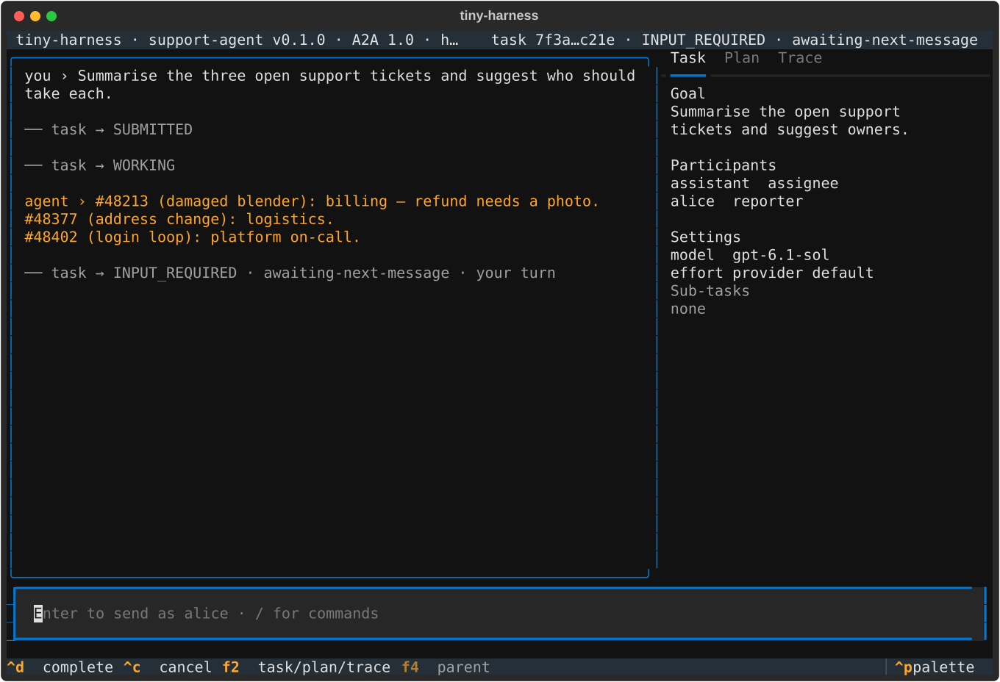
- `slash-completion-and-hint`: 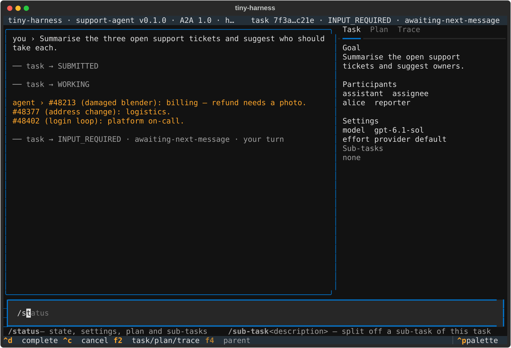
- `sub-task-row`: 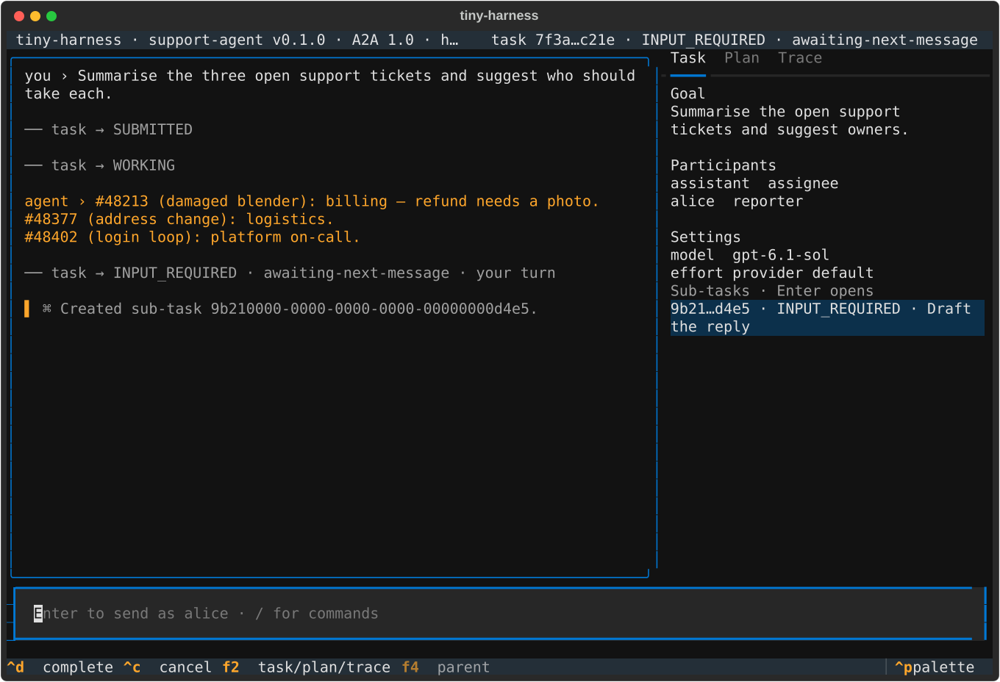
- `sub-task-open`: 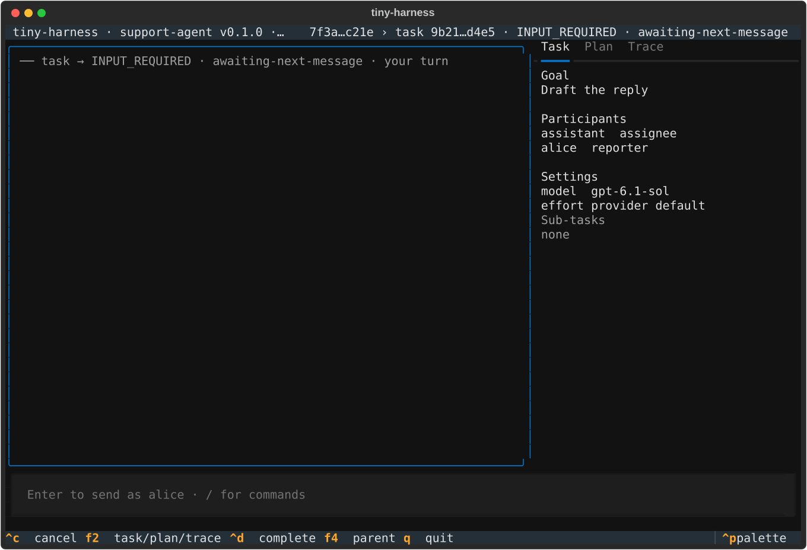
- `completed-state`: 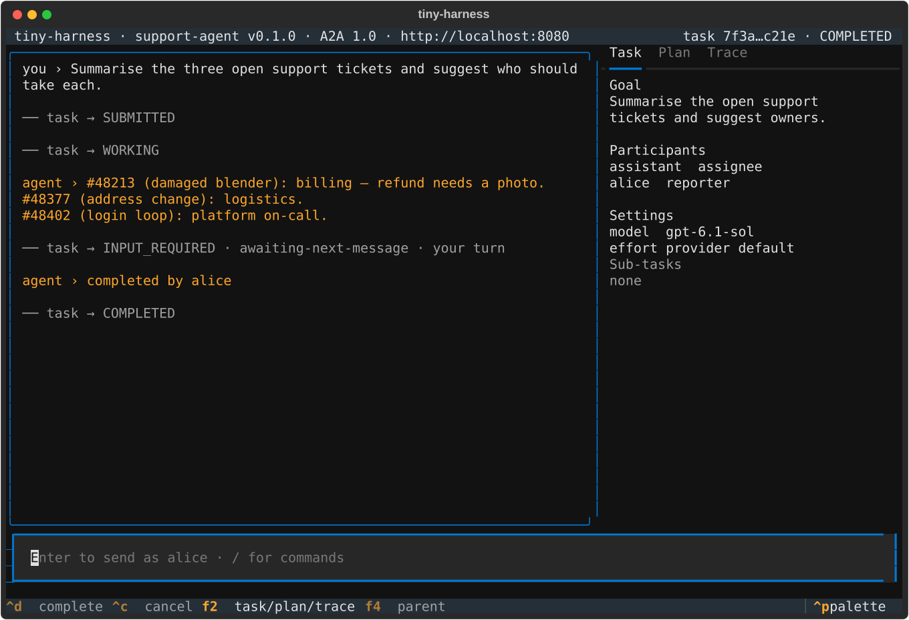

## Web

`cd renderers/web && bun run test:visual` (Playwright, system Chromium via
`TINY_HARNESS_CHROMIUM`)

```text

  12 passed (23.4s)
rc=0 secs=36
```

- `controls-light`: 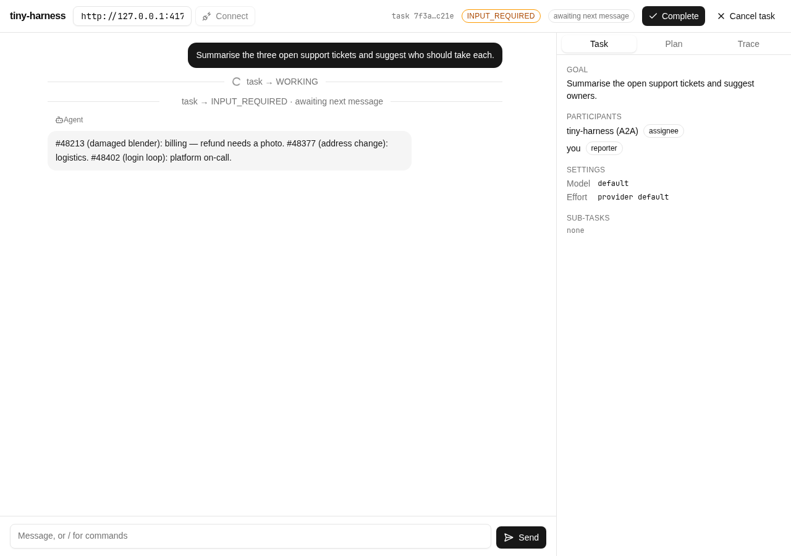
- `controls-dark`: 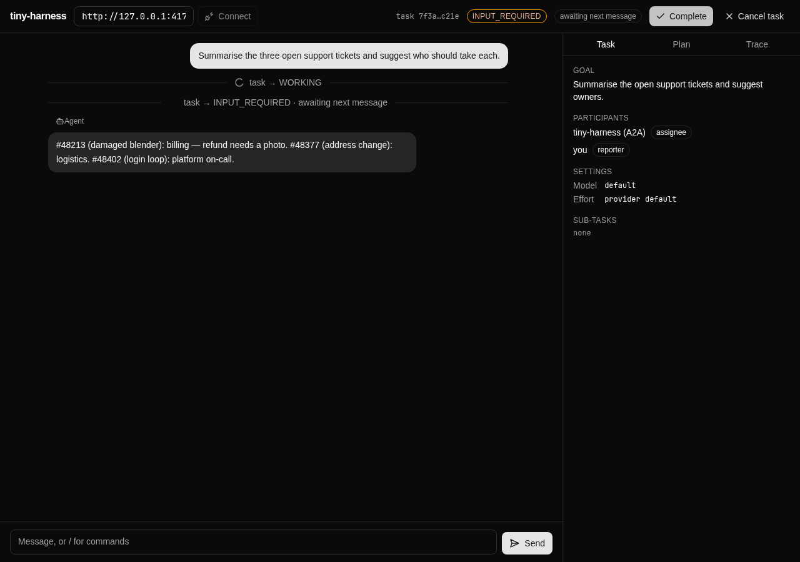
- `controls-phone`: 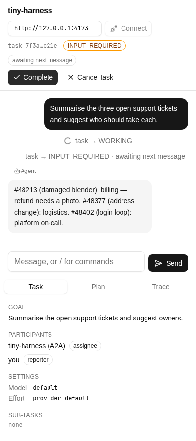
- `listbox`: 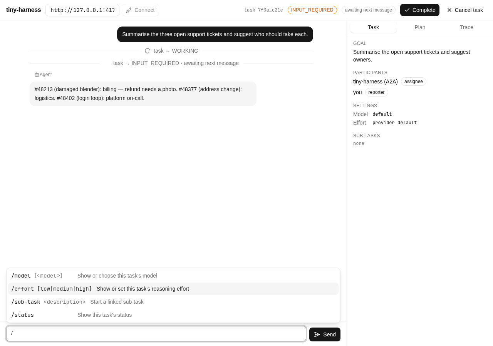
- `sub-task-created`: 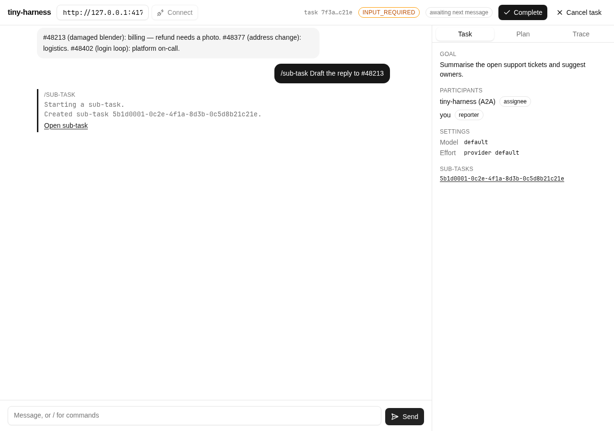
- `sub-task-open`: 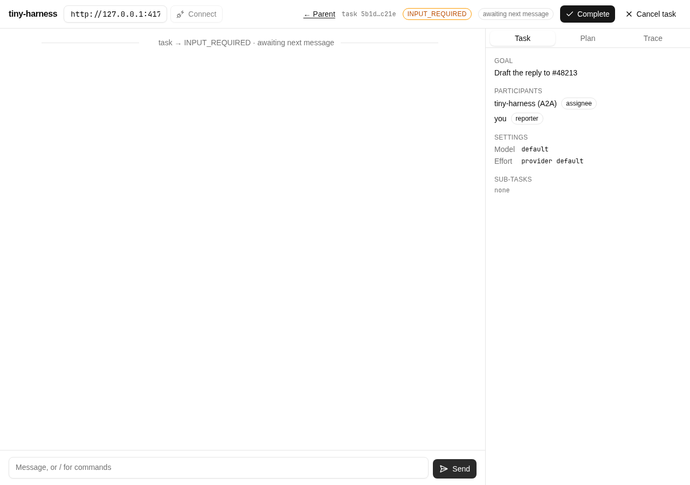
- `completed-light`: 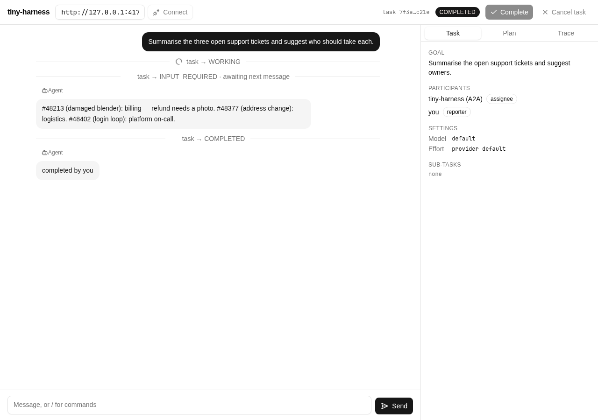
- `completed-dark`: 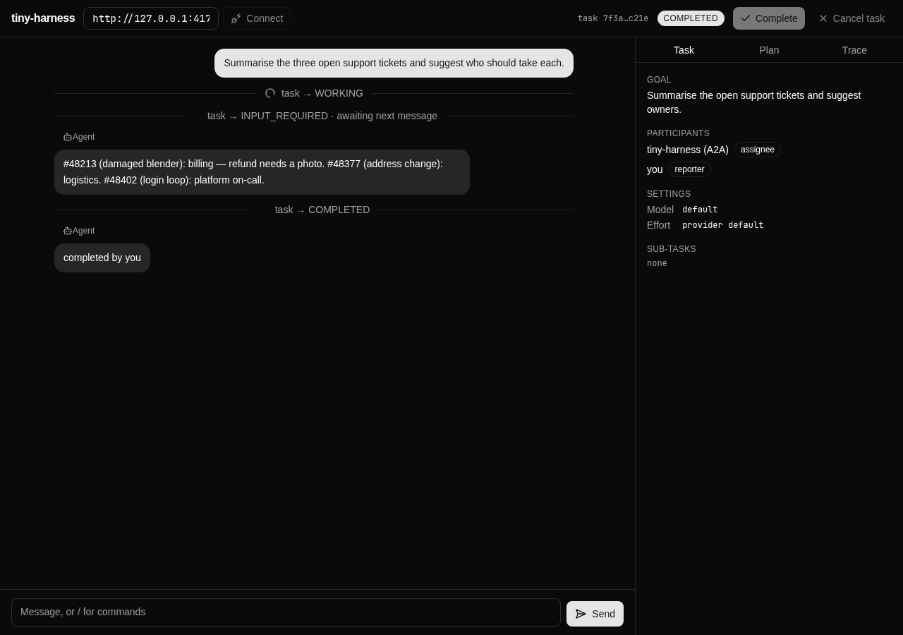
- `completed-phone`: 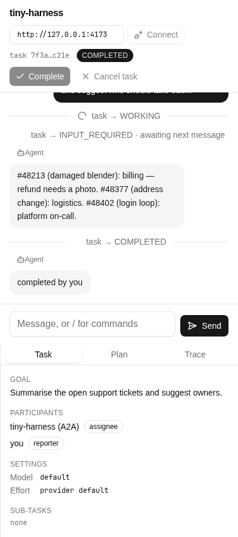

The flow goes: reply → `/` listbox → `/sub-task` → open it → Complete the sub-task →
← Parent → Complete.

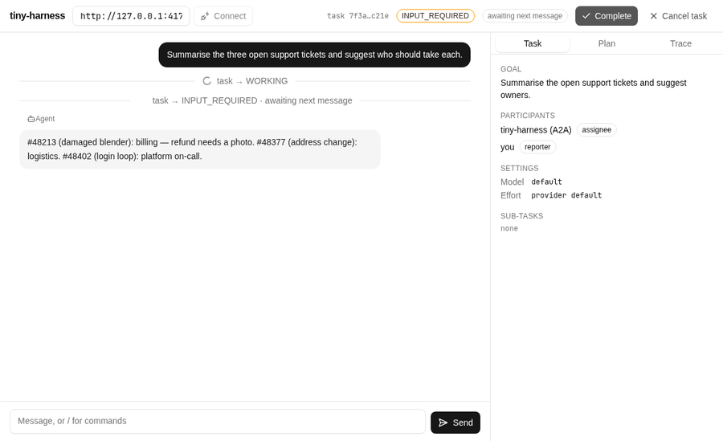

The screens match the locked prototypes in `docs/specs/issue-25/design/`, except where
`design.md` changed during implementation:

- Web sub-task rows show the id and the agent, not "state · goal": showing state and goal
  would cost an extra request per sub-task.
- In the TUI, the reply is drawn before its state line.
