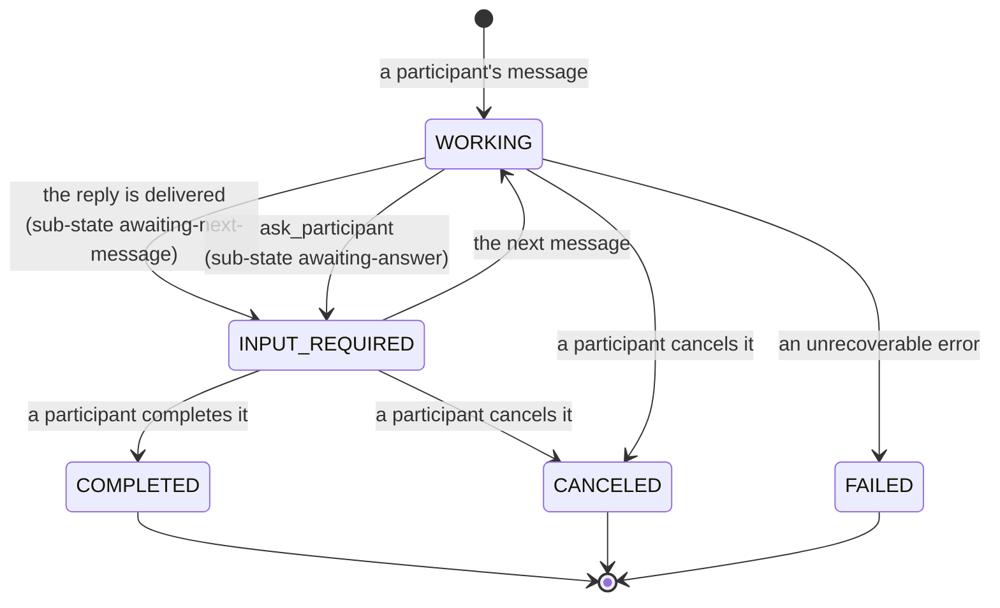

<!-- Written per the `the-loop:writing` skill: front-load each section's
     conclusion, draw it rather than describe it (3+ named parts -> a mermaid
     diagram), and keep the formal registers formal (EARS, abuse cases,
     RFC-2119, API contracts, schema descriptions). No length limit — length
     follows the change; the test is whether a sentence can come out without
     losing information. A gated section stays even when it is empty. -->

# Requirements: Make the CLI/TUI experience seamless

> Phase 1 of 3 (requirements → design → tasks). Following the Kiro spec approach
> (<https://kiro.dev/docs/specs/>). This phase MUST be reviewed and approved by the
> required collaborators before moving to design.

## Introduction

Installing `tiny-harness` from PyPI does not yet give you a working tool. The
`tiny-harness` command exists, but it requires a subcommand, and with no `--config` it
reads no file, so validation fails on the first required key (`server.base_url`).
Temporal also defaults to `remote` mode, which needs `TEMPORAL_API_KEY`. Even once it
runs, every exchange ends the task: when the model replies without a tool call, the core
loop completes the task. The executor then refuses the next message ("the task is in a
terminal state"), as A2A requires, since a terminal task never restarts. A conversation turns into a string of finished
tasks. The TUI and the Web UI can cancel a task but cannot complete one, and there is no
way to change the model or check a task's status from inside a conversation.
Ticket: [MadaraUchiha-314/tiny-harness#25](https://github.com/MadaraUchiha-314/tiny-harness/issues/25).

This work item does five things:

1. **First run works.** With no `--config`, the CLI uses `~/.tiny-harness/config.toml`
   and creates it with a working local default if it is missing.
2. **A reply leaves the task open.** After a reply, the task waits in `INPUT_REQUIRED`,
   with a sub-state in metadata that says it is waiting for the next message. A
   participant completes it, cancels it, or keeps talking.
3. **Both UIs get task controls.** The TUI and the Web UI have explicit **Complete** and
   **Cancel** controls.
4. **Slash commands.** `/<name>` runs a registered command: `/model`, `/effort`,
   `/sub-task` and `/status` to start with. A command runs through a new
   `command.invoked` hook operation, so code, a plugin or a remote hook executor can add
   or override one the same way it extends any other operation. A `/<name>` that matches
   no registered command goes to the harness as an ordinary message.
5. **The SDK keeps parity.** Everything the CLI gains is also available to code that
   imports `tiny_harness`, and the SDK gets none of the CLI's file-system side effects.

**What the A2A protocol says, as the ticket asked.** A2A has no state for "the agent
replied and the conversation goes on". A task in a terminal state (`completed`,
`canceled`, `rejected`, `failed`) "cannot restart", and any follow-up "must initiate a
new task within the same `contextId`"
([Life of a Task](https://a2a-protocol.org/latest/topics/life-of-a-task/)).
`input-required` is the interrupted state an agent uses when it needs the client again.
A2A extensions **cannot add enum values**: "Extensions should use existing enum values
and annotate additional semantic meaning in the `metadata` field", and the docs give
task sub-states as the example
([Extensions](https://a2a-protocol.org/latest/topics/extensions/)). So the ticket's
fallback is also the protocol's own recommendation: keep the task in `INPUT_REQUIRED`
and carry the sub-state in metadata, declared by an extension the agent card advertises.

## Requirements

### Requirement 1 — The `tiny-harness` command works straight after `pip install`

**User story:** As someone who just installed the package, I want `tiny-harness` to start
a working TUI, so that I can try the harness without first writing a configuration file
or running Temporal.

#### Acceptance criteria (EARS)

1. WHEN the package is installed THEN the system SHALL provide the `tiny-harness`
   console command, as it does today.
2. WHEN `tiny-harness` is run with no subcommand THEN the system SHALL start the TUI,
   with the same behaviour as `tiny-harness tui`.
3. WHERE the configuration in effect sets `[temporal] mode = "embedded"`, WHEN
   `tiny-harness tui` is run with no `--url` THEN the system SHALL host the harness in
   its own process, as it does today, and the user SHALL need no running server and no
   environment variable other than the model provider's API key.
4. The existing subcommands (`serve`, `worker`, `tui`, `schedules delete`, `tasks purge`)
   and `--version` SHALL keep their current behaviour.
5. `tiny-harness --help` SHALL list every subcommand and the configuration file in
   effect, including whether it was taken from `--config` or from the default location.

### Requirement 2 — A default configuration file at `~/.tiny-harness/config.toml`

**User story:** As a CLI user, I want the harness to create and use a configuration file
in my home directory, so that my settings persist between runs and I can still point at
another file when I need to.

#### Acceptance criteria (EARS)

1. The CLI SHALL resolve its configuration file in this order: the `--config` path, else
   `~/.tiny-harness/config.toml`.
2. WHEN `--config` is given THEN the system SHALL read that file only and SHALL NOT read,
   create or modify `~/.tiny-harness/config.toml`.
3. IF `--config` names a file that does not exist THEN the system SHALL exit with status
   2 naming the path, as it does today, and SHALL NOT create it.
4. WHEN no `--config` is given and `~/.tiny-harness/config.toml` does not exist THEN the
   system SHALL create `~/.tiny-harness/` and the file, print the created path on stderr,
   and continue with it.
5. The created file SHALL be a valid configuration that the current `Settings` accepts.
   It SHALL select `[temporal] mode = "embedded"` with persistence on, place the store,
   the embedded Temporal database and the log file under `~/.tiny-harness/`, contain no
   secret, and document each key it sets in a TOML comment.
6. WHEN `~/.tiny-harness/config.toml` exists THEN the system SHALL read it and SHALL NOT
   rewrite it, even if it differs from the default.
7. IF `~/.tiny-harness/config.toml` exists but cannot be read or is invalid THEN the
   system SHALL exit with status 2 naming the file and the offending key, as for any
   configuration error, and SHALL NOT replace it.
8. Relative paths in a configuration file SHALL keep their current meaning.

### Requirement 3 — A reply does not complete the task

**User story:** As a user in a conversation with the harness, I want my task to stay open
after the harness replies, so that my next message continues the same task instead of
starting a new one.

#### Acceptance criteria (EARS)

1. WHEN the core loop of a task started by a participant's message ends a turn without a
   tool call THEN the system SHALL set the task's state to `TASK_STATE_INPUT_REQUIRED`
   with the sub-state `awaiting-next-message`, and SHALL NOT set
   `TASK_STATE_COMPLETED`.
2. WHEN `ask_participant` ends a run THEN the system SHALL set `TASK_STATE_INPUT_REQUIRED`
   with the sub-state `awaiting-answer`.
3. WHEN a message arrives for a task in `TASK_STATE_INPUT_REQUIRED` THEN the system SHALL
   clear the sub-state and resume the task in `TASK_STATE_WORKING` with the message,
   whichever sub-state it held.
4. A sub-task the agent spawns through `spawn_subtask` SHALL keep completing when its core
   loop ends, as it does today, so that its parent can continue. A participant task
   created through `create_task_for_participant` SHALL keep completing on the assignee's
   reply, as it does today.
5. The system SHALL keep the existing rule that a parent does not complete while a
   sub-task is unresolved.
6. The system SHALL record every state change, with its sub-state, in the task's event
   log and the store, so that `GetTask` and `SubscribeToTask` replay it across restarts.

### Requirement 4 — `INPUT_REQUIRED` sub-states as an A2A extension

**User story:** As an A2A client developer, I want to know why a task is in
`INPUT_REQUIRED`, so that my client can tell "the harness asked you a question" apart
from "your turn, the conversation is open".

#### Acceptance criteria (EARS)

1. The system SHALL carry the sub-state in the status metadata of each `INPUT_REQUIRED`
   status update and in the task's metadata, under a key owned by an A2A extension. It
   SHALL NOT add a value to `TaskState`.
2. The system SHALL advertise that extension in the agent card's
   `capabilities.extensions` and publish its JSON Schema under `docs/a2a/ext/`, next to
   the task extension's.
3. The schema SHALL define the sub-states `awaiting-next-message` and `awaiting-answer`
   and SHALL allow new values to be added later without a breaking change.
4. WHEN a client does not activate the extension THEN the system SHALL still report the
   standard `TASK_STATE_INPUT_REQUIRED`, so that an extension-unaware client keeps
   working.

### Requirement 5 — Complete and cancel from the TUI and the Web UI

**User story:** As a participant, I want explicit Complete and Cancel controls in both the
TUI and the Web UI, so that I decide when a task is done.

#### Acceptance criteria (EARS)

1. The system SHALL let a participant complete a task through A2A, in a way any A2A
   client can use, and the TUI and the Web UI SHALL use that same way.
2. WHEN a participant completes a task in `TASK_STATE_INPUT_REQUIRED` or
   `TASK_STATE_WORKING` THEN the system SHALL stop any turn in progress, set
   `TASK_STATE_COMPLETED`, emit the final status update to every subscriber and persist
   it.
3. WHEN a participant completes or cancels a task that is already in a terminal state
   THEN the system SHALL refuse with an error naming the current state and SHALL leave
   the task unchanged.
4. WHERE a task has an unresolved sub-task, WHEN a participant completes it THEN the
   system SHALL refuse with an error naming the unresolved sub-tasks, unless a hook
   overrides the rule as it can today.
5. The TUI SHALL offer Complete and Cancel for the open task, each bound to a key and
   shown in the footer. The Web UI SHALL offer them as buttons. Each control SHALL be
   enabled only while the task is in a non-terminal state.
6. WHEN another surface completes or cancels the task THEN both renderers SHALL show the
   new state without a reload.
7. Both renderers SHALL show the task's state and, while it is `INPUT_REQUIRED`, its
   sub-state.

### Requirement 6 — Slash commands with a programmatic registry

**User story:** As a user, I want to type `/<command>` to control the harness, and as a
developer I want to register my own commands, so that frequent controls do not depend on
the model understanding a request.

#### Acceptance criteria (EARS)

1. The system SHALL provide a command registry that SDK code fills by registering a
   command with a name, a one-line description, an argument hint and a handler.
2. WHEN a message's text starts with `/<name>` and `<name>` is a registered command THEN
   the system SHALL run that command's handler with the rest of the text as its
   arguments, SHALL NOT invoke the model for that message, and SHALL emit the handler's
   reply as a message on the task.
3. WHEN a message's text starts with `/<name>` and no command named `<name>` is registered
   THEN the system SHALL handle the message exactly as an ordinary message, giving the
   whole text to the harness.
4. The system SHALL resolve commands on the harness side, so that the TUI, the Web UI and
   any other A2A client get the same behaviour from the same text.
5. Command names SHALL be matched case-sensitively against `[a-z][a-z0-9-]*`, and
   registering a name that is invalid or already registered SHALL raise an error when the
   registry is built.
6. WHEN a command handler raises an error THEN the system SHALL reply with the error
   message on the task, leave the task's state as it was before the command, and log the
   error.
7. The system SHALL expose the registered commands (name, description, argument hint) to
   clients. The TUI and the Web UI SHALL offer them as completions when the composer's
   text starts with `/`.
8. The built-in commands of Requirements 7–10 SHALL be registered through the same
   registry, and an SDK user SHALL be able to build a harness without them.

### Requirement 6a — Commands through the hook system

**User story:** As a plugin author, I want to add or change commands through the hook
system, so that commands extend like every other harness operation and need no code in
the harness.

#### Acceptance criteria (EARS)

1. The hook catalogue SHALL include the operation `command.invoked` with the phases
   `pre`, `in` and `post`, whose context carries the command name, its argument text,
   the task reference and the sender.
2. WHEN a registered command runs THEN the system SHALL run it through the
   `command.invoked` hook chain, with the command's body as the `in` phase.
3. The built-in commands SHALL be `in` executors that the built-in plugin registers at
   the default priority, so that an executor with a lower priority that sets the
   context's result replaces a built-in command's body.
4. WHEN a `pre` executor on `command.invoked` returns a replacement THEN the command
   SHALL run with it. WHEN a `pre` executor raises a typed abort THEN the command SHALL be
   refused with the abort's reason as the reply, and the task's state SHALL be
   unchanged.
5. WHEN a `post` executor returns a replacement THEN it SHALL be the command's reply.
6. A plugin SHALL be able to declare commands (name, description, argument hint) in its
   `io.github.madarauchiha-314.tiny-harness/` directory, with each body a hook executor
   declared in its `hooks.json`, local or remote (JSON-RPC 2.0 or MCP) as for any other
   hook point.
7. Registering a command from code (Requirement 6.1) SHALL declare the command and
   register its `in` executor, so that a command registered from code and one declared
   by a plugin behave the same.
8. IF a plugin declares a command whose name is invalid or already declared, or whose
   body has no `in` executor THEN the system SHALL skip that command and record the
   reason in the plugin's load report, as for any failed component.
9. WHEN a remote command executor fails or answers out of contract THEN the system SHALL
   raise `HookTransportError` as for any remote hook, reply with the failure on the task
   and leave the task's state unchanged.

### Requirement 7 — `/model`

**User story:** As a user, I want to switch the model for my task, so that I can trade
cost for capability during a conversation.

#### Acceptance criteria (EARS)

1. The configuration SHALL declare the models that may be selected. The configured
   default model SHALL always be one of them.
2. WHEN `/model` is sent with no argument THEN the system SHALL reply with the task's
   current model and the selectable models.
3. WHEN `/model <name>` is sent and `<name>` is selectable THEN the system SHALL use that
   model for every later model call of the task and its new sub-tasks, record the choice
   in the task's metadata so that it survives a restart, and reply with the new model.
4. IF `<name>` is not selectable THEN the system SHALL refuse, reply with the selectable
   models, and leave the task's model unchanged.
5. WHEN a task has no model chosen THEN the system SHALL use the configured default.

### Requirement 8 — `/effort`

**User story:** As a user, I want to set how hard the model thinks for my task, so that I
can trade latency and cost for quality.

#### Acceptance criteria (EARS)

1. The system SHALL accept the efforts `low`, `medium` and `high`, and the configuration
   MAY set a default effort.
2. WHEN `/effort` is sent with no argument THEN the system SHALL reply with the task's
   current effort and the accepted values.
3. WHEN `/effort <value>` is sent with an accepted value THEN the system SHALL send that
   effort as the provider's reasoning-effort setting on every later model call of the
   task, record it in the task's metadata, and reply with it.
4. IF the value is not accepted THEN the system SHALL refuse, reply with the accepted
   values, and leave the effort unchanged.
5. WHERE no effort is set for the task or in the configuration, the system SHALL send no
   reasoning-effort setting, so that requests stay byte-identical to today's.

### Requirement 9 — `/sub-task`

**User story:** As a user, I want to split off a sub-task from my current task, so that I
can work on a piece of it in its own thread while the parent stays open.

#### Acceptance criteria (EARS)

1. WHEN `/sub-task <description>` is sent THEN the system SHALL create a task in the same
   `contextId`, linked to the current task as its parent and recorded in the parent's
   sub-task list, with the sender as its reporter and the description as its goal, and
   SHALL reply with the new task's id.
2. A sub-task created this way SHALL behave as a conversation task (Requirement 3): it
   waits in `INPUT_REQUIRED` after each reply until a participant completes or cancels
   it.
3. IF `/sub-task` is sent with no description THEN the system SHALL refuse and reply with
   the usage.
4. The TUI and the Web UI SHALL let the user open the new sub-task and return to its
   parent.

### Requirement 10 — `/status`

**User story:** As a user, I want to ask for my task's status, so that I can see where it
stands without asking the model.

#### Acceptance criteria (EARS)

1. WHEN `/status` is sent THEN the system SHALL reply, without invoking the model, with
   the task's id, name, A2A state and sub-state, model, effort, plan progress (steps done
   out of total) and each sub-task's id and state.
2. `/status` SHALL NOT change the task's state.

### Requirement 11 — The SDK keeps parity with the CLI

**User story:** As a developer embedding tiny-harness, I want everything the CLI does to
be available from Python, so that the CLI is a thin layer and my program is not a
second-class citizen.

#### Acceptance criteria (EARS)

1. The public API SHALL expose the configuration-path resolution of Requirement 2 and the
   default-file creation as functions, used by the CLI, that an SDK caller can call
   explicitly.
2. `Settings.load` and the programmatic entry points (`running_harness`, `serve`) SHALL
   NOT read or create `~/.tiny-harness/` unless the caller asks them to.
3. The public API SHALL expose the command registry, the built-in commands, task
   completion, and the `INPUT_REQUIRED` sub-state constants.
4. The CLI SHALL perform nothing that the public API cannot perform.

## Non-functional requirements

- **Behaviour change for A2A clients.** A task started by a participant's message no
  longer reaches `TASK_STATE_COMPLETED` on its own (Requirement 3). Clients that waited
  for `completed` to know a reply was done SHALL instead treat any final status update
  (`INPUT_REQUIRED` included) as the end of a turn. The demo, the e2e tests and the
  README SHALL be updated to match.
- **Backwards compatibility.** An existing `--config` file SHALL be accepted unchanged.
  The new configuration keys (selectable models, default effort) SHALL be optional.
- **Observability.** Command runs SHALL be logged and traced with the command name, the
  task id and the outcome, never the arguments' secrets. State changes SHALL carry the
  sub-state in their logs and spans.
- **Accessibility.** The Web UI controls SHALL pass the existing axe-core checks, and
  every TUI control SHALL be reachable from the keyboard.
- **Dependencies.** No new runtime dependency is expected. Any that is added SHALL be
  justified in `design.md`.
- **Documentation.** The README, the getting-started guide and the affected capability
  docs (`configuration`, `tasks-and-plans`, `a2a-server`, `surfaces-and-renderers`,
  `models`, `hooks`, `plugins`) SHALL describe the new behaviour.

## Security considerations

The new surfaces are a file the CLI writes into the user's home directory, a text prefix
(`/`) that now reaches code instead of the model, and a participant-initiated completion.
None of them adds an inbound network interface. The new risks are participants steering
cost or state, and the local file being redirected.

- **Actors & trust:** The operator who runs the CLI and writes the configuration is
  trusted, as today. Participants who send messages are identified only by a
  self-asserted `X-Participant-Id` (decision-003) and are **untrusted** for anything
  beyond their task. Message text, including a command's arguments, is **untrusted
  input**. Model output stays untrusted, as today.
- **Trust boundaries & data:**
  - *Message text → command handler.* A participant's text now selects code to run and
    passes it arguments. Handlers run in-process with the harness's privileges, or in
    a remote hook executor the operator's plugin names (Requirement 6a). Plugins and
    their executors are operator-installed and as trusted as today's hooks; the
    argument text they receive is not.
  - *Message text → model selection and effort.* A participant can now change which model
    is called and how much it reasons, which changes the operator's cost.
  - *Participant → task state.* A participant can now end a task as completed, and
    `/sub-task` lets a participant create tasks.
  - *CLI → home directory.* The CLI creates `~/.tiny-harness/` and a file in it. The
    store and the embedded Temporal database it points at hold conversation data. The
    file holds no secret, since secrets stay environment-only.
- **Abuse cases (EARS):**
  1. WHEN a participant sends `/model <name>` naming a model the configuration does not
     list THEN the system SHALL refuse it and keep the current model.
  2. WHEN a participant sends `/effort <value>` with a value outside `low`, `medium`,
     `high` THEN the system SHALL refuse it and keep the current effort.
  3. WHEN a participant who is not on a task sends a command, a completion or a
     cancellation for it THEN the system SHALL answer as if the task did not exist,
     applying the existing access policy.
  4. WHEN a participant whose only role on a task is `watcher` completes, cancels, or
     sends `/model`, `/effort` or `/sub-task` THEN the system SHALL refuse it and leave the
     task unchanged.
  5. WHEN a command's argument text contains shell metacharacters, path separators,
     control characters or a prompt-injection payload THEN the system SHALL treat it only
     as a value for that command's own validation. It SHALL never execute it, use it as
     a path, or pass it to the model as an instruction.
  6. WHEN a participant sends `/sub-task` repeatedly THEN the existing request-rate and
     size limits SHALL apply, so that one participant cannot create tasks faster than
     `rate_limit_per_minute`.
  7. WHEN `~/.tiny-harness` or `~/.tiny-harness/config.toml` is a symbolic link, or is
     owned by another user, THEN the CLI SHALL refuse to create or write through it,
     and SHALL exit with status 2 naming the path.
  8. WHEN the CLI creates `~/.tiny-harness/` and the configuration file THEN it SHALL
     create the directory with mode `0700` and the file with mode `0600`, so that other
     local users cannot read the conversation store's location or tamper with the
     configuration.
  9. WHEN the text after `/` is not a registered command THEN the system SHALL treat the
     message as ordinary untrusted input to the model, as it treats any message today.
  10. WHEN a command runs through a remote hook executor THEN the system SHALL send the
      argument text only after the redactor has scrubbed the context, as for every hook,
      and SHALL treat the executor's reply as untrusted text to show, never as a state
      change it did not make through the hook contract.
- **Fail closed:**
  - A command, completion or cancellation SHALL be refused when the sender's identity is
    missing, when the sender is not on the task, or when the sender's role does not
    permit it.
  - A selectable-models list that is empty or does not contain the default model SHALL
    be a configuration error (status 2), never "any model allowed".
  - If the default configuration file cannot be created safely, the CLI SHALL exit with
    status 2 and SHALL NOT fall back to running with no configuration.

## Out of scope

- Shipping the built Web UI inside the PyPI wheel. The Web UI stays served from
  `ui_dir`, as today.
- Controls for other task states (`rejected`, `auth-required`, pause/resume). The
  sub-state schema leaves room for them.
- Commands defined in the configuration file. Commands come from code or from plugins
  (Requirement 6a).
- Switching provider (OpenAI ↔ Anthropic) through `/model`. `/model` selects among the
  configured provider's models.
- A `TINY_HARNESS_HOME`-style environment variable for the default location.
- Agent-initiated completion of a conversation task (see open question 3).

## Open questions

Raised on the pull request that carries this document, the outer loop's surface for this
work item.

1. **Bare `tiny-harness` → TUI.** Requirement 1.2 makes the command with no subcommand
   start the TUI. Is that the experience you want, or should it print help as it does
   today?
2. **Default configuration.** Requirement 2.5 makes the created file select embedded
   Temporal, so a first run needs only the model provider's key. Is embedded the right
   default for the CLI, given that `remote` stays the default when a file does not set
   `mode`?
3. **Who ends a conversation task.** Under Requirement 3, only a participant (Complete or
   Cancel) ends a task that a participant's message started. Should the agent also be
   able to complete it explicitly, for example through an intrinsic tool, when the goal's
   acceptance criteria are met?
4. **Scope of `/model` and `/effort`.** This document makes them per task, inherited by
   new sub-tasks. Should they instead be per surface or session, applying to every task
   the user opens?
5. **Effort values.** `low`, `medium`, `high` are the values every provider in scope
   understands. Do you also want `minimal` or `xhigh`, where a provider supports them?

## Review comments

> Appended by the-loop's `record-feedback` hook when a human gate approves with
> comments (issue-109). Append-only and attributed: an approval never silently
> discards a reviewer's suggestions, and the feedback travels with the document
> it concerns rather than living in a side-channel tracker.
