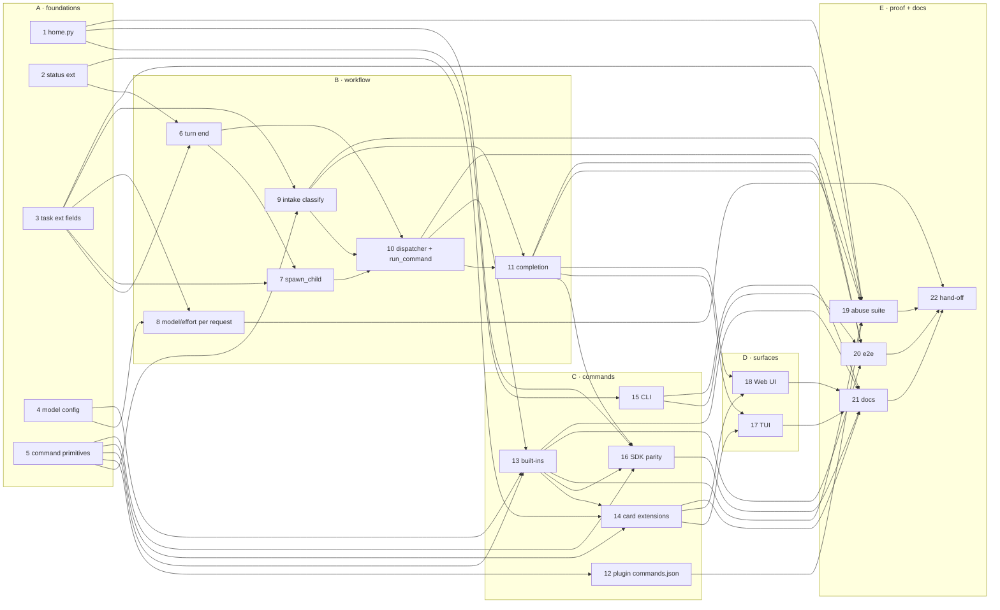

<!-- Written per the `the-loop:writing` skill: front-load each section's
     conclusion, draw it rather than describe it (3+ named parts -> a mermaid
     diagram), and keep the formal registers formal (EARS, abuse cases,
     RFC-2119, API contracts, schema descriptions). No length limit — length
     follows the change; the test is whether a sentence can come out without
     losing information. A gated section stays even when it is empty. -->

# Tasks: Make the CLI/TUI experience seamless

> The last spec artifact. A DAG derived from the approved [`design.md`](design.md) and
> [`testing-plan.md`](testing-plan.md). Each task's `_Test:_` names a row of the plan's
> matrix. Single repository (`the-loop graph repos issue-25 --clear`); everything lands on
> PR #26.

There are 22 tasks in five layers: foundations, then workflow behaviour, then commands,
then surfaces, then proof and docs. Every task is test-first: write the named test, watch
it fail, make it pass. The commit records red → green. Security-relevant tasks name their
negative test.

## Task list

### Layer A: foundations (no dependencies between them)

- [x] 1. `tiny_harness/home.py`: configuration resolution and safe default creation
  - `ConfigSource`, `resolve_config_path`, `default_config_text`, `ensure_default_config`
    as in design § `tiny_harness/home.py`.
  - The creation steps: `lstat`, owner check, `mkdir 0o700`,
    `O_WRONLY|O_CREAT|O_EXCL|O_NOFOLLOW|O_CLOEXEC` at `0o600`. Every refusal is a
    `ConfigError(path)`.
  - `geteuid` is injectable for tests.
  - _Depends on:_ none
  - _Requirements:_ R2.1–2.8, R11.1; abuse cases 7, 8
  - _Test:_ T1 `tests/unit/test_home.py` (resolution, default text loads as `Settings`
    with absolute paths, existing file untouched); T8
    `tests/security/test_home_paths.py` (symlink home, symlink file, foreign owner,
    modes)
- [x] 2. Status extension module and sub-state on `with_state`
  - `harness/core/status.py`: `STATUS_EXT_URI`, `STATUS_EXT_KEY`, `SubState`,
    `StatusExtensionData`.
  - `HarnessTask.with_state(state, sub_state=None)` writes the key, or deletes it.
  - `HarnessTask.sub_state` reads it.
  - _Depends on:_ none
  - _Requirements:_ R4.1, R4.3, R3.3
  - _Test:_ T1 `tests/unit/core/test_status.py`
- [x] 3. Task extension fields, lifecycle derivation, and the server-controlled refusal
  - `TaskExtensionData` gains `lifecycle`, `model` and `reasoning_effort`.
  - `HarnessTask.lifecycle` derives `delegated` / `conversation` when the field is
    absent.
  - `extension_from_envelope` and `apply_task_envelope` refuse an envelope that sets any
    of the three.
  - Regenerate `docs/a2a/ext/task.json`.
  - _Depends on:_ none
  - _Requirements:_ R3, R7.3; abuse case 1
  - _Test:_ T1 `tests/unit/core/test_task.py`; T8
    `tests/security/test_server_controlled_fields.py`; T10
    `tests/unit/core/test_task_compat.py`
- [x] 4. Model configuration and `ModelCatalog`
  - `[openai]` and `[anthropic]` gain `models` and `reasoning_effort`. A validator
    rejects an empty `models`, or one missing `model` (exit 2, `openai.models`).
  - `ModelCatalog` provides `default`, `selectable`, `default_effort`,
    `context_window(model)` and `settings_for(task)`.
  - _Depends on:_ none
  - _Requirements:_ R7.1, R7.5, R8.1, R8.5
  - _Test:_ T1 `tests/unit/test_config_openai.py`,
    `tests/unit/models/test_catalog.py`; T10 `tests/unit/test_config.py` (old file
    unchanged)
- [x] 5. Command primitives: hook operation, contexts, registry, name filter
  - `Operation.COMMAND_INVOKED`.
  - `CommandInvokedPre/In/Post`, `CommandSpec`, `TaskSettings`, `SpawnIntent`,
    `CommandResult`, `TaskSnapshot`.
  - `EntityKind.COMMAND`.
  - `CommandRegistry.register(spec, handler, priority=500)` raises `CommandError` on a
    bad or duplicate name.
  - `_ForCommand` passes through every other name, and any context whose result is
    already set.
  - The command-text parser.
  - _Depends on:_ none
  - _Requirements:_ R6.1, R6.3, R6.5, R6a.1–6a.5, R6a.7
  - _Test:_ T1 `tests/unit/commands/test_registry.py`,
    `tests/unit/commands/test_parse.py`

### Layer B: workflow behaviour

- [x] 6. Turn end parks conversation tasks; `ask_participant` sub-state
  - `OutcomeKind` gains `waiting_for_message`.
  - `Operations.await_next_message` in both the in-process and the workflow
    implementations.
  - `CoreLoop._finish` branches on the lifecycle.
  - `set_status(..., sub_state=)` writes the status-update metadata.
  - `ask` passes `awaiting-answer`.
  - The executor's first-message path sets `lifecycle="conversation"`.
  - _Depends on:_ 2, 3
  - _Requirements:_ R3.1–3.3, R3.6, R4.1
  - _Test:_ T1 `tests/unit/core/test_loop.py`; T2 `tests/integration/durable/test_conversation_lifecycle.py`
    (`Scenario: A reply leaves a conversation task awaiting the next message`;
    `…resumes the same task and clears the sub-state`;
    `ask_participant parks the task awaiting an answer`;
    `A delegated sub-task still completes when its loop ends`)
- [x] 7. `spawn_child` sets the lifecycle and inherits settings
  - `delegated` for `spawn_subtask`. `conversation`, with no first message, for a
    `/sub-task` spawn.
  - The parent's `model` and `reasoning_effort` are copied into every local child.
  - _Depends on:_ 3, 6
  - _Requirements:_ R3.4, R7.3, R9.2
  - _Test:_ T2 `Scenario: Sub-tasks inherit the parent's model and effort`
- [x] 8. Per-request model and effort through every model call
  - `LLMRequest.model` and `LLMRequest.reasoning_effort`.
  - The request builders (`context.py`, `compaction.py`, `help.py`) use `settings_for`.
  - The adapters map effort: Responses `reasoning`, Chat `reasoning_effort`, Anthropic
    `output_config.effort`.
  - `request.model or self._model`.
  - `assemble_context` uses the per-model window.
  - Span attributes.
  - _Depends on:_ 3, 4
  - _Requirements:_ R7.3, R8.3, R8.5; NFR observability
  - _Test:_ T1 `tests/unit/models/test_openai_effort.py`,
    `test_openai_chat_effort.py`, `test_anthropic_effort.py` (byte-identical when
    unset); T2 `Scenario: /model and /effort change the next model request, compaction
    and help included`
- [x] 9. Intake classification and the control envelope
  - `EventEnvelope.kind` gains `control` (with `action: Literal["complete"]` and
    `extra="forbid"`).
  - `IntakeOut.command` and `IntakeOut.control`.
  - A command or control writes an audit row and adds no history.
  - A watcher's control is not accepted.
  - _Depends on:_ 3, 5
  - _Requirements:_ R5.1, R6.2, R6.3; abuse cases 4, 9
  - _Test:_ T1 `tests/unit/service/test_intake_classify.py`; T8
    `tests/security/test_command_roles.py` (watcher control; `/unknown hi` is ordinary)
- [x] 10. `run_command` activity and the workflow dispatcher
  - `ActivityName.RUN_COMMAND`, `CommandIn` and `CommandOut`. The activity runs the
    chain through `OperationRunner`: a pre-abort becomes a refusal, an exception
    becomes `/<name> failed: …`, and no result becomes "has no handler".
  - `_dispatch()` runs before `CoreLoop`, and at the loop's drain points.
  - The loop starts only when the ordinary queue or the notes are non-empty.
  - Results are applied in the order settings, spawn, reply, with the `TaskRef`
    confirmation and `task_ref` metadata.
  - `_run_participant` dispatches first.
  - _Depends on:_ 6, 7, 9
  - _Requirements:_ R6.2, R6.6, R9.1, R10.2, R3.4
  - _Test:_ T2 `tests/integration/durable/test_commands.py` (`A command runs without
    invoking the model and the state is unchanged`; `…during a running turn…`;
    `A failing command…`; `A participant task still completes on the assignee's answer,
    and a command does not`)
- [x] 11. Participant completion and cancel hardening
  - The inbox update validator authorizes a control: sender present, on the task, not a
    `watcher`. Only then does it set the interrupt.
  - `_complete(actor)` runs `decide_completion` with `TaskCompleteIn.requested_by`.
    COMPLETE finishes the task. WAIT emits a refusal naming the unresolved sub-tasks and
    re-emits the state.
  - The executor's terminal refusal names the state, for `execute` and `cancel` alike.
  - A `watcher`'s cancel is refused.
  - _Depends on:_ 9, 10
  - _Requirements:_ R5.1–5.4, R5.6; abuse cases 3, 4
  - _Test:_ T2 `tests/integration/durable/test_complete.py` (`A participant completes a
    task and every subscriber sees COMPLETED`; `Completing a task interrupts the turn in
    progress`; `Completing or cancelling a terminal task names its state`; `Completion
    is refused while a sub-task is open`); T8 `tests/security/test_complete_roles.py`
    (non-member, watcher idle and mid-turn)

### Layer C: commands

- [x] 12. Plugin `commands.json` and command-owned hooks
  - `PluginLoader.load` resolves `commands.json` before its hook loop, and the hook loop
    skips command-owned `HookDef`s.
  - Command-owned hooks are registered only through `_ForCommand`. Their points must be
    exactly `command.invoked.in`.
  - Skips: bad name, unknown hook, extra points, shared hook, duplicate.
  - `ComponentKind.command`. Schema at `docs/plugins/commands.json`.
  - _Depends on:_ 5
  - _Requirements:_ R6a.6–6a.8; abuse case 10
  - _Test:_ T1 `tests/unit/plugins/test_commands_json.py`; T8
    `tests/security/test_remote_command_executor.py` (sees only its own command,
    scrubbed)
- [x] 13. Built-in commands and the role `pre` executor
  - `/model`, `/effort`, `/sub-task` and `/status`, as pure handlers over
    `CommandInvokedIn` + `ModelCatalog`.
  - The built-in `pre` executor at priority 100 refuses `/model <x>`, `/effort <x>` and
    `/sub-task` from a `watcher`, and any command from a sender with no role.
  - The built-in plugin registers these at `DEFAULT_BODY_PRIORITY`.
  - `build_runtime(builtin_commands=True)`.
  - _Depends on:_ 4, 5, 10
  - _Requirements:_ R6.8, R7.2–7.4, R8.2–8.4, R9.1, R9.3, R10.1; abuse cases 1, 2, 4, 5
  - _Test:_ T1 `tests/unit/commands/test_builtins.py`; T2 `Scenario: /sub-task creates a
    linked conversation task and replies with its id`, `Scenario: A plugin command
    overrides a built-in and a pre hook can refuse it`, `Scenario: A remote command
    executor that fails leaves the task unchanged`; T8
    `tests/security/test_command_arguments.py` (unlisted model, bad effort, hostile
    arguments)
- [x] 14. Card: status and commands extensions
  - `SUPPORTED_EXTENSIONS` and `EXTENSION_DESCRIPTIONS` gain status (`required: false`)
    and commands, the latter with `params.commands` from the registry.
  - Schemas: `docs/a2a/ext/status.json` (a string, not a closed enum),
    `status/v1.md`, `commands.json`.
  - _Depends on:_ 2, 5, 13
  - _Requirements:_ R4.2–4.4, R6.7
  - _Test:_ T3 `tests/contract/test_card.py` snapshot,
    `tests/contract/test_ext_schemas.py`
- [x] 15. CLI: bare command, config wiring, help epilog
  - `add_subparsers(required=False)`. No subcommand dispatches to `tui`.
  - `main` resolves the configuration and calls `ensure_default_config` for the default
    origin, before `Settings.load`.
  - A `parse_known_args` pre-pass builds the epilog. `--help` creates nothing.
  - _Depends on:_ 1
  - _Requirements:_ R1.1–1.5, R2.1–2.4
  - _Test:_ T1 `tests/unit/service/test_cli.py`
- [x] 16. SDK parity and the public API
  - Exports: `tiny_harness.home`, the commands package, the sub-state constants and task
    completion.
  - `running_harness(..., plugins=…, commands=…, builtin_commands=…)`.
  - Regenerate the API snapshots.
  - _Depends on:_ 1, 5, 11, 13
  - _Requirements:_ R11.1–11.4
  - _Test:_ T3 `tests/contract/test_*_api.py` (`UPDATE_API_SNAPSHOTS=1` once, then
    green); T1 `Settings.load(None)` and `running_harness` never touch `HOME`

### Layer D: surfaces

- [x] 17. TUI: controls, sub-state, `/` completion, sub-task navigation
  - `A2AClientPort.complete` and `.commands`. `SdkClient` and `ScriptedClient`
    implement both.
  - Bindings: `ctrl+d`, `ctrl+c`, `f4`, and `enter` on a sub-task row.
  - The top bar shows the state and the sub-state.
  - `SuggestFromList` on the composer, plus a hint line.
  - The task stack, and a `ListView` of sub-tasks.
  - The prototype is the visual contract.
  - _Depends on:_ 11, 14
  - _Requirements:_ R5.5–5.7, R6.7, R9.4
  - _Test:_ T5/T6 `tests/ui/test_tui_keys.py`, `tests/ui/test_tui_snapshots.py` (new
    states); T9 keys only
- [x] 18. Web UI: controls, sub-state, command listbox, sub-task links
  - `a2a.ts`: `complete` and `commands`.
  - `model.ts`: `subState`.
  - The header: Complete, Cancel, the sub-state badge and ← Parent, in an `actions`
    group.
  - The composer combobox and listbox.
  - Sub-task links (`?task=`).
  - The fixture gains the new states.
  - The prototype is the visual contract.
  - _Depends on:_ 11, 14
  - _Requirements:_ R5.5–5.7, R6.7, R9.4; NFR accessibility
  - _Test:_ T1 `src/model.test.ts`, `src/App.test.tsx`; T5/T6 `e2e/visual.spec.ts`
    (light, dark, phone, listbox, completed); T9 `e2e/a11y.spec.ts`

### Layer E: proof and documentation

- [ ] 19. Abuse-case suite completeness and the rate limit
  - Check that each abuse case 1–10 has a passing negative test.
  - Add case 6: `/sub-task` past `rate_limit_per_minute` gets 429.
  - _Depends on:_ 1, 3, 9, 11, 12, 13
  - _Requirements:_ Security considerations, abuse cases 1–10
  - _Test:_ T8 `uv run pytest tests/security`
- [ ] 20. E2E demo flow
  - The offline Ollama demo expects `INPUT_REQUIRED · awaiting-next-message`, a second
    message on the same task, `/status` with no model call, then complete.
  - The demo's own scripted client is updated.
  - _Depends on:_ 10, 11, 13, 15
  - _Requirements:_ R1.3, R3, R5, R10; NFR behaviour change
  - _Test:_ T4 `uv run pytest tests/e2e/test_demo_ollama.py -m e2e`
- [ ] 21. Documentation and the decision record
  - README and the getting-started guide: install → `tiny-harness` → the default file;
    the conversation lifecycle; commands; Complete.
  - `docs/a2a/extensions.md`: the status and commands extensions and the control
    envelope.
  - The capability docs: `configuration`, `tasks-and-plans`, `a2a-server`,
    `surfaces-and-renderers`, `models`, `hooks`, `plugins`, `entities-and-registry`,
    each with a history row.
  - `docs/decisions/decision-007.md` plus its index row.
  - `evidence/documentation.md`.
  - _Depends on:_ 13, 14, 15, 16, 17, 18
  - _Requirements:_ NFR documentation
  - _Test:_ markdownlint (pre-commit) and `cd docs && bun run docs:build`
- [ ] 22. Verification hand-off
  - Run the whole suite once, the way CI runs it, so that verification starts green:
    `uv run pre-commit run --all-files`,
    `uv run pytest tests/integration tests/contract tests/security tests/ui`, and the
    web `build`, `test` and Playwright projects.
  - _Depends on:_ 1–21
  - _Requirements:_ all
  - _Test:_ T1–T3, T5, T6, T8, T9 commands from `testing-plan.md` § Verification
    activities

## Dependency graph (DAG)

Critical path: 3 → 6 → 7 → 10 → 11 → 17/18 → 21 → 22. Tasks 1, 4, 8, 12 and 15 are off
it and can be done whenever their inputs are ready.

## Checkpoints

- **After each task:** its named tests, plus `uv run pre-commit run --files <changed>`
  (ruff, pyright strict, unit tests, markdownlint). The commit message carries the task
  number and the red → green test.
- **After Layer B (task 11):** `uv run pytest tests/integration/durable`. The lifecycle,
  dispatch and completion scenarios must be green before commands build on them.
- **After Layer C (task 16):** `uv run pytest tests/contract tests/security`.
- **After Layer D (task 18):** `uv run pytest tests/ui` and the web `test`, `test:visual`
  and `test:a11y` scripts.
- **After task 22:** the `verification` node runs `testing-plan.md`. It ticks each
  activity and records its evidence under `evidence/`. The review phases follow: self,
  critic, and the security review gate in `evidence/security-review.md`.

## Review comments

> Appended by the-loop's `record-feedback` hook when a human gate approves with
> comments (issue-109). Append-only and attributed: an approval never silently
> discards a reviewer's suggestions, and the feedback travels with the document
> it concerns rather than living in a side-channel tracker.
