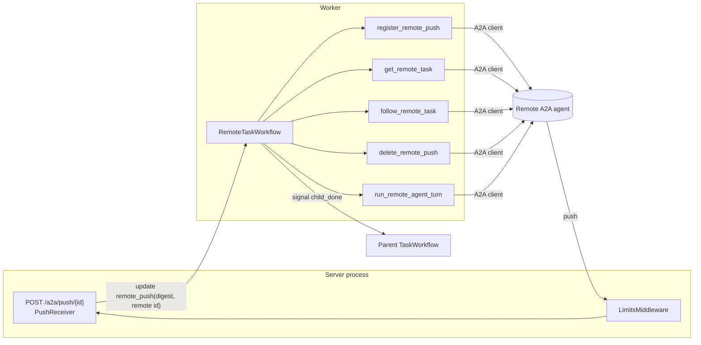
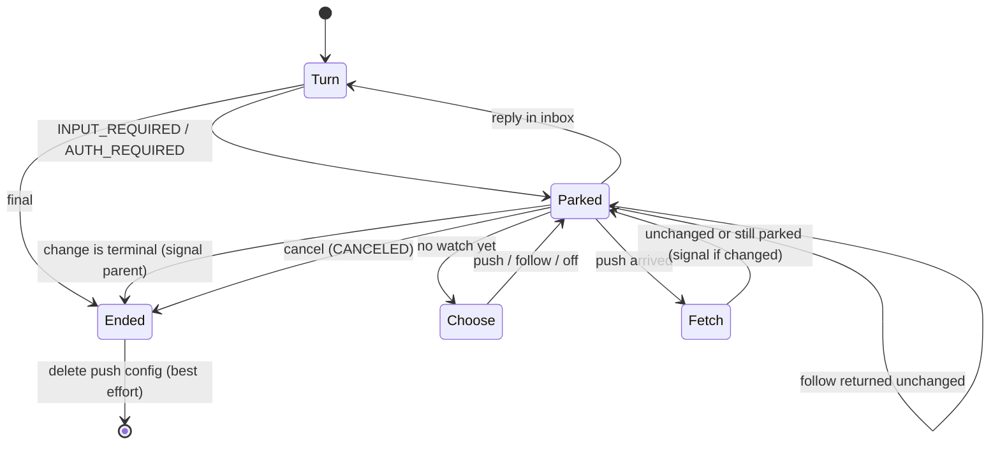

<!-- Written per the `the-loop:writing` skill: front-load each section's
     conclusion, draw it rather than describe it (3+ named parts -> a mermaid
     diagram), and keep the formal registers formal (EARS, abuse cases,
     RFC-2119, API contracts, schema descriptions). -->

# Design: Remote sub-tasks hear remote state changes between turns

> Phase 2 of 3, derived from [`requirements.md`](requirements.md). Reviewed together with
> [`testing-plan.md`](testing-plan.md). Ticket
> [#27](https://github.com/MadaraUchiha-314/tiny-harness/issues/27), PR
> [#28](https://github.com/MadaraUchiha-314/tiny-harness/pull/28).

## Overview

The stand-in (`RemoteTaskWorkflow`) gains a **watch** between turns. When a turn ends
parked, the stand-in picks one of three watches once per remote task. An
activity makes the choice, because only an activity can see the agent's card and
configuration:

| Watch | When | How a change is heard |
|-------|------|-----------------------|
| `push` | `updates = "auto"`, the card advertises push, the server has a base URL, and registration succeeds | The remote agent POSTs to `/a2a/push/{local task id}`; the endpoint verifies the token and sends a `remote_push` **update** to the stand-in; the stand-in fetches the task with `GetTask` |
| `follow` | `updates = "follow"`, or `"auto"` without push, or a failed registration | A heartbeating activity holds `SubscribeToTask` open and returns the first change |
| `off` | `updates = "off"`, or the agent is not a `RemoteAgent` | None, as today |

**The push is a doorbell, not a message.** The stand-in never reads state from a push
body. It fetches the task from the agent it registered, so a forged or replayed push can
cause one extra `GetTask` and nothing else. **The token never enters workflow history.**
The registering activity generates it, hands it to the remote agent, and returns only its
SHA-256 digest. The endpoint hashes the presented token, and the update's **validator**
compares digests with `hmac.compare_digest`. Temporal records no update for a rejected
one. At most an empty workflow task is left: Temporal's test server persists it, while
servers with speculative workflow tasks drop it. A refused push therefore runs no
activity and changes no state.

## Architecture



### Stand-in state machine



## Components & interfaces

### Configuration (`tiny_harness/config.py`; R4)

```python
class RemoteAgentSpec(_Strict):
    id: str
    url: HttpUrl
    version: str | None = None
    updates: Literal["auto", "follow", "off"] = Field(
        default="auto",
        description="how a parked remote task's changes are heard: push when the card "
        "advertises it (auto), SubscribeToTask (follow), or not at all (off)",
    )
    follow_interval: timedelta = Field(
        default=timedelta(seconds=5),
        description="the pause before re-subscribing when a follow stream ends unchanged",
    )
    # validator: follow_interval >= 1 s, else ValueError -> ConfigError (status 2)
```

`build_runtime` passes both to `RemoteAgent.connect`.

### `RemoteAgent` (`harness/agents/remote.py`)

The constructor and `connect` take `updates` and `follow_interval` and keep them as
attributes. New methods are thin wrappers over the SDK client, with the same
`A2A-Extensions` context as `send_message`:

```python
@property
def push_supported(self) -> bool: ...          # card.capabilities.push_notifications
async def set_push_config(self, task_id: str, url: str, token: str) -> str: ...  # config id
async def delete_push_config(self, task_id: str, config_id: str) -> None: ...
async def get_task(self, task_id: str) -> Task: ...
def subscribe(self, task_id: str) -> AsyncIterator[A2AEvent]: ...
```

`set_push_config` sends `TaskPushNotificationConfig(task_id, url, token)` with no `id`,
and returns the id the remote assigned.

Each task-scoped call takes `participant=`, sent as `X-Participant-Id` beside
`A2A-Extensions` (R1.6). `send_message` takes it from the message's own `participant_id`.
Without it a tiny-harness peer answers "task not found" to every call after the first
message, including a reply to its question. That was a latent bug in replies to a parked
peer, which no earlier test reached. The workflow passes `start.config.agent` in
`RemoteTaskIn.participant`.

### Turn mapping, shared (`service/durable/activities.py`)

The mapping `_remote_turn` applies at the end of a stream moves into one function,
`remote_out(remote_task_id, state, sub_state, text)`. It maps `INPUT_REQUIRED ·
awaiting-next-message` to `COMPLETED` and sets `final`. Three readers use it: the turn,
`get_remote_task` (from a `Task`) and `follow_remote_task` (from each streamed event), so
all three report a change the same way (R2.5).

### New activities (`ActivityName`, `Activities`)

| Activity | In → Out | Timeouts and retries |
|----------|----------|----------------------|
| `register_remote_push` | `RemotePushIn(agent, remote_task_id)` → `RemoteWatch(mode, config_id, token_digest)` | short (30 s), one attempt: a failure falls back to `follow` inside the activity |
| `get_remote_task` | `RemoteTaskIn(agent, remote_task_id)` → `RemoteTurnOut` | short, up to 3 attempts; a final failure keeps the last state (fail closed) |
| `follow_remote_task` | `FollowIn(agent, remote_task_id, known_state, known_text)` → `FollowOut(changed, out)` | `start_to_close` = `FOLLOW_WINDOW` (10 min) + 1 min, heartbeat timeout from config, one attempt; cancellable |
| `delete_remote_push` | `RemotePushDelete(agent, remote_task_id, config_id)` → `None` | short, 2 attempts; failure logged and swallowed by the workflow |

`register_remote_push`:

1. Resolve the agent. If it is not a `RemoteAgent`, or `updates == "off"`, return
   `mode="off"`.
2. If `updates == "follow"`, or the card lacks push, or `Activities.push_base_url` is
   `None`, return `mode="follow"`.
3. Otherwise: `token = secrets.token_urlsafe(32)` (256 bits). Build the URL as
   `push_url(base, local task id)`, with the id percent-encoded, from `base_url` and the
   **local** id only (abuse case 9). Call `set_push_config`.
   - On success, return `mode="push"`, the config id and `sha256(token).hexdigest()`.
   - On any exception, log `"push registration failed for %s: %s"` with the agent id and
     the exception's type name (never its text, which could echo the request), and
     return `mode="follow"`.

   The token is a local variable that never leaves the activity.

`follow_remote_task` loops until `FOLLOW_WINDOW` elapses:

1. Open `agent.subscribe(remote_task_id)` and map each event through `remote_out`. The
   first whose `(state_name, text)` differs from the known pair is returned as
   `changed=True`.
2. If the stream ends unchanged, or raises an A2A or transport error, sleep
   `agent.follow_interval` and subscribe again.
3. A ticker inside `_heartbeating` sends a heartbeat throughout, so a cancel from the
   workflow is delivered within one heartbeat interval.
4. When the window elapses, return `changed=False`. The workflow then starts a new
   follow; the windowing keeps one activity from running forever.

`Activities.__init__` gains `push_base_url: str | None = None`. `running_harness` passes
`str(settings.server.base_url)`.

### `RemoteTaskWorkflow` (`service/durable/workflows.py`; R1–R3, R5)

New state: `watch: RemoteWatch | None`, `push_pending: bool`, `last: RemoteTurnOut`.

```python
@workflow.update
async def remote_push(self, push: PushIn) -> None:
    self.push_pending = True
    self.claimed = push.claimed_state      # a hint for re-fetching, never applied
    self.recheck = None

@remote_push.validator
def _check_push(self, push: PushIn) -> None:
    w = self.watch
    if self.closed or w is None or w.mode != "push" or not hmac.compare_digest(
        push.token_digest, w.token_digest
    ) or push.remote_task_id != self.remote_task_id:
        raise ValueError("push not accepted")   # one message for every refusal
```

`PushIn(token_digest, remote_task_id, claimed_state)`: the digest, never the token. The
receiver maps the body's state with `remote_out`, so the claim and a fetch compare like
for like.

**Re-fetch on disagreement (R2.9).** In testing, a tiny-harness remote pushed its
`CANCELED` event before its own `GetTask` showed it. The stand-in fetched, saw
`INPUT_REQUIRED`, and waited forever. So after a push-triggered fetch whose state differs
from `claimed`, the stand-in waits `PUSH_RECHECKS` (1 s, 2 s, 4 s) in turn and fetches
again, stopping when they agree or the delays run out. Every wait is interruptible by a
reply, a cancel or a new push, and a new push restarts the sequence. A forged push
therefore costs at most four `GetTask` calls.

The run loop becomes `turn → (final? end) → park → (reply? turn | ended? end)`. `_park`
works like this:

1. If `watch` is `None`, run `register_remote_push`. If the mode is `push`, set
   `push_pending = True` to reconcile once (R1.4).
2. Loop:
   - If the mode is `follow`, start `follow_remote_task` with
     `workflow.start_activity` and keep the handle.
   - `wait_condition(mailbox or cancel_reason or push_pending or follow done)`.
   - If a follow is running and the mailbox or a cancel woke the stand-in, cancel the
     follow and await it, suppressing `CancelledError` and `ActivityError` (R3.4).
     Then return to the caller, which handles the reply or the cancel as today.
   - If `push_pending`: clear it, run `get_remote_task`, and apply the result. On
     `ActivityError`, keep `last` (fail closed).
   - If the follow finished: when `changed`, apply its result. When the activity itself
     failed, wait `FOLLOW_RETRY` (5 s, interruptible) before the next follow. Within an
     activity, the agent's `follow_interval` paces re-subscription.
   - Apply means: if `(state_name, text)` differs from `last`, set the local state, call
     `_tell_parent`, and store `last`. If `final`, return `ended`.
3. `_end(state)` sets `closed = True`. It runs `delete_remote_push` when the watch is
   `push`, suppressing `ActivityError` (R5.1, R5.2), and returns the proto.

   Every exit goes through `_end`: a final turn, a final fetch or follow, and a cancel.
   `closed` is set first, so the validator refuses any push from that point (R5.3).

`run_remote_agent_turn` is unchanged apart from using `remote_out`.

### Parent `child_done` (R2.7)

```python
interrupted = done.state_name in ("INPUT_REQUIRED", "AUTH_REQUIRED")
if terminal or (remote and interrupted):
    self.notes.append(...)
```

The row update is unchanged. A remote child reporting `WORKING` moves the row and wakes no
model turn. The parent's `_rows()` already shows the row on its stream once it is idle.

### Push endpoint (`service/a2a/push.py`, `service/a2a/app.py`; R2.1–2.2)

```python
PUSH_PATH = "/a2a/push/{task_id}"
PUSH_TOKEN_HEADER = "X-A2A-Notification-Token"
MAX_PUSH_BYTES = 65_536

def push_url(base_url: str, task_id: str) -> str: ...
def token_digest(token: str) -> str: ...      # sha256 hex

class PushReceiver:
    """Verifies an inbound push and wakes its stand-in; answers an HTTP status."""
    def __init__(self, client: temporalio.client.Client) -> None: ...
    async def receive(self, task_id: str, token: str | None, body: bytes) -> int: ...
```

`receive` runs these checks in order, and every refusal is logged at INFO with the task id
and a category, never the token:

1. If `len(body) > MAX_PUSH_BYTES`, answer `413`.
2. If the token is missing or empty, answer `401`.
3. Parse the body as `StreamResponse` with `json_format.Parse`, ignoring unknown fields.
   Take the remote task id from `task.id`, `status_update.task_id`,
   `artifact_update.task_id` or `message.task_id`. If none is present or the body does
   not parse, answer `400`.
4. Call `client.get_workflow_handle(task_id).execute_update("remote_push",
   PushIn(token_digest(token), remote_id))`. **Any** exception (validator rejection,
   unknown workflow, a `TaskWorkflow` with no such handler, a closed workflow, an RPC
   error) answers `401`. Success answers `204`.

`create_app` also installs a filter on the SDK's `a2a.server.routes.jsonrpc_dispatcher`
logger. The filter drops its DEBUG `Request body: …` record, which would otherwise log
every push token a client registers with this server (abuse case 7).

`create_app` gains `push: PushReceiver | None = None`. When it is set, the route is
registered beside `/_monitor`, before the SDK's REST routes. The handler reads the
`Content-Length` header first and refuses an oversized body before reading it. The
global `LimitsMiddleware` already bounds the body at `max_request_bytes` and rate-limits
per peer (abuse case 5). `running_harness` constructs `PushReceiver(client)`.

## Data models

New frozen models in `service/durable/models.py`:

```python
class RemotePushIn(ActivityIn):     agent: str; remote_task_id: str; participant: str
class RemoteWatch(_Frozen):         mode: Literal["push", "follow", "off"]
                                    config_id: str = ""; token_digest: str = ""
class RemoteTaskIn(ActivityIn):     agent: str; remote_task_id: str; participant: str = ""
class FollowIn(ActivityIn):         agent: str; remote_task_id: str
                                    known_state: str; known_text: str = ""
class FollowOut(_Frozen):           changed: bool; out: RemoteTurnOut | None = None
class RemotePushDelete(ActivityIn): agent: str; remote_task_id: str; config_id: str
class PushIn(_Frozen):              token_digest: str; remote_task_id: str
```

`ActivityIn` already carries `task_id` (the local id) and `correlation_id`.

## Error handling

| Failure | Behaviour |
|---------|-----------|
| Registration raises | `follow`, logged without the token (R1.5) |
| `GetTask` fails after retries | keep the last state; the next push or reply tries again |
| Follow stream errors | re-subscribe after `follow_interval`, inside the activity |
| Follow activity fails or times out | `workflow.sleep(follow_interval)`, then a new follow |
| Delete fails | logged in the activity, swallowed in the workflow (R5.2) |
| Push to an ended stand-in | the validator refuses (`closed`), or Temporal reports the workflow complete → `401` |
| Worker restart while following | the follow activity's heartbeat times out; the workflow starts a new one |

## Security design

How each requirements-phase boundary is enforced:

| Boundary | Enforcement |
|----------|-------------|
| Network → push endpoint | `LimitsMiddleware` (size, per-peer rate) and then `MAX_PUSH_BYTES`. A token is required before any Temporal call. |
| Push endpoint → stand-in | The URL names the workflow. The update validator checks the digest in constant time, that the task id equals `remote_task_id`, `mode == "push"` and `not closed`. Only `RemoteTaskWorkflow` has the handler. Every refusal is one `401`. |
| Push body → state | Never applied. `push_pending` only triggers `GetTask` on the agent from the registry; the claimed state only decides whether to fetch again, up to three times (abuse case 6). |
| Token at rest | Generated and used inside `register_remote_push` only. History, the store and logs see `sha256(token)` alone. The SDK's request-body DEBUG log is filtered on the receiving server (abuse case 7). |
| Stand-in → remote agent | The existing card validation. The URL is built from `server.base_url` and the local id (abuse case 9). |
| Status text → parent model | Unchanged. A `child_done` summary becomes a sub-task note, which the model reads as data (abuse case 8). |

Abuse cases 1–4 map to the validator and the endpoint's refusal ordering. Case 5 maps to
the size checks and the parse step. Case 6 is the doorbell rule. Case 7 is the digest and
the activity boundary. Case 9 is `push_url`.

**Residual risks.** A peer that knows a running stand-in's id and its token can make the
harness call `GetTask` up to four times per push, for `rate_limit_per_minute` pushes a
minute. A remote agent that
leaks its own stored token gives the same, and nothing more. A remote agent can ignore
`DeleteTaskPushNotificationConfig`, but later pushes to an ended stand-in are refused.

## Testing strategy

The full matrix is in [`testing-plan.md`](testing-plan.md). In short:

- **Unit:** `push_url`, `token_digest`, `remote_out`, the config validators and the
  receiver's refusal ordering, against a fake client.
- **Integration:** two in-process harnesses on Temporal's test server. The remote
  harness's push sender is pointed at the local app over `httpx.ASGITransport`, so a real
  push travels the real route.
- **Security:** one negative test per abuse case.

## Trade-offs & decisions

- **Doorbell, not payload.** One `GetTask` per push buys immunity to forged and
  out-of-order pushes. Without it, a stale `WORKING` push arriving after the turn's
  stream would roll the row back.
- **An update with a validator, not query-then-signal.** Verification and wake-up are one
  atomic RPC. A rejected update writes no history, so a flood of bad pushes cannot grow
  a workflow's history.
- **SHA-256, not a slow hash.** The token is 256 random bits, so there is nothing to
  brute-force. Speed matters on the hot path.
- **A follow window.** A 10-minute window keeps `start_to_close` finite and lets a
  restarted worker pick the task up again.
- **No new dependency.** `hmac`, `hashlib` and `secrets` from the standard library; the
  A2A SDK client already offers every call.

## Open questions

None beyond those in `requirements.md`.
