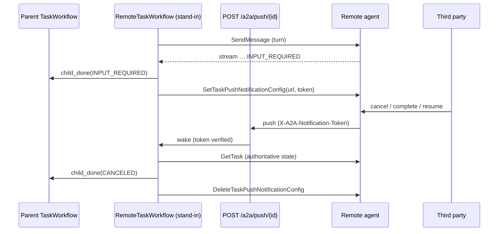

<!-- Written per the `the-loop:writing` skill: front-load each section's
     conclusion, draw it rather than describe it (3+ named parts -> a mermaid
     diagram), and keep the formal registers formal (EARS, abuse cases,
     RFC-2119, API contracts, schema descriptions). -->

# Requirements: Remote sub-tasks hear remote state changes between turns

> Phase 1 of 3 (requirements → design → tasks), following the Kiro spec approach
> (<https://kiro.dev/docs/specs/>). Ticket:
> [MadaraUchiha-314/tiny-harness#27](https://github.com/MadaraUchiha-314/tiny-harness/issues/27),
> a follow-up from #25 / PR #26.

## Introduction

When the harness delegates a sub-task to a remote A2A agent, a local stand-in workflow
(`RemoteTaskWorkflow`) drives the remote task. Each turn sends one message and streams
the remote task's events until the task parks (`INPUT_REQUIRED`, `AUTH_REQUIRED`) or
ends. The stand-in then signals the parent through `child_done` and waits for a reply.

**While the remote task is parked, nothing watches it.** If a third party completes,
cancels or resumes it on the remote side, the harness finds out only when it next sends
the task a message. Until then the parent's sub-task row is stale and the parent's model
is never told. Since PR #26 a local sub-task reports every state change to its parent;
a remote sub-task should too.

The harness already *sends* A2A push notifications to its own clients. It never
*registers* a push config on a remote task, and it has no endpoint to *receive* one.

This work item does three things:

1. **Push.** When the remote card advertises push notifications, the stand-in registers
   a push config on the remote task, pointing at a new endpoint on this server with a
   random per-task token. A push the endpoint accepts wakes the stand-in, which relays the
   change to the parent.
2. **Follow (fallback).** When the card advertises no push support, the stand-in keeps a
   `SubscribeToTask` stream open while the remote task is parked.
3. **Cleanup.** The push config is deleted when the remote task ends or the stand-in is
   cancelled.

## Requirements

### Requirement 1 — Register a push config on a parked remote task

**User story:** As an operator delegating to a remote agent that supports push, I want the
remote agent to tell my harness when its task changes, so that my harness need not poll.

#### Acceptance criteria (EARS)

1. WHERE the remote agent's card sets `capabilities.push_notifications` and the agent's
   configured update mode allows push, WHEN a turn ends with the remote task id known and
   the remote task not in a terminal state THEN the stand-in SHALL call
   `SetTaskPushNotificationConfig` on that task, once per remote task.
2. The registered config's URL SHALL be `<server.base_url>/a2a/push/<local task id>`.
3. The registered config SHALL carry a token of at least 256 bits from a
   cryptographically secure random source, unique to that stand-in.
4. WHEN the registration succeeds THEN the stand-in SHALL fetch the remote task once
   (`GetTask`), so that a change made between the end of the turn and the registration is
   not missed.
5. IF the registration fails THEN the stand-in SHALL log the failure without the token
   and SHALL fall back to following the task (Requirement 3).
6. On every call it makes on the remote task (send, get, subscribe, and set or delete a
   push config), the stand-in SHALL assert in `X-Participant-Id` the participant id it
   delegated as. A tiny-harness peer answers a task-scoped call only for a participant
   (decision-003). Without the header, every such call, including a reply to a parked
   peer's question, is answered "task not found".

### Requirement 2 — Receive a push and relay the change

**User story:** As a user whose agent delegated work, I want a remote sub-task that a third
party completes or cancels to show its new state on my task's stream, with no message sent
to it.

#### Acceptance criteria (EARS)

1. The server SHALL accept `POST /a2a/push/{task_id}` with an A2A `StreamResponse` JSON
   body and the token in the `X-A2A-Notification-Token` header, as the A2A SDK's push
   sender sends them.
2. WHEN a push carries the token registered for `{task_id}` and names the remote task that
   stand-in drives THEN the server SHALL wake that stand-in and answer `204`.
3. WHEN a stand-in is woken by a push THEN it SHALL fetch the remote task (`GetTask`) and
   take the task's state from that answer, not from the push body.
4. WHEN the fetched state or status text differs from what the stand-in last recorded THEN
   the stand-in SHALL update its own state and signal the parent through `child_done`.
   WHEN neither differs THEN it SHALL signal nothing.
5. A remote `INPUT_REQUIRED` with the sub-state `awaiting-next-message` SHALL be recorded
   as `COMPLETED`, as a turn's end already is (issue-25 R3.4).
6. WHEN the fetched state is terminal THEN the stand-in SHALL end in that state after
   signalling the parent.
7. WHEN the parent receives `child_done` for a remote child THEN it SHALL update the
   child's row, and SHALL add a note for its model only when the state is terminal,
   `INPUT_REQUIRED` or `AUTH_REQUIRED`. A remote child moving to `WORKING` SHALL update
   the row and SHALL NOT wake the parent's model.
8. WHEN a push arrives while a turn's stream is open THEN the stand-in SHALL apply it only
   after the turn ends, and only if the fetched state still differs.
9. WHEN the fetched state differs from the state the push's body claims THEN the stand-in
   SHALL fetch again after 1, 2 and 4 seconds, stopping early once the two agree. A remote
   agent may push before its own `GetTask` shows the change, and without the re-fetch that
   change would be lost until the next push.

### Requirement 3 — Follow a parked remote task when push is unavailable

**User story:** As an operator delegating to a remote agent without push support, or whose
server is not reachable from the remote agent, I want the harness to follow the parked
task itself.

#### Acceptance criteria (EARS)

1. WHEN a remote task is parked and push is not registered for it THEN the stand-in SHALL
   run a heartbeating activity that keeps `SubscribeToTask` open on the remote task.
2. WHEN that stream reports a state or status text different from the last recorded THEN
   the activity SHALL return it and the stand-in SHALL handle it as in Requirement 2.4–2.7.
3. WHEN the stream ends with no change, or the remote refuses the subscription, THEN the
   activity SHALL wait `follow_interval` before subscribing again, so that a remote whose
   stream closes at once is polled no faster than that interval.
4. WHEN a reply for the remote task reaches the stand-in's inbox, or the stand-in is
   cancelled, THEN the stand-in SHALL cancel the follow activity before acting.

### Requirement 4 — Choose how updates are heard, per agent

**User story:** As an operator, I want to choose per remote agent whether updates come by
push, by follow, or not at all, because a localhost `base_url` is unreachable from a
remote agent elsewhere.

#### Acceptance criteria (EARS)

1. Each `[[agents]]` entry SHALL accept `updates = "auto" | "follow" | "off"`, defaulting to
   `"auto"`, and SHALL reject any other value as a configuration error (status 2).
2. WHERE `updates = "auto"` the stand-in SHALL use push when the card advertises it, and
   follow otherwise.
3. WHERE `updates = "follow"` the stand-in SHALL follow and SHALL NOT register a push config.
4. WHERE `updates = "off"` the stand-in SHALL behave as it does today: it hears of a change
   only when it next sends a message.
5. A `follow_interval` duration per agent SHALL default to 5 seconds and SHALL be at least
   1 second.

### Requirement 5 — Clean up

**User story:** As the operator of the remote agent, I want push configs to disappear when
they are no longer useful.

#### Acceptance criteria (EARS)

1. WHEN the stand-in ends for any reason — a terminal state from a turn, a push or a
   follow, or a cancellation — and it registered a push config THEN it SHALL call
   `DeleteTaskPushNotificationConfig` for that config before it returns.
2. IF the deletion fails THEN the stand-in SHALL log the failure and still end in the
   state it reached.
3. WHEN a stand-in has ended THEN a push for its task id SHALL be refused (Requirement 6).

## Security considerations

This work item adds an **inbound network surface**: an endpoint that remote agents, and
anyone who can reach the server, can call. Everything that arrives on it is untrusted.

- **Actors & trust:**
  - The operator, who writes the configuration and registers remote agents, is trusted as
    today.
  - A registered remote agent is trusted to report its *own* task, through its A2A API.
  - A caller of `POST /a2a/push/...` is **untrusted** until its token checks out, and even
    then its body is untrusted data.
  - The remote task's status text stays untrusted model output, as remote turns already
    are.
- **Trust boundaries & data:**
  - *Network → push endpoint.* New. The token is the only credential.
  - *Push endpoint → stand-in workflow.* A verified push may only wake the stand-in its URL
    names. The state applied always comes from a `GetTask` the harness itself sends to the
    registered agent.
  - *Stand-in → remote agent.* Existing client, existing card validation. New calls:
    set, get and delete push config, and `SubscribeToTask`.
  - *Token at rest.* The token is a bearer credential to wake the stand-in. The remote
    agent stores it; the harness must not.
  - *Status text → parent's model.* As today, a note the model reads as data.
- **Abuse cases (EARS):**
  1. WHEN a push has no `X-A2A-Notification-Token` header, or a token that does not match
     the one registered for `{task_id}`, THEN the server SHALL answer `401`, SHALL record
     no update and run no activity in any workflow, and SHALL change no record or row.
  2. WHEN `{task_id}` names no running stand-in, a stand-in that registered no push
     config, or a workflow that is not a stand-in (a `TaskWorkflow`) THEN the server SHALL
     answer exactly as for a wrong token, so that the endpoint does not reveal which task
     ids exist.
  3. The token comparison SHALL take time independent of how much of the token matches.
  4. WHEN a push carries a valid token but names a remote task id other than the one its
     stand-in drives THEN the server SHALL refuse it as in abuse case 1.
  5. WHEN a push body is larger than 64 KiB, or is not a parseable `StreamResponse`,
     THEN the server SHALL refuse it with `413` or `400` and change nothing. The
     server-wide request size and per-peer rate limits SHALL apply to the endpoint too.
  6. WHEN an attacker with a valid token sends a push whose body claims a terminal state
     THEN the stand-in SHALL apply only the state its own `GetTask` returns, so that a
     leaked token can cause, at most, four `GetTask` calls per push (Requirement 2.9),
     with pushes bounded by the rate limit.
  7. The token SHALL NOT appear in logs, traces, workflow history, activity inputs or
     results, the store, or evidence. The harness SHALL keep only a SHA-256 digest of it.
     This includes the A2A SDK's own DEBUG log of each JSON-RPC request body, which on a
     tiny-harness server would hold every push token a client registers.
  8. WHEN the remote task's status text contains instructions THEN the parent SHALL pass
     it to the model only as a sub-task note, which the model reads as data, as today.
  9. The push config's URL SHALL be built from `server.base_url` and the local task id
     only, never from data the remote agent supplied.
- **Fail closed:**
  - Any failure to verify a push — missing token, wrong token, unknown task, ended task,
    malformed body, a Temporal error — SHALL leave every workflow unchanged.
  - A failure to register a push config SHALL fall back to follow, never to "accept
    unauthenticated pushes".
  - A stand-in that cannot reach the remote agent to fetch the task SHALL keep its last
    recorded state rather than apply the push body.

## Out of scope

- Authenticating the remote agent to us through `authentication` schemes in the push
  config (the token is the credential). Remote cards that declare security schemes
  stay refused, as today.
- Cancelling the remote task when the local stand-in is cancelled. Today's behaviour is
  kept: the local record is cancelled and the remote task is left alone.
- Push or follow for a remote task while a turn's stream is open; the stream already
  carries those events.
- Restoring push registrations for stand-ins that were running before an upgrade.

## Open questions

Resolved with reasonable defaults so the work can proceed; raise any of them on the PR.

1. **Push body as a hint.** This document takes the state from `GetTask`, not the push
   body (Requirement 2.3, abuse case 6). That costs one call per push and makes a leaked
   token nearly harmless. Applying the body directly would save the call.
2. **`updates` setting.** Requirement 4 adds a per-agent switch because a `base_url` that
   remote agents cannot reach would make push silently useless.
3. **Endpoint path.** `/a2a/push/{task_id}`, as the ticket suggested.
