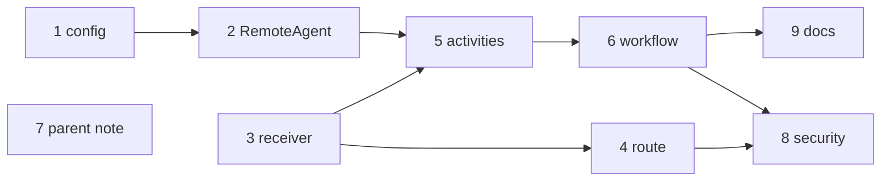

<!-- Written per the `the-loop:writing` skill. -->

# Tasks: Remote sub-tasks hear remote state changes between turns

> A DAG derived from [`design.md`](design.md) and [`testing-plan.md`](testing-plan.md).
> Each task's `_Test:_` names a row of the plan's matrix. Single repository; everything
> lands on PR #28.

There are nine tasks. Every task is test-first: write the named test, watch it fail, then
make it pass.

## Task list

- [x] 1. Configuration: `updates` and `follow_interval` on `RemoteAgentSpec`
  - Add the fields and the `>= 1 s` validator, and update the settings schema snapshot.
  - _Depends on:_ none
  - _Requirements:_ R4.1, R4.5
  - _Test:_ T1/T10 `tests/unit/test_config_agents.py`; T3 snapshot
- [ ] 2. `RemoteAgent`: settings plus push, get and subscribe wrappers
  - Constructor and `connect` take `updates` and `follow_interval`, and `build_runtime`
    passes them.
  - Add `push_supported`, `set_push_config`, `delete_push_config`, `get_task` and
    `subscribe`.
  - _Depends on:_ 1
  - _Requirements:_ R1.1, R3.1, R5.1
  - _Test:_ T2 (exercised end-to-end); T3 API snapshot
- [ ] 3. Push primitives and `PushReceiver`
  - In `service/a2a/push.py`: `push_url`, `token_digest`, `PushIn` (in durable models),
    `PushReceiver.receive` with the refusal ordering.
  - _Depends on:_ none
  - _Requirements:_ R2.1, R2.2; abuse cases 1–5, 9
  - _Test:_ T1 `tests/unit/test_push_receiver.py`
- [ ] 4. The push route in `create_app`, wired in `running_harness`
  - `POST /a2a/push/{task_id}` before the SDK routes, reading `Content-Length` first.
  - `running_harness` builds `PushReceiver(client)` and passes `push_base_url` to
    `Activities`.
  - _Depends on:_ 3
  - _Requirements:_ R2.1, abuse case 5
  - _Test:_ T8 `tests/security/test_remote_push.py` (route-level cases)
- [ ] 5. `remote_out` and the new activities
  - Factor `remote_out` out of `_remote_turn`.
  - Add `register_remote_push`, `get_remote_task`, `follow_remote_task` and
    `delete_remote_push`, with the new `ActivityName`s and models.
  - _Depends on:_ 2, 3
  - _Requirements:_ R1.1–1.3, R1.5, R2.3, R2.5, R3.1–3.3, R5.1
  - _Test:_ T1 `tests/unit/test_remote_out.py`; T2
- [ ] 6. `RemoteTaskWorkflow`: the watch, the `remote_push` update and its validator,
  `_park`, `_end`
  - _Depends on:_ 5
  - _Requirements:_ R1.4, R2.2–2.4, R2.6, R2.8, R3.4, R4.2–4.4, R5.1–5.3
  - _Test:_ T2 `tests/integration/agents/test_remote_updates.py`; T8
- [ ] 7. Parent `child_done`: note only on terminal or interrupted remote states
  - _Depends on:_ none
  - _Requirements:_ R2.7
  - _Test:_ T2 (row moves without a model turn on `WORKING`)
- [ ] 8. Security tests for every abuse case
  - Include the token-absence check over workflow history, captured logs and the store.
  - _Depends on:_ 4, 6
  - _Requirements:_ abuse cases 1–9
  - _Test:_ T8 `tests/security/test_remote_push.py`
- [ ] 9. Documentation
  - Update `docs/capabilities/remote-agents.md` and `a2a-server.md` (the endpoint), the
    configuration capability doc and the example config. Record them in
    `evidence/documentation.md`.
  - _Depends on:_ 6
  - _Requirements:_ all (capability docs)
  - _Test:_ T12 markdownlint

## Dependency graph (DAG)

## Checkpoints

- After 4: `uv run pytest tests/unit tests/contract`.
- After 7: `uv run pytest tests/integration -q`.
- After 9: `uv run pre-commit run --all-files`.
