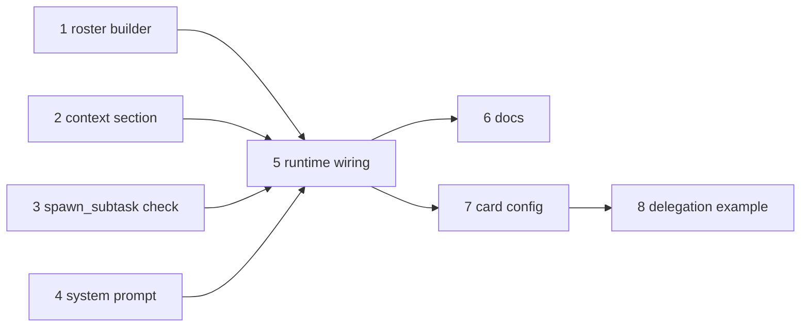

<!-- Written per the `the-loop:writing` skill: front-load each section's
     conclusion, draw it rather than describe it (3+ named parts -> a mermaid
     diagram), and keep the formal registers formal (EARS, abuse cases,
     RFC-2119, API contracts, schema descriptions). No length limit — length
     follows the change; the test is whether a sentence can come out without
     losing information. A gated section stays even when it is empty. -->

# Tasks: show the configured remote agents to the model

> The last spec artifact (requirements → design → testing plan → tasks). Derived from the
> approved [`design.md`](design.md) and [`testing-plan.md`](testing-plan.md). Six tasks:
> four independent building blocks, the runtime wiring that joins them, then the docs.

## Task list

Each task is test-first: write the test, watch it fail, then make it pass. Commands run
from the repository root.

- [x] 1. Agent roster builder (`tiny_harness/harness/agents/roster.py`)
  - `AgentRoster`, `clean_field`, `build_roster` and the caps, as in design
    § Components. Wrap a non-empty body with `render_untrusted_text(…, "agent-cards")`.
    `(no agents)` when empty. Export from `tiny_harness.harness.agents`.
  - Unit tests in `tests/unit/agents/test_roster.py`: ordering, fields, empty roster,
    `skills: (none)`, each cap and `…`, `(n more)`, the `truncated` report, no URL in
    the output.
  - Security tests in `tests/security/test_agent_roster.py`: abuse cases 1 (injected text
    only inside the untrusted block), 2 (`</agents>`, `</untrusted>`, newlines, control
    characters → one single-line entry) and 3 (10 kB description, 50 skills → within caps).
  - _Depends on:_ none
  - _Requirements:_ R1.2, R1.3, R1.4, R4.1, abuse cases 1–3
  - _Test:_ T1 — `uv run pytest tests/unit/agents/test_roster.py`; T8 —
    `uv run pytest tests/security/test_agent_roster.py` (red→green)

- [x] 2. `agents` section in the context window (`core/context.py`, `core/inprocess.py`)
  - `ORDER` gains `agents` after `participants`. `NEVER_COMPACT` gains `agents`.
    `ContextWindowManager.assemble(agents_roster=…)` adds the `STATIC` section.
    `InProcessOperations(agents_roster=…)` stores it and passes it through.
  - Unit tests in `tests/unit/core/`: the section is `STATIC`, never compacted, after
    `participants`, defaults to `(no agents)`, and `instructions()` is byte-identical
    across two turns.
  - _Depends on:_ none
  - _Requirements:_ R1.1, R1.4, R1.5, R1.7
  - _Test:_ T1 — `uv run pytest tests/unit/core -k agents` (red→green)

- [x] 3. `spawn_subtask` refuses an unknown agent (`core/intrinsics.py`, `core/inprocess.py`, `tools/intrinsics.py`)
  - `core_intrinsics(context, *, known_agents=…)`. In `bind()`, pass a callable that
    reads `registry.list(EntityKind.AGENT)`. Unknown or empty `agent` returns
    `ToolResult.error(…, "agent.unknown", …)` listing the valid ids, with no command.
  - New `SpawnSubtaskArgs.agent` description. Regenerate
    `docs/a2a/ext/intrinsics/spawn_subtask.json` with `UPDATE_API_SNAPSHOTS=1`.
  - Unit tests: unknown, empty, known and null `agent`. Security test (abuse case 4):
    `agent="https://evil.example"` → `agent.unknown`, no command, no HTTP request.
  - _Depends on:_ none
  - _Requirements:_ R2.2, R3.1, R3.2, R3.3, abuse case 4
  - _Test:_ T1 — `uv run pytest tests/unit/core -k spawn`; T3 —
    `uv run pytest tests/contract/test_intrinsic_schemas.py`; T8 —
    `uv run pytest tests/security/test_agent_roster.py -k unknown` (red→green)

- [x] 4. System prompt `## agents` section (`systemprompt.md`, `prompts/entity.py`)
  - Add the section text from design § System prompt between `skills` and `rules`.
    `SECTION_ORDER` gains `agents` in the same place.
  - Unit tests in `tests/unit/prompts/`: the section exists and states each R2.1
    point. A prompt with `extends: agents` appends to it.
  - _Depends on:_ none
  - _Requirements:_ R2.1, R2.3
  - _Test:_ T1 — `uv run pytest tests/unit/prompts`; T3 —
    `uv run pytest tests/contract/test_prompts_api.py` (red→green)

- [x] 5. Wire the roster into `build_runtime` (`service/runtime.py`)
  - After the agents are registered: build the roster, log `INFO` with the ids, log one
    `WARNING` per truncation, and pass `roster.text` to `InProcessOperations`.
  - Integration tests in `tests/integration/agents/test_agents_roster.py`, each with a
    Gherkin docstring and a `Requirement:` link, for the five T2 scenarios and the T8
    hostile-card scenario in `testing-plan.md`. Use a fake A2A agent and `FakeLLM`.
  - Update the public-API snapshots (`tests/contract/snapshots/`) for the new names, on
    purpose, and check nothing else changed.
  - _Depends on:_ 1, 2, 3, 4
  - _Requirements:_ R1.1, R1.6, R3.1, R3.2, R4.2, NFR both engines, NFR observability
  - _Test:_ T2 — `uv run pytest tests/integration/agents/test_agents_roster.py`; T3 —
    `uv run pytest tests/contract` (red→green)

- [x] 6. Documentation
  - Capability docs: `remote-agents.md` (the roster, the unknown-id refusal),
    `context-window.md` (the `agents` section), `prompts-and-skills.md` (the `agents`
    prompt section), each with an issue-34 history row.
  - User docs, following `.agents/skills/docs-writing/SKILL.md`:
    `docs/configuration/plugins-and-agents.md`, which explains what the model sees for each
    configured agent and why a good card description matters.
  - Record both in `docs/specs/issue-34/evidence/documentation.md`.
  - _Depends on:_ 5
  - _Requirements:_ NFR docs
  - _Test:_ `uv run pre-commit run --all-files` (markdownlint) and
    `cd docs && bun run docs:build` (no dead links)

- [x] 7. `[card]` configures this agent's own card (`config.py`, `service/a2a/card.py`, `service/process.py`)
  - Added after approval, from PR review (R5). `CardConfig`, `CardSkillConfig`,
    `Settings.card`; `describe()`; `serve` builds the card from `describe(settings.card)`.
  - Unit tests in `tests/unit/test_config_card.py`; the scenario _"A tiny-harness
    described by its card section is listed by another"_; the settings schema and config
    API snapshots regenerated on purpose.
  - Docs: `[card]` in `docs/configuration/plugins-and-agents.md`, the `configuration`
    and `a2a-server` capability docs.
  - _Depends on:_ 5
  - _Requirements:_ R5.1–R5.4
  - _Test:_ T12 (red→green)

- [x] 8. The delegation example (`examples/delegation/`, `docs/sdk/example-delegation.md`)
  - Added after approval, from PR review (R6). The ledger and front-desk configurations,
    the ledger's read-only plugin, the README, the guide and its sidebar entry.
  - _Depends on:_ 7
  - _Requirements:_ R6.1–R6.3
  - _Test:_ T12 (the example configs load and pair up); T13 (run with a real model)

## Dependency graph (DAG)

Tasks 1–4 touch separate files and can run in any order.

## Checkpoints

- After each task: its own tests, then `uv run pre-commit run --all-files` (ruff, pyright,
  unit tests, markdownlint), then a commit that names the task and its red→green.
- After task 5: `uv run pytest tests/integration tests/contract tests/security tests/ui`,
  the CI set.
- After task 6: the docs build.
- Then the `verification` node runs `testing-plan.md` (including the manual T11). The
  review phases follow: self and critic rounds and the security review gate, recorded
  in `evidence/`.

## Review comments

> Appended by the-loop's `record-feedback` hook when a human gate approves with
> comments (issue-109). Append-only and attributed: an approval never silently
> discards a reviewer's suggestions, and the feedback travels with the document
> it concerns rather than living in a side-channel tracker.
