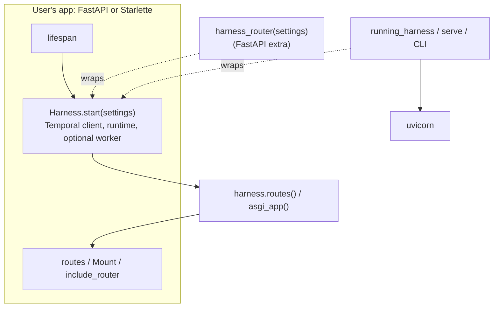

# Brainstorm: mount tiny-harness onto an existing Python web app

> Phase 0, the root artifact. A scratchpad: nothing here is a commitment until the
> author says the direction is settled. `requirements.md` is derived from it.

## Problem / opportunity

[Issue #36](https://github.com/MadaraUchiha-314/tiny-harness/issues/36): a Python
application that already runs a FastAPI or Starlette app cannot add tiny-harness to it.
The harness only offers whole-process entry points, and they own too much.

Today the SDK user has two choices, and both take over the process:

- `running_harness(settings)` starts Temporal, builds the runtime, starts the worker,
  **and starts its own uvicorn server** on `[server] bind`
  (`tiny_harness/service/process.py`).
- `serve(settings)` does the same and blocks until SIGTERM.

The ASGI app itself is built by `create_app(handler, card, config=…)` in
`tiny_harness/service/a2a/app.py`. That function is not exported. It also needs a
`HarnessRequestHandler`, an `AgentCard`, a push receiver and a monitor source, and only
`running_harness` knows how to build those.

So the user cannot:

- serve the agent on the **same port and process** as their own app;
- put it under a **path prefix** (`/agents/support`);
- use **their own authentication**: the harness reads identity only from the
  self-asserted `X-Participant-Id` header (decision-003), and the deploy guide asks for a
  separate gateway;
- use **their own middleware**, or turn off ours: limits and CORS are always installed;
- tie the harness's **lifecycle** to their app's lifespan instead of a context manager
  around uvicorn;
- see the A2A routes in **their app's OpenAPI docs**.

The prior art the issue names is a2a-python's
[`add_a2a_routes_to_fastapi`](https://github.com/a2aproject/a2a-python/blob/main/src/a2a/server/routes/fastapi_routes.py).
It takes the SDK's route lists (`create_agent_card_routes`, `create_jsonrpc_routes`,
`create_rest_routes`) and attaches them to a caller's `FastAPI` app as `APIRoute`s, so
they show in `/docs`. The caller owns the app, the server and the lifecycle; the SDK
only contributes routes.

## Context & constraints

- **The server does not run the agent.** A request update-with-starts a Temporal
  workflow and streams its event log back. The worker is a separate concern. So a
  mounted app needs a **Temporal client** and the **runtime** (store, command registry,
  redactor, card), but not necessarily a worker.
- **Async setup.** Connecting to Temporal, building the runtime (MCP sources, plugins)
  and publishing commands are async. They must happen in a lifespan, not at import time.
- **Starlette `Mount` does not run a sub-app's lifespan.** A mounted sub-application's
  startup never fires. So "return an app with its own lifespan" alone is not enough; the
  host must call our lifespan, or we must hand them routes plus a lifespan to compose.
  FastAPI can merge a router's lifespan through `include_router` (to confirm for the
  version we pin in design).
- **The agent card carries the public URL.** Mounted under a prefix, the card's
  interface URLs and the push callback base (`base_url` + `/a2a/push/{task_id}`) must
  include that prefix, or remote agents push to the wrong place.
- **`/.well-known/agent-card.json` at the origin root.** Mounted under a prefix, the
  card is at `<prefix>/.well-known/agent-card.json`. A2A clients resolve the card from
  the URL they are given, so this works if the user hands out the prefixed URL. Several
  agents in one app each get their own prefix.
- **Identity is self-asserted today** (decision-003). A host app with real auth wants to
  map *its* authenticated user to the participant id. `HarnessContextBuilder` is already
  the seam: it copies the header into `ServerCallContext.state`.
- **No `Any`, strict pyright** (R22.2). FastAPI is not a dependency today; a2a-sdk's
  FastAPI helper needs the `a2a-sdk[fastapi]` extra.
- **Keep the CLI unchanged.** `tiny-harness serve` and `tui` keep working as they do;
  they should be rebuilt *on* the new pieces (dogfooding), not beside them.
- The SQLite store and the polling event bridge stay single-host. This item does not
  change that.

## Ideas & options

- **Option A — export `create_app` as is.** Make the existing factory public and
  document how to build its arguments.
  Cons: the user must build a handler, executor, bridge, push store and card by hand:
  about 60 lines of internals copied from `running_harness`. Struck: it exposes
  internals without making them usable.

- **Option B — a `Harness` object with a lifespan, which then produces an ASGI app.**
  Split `running_harness` into two parts:

  1. `Harness.start(settings, …)`: an async context manager that connects Temporal,
     builds the runtime, and optionally starts the worker. It serves nothing.
  2. Methods on the started harness: `harness.asgi_app(prefix=…, …)` returns a
     Starlette app to `Mount`; `harness.routes(…)` returns the route list.

  The host app calls `Harness.start` in its own lifespan. `running_harness` becomes
  `Harness.start` plus uvicorn.
  Pros: one object, clear lifecycle, works for Starlette and FastAPI.
  Cons: the user must write the lifespan wiring (about 5 lines).

- **Option C — a lifespan-carrying sub-app (`create_harness_app(settings)`).** One call
  returns a Starlette app whose lifespan builds everything.
  Cons: `Mount` drops the sub-app's lifespan, so this only works as the top-level app or
  with the user forwarding the lifespan by hand. Could exist as a convenience on top of
  B for the "the harness *is* my app" case.

- **Option D — a FastAPI `APIRouter` (`harness_router(settings)`).** A router with a
  lifespan; `app.include_router(router, prefix="/agents/support")` merges the lifespan
  and the routes show in `/docs`, like a2a-python's helper.
  Pros: the one-line integration the issue asks for, for FastAPI users.
  Cons: needs FastAPI (an optional extra); Starlette-only users still need B.

- **Option E — routes only, the user brings every dependency.** Like a2a-python: the
  user passes a Temporal client, a store, a card. Most flexible, least helpful. Fits as
  the lowest layer under B, not as the public story.

**Customization points** to offer on whichever option wins (each a keyword argument):

| Point | Today | Proposed |
|-------|-------|----------|
| Path prefix / public URL | `[server] base_url` only | the mount prefix flows into the card and the push base URL |
| Identity | `X-Participant-Id` header | a `participant` callable: `Request -> str \| None` (the header stays the default) |
| Middleware | limits and CORS always on | on by default; the user can turn each off and use their own |
| Extra routes | `/_monitor`, `/a2a/push/…`, `/ui` always / by config | each can be turned off |
| Temporal client | always created by us | pass your own client, or let us connect |
| Worker | in-process or not, by flag | the same flag |
| Agent card | built from `AgentDescription()` | pass an `AgentDescription` (name, description, skills) |
| OpenAPI | none | FastAPI helper tags the routes, like a2a-python |

## Sketches & notes

Layering, if B + D win:



Starlette (Option B):

```python
@asynccontextmanager
async def lifespan(app: Starlette):
    async with Harness.start(settings, with_worker=True) as harness:
        app.router.routes.append(Mount("/agents/support", app=harness.asgi_app()))
        yield

app = Starlette(routes=[...], lifespan=lifespan)
```

FastAPI (Option D):

```python
app = FastAPI()
app.include_router(
    harness_router(settings, participant=lambda r: r.state.user.id),
    prefix="/agents/support",
)
```

Mounting after startup (inside the lifespan) is awkward. A variant: `Harness(settings)`
is built synchronously and holds no connection; `asgi_app()` can be mounted at
definition time and answers 503 until the lifespan has started it. That keeps the
routing table static.

## Open questions

1. **Which shape is the public story?** Lean: B (Starlette, the base) plus D (FastAPI
   router as an optional extra, `tiny_harness[fastapi]`). Is FastAPI as an optional
   extra acceptable, or should it be a core dependency?
2. **Static routes or late mount?** Should the app be mountable at definition time
   (answers 503 until started), or is mounting inside the lifespan fine?
3. **Identity hook.** Is a `Request -> participant id` callable the right seam for the
   host's auth? Should the header fallback be off when a callable is given, so a client
   cannot assert another identity?
4. **Several agents per app?** Two harnesses with different settings under two
   prefixes in one process. In scope, or later? (They would share or split a Temporal
   client and task queue.)
   **Answered: in scope, and the main acceptance test.** Five configs give five
   agents on five paths in one service, and each can call the others through its
   `[[agents]]` config
   ([PR #37 comment](https://github.com/MadaraUchiha-314/tiny-harness/pull/37#issuecomment-6150070351)).
   Today that collides on the task queue, task lookup, the heartbeat schedule id, the
   agent's participant id and embedded Temporal; `requirements.md` R5 removes them.
5. **Prefix discovery.** Take the prefix as an argument, or read `root_path` from the
   ASGI scope per request? The card is built once, so an argument is simpler.
6. **Back compatibility.** Keep `running_harness` and `serve` with the same signatures,
   re-implemented on the new pieces? Lean: yes.
7. **OpenAPI.** Must the A2A routes show in the host's `/docs`?

## Leaning / working hypothesis

Ship **B + D**, with **E as the internal layer**:

- A public `Harness` with an async `start` lifecycle that serves nothing, and an
  `asgi_app()` / `routes()` that the user mounts on their app.
- A FastAPI `harness_router()` in an optional extra that merges the lifespan and puts the
  routes in `/docs`.
- Customization by keyword: prefix, participant callable, middleware toggles, optional
  routes, own Temporal client, worker flag, agent description.
- `running_harness`, `serve` and the CLI rebuilt on `Harness`, unchanged in behaviour.

## Hand-off → requirements

To fill in when the open questions are answered: the chosen API shape, a user story per
persona (Starlette user, FastAPI user, existing SDK user who must not break), and the
constraints that become acceptance criteria (prefix in the card, lifespan behaviour,
identity hook, no change to the CLI). Security: the identity hook moves the trust
boundary from "a gateway in front" to "the host app's auth", and that needs its own
section in requirements.

## Review comments

> Appended by the-loop's `record-feedback` hook when a human gate approves with
> comments (issue-109). Append-only and attributed.
