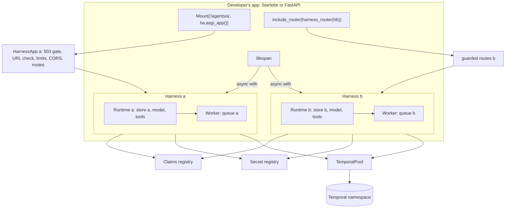
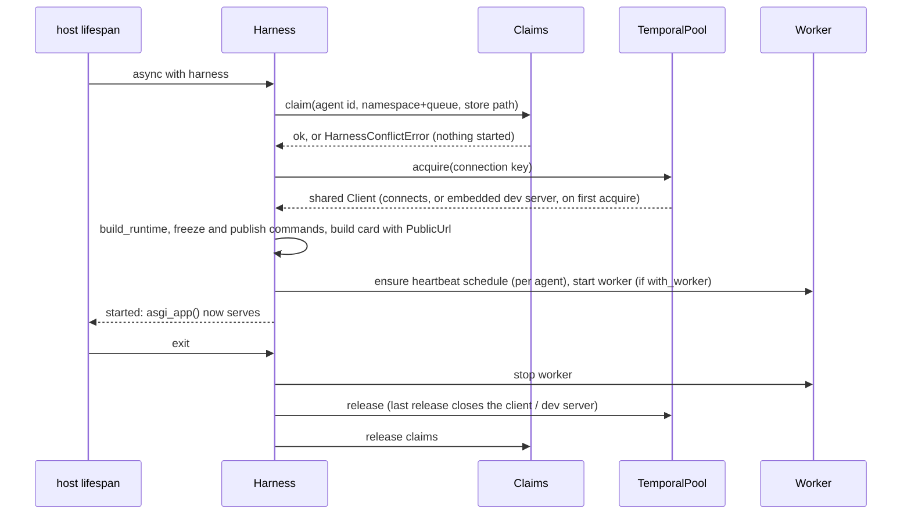
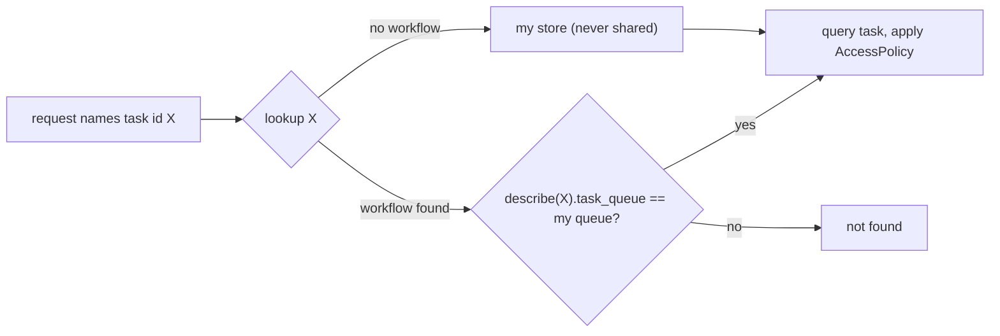

<!-- Written per the `the-loop:writing` skill: front-load each section's
     conclusion, draw it rather than describe it (3+ named parts -> a mermaid
     diagram), and keep the formal registers formal (EARS, abuse cases,
     RFC-2119, API contracts, schema descriptions). -->

# Design: mount tiny-harness agents onto an existing FastAPI or Starlette app

> Phase 2 of 3 (requirements → design → tasks). Derives from the approved
> [`requirements.md`](requirements.md). Reviewed with [`testing-plan.md`](testing-plan.md)
> at the one `design-approval` gate.

## Overview

`running_harness` is split into two parts:

1. **`Harness`.** A new public class. It holds one agent's `Settings` and options, and
   has an async lifecycle (`async with harness:`). The lifecycle connects Temporal, builds
   the runtime and starts the worker. It opens no port.
2. **`harness.asgi_app()`.** A Starlette app for the developer to mount. It exists from
   construction and answers `503` until the harness has started. For FastAPI,
   `tiny_harness.fastapi.harness_router(harness)` turns the same routes into an
   `APIRouter` that carries the lifespan and shows in `/docs`.

`running_harness`, `serve` and the CLI become a thin layer: a `Harness` plus a uvicorn
server.

Several harnesses in one process are isolated by these mechanisms:

- **The task queue marks ownership.** Each agent has its own queue, and the queue
  defaults to the agent id. Before an agent answers for a task or a push, it checks that
  the task's workflow runs on its own queue.
- **A process-wide claims registry.** It refuses a second harness with the same agent
  id, the same namespace and queue, or the same store file.
- **A reference-counted Temporal pool.** Harnesses with the same connection settings
  share one client. In embedded mode they share one dev server.
- **A process-wide secrets registry.** Every redactor masks the secrets of every agent
  in the process.

Agents in one service call each other over HTTP through their mounted routes, the same
way as between services.

| Requirement | Component(s) |
|-------------|--------------|
| R1 Start without a server | `Harness` (`service/harness.py`), `TemporalPool` |
| R2 Mount on Starlette | `HarnessApp`, `build_routes`, `PublicUrl` (`service/a2a/app.py`) |
| R3 FastAPI | `tiny_harness/fastapi.py` (`harness_router`), extra `tiny_harness[fastapi]` |
| R4 Customize | `HarnessContextBuilder` (resolver), `RouteOptions`, `AgentConfig` |
| R5 Several agents | `Claims`, `TemporalPool`, owner checks in `TemporalTaskStore` and `PushReceiver`, per-agent heartbeat, `SecretRegistry` |
| R6 Agents call each other | `PublicUrl` in the card and the push URL; the unchanged `RemoteAgent` path; `examples/multi_agent/` |
| R7 No change for existing users | `running_harness` and `serve` rebuilt on `Harness`; defaults equal to today's |
| R8 Docs | `docs/sdk/mount.md`, `docs/configuration/agent.md`, deploy guide, capability docs |

## Architecture



### Startup and shutdown



Each start step is pushed onto an `AsyncExitStack` as it succeeds. A failure part-way
undoes exactly the steps that ran, in reverse order, and the claims are released last.

## Components & interfaces

### `Harness` — `tiny_harness/service/harness.py` (R1, R4.6, R5)

```python
class Harness:
    def __init__(
        self,
        settings: Settings,
        *,
        client: Client | None = None,          # R1.3: yours, never closed by us
        with_worker: bool = True,
        prefix: str | None = None,             # R2.4
        participant: ParticipantResolver | None = None,   # R4.1
        routes: RouteOptions = RouteOptions(),            # R4.4, R4.5
        agent: AgentDescription | None = None,            # R4.6, in code; else [agent]
        plugins: Sequence[Plugin | Path] = (),
        commands: Iterable[tuple[CommandSpec, CommandHandler]] = (),
        builtin_commands: bool = True,
        llm: LLM | None = None,                # build_runtime's existing seam: a custom or scripted model
        log_stream: TextIO | None = None,
    ) -> None: ...

    async def __aenter__(self) -> Self: ...     # start; raises HarnessConflictError, ConfigError
    async def __aexit__(self, *exc: object) -> None: ...
    def lifespan(self, app: object) -> AbstractAsyncContextManager[None]: ...  # Starlette/FastAPI shape

    @property
    def started(self) -> bool: ...
    @property
    def agent_id(self) -> str: ...
    @property
    def public_url(self) -> str: ...            # base_url with the prefix, no trailing slash
    @property
    def client(self) -> Client: ...             # raises HarnessNotStartedError before start
    def asgi_app(self) -> HarnessApp: ...       # the same object on every call

def harnesses_lifespan(*harnesses: Harness) -> Callable[[object], AbstractAsyncContextManager[None]]:
    """One lifespan that starts every harness in order and stops them in reverse."""
```

- `Harness` is exported from `tiny_harness.service`, through the same lazy `_EXPORTS`
  map as `running_harness`.
- The constructor does no I/O. It validates the prefix against `base_url` (R2.4) and
  computes `public_url`, so a mismatch fails at construction, before any lifespan runs.
- `__aenter__` raises `HarnessAlreadyStartedError` when called a second time, and
  `HarnessStoppedError` when called after exit. A `Harness` runs once.
- `asgi_app()` and `harness_router()` read the options passed to the constructor. Every
  option is set in one place, so the app and the runtime cannot disagree. One example:
  `routes.push=False` must also turn off push registration on remote tasks (R4.5).
- `ParticipantResolver = Callable[[Request], str | None]`. It is synchronous because the
  SDK's `ServerCallContextBuilder.build` is synchronous. Host auth middleware has
  already put the user on `request.state` or `request.scope["user"]` by then.

### `RouteOptions` (R4.4, R4.5)

```python
@dataclass(frozen=True)
class RouteOptions:
    limits: bool = True      # LimitsMiddleware (max_request_bytes, rate_limit_per_minute)
    cors: bool = True        # CORSMiddleware when [server] cors_origins is set
    monitor: bool = True     # GET /_monitor
    push: bool = True        # POST /a2a/push/{task_id}; False ⇒ remote agents use follow
    ui: bool = True          # /ui when [server] ui_dir is set
```

When `push=False`, `Activities` is built with `push_base_url=None`. The existing branch
in `activities.py` (`if agent.updates == "follow" or not agent.push_supported or not
self.push_base_url`) then uses follow, so nothing new is needed there.

### `HarnessApp` and `build_routes` — `tiny_harness/service/a2a/app.py` (R2, R4)

`create_app` is replaced by two functions:

- `build_routes(handler: RequestHandler, card: CardSource, *, options, monitor, push)`
  returns the route list. Every route is built **at definition time** against a
  `DeferredRequestHandler`. That is an SDK `RequestHandler` whose methods delegate to
  the real `HarnessRequestHandler` once `start` sets it. The card route uses the SDK's
  `create_agent_card_routes(placeholder, card_modifier=…)`, and the modifier returns
  the card built at start. Route order is kept from today: the card, `/_monitor`,
  push, `/ui`, then JSON-RPC at `/` and HTTP+JSON.
- `HarnessApp` is an ASGI callable. It holds a Starlette app over those routes, wrapped
  in limits and CORS as `RouteOptions` say, and adds three behaviours:
  1. **The 503 gate (R2.2).** WHILE the harness is not started, every `http` request is
     answered `503 {"error": "agent <id> is not started"}`. The gate reads one boolean,
     and the request reaches no route.
  2. **Lifespan when top-level.** A `lifespan` scope starts and stops the harness unless
     something else already started it. So `uvicorn.run(Harness(s).asgi_app())` works.
     Under a `Mount`, Starlette never sends this scope; the host's lifespan starts the
     harness instead.
  3. **The mount check.** On the first request, `scope["root_path"]` must end with the
     configured prefix. IF it does not THEN the app answers `500`, logs once
     `agent <id> is mounted at <root_path> but configured for <prefix>`, and keeps
     refusing. A wrong mount would put wrong URLs in the card, and a remote agent would
     then push to the wrong place.

`HarnessContextBuilder` gains the resolver:

```python
class HarnessContextBuilder(DefaultServerCallContextBuilder):
    def __init__(self, resolver: ParticipantResolver | None = None) -> None: ...
    def build(self, request: Request) -> ServerCallContext:
        context = super().build(request)
        if self._resolver is None:                      # today's behaviour (decision-003)
            value = request.headers.get(PARTICIPANT_HEADER)
        else:
            context.state[STRICT_STATE_KEY] = True      # the header is never read
            value = self._resolver(request)             # raises ⇒ 500, no fallback
        if value:
            context.state[PARTICIPANT_STATE_KEY] = value
        return context
```

`sender_of` in `executor.py` reads `STRICT_STATE_KEY`. In strict mode the message's own
`participant_id` claim is never trusted on its own: with no resolved participant the
message is refused (`no participant asserted`). This refines R4.3. Task access is
exactly as with no header (`AccessPolicy` denies). A message, though, cannot fall back
to its self-claimed metadata. That fallback would be a header bypass, and abuse case 1
forbids it.

### `PublicUrl` (R2.3, R2.4, R6)

`public_url(base_url, prefix) -> str`:

| `base_url` path | `prefix` | Result |
|-----------------|----------|--------|
| `/` or empty | none | `base_url` (today) |
| `/` or empty | `/agents/a` | `base_url` + `/agents/a` |
| `/agents/a` | none or `/agents/a` | `base_url` |
| `/agents/a` | `/agents/b` | `ConfigError` naming both |

A prefix is normalized: it gets a leading `/` and no trailing `/`, and `/` alone counts
as no prefix. `build_agent_card` and `Activities(push_base_url=…)` take `public_url`.
The card's interfaces are `<public_url>/` for JSON-RPC and `<public_url>` for HTTP+JSON,
so a client given the prefixed URL finds the card at
`<public_url>/.well-known/agent-card.json`.

### FastAPI — `tiny_harness/fastapi.py` (R3)

```python
def harness_router(harness: Harness, *, tags: Sequence[str] | None = None) -> APIRouter:
    """The harness's routes as an APIRouter with the harness's lifespan.
    Include it with ``app.include_router(router)``. The prefix is the harness's own."""
```

- The module imports `fastapi` at the top. With no FastAPI installed, it raises
  `ImportError("tiny_harness.fastapi needs FastAPI: pip install 'tiny_harness[fastapi]'")`
  (R3.4). `pyproject.toml` gains `[project.optional-dependencies] fastapi =
  ["a2a-sdk[fastapi]>=1.2.2"]`, and the dev group installs it, so tests and pyright see
  it.
- **Routes and OpenAPI (R3.3).** The routes from `build_routes` go through a2a-sdk's
  public `add_a2a_routes_to_fastapi`, applied to a scratch `FastAPI()`. That adds the
  tags and request body schemas. The path, endpoint, methods and `openapi_extra` of
  each resulting `APIRoute` are re-added to an
  `APIRouter(prefix=harness.prefix, lifespan=…)` with `add_api_route`. That call is
  what applies the router prefix: a route appended to `router.routes` directly keeps
  its bare path. The default tag is
  `A2A: <agent id>`, so five agents show as five groups.
- **The 503 gate and limits per route.** A router cannot carry ASGI middleware. A
  custom route class's `app` does not help either: a probe on FastAPI 0.143 showed that
  `include_router` no longer copies routes (it wraps the router in `_IncludedRouter`) and
  that it ignores an overridden `APIRoute.app`. So the router gets router-level
  `dependencies`:
  - `Depends(gate)` raises `503` while the harness is not started.
  - `Depends(limits)` enforces `rate_limit_per_minute` and a declared `Content-Length`
    over `max_request_bytes` (`413`). It shares one limiter state across the
    harness's routes.
  - A body with no declared length is read by the endpoint wrapper through a bounded
    stream. The wrapper stops at `max_request_bytes` with `413`, and the read body is
    cached on the request for the SDK.
  - `RouteOptions.limits=False` drops the second dependency and the bound.
- **The prefix (R3.2).** The router carries `harness.prefix`. The developer includes it
  **without** a further prefix. The same check as the mount check runs on the first
  request, against `request.url.path`, because an include prefix sets no `root_path`.
  IF the path does not start with `<base path><harness prefix>` THEN the request
  answers `500`, an ERROR is logged once naming both paths, and every later request is
  refused. So the P of R3.2 is set once, on the harness, and a different include prefix
  fails closed. Requirement 2.3 then holds.
- **What the router does not carry.** CORS is application-wide in Starlette, so the
  router cannot apply it. IF `[server] cors_origins` is set THEN the router's lifespan
  logs a warning telling the developer to add `CORSMiddleware` to their app. The same
  goes for `/ui`: FastAPI's `include_router` drops a `Mount`, so `ui_dir` gets a
  warning and is not served. The docs say both.
- The router's lifespan is `harness.lifespan`. FastAPI 0.143 merges a router's lifespan
  in `include_router` (`_merge_lifespan_context`), as a probe confirmed. The extra pins
  `fastapi>=0.143`, and the testing plan proves the merge.

### `AgentConfig` and the task queue default — `tiny_harness/config.py` (R4.6, R5.3, R7.2)

```python
class AgentConfig(_Strict):
    """Who this agent is (issue-36): its id on tasks, in the card and in Temporal."""
    id: str = Field(default="tiny-harness", pattern=r"^[a-z0-9][a-z0-9-]{0,62}$")
    name: str | None = None            # card name; default: AgentDescription's
    description: str | None = None     # card description; default: AgentDescription's

class Settings(_Strict):
    agent: AgentConfig = AgentConfig()
    ...

class TemporalConfig(_Strict):
    task_queue: str | None = None      # was "tiny-harness"
    @property
    def effective_task_queue(self) -> str: ...  # set by Settings' validator to agent.id when None
```

- **Default agent.** With no `[agent]` section and no `task_queue`, the id and the
  queue are both `tiny-harness`, as today (R7.2). With `[agent] id = "billing"` and no
  queue, the queue is `billing`. So five configurations that differ only in
  `[agent] id` never clash.
- `runtime.AGENT_ID` is removed. Every reader uses `settings.agent.id`:
  `workflow_config`, `commands.py`'s worker banner, and the participant the executor
  adds. The participant id of the default agent stays `tiny-harness`.
- `[agent].id` goes into the `TinyHarnessAgent` search attribute, which already exists,
  and into every log line (see Observability).
- Everything that read `settings.temporal.task_queue` now reads
  `effective_task_queue`: the worker, the executor, the heartbeat and `commands.py`.

### `Claims` — `tiny_harness/service/claims.py` (R5.3, R5.8)

This is a process-wide registry guarded by a `threading.Lock`. `claim(agent_id,
(namespace, queue), store_path)` either reserves all three or raises
`HarnessConflictError`, naming the clash and the agent that holds it. `release` frees
them. The store path is resolved, so two spellings of one file clash too.

R5.8 offers two options: share a store safely, or refuse to share it. The design takes
**refuse**. Records carry no agent column today, and the access policy's store fallback
must not see another agent's tasks. The registry covers one process only; the deploy
guide says that two processes must not be given the same agent id.

### `TemporalPool` — `tiny_harness/service/durable/pool.py` (R1.3, R5.2, NFR startup)

`acquire(settings, *, output) -> Client` and `release(key)`. Connections are
reference-counted per key:

- **Embedded:** the key is `("embedded", resolved database_path)`. The first acquire
  enters `EmbeddedTemporal` (dev server and state lock). The last release stops it. To
  share one dev server, several configurations set the same
  `[temporal.embedded] database_path`. Without that, each agent has its own (the default
  path is beside each store).
- **Remote:** the key is `(address, namespace, sha256(api_key) or "")`. The hash keeps
  the key out of logs.
- **A client passed to `Harness(client=…)`** skips the pool and is never closed (R1.3).

`temporal_client(settings)` keeps its signature and is reimplemented as acquire and
release.

### Ownership checks — `task_store.py`, `push.py` (R5.4, abuse cases 2, 3)



- `TemporalTaskStore` takes `task_queue`. `lookup(task_id)` calls `handle.describe()`
  first. IF `description.task_queue != task_queue` THEN it returns `None`, the same as
  an unknown id. Ownership never changes, so the result is cached in an LRU of 4,096
  ids per store, and a known id costs no extra RPC. The `RPCError` fallback to the store
  stays, and the store is the agent's own.
- Every A2A task operation already goes through `task_store.get`: `GetTask`,
  `CancelTask` (`current_task`), `SubscribeToTask`, the push-config operations, and
  `SendMessage` with a task id (the SDK raises `TaskNotFoundError` when the store
  returns `None`). So the one check covers R5.4. The testing plan proves each
  operation.
- `ListTasks` adds `AND TaskQueue = '<queue>'` to the visibility query. `TaskQueue` is a
  built-in search attribute. The unfiltered fallback (the test server) compares
  `execution.task_queue`.
- `PushReceiver` takes `task_queue`. Before `execute_update("remote_push", …)` it
  describes the stand-in workflow. IF its queue is not the receiver's THEN it returns
  `401`, the same refusal as a wrong token (abuse case 3). A stand-in is a child
  workflow and runs on its parent's queue by default (`start_child_workflow` names no
  queue), so a stand-in's queue is its agent's.
- `running_task_workflows(client, task_queue)` gains the same `TaskQueue` filter, so a
  heartbeat scans only its own agent's tasks (R5.6).

### Heartbeat per agent (R5.6)

`schedule_id(agent_id)` returns `tiny-harness-heartbeat` for the default agent (R7: an
existing deployment keeps its schedule), and `tiny-harness-heartbeat-<agent id>` for
any other. The scheduled run's workflow id follows the same rule. `HeartbeatTick`
already carries `task_queue`. `ensure_heartbeat_schedule` and
`delete_heartbeat_schedule` take the agent id, and `tiny-harness schedules delete`
passes `settings.agent.id`. Retention pruning runs over the agent's own store.

### `SecretRegistry` — `tiny_harness/harness/security/` (abuse case 6)

`PROCESS_SECRETS` is a process-wide set with a version counter. `Harness.__aenter__`
registers `secret_values(settings)` and `__aexit__` removes them. `Redactor` gains an
optional `registry`. When the registry's version changes, the redactor rebuilds its
sorted value list. Every `Redactor` built by the service (the runtime's, the logging
formatter's from `observe`) passes `PROCESS_SECRETS`. Agent A's logs, traces and saved
messages then mask agent B's keys too. Push tokens are already never logged (issue-27),
and that does not change.

### Observability: the agent on every line and span (NFR)

A context variable `current_agent` is set:

- by `HarnessApp` and the router's `gate` dependency, for each request;
- by a Temporal worker interceptor, `AgentContextInterceptor(agent_id)`, for each
  activity.

`JsonFormatter` adds `"agent": <id>` when the variable is set. The o11y hook adds the
span attribute `tiny_harness.agent`. Workflow code is sandboxed and does not log
through this formatter. Its records already carry the task queue, which equals the
agent id by default.

### `running_harness`, `serve` and the CLI (R7)

```python
@asynccontextmanager
async def running_harness(settings, *, with_worker=True, log_stream=None, plugins=(),
                          commands=(), builtin_commands=True) -> AsyncGenerator[RunningHarness]:
    harness = Harness(settings, with_worker=with_worker, log_stream=log_stream,
                      plugins=plugins, commands=commands, builtin_commands=builtin_commands)
    async with harness:
        server = uvicorn.Server(uvicorn.Config(harness.asgi_app(), …))   # as today
        ...
        yield RunningHarness(harness.public_url + "/", harness.client, settings, task)
```

The signature, the yielded `RunningHarness` and the embedded-mode rule
(`with_worker` forced on) are unchanged. `serve` is unchanged on top of it.
`tiny-harness worker` builds through the same runtime path with
`effective_task_queue` and the per-agent schedule id.

### Example — `examples/multi_agent/` (R6.4)

- `a.toml` … `e.toml`: five agents, `[agent] id = "a"` … `"e"`, one shared
  `[temporal.embedded] database_path`, and their own stores. Each sets
  `base_url = "http://127.0.0.1:8090/agents/<id>"`. Agent `a` lists `b` and `c` under
  `[[agents]]`, and `b` lists `d`.
- `app.py`: one Starlette app that mounts all five with `harnesses_lifespan`, plus a
  FastAPI variant (`app_fastapi.py`) for the router path.
- `README.md`: run it, then ask `a` something that it delegates to `b`.

## UI/UX design

N/A. This is an SDK and server API change with no screen. The web renderer and the TUI
are unchanged. They reach a mounted agent by its prefixed URL.

## Data models

- **Configuration:** a new `[agent]` section (`id`, `name`, `description`).
  `[temporal] task_queue` becomes optional and defaults to `agent.id`. Configuration
  files valid today load unchanged and give the same id and queue (R7.2).
- **Persistence:** no schema change. Stores are per agent, by the `Claims` rule.
- **Temporal:** no workflow or activity signature changes, so no replay risk. The
  `HeartbeatTick` model is unchanged. Only the schedule id of a non-default agent is
  new.
- **Agent card:** for the default agent at the root, the card is byte-identical, and
  the contract snapshot is unchanged (R7.3). `[agent] name` and `description` set the
  card's `name` and `description` when given.

## Error handling

| Failure | When | Surface |
|---------|------|---------|
| Prefix disagrees with `base_url` path | `Harness(...)` | `ConfigError` naming both values |
| Duplicate agent id / namespace+queue / store path | `__aenter__`, before any connection | `HarnessConflictError` naming the clash and the holder |
| Second start, or a start after stop | `__aenter__` | `HarnessAlreadyStartedError`, `HarnessStoppedError` |
| `harness.client` before start | property access | `HarnessNotStartedError` |
| Request before start | each request | `503` JSON, logged at DEBUG (it is expected during startup) |
| Mounted at the wrong path | first request | `500` JSON, ERROR logged once, then every request refused |
| Router included under another prefix | first request | `500` JSON, ERROR logged once naming both paths, then every request refused |
| Resolver raises | request | `500`; the exception is logged with the agent id; never a fallback to the header |
| Temporal unreachable at start | `__aenter__` | the existing `temporal_client` errors; the exit stack undoes earlier steps |
| `cors_origins` / `ui_dir` set in router mode | router lifespan | WARNING naming the setting and what to do |
| FastAPI missing | `import tiny_harness.fastapi` | `ImportError` naming the extra |

All new errors subclass `TinyHarnessError` in `tiny_harness/errors.py`. The CLI already
prints those without a traceback.

## Security design

- **AuthN/AuthZ.**
  - *No resolver (today's mode).* Identity is the `X-Participant-Id` header set by a
    gateway (decision-003). This does not change.
  - *With a resolver.* `HarnessContextBuilder` never reads the header. It sets
    `STRICT_STATE_KEY`, and `sender_of` refuses a message that has no resolved
    participant instead of trusting the message's own claim.
  - *Authorization.* It stays in `AccessPolicy`, applied through `task_store.get`. The
    ownership check adds the agent boundary in front of it: queue, then participant.
- **Input validation & injection surfaces.**
  - *Task ids.* A task id from a client reaches `get_workflow_handle(id).describe()`, a
    typed RPC with no query language, as today's `query` call does.
  - *The `ListTasks` query.* The new `TaskQueue = '<queue>'` clause is built from
    configuration, not from the request. `context_id` is still interpolated, as today.
    It is escaped (single quotes doubled), which closes an injection that exists today.
  - *The prefix.* It comes from configuration or code, is normalized and is compared,
    never evaluated.
  - *The resolver.* It is the host's own code and is trusted.
- **Secrets handling.**
  - *Process-wide masking.* `SecretRegistry` makes every redactor mask every agent's
    model key, Temporal key and Langfuse keys.
  - *The pool key.* `TemporalPool` keys hold a SHA-256 of the API key, never the key.
  - *Push tokens.* They stay digest-only in workflows and absent from logs.
- **Least privilege.**
  - *Workers.* Each worker polls only its own queue, so it runs only its own agent's
    workflows and activities.
  - *Stores.* Each runtime opens only its own store file.
  - *The FastAPI router.* It gets the same handler and no more.
- **Fail-closed behaviour.**
  - *Configuration clashes.* An unknown or clashing configuration stops startup before
    any connection or worker.
  - *Ownership.* A task whose queue cannot be confirmed is not found: a `describe` that
    fails falls back to the agent's own store and never to another agent's.
  - *Pushes.* A push whose stand-in is not ours is `401`.
  - *Before start.* A request before start is `503`.
  - *Wrong mount.* A wrong mount is `500` until fixed.
  - *No limits.* With `limits=False`, `RouteOptions` logs at start that the host must
    limit request size and rate. The docs say the same next to the option.
- **Abuse-case coverage** (requirements § Security considerations):

| # | Abuse case | Mechanism | Negative test |
|---|------------|-----------|---------------|
| 1 | Header spoofing with a resolver | `HarnessContextBuilder` ignores the header; strict `sender_of` | Resolver returns `alice`, client sends `X-Participant-Id: admin` → task created with reporter `alice`; `admin`'s task unreadable |
| 2 | Cross-agent task access | Queue ownership check in `lookup`; `TaskQueue` filter in `ListTasks` | Task on agent b; each of `GetTask`, `ListTasks`, `CancelTask`, `SubscribeToTask`, push-config get/set/list/delete, `SendMessage` with its id, on agent a → not found, b's task unchanged |
| 3 | Push to the wrong agent | Queue check in `PushReceiver` before the update | b's stand-in id with b's valid token at a's push route → `401`, b's stand-in not woken |
| 4 | Shared queue | `Claims` | Two configs with the same namespace and queue → second start raises `HarnessConflictError`, no worker registered |
| 5 | Request before start | `HarnessApp` 503 gate; `Depends(gate)` in router mode | Request before lifespan → `503`; a Temporal client double records no call |
| 6 | Cross-agent secret leak | `SecretRegistry` in every redactor | Agent a logs a string that holds b's key → the log line holds the mask |

## Testing strategy

The core changes get unit tests: `public_url`, `Claims`, `TemporalPool` reference
counting, the `RouteOptions` toggles, the resolver and strict `sender_of`, the
ownership check with a fake client, `SecretRegistry` versioning, the schedule id and
the `AgentConfig` defaults. Integration tests run on the local Temporal server
(`start_local`, as since PR #28):

- one harness mounted under a prefix in a host Starlette app, with the card URLs, the
  503 window and the wrong-mount refusal;
- the FastAPI router, with the lifespan merge, the OpenAPI tags, the 503 and limits
  dependencies, and the prefix-mismatch refusal;
- two agents in one process for every abuse case above;
- `running_harness` and `serve` unchanged, with the existing tests unmodified and the
  card contract snapshot unchanged.

The acceptance scenario is
`Scenario: five agents in one app delegate to each other`. It runs
`examples/multi_agent/` in-process with a scripted model, and agent `a` delegates to
`b` over HTTP and gets the result, with a push back to `a`'s prefixed route. Each
integration test carries a Gherkin docstring linking its requirement. The testing types,
the environment and the evidence are in `testing-plan.md`.

## Trade-offs & decisions

- **Ownership by task queue, not by namespaced workflow ids.** Prefixing workflow ids
  with the agent id would isolate by construction with no extra RPC. But it would
  change every handle lookup in `workflows.py`, `activities.py`, the bridge and the
  push receiver, and break running workflows of existing deployments. A `describe` plus
  an LRU costs one RPC per new task id per process and touches three call sites. To be
  logged as **decision-009**.
- **Refuse shared stores rather than partition them.** Adding an agent column to every
  record kind is a migration for little gain. Each agent gets its own SQLite file.
  Also decision-009.
- **The prefix lives on the harness, not on `include_router`.** The card is built once
  at start and must know its URL before any request arrives. A router-level prefix is
  known only after `include_router`. So the harness owns the prefix, and the first
  request verifies the router was not given another.
- **Strict participant mode with a resolver.** This goes slightly beyond R4.3's wording.
  Without it, a message's self-claimed `participant_id` would bypass the host's auth
  (abuse case 1). It is called out here for the reviewer.
- **Routes built at definition time over a deferred handler.** This makes R2.2 (mount
  first, 503 until started) and R3.3 (static routes for OpenAPI) possible with one route
  set. The cost is a small proxy class over the SDK's `RequestHandler` interface.
- **No in-process transport between agents (R6.3).** Calls loop back over HTTP to the
  same server. That costs a local hop, and keeps one code path and one access check.
- **CORS and `/ui` are not carried by the FastAPI router.** Starlette applies CORS
  application-wide, and FastAPI drops mounts from routers. The harness warns, and the
  docs say what to add.

## Open questions

1. **Credentials for agent-to-agent calls when the host requires auth.** Agent a calls
   b with `X-Participant-Id: a` and no other credential. If the host's resolver needs a
   bearer token, a's call is refused. The example and the acceptance test use the
   default header mode. A `headers` option on `[[agents]]` (values from the
   environment) would close this; it is proposed as a follow-up issue, not built here.
   [Raised on PR #37](https://github.com/MadaraUchiha-314/tiny-harness/pull/37).

## Review comments

> Appended by the-loop's `record-feedback` hook when a human gate approves with
> comments (issue-109). Append-only and attributed: an approval never silently
> discards a reviewer's suggestions, and the feedback travels with the document
> it concerns rather than living in a side-channel tracker.

### 2026-10-13 — approved

**@MadaraUchiha-314** wrote:

approved
