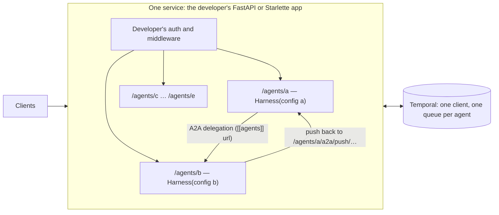

<!-- Written per the `the-loop:writing` skill: front-load each section's
     conclusion, draw it rather than describe it (3+ named parts -> a mermaid
     diagram), and keep the formal registers formal (EARS, abuse cases,
     RFC-2119, API contracts, schema descriptions). -->

# Requirements: mount tiny-harness agents onto an existing FastAPI or Starlette app

> Phase 1 of 3 (requirements → design → tasks), following the Kiro spec approach
> (<https://kiro.dev/docs/specs/>). Ticket:
> [MadaraUchiha-314/tiny-harness#36](https://github.com/MadaraUchiha-314/tiny-harness/issues/36).
> Derived from [`brainstorm.md`](brainstorm.md); discussion on
> [PR #37](https://github.com/MadaraUchiha-314/tiny-harness/pull/37).

## Introduction

A Python developer with an existing FastAPI or Starlette service cannot add a
tiny-harness agent to it. The only entry points, `running_harness` and `serve`, start
their own uvicorn server and own the whole lifecycle. The ASGI app factory is internal,
identity comes only from the self-asserted `X-Participant-Id` header, and the limits and
CORS middleware are always on.

This work item makes an agent **a set of routes plus a lifecycle** that the developer
mounts on their own app, in the style of a2a-python's
[`add_a2a_routes_to_fastapi`](https://github.com/a2aproject/a2a-python/blob/main/src/a2a/server/routes/fastapi_routes.py).
The developer keeps the server, the middleware, the authentication and the startup.

**The acceptance test, from the issue's author:** five configuration files give five
agents. One service mounts each agent on its own path. Each agent can delegate to the
others when its configuration lists them under `[[agents]]`.

Today two harnesses in one process and one Temporal namespace collide: both use the
task queue `tiny-harness`, each answers `GetTask` and `ListTasks` for the other's tasks,
both write the heartbeat schedule `tiny-harness-heartbeat`, both join their tasks as
the participant `tiny-harness`, and in embedded mode each starts its own Temporal dev
server. Requirement 5 removes these collisions.

## Requirements

### Requirement 1 — Start a harness without a server

**User story:** As an SDK user, I want to start an agent's runtime from my app's
lifespan without it opening a port, so that my app's server serves the agent.

#### Acceptance criteria (EARS)

1. The SDK SHALL export a public harness type (working name `Harness`) that connects to
   Temporal, builds the runtime and, when asked, starts the worker, and that binds no
   port and starts no HTTP server.
2. The harness SHALL have an async start that the caller enters and an exit that stops
   the worker and everything the start created, in reverse order. It SHALL be usable
   from a Starlette or FastAPI `lifespan`.
3. WHEN the caller passes a connected Temporal client THEN the harness SHALL use it and
   SHALL NOT close it on exit. WHEN the caller passes none THEN the harness SHALL
   connect per `[temporal]` as today and close what it opened.
4. The harness SHALL accept, in code, what `running_harness` accepts today: plugins,
   commands, `builtin_commands`, `with_worker` and a log stream.
5. Nothing in the harness SHALL configure process-wide logging or tracing. The CLI and
   `serve` keep doing that; an SDK user calls `observe` once for their process.

### Requirement 2 — Mount an agent on a Starlette app

**User story:** As a Starlette developer, I want an ASGI app for my agent that I mount
under a path, so that the agent shares my service's port, process and middleware.

#### Acceptance criteria (EARS)

1. The harness SHALL provide an ASGI app (working name `asgi_app()`) and the
   equivalent route list (`routes()`) that serve every route the server serves today:
   the agent card, JSON-RPC, HTTP+JSON, `GET /_monitor`, `POST /a2a/push/{task_id}`
   and, when configured, `/ui`.
2. The app SHALL be mountable when the host app is defined, before the harness has
   started. WHILE the harness is not started, every route SHALL answer `503` with a
   JSON error body and SHALL NOT reach Temporal.
3. WHEN the app is mounted under a prefix THEN the agent card's interface URLs and the
   push callback URL that the agent registers on remote tasks SHALL include that
   prefix, so a client given `<origin><prefix>` finds the card at
   `<origin><prefix>/.well-known/agent-card.json` and every URL in it works.
4. The prefix SHALL be given as an argument, or derived from `[server] base_url` when
   that URL has a path. WHEN both are given and they disagree THEN the harness SHALL
   refuse to start, naming both values.
5. WHEN the app is served by `running_harness`, `serve` or the CLI THEN it SHALL behave
   as today, at the root path.

### Requirement 3 — Include an agent in a FastAPI app

**User story:** As a FastAPI developer, I want one `include_router` call per agent, so
that its lifespan runs with my app's and its routes show in my `/docs`.

#### Acceptance criteria (EARS)

1. An optional install extra (`tiny_harness[fastapi]`) SHALL provide a function
   (working name `harness_router(settings, …)`) that returns a FastAPI `APIRouter`
   carrying the harness's routes and its lifespan.
2. WHEN the router is included with `app.include_router(router, prefix=P)` THEN the
   harness SHALL start with the app's lifespan and stop with it, and Requirement 2.3
   SHALL hold for `P`.
3. The A2A routes SHALL appear in the app's OpenAPI document, tagged per agent, with
   the A2A request body schemas, as a2a-python's helper does.
4. IF FastAPI is not installed THEN importing the helper SHALL fail with an
   `ImportError` that names the extra to install. The core package SHALL NOT depend on
   FastAPI.

### Requirement 4 — Customize the integration

**User story:** As a developer with my own auth and middleware, I want to replace or
turn off the harness's own, so that the agent follows my service's rules.

#### Acceptance criteria (EARS)

1. The ASGI app and the router SHALL accept a participant resolver (working name
   `participant`), a callable from the request to a participant id or none.
2. WHEN a resolver is given THEN the harness SHALL take the participant from it only,
   and SHALL ignore the `X-Participant-Id` header. WHEN none is given THEN the header
   SHALL be used, as today.
3. WHEN the resolver returns none THEN the request SHALL be treated as having no
   asserted participant, exactly as a request without the header is today.
4. The limits middleware and the CORS middleware SHALL each be on by default and each
   SHALL be possible to turn off, so the host's own middleware applies instead.
5. `GET /_monitor`, `POST /a2a/push/{task_id}` and `/ui` SHALL each be possible to turn
   off. WHEN the push route is off THEN the agent SHALL NOT register push configs on
   remote tasks and SHALL use `follow` updates instead.
6. The agent's identity, its id, name and description, SHALL be settable in
   configuration (a new `[agent]` section) and in code. The id SHALL default to
   `tiny-harness`, so existing configurations behave as today.

### Requirement 5 — Several isolated agents in one process

**User story:** As a developer, I want to run several agents, each from its own
configuration, in one process, so that one service hosts all of them.

#### Acceptance criteria (EARS)

1. The SDK SHALL let one process start several harnesses at once, each from its own
   `Settings`, each mounted on its own prefix.
2. Several harnesses SHALL be able to share one Temporal client. In embedded mode,
   harnesses whose `[temporal]` settings name the same embedded server SHALL share one
   dev server instead of each starting one.
3. IF two harnesses in one process have the same agent id, or the same Temporal
   namespace and task queue, THEN the second start SHALL fail with an error that names
   the clash, before it registers a worker.
4. WHEN agent A receives `GetTask`, `ListTasks`, `CancelTask`, `SubscribeToTask`,
   `SendMessage` naming a task id, or a push-config operation, for a task that belongs
   to agent B THEN agent A SHALL answer exactly as for a task that does not exist.
5. Each agent's worker SHALL run only its own agent's tasks, with its own model, tools,
   plugins, prompts and store.
6. The heartbeat schedule SHALL be one per agent, with an id derived from the agent,
   and each heartbeat SHALL scan, monitor and prune only its own agent's data.
7. Each agent SHALL join its tasks as a participant with its own agent id.
8. Two agents MAY share a SQLite store file only if their records cannot collide; IF
   the design cannot guarantee that THEN the harness SHALL refuse a shared store path,
   naming it.

### Requirement 6 — Agents in one service delegate to each other

**User story:** As a developer, I want agent A to delegate to agent B in the same
service through A's `[[agents]]` configuration, so that I compose agents without
deploying them apart.

#### Acceptance criteria (EARS)

1. WHEN agent A's configuration lists `{ id = "b", url = "<origin>/agents/b" }` and B
   is mounted at `/agents/b` in the same service THEN A SHALL fetch B's card, delegate
   a sub-task to B over A2A and receive B's result, as it does for an agent in another
   process.
2. WHEN B's task parks or changes state between turns and A's update mode is `auto`
   THEN B's push SHALL reach A's prefixed push route and wake A's stand-in.
3. Delegation between two agents in one service SHALL use the same A2A HTTP path as
   between two services. There SHALL be no in-process shortcut that skips B's routes,
   its middleware or its access checks.
4. The project SHALL ship a runnable example and an automated test with **five** agent
   configurations mounted in one app, where at least one agent delegates to another
   and gets a result.

### Requirement 7 — Existing entry points do not change

**User story:** As an existing CLI or SDK user, I want my setup to work unchanged, so
that this feature costs me nothing.

#### Acceptance criteria (EARS)

1. `running_harness`, `serve`, `RunningHarness`, `tiny-harness serve`, `worker` and
   `tui` SHALL keep their signatures and behaviour, and SHALL be built on the new
   harness type.
2. A configuration file valid before this change SHALL load and behave the same after
   it.
3. The agent card served at the root by `serve` SHALL match the existing contract
   snapshot, except for fields this work item adds on purpose and names in the design.

### Requirement 8 — Documentation

**User story:** As an SDK user, I want a guide for mounting agents on my app, so that I
can do it without reading the source.

#### Acceptance criteria (EARS)

1. The SDK docs SHALL have a page for mounting on Starlette and on FastAPI, quickstart
   first, per the project's docs-writing skill, including several agents in one app.
2. The deploy guide SHALL state who enforces authentication in each setup: a gateway in
   front of `serve`, or the host app (with a participant resolver) when mounted.
3. `docs/configuration/` SHALL document the new `[agent]` section.
4. The capability docs `a2a-server.md` and `durable-execution.md` (and any other the
   change affects) SHALL be updated in the same pull request.

## Non-functional requirements

- **Typing:** no `Any` (R22.2); strict pyright passes, including the FastAPI helper.
- **Overhead:** a mounted agent adds no request latency beyond today's server at the
  root; the 503-before-start check is one flag read.
- **Startup:** starting five harnesses that share a Temporal client opens one Temporal
  connection, not five.
- **Observability:** every log line and span from a harness carries its agent id, so
  five agents in one process can be told apart.

## Security considerations

- **Actors & trust:**
  - *Clients* of each agent (people, renderers, other agents) are untrusted.
  - *The host app* is trusted. Its participant resolver becomes the source of identity
    when it is given.
  - *Other agents in the same service* are untrusted toward each other: agent A calls
    agent B as an external A2A client, and B pushes to A as an external pusher.
  - *Configuration files* are trusted operator input.
- **Trust boundaries & data:**
  - *Identity.* Mounted with a resolver, the boundary moves from "a gateway sets
    `X-Participant-Id`" to "the host app's auth". A client-sent header must not cross
    it.
  - *Agent to agent, in one process.* The boundary is the same HTTP route as between
    services. Tasks, transcripts, push tokens and stores of one agent must not be
    readable by another through the API, the shared Temporal namespace or a shared
    store.
  - *Unauthenticated routes.* Mounted on a host app, our routes sit behind the host's
    middleware. If the host app has no authentication, the agents have none: the same
    warning as for `serve` without a gateway applies.
  - *Secrets.* Each agent has its own model key, and several agents may hold different
    keys in one process. The redactor of each agent must cover every key in the
    process, so agent A's logs cannot carry agent B's key.
- **Abuse cases (EARS):**
  1. WHEN a participant resolver is given and a client sends `X-Participant-Id: admin`
     THEN the harness SHALL ignore the header and use the resolver's result.
  2. WHEN a client of agent A sends `GetTask`, `ListTasks`, `CancelTask`,
     `SubscribeToTask`, a push-config call or a message naming a task id that belongs
     to agent B THEN agent A SHALL answer as for an unknown task and SHALL NOT change B's
     task.
  3. WHEN a push arrives at agent A's push route for a stand-in of agent B, or with a
     token issued by agent B THEN agent A SHALL refuse it with `401`, the same as any
     wrong token.
  4. WHEN two configurations share a namespace and task queue THEN the second harness
     SHALL refuse to start, so agent A's worker can never run agent B's task with A's
     tools and keys.
  5. WHEN a request reaches a mounted agent before its harness has started THEN it SHALL
     get `503` and SHALL NOT reach Temporal or the store.
  6. WHEN agent A logs or traces anything THEN no model key, Temporal key or push token of
     any agent in the process SHALL appear in it.
- **Fail closed:**
  - A prefix that disagrees with `base_url`'s path stops the start.
  - A duplicate agent id, a duplicate namespace and task queue, or an unsafe shared
    store path stops the start.
  - A resolver that raises fails the request with `500` and treats nobody as the
    participant; it never falls back to the header.
  - With the limits middleware off, nothing in the harness limits request size or rate;
    the docs say so next to the switch.

## Out of scope

- Authentication inside tiny-harness. The host app or a gateway authenticates; the
  harness only takes the resolved participant id.
- Several hosts. The SQLite store and the polling event bridge stay single-host.
- An in-process transport between agents (Requirement 6.3 forbids one).
- gRPC.
- Changing the A2A protocol or the published extensions.
- Frameworks other than Starlette and FastAPI. Any ASGI server can serve the
  Starlette app.

## Open questions

Asked on [PR #37](https://github.com/MadaraUchiha-314/tiny-harness/pull/37#issuecomment-6140889579).
Question 4 was answered: several agents in one process are in scope
([reply](https://github.com/MadaraUchiha-314/tiny-harness/pull/37#issuecomment-6150070351)).
The others had no answer when this draft was written, so the requirements above take
the proposed answer. Each is an **assumption** to confirm or change in review:

| # | Question | Assumed answer | Where |
|---|----------|----------------|-------|
| 1 | FastAPI as a core dependency or an optional extra? | Optional extra, `tiny_harness[fastapi]` | R3.1, R3.4 |
| 2 | Mountable when the app is defined, or only inside the lifespan? | When defined; `503` until started | R2.2 |
| 3 | With a resolver, ignore `X-Participant-Id`? | Yes | R4.2, abuse case 1 |
| 5 | Prefix as an argument? | Yes, or from `base_url`'s path; a mismatch stops the start | R2.4 |
| 6 | A2A routes in the host's `/docs`? | Yes, through the FastAPI helper only | R3.3 |

## Review comments

> Appended by the-loop's `record-feedback` hook when a human gate approves with
> comments (issue-109). Append-only and attributed: an approval never silently
> discards a reviewer's suggestions, and the feedback travels with the document
> it concerns rather than living in a side-channel tracker.

### 2026-10-13 — approved

**@MadaraUchiha-314** wrote:

approved
