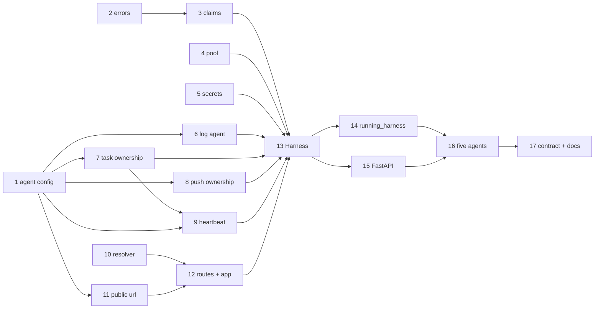

<!-- Written per the `the-loop:writing` skill: front-load each section's
     conclusion, draw it rather than describe it (3+ named parts -> a mermaid
     diagram), and keep the formal registers formal (EARS, abuse cases,
     RFC-2119, API contracts, schema descriptions). -->

# Tasks: mount tiny-harness agents onto an existing FastAPI or Starlette app

> A DAG derived from the approved [`design.md`](design.md) and
> [`testing-plan.md`](testing-plan.md). Each task's `_Test:_` names a row of the plan's
> matrix. Single repository; the code lands on the work item's branch `loop/issue-36`,
> [PR #37](https://github.com/MadaraUchiha-314/tiny-harness/pull/37).

There are seventeen tasks. Every task is test-first: write the named test, watch it fail,
then make it pass. Tasks 1–10 are the isolation and identity groundwork, each usable
alone. Tasks 11–14 assemble `Harness` and its app. Tasks 15–17 add FastAPI, the
five-agent acceptance and the docs.

## Task list

- [ ] 1. `[agent]` configuration and the task queue default
  - Add `AgentConfig` (`id` with its pattern, `name`, `description`) to `Settings`.
  - Make `TemporalConfig.task_queue` optional, add `effective_task_queue`, and fill it
    from `agent.id` in a `Settings` validator.
  - Remove `runtime.AGENT_ID`. Every reader moves to `settings.agent.id` or
    `effective_task_queue`: `workflow_config`, `commands.py`, `process.py` and the
    worker.
  - _Depends on:_ none
  - _Requirements:_ R4.6, R5.3, R7.2
  - _Test:_ T1 `tests/unit/test_config_agent.py` (defaults, explicit queue kept, bad id
    refused); T6/T13 `examples/demo/config.toml` loads with id and queue `tiny-harness`
- [ ] 2. New errors
  - Add `HarnessConflictError`, `HarnessAlreadyStartedError`, `HarnessStoppedError`
    and `HarnessNotStartedError` under `TinyHarnessError` in `tiny_harness/errors.py`.
  - _Depends on:_ none
  - _Requirements:_ design § Error handling
  - _Test:_ T1 `tests/unit/test_errors.py` (hierarchy, messages)
- [ ] 3. `Claims` registry
  - Add `tiny_harness/service/claims.py`. It claims the agent id, the namespace and
    queue, and the resolved store path, all or nothing, under a lock, and releases them.
  - _Depends on:_ 2
  - _Requirements:_ R5.3, R5.8; abuse case 4
  - _Test:_ T1 `tests/unit/service/test_claims.py` (each clash names the holder, two
    spellings of one path clash, release frees, all-or-nothing)
- [ ] 4. `TemporalPool`
  - Add `tiny_harness/service/durable/pool.py`: connections reference-counted per key,
    with the embedded key `(embedded, database_path)` and the remote key
    `(address, namespace, sha256(api_key))`.
  - Reimplement `temporal_client(settings)` on it, keeping its signature.
  - _Depends on:_ none
  - _Requirements:_ R1.3, R5.2, NFR startup
  - _Test:_ T1 `tests/unit/service/test_pool.py` (shared per key, the last release
    closes, no API key in the key, over a fake connector); T6 the `tests/integration/embedded`
    suite unchanged
- [ ] 5. `SecretRegistry` in every redactor
  - Add a process-wide registry with a version counter.
  - `Redactor(registry=…)` rebuilds its values when the version changes.
  - The service's redactors (runtime, `observe`) use `PROCESS_SECRETS`.
  - _Depends on:_ none
  - _Requirements:_ abuse case 6
  - _Test:_ T1 `tests/unit/test_redactor_registry.py`; T4 `tests/security/test_multi_agent_isolation.py::test_one_agents_log_masks_another_agents_key`
- [ ] 6. The agent on every log line and span
  - Add the `current_agent` context variable and the `"agent"` field in
    `JsonFormatter`.
  - Add `AgentContextInterceptor` on the worker, and the `tiny_harness.agent` span
    attribute in the o11y hook.
  - _Depends on:_ 1
  - _Requirements:_ NFR observability
  - _Test:_ T1 `tests/unit/service/test_logging_agent.py`; T2 `Scenario: Each log line
    names the agent that wrote it` (in task 13's suite)
- [ ] 7. Task ownership by queue
  - `TemporalTaskStore(task_queue=…)`: `lookup` describes the workflow first, a foreign
    queue gives `None`, and an LRU of 4,096 ids caches the result.
  - `ListTasks` adds `TaskQueue = '<queue>'`, and the fallback compares
    `execution.task_queue`.
  - `context_id` is escaped in the visibility query.
  - `running_task_workflows(client, task_queue)` gets the same filter.
  - _Depends on:_ 1
  - _Requirements:_ R5.4, R5.6; abuse case 2
  - _Test:_ T1 `tests/unit/service/test_task_ownership.py` (owned, foreign,
    `describe` failing ⇒ own store, LRU hit makes no second call, quote escaping); T4
    `Scenario: Agent a treats every task of agent b as unknown`
- [ ] 8. Push ownership
  - `PushReceiver(client, task_queue=…)` describes the stand-in before the update. A
    foreign queue gives `401`, the same as a wrong token.
  - _Depends on:_ 1
  - _Requirements:_ R5.4; abuse case 3
  - _Test:_ T1 `tests/unit/service/test_push_receiver.py` (foreign queue ⇒ 401, no
    update call); T4 `Scenario: A push for agent b's stand-in at agent a's route is refused`
- [ ] 9. Heartbeat per agent
  - `schedule_id(agent_id)` keeps `tiny-harness-heartbeat` for the default agent.
  - `ensure_heartbeat_schedule` and `delete_heartbeat_schedule` take the agent id, and
    `tiny-harness schedules delete` passes it.
  - _Depends on:_ 1, 7
  - _Requirements:_ R5.6, R7.1
  - _Test:_ T1 `tests/unit/service/test_heartbeat_id.py`; T6 the `tests/integration/heartbeat`
    suite unchanged
- [ ] 10. Participant resolver and strict mode
  - `HarnessContextBuilder(resolver)`: with a resolver it never reads the header, sets
    `STRICT_STATE_KEY`, and a raising resolver gives `500`.
  - `sender_of` refuses a message that has no resolved participant in strict mode.
  - _Depends on:_ none
  - _Requirements:_ R4.1–R4.3; abuse case 1
  - _Test:_ T1 `tests/unit/service/test_context_builder.py`; T4
    `tests/security/test_participant_resolver.py` (`Scenario: With a resolver a spoofed
    participant header is ignored`)
- [ ] 11. `public_url` and the card
  - Add `public_url(base_url, prefix)` per the design's table, with normalization and
    a `ConfigError` on mismatch.
  - `build_agent_card` takes the public URL and the `[agent]` name and description.
  - For the default agent at the root, the card stays byte-identical.
  - _Depends on:_ 1
  - _Requirements:_ R2.3, R2.4, R4.6, R7.3
  - _Test:_ T1 `tests/unit/service/test_public_url.py`; T5 `tests/contract/test_agent_card.py`
    unchanged
- [ ] 12. `build_routes`, `DeferredRequestHandler`, `RouteOptions`, `HarnessApp`
  - Replace `create_app`.
  - The routes are built at definition time over a deferred handler, and the card
    comes through `card_modifier`.
  - `RouteOptions` toggles limits, CORS, monitor, push and ui.
  - `HarnessApp` adds the 503 gate, a lifespan when it is the top-level app, and the
    mount check on the first request.
  - _Depends on:_ 10, 11
  - _Requirements:_ R2.1, R2.2, R2.5, R4.4, R4.5; abuse case 5
  - _Test:_ T1 `tests/unit/service/test_route_options.py`,
    `tests/unit/service/test_harness_app.py` (503 before start, mount-check refusal)
- [ ] 13. `Harness` and `harnesses_lifespan`
  - Add `tiny_harness/service/harness.py`: the constructor validates without I/O.
    `__aenter__` claims, acquires the pool, builds the runtime (`llm` seam), publishes
    the commands, builds the card, ensures the heartbeat, starts the worker, and
    registers the secrets, all on one `AsyncExitStack`.
  - `push=False` gives `push_base_url=None`.
  - Export it lazily from `tiny_harness.service`.
  - _Depends on:_ 3, 4, 5, 6, 7, 8, 9, 12
  - _Requirements:_ R1.1–R1.5, R4.5, R5.1–R5.3, R5.5, R5.7
  - _Test:_ T1 `tests/unit/service/test_harness_lifecycle.py` (second start, start after
    stop, `client` before start, part-way failure undoes); T2 `tests/integration/mount/test_starlette.py`
    (lifespan, client passed in not closed, prefix card, 503 window, wrong mount,
    push off ⇒ follow, log agent field, several harnesses in order); T4 `Scenario: A
    second harness on the same namespace and queue does not start`, `Scenario: A request
    before start never reaches Temporal`
- [ ] 14. `running_harness`, `serve` and `worker` on `Harness`
  - `running_harness` becomes `Harness` plus uvicorn over `asgi_app()`, with the same
    signature and the same yielded `RunningHarness`.
  - `tiny-harness worker` uses `effective_task_queue` and the per-agent schedule id.
  - _Depends on:_ 13
  - _Requirements:_ R2.5, R7.1–R7.3
  - _Test:_ T6 the full existing suite, unmodified except for `AGENT_ID` imports (each
    listed); T2 `Scenario: A top-level harness app starts itself from the server lifespan`
- [ ] 15. FastAPI extra and `harness_router`
  - Add `[project.optional-dependencies] fastapi = ["a2a-sdk[fastapi]>=1.2.2",
    "fastapi>=0.143"]` and add FastAPI to the dev group.
  - Add `tiny_harness/fastapi.py`, with the `ImportError` naming the extra.
  - The routes go through a2a-sdk's helper on a scratch app and are re-added to an
    `APIRouter(prefix, lifespan)` with `add_api_route`.
  - Add the `gate` and `limits` dependencies and the bounded body read.
  - The first-request prefix check, and warnings for `cors_origins` and `ui_dir`.
  - _Depends on:_ 13
  - _Requirements:_ R3.1–R3.4
  - _Test:_ T2 `tests/integration/mount/test_fastapi.py` (`Scenario: A FastAPI app includes
    an agent router and lists its routes in OpenAPI`, `Scenario: A router included under
    another prefix refuses every request`); T7 `tests/integration/test_package.py`; T5
    `tiny_harness.fastapi` API snapshot
- [ ] 16. The five-agent example and acceptance tests
  - Add `examples/multi_agent/`: `a.toml` … `e.toml`, `app.py` (Starlette with
    `harnesses_lifespan`), `app_fastapi.py` and `README.md`.
  - Add `tests/integration/mount/test_multi_agent.py`: real uvicorn on an ephemeral
    port, scripted models, `a` → `b` and `b` → `d` delegation, `b`'s push to `a`'s
    prefixed route, one pool connection, and the FastAPI variant.
  - _Depends on:_ 14, 15
  - _Requirements:_ R5.1–R5.7, R6.1–R6.4, NFR startup
  - _Test:_ T3 `Scenario: five agents in one app delegate to each other`, `Scenario: A
    parked sub-task on agent b pushes to agent a's prefixed route`, `Scenario: five agents
    in one FastAPI app delegate to each other`; T4 the cross-agent cases on the same
    fixture; T11 the asserted single connection
- [ ] 17. Contract snapshots and documentation
  - Update the snapshots on purpose: `settings.schema.json`, `tiny_harness.service`,
    `tiny_harness.config`, `tiny_harness.errors`, the new `tiny_harness.fastapi`; the
    card stays unchanged.
  - New docs per the docs-writing skill: `docs/sdk/mount.md` (quickstart first:
    Starlette, FastAPI, several agents) and `docs/configuration/agent.md`.
  - Updates: the deploy guide (who authenticates in each setup; one agent id per
    process), `docs/configuration/server.md` (prefix in `base_url`), and
    `docs/.vitepress/config.mts`.
  - Capability docs: `a2a-server.md`, `durable-execution.md`, `heartbeat.md`,
    `configuration.md`, `observability.md`.
  - Also `docs/architecture/architecture.md` and **decision-009** (ownership by queue;
    no shared stores).
  - _Depends on:_ 16
  - _Requirements:_ R8.1–R8.4
  - _Test:_ T5 `uv run pytest tests/contract`; T15 `cd docs && bun run docs:build`; T16
    `uv run pre-commit run --all-files`

## Dependency graph (DAG)

Tasks 1, 2, 4, 5 and 10 have no dependencies and can start first.

## Checkpoints

- **After each task:** its named tests go red → green; `uv run pytest tests/unit` stays
  green; the task's box is ticked and the work committed.
- **After task 9:** `uv run pytest tests/integration/heartbeat tests/integration/a2a` —
  the isolation groundwork has not changed single-agent behaviour.
- **After task 14:** the full T6 regression run
  (`uv run pytest tests/unit tests/integration tests/contract tests/security tests/ui`).
- **After task 17:** `uv run pre-commit run --all-files` and the docs build.
- Then the **verification** node executes `testing-plan.md`: it ticks each activity
  and records its command, outcome and committed evidence. Only after that do the review
  phases run: the self and critic rounds, and the **security review gate** (recorded in
  `evidence/security-review.md`).

## Review comments

> Appended by the-loop's `record-feedback` hook when a human gate approves with
> comments (issue-109). Append-only and attributed: an approval never silently
> discards a reviewer's suggestions, and the feedback travels with the document
> it concerns rather than living in a side-channel tracker.
