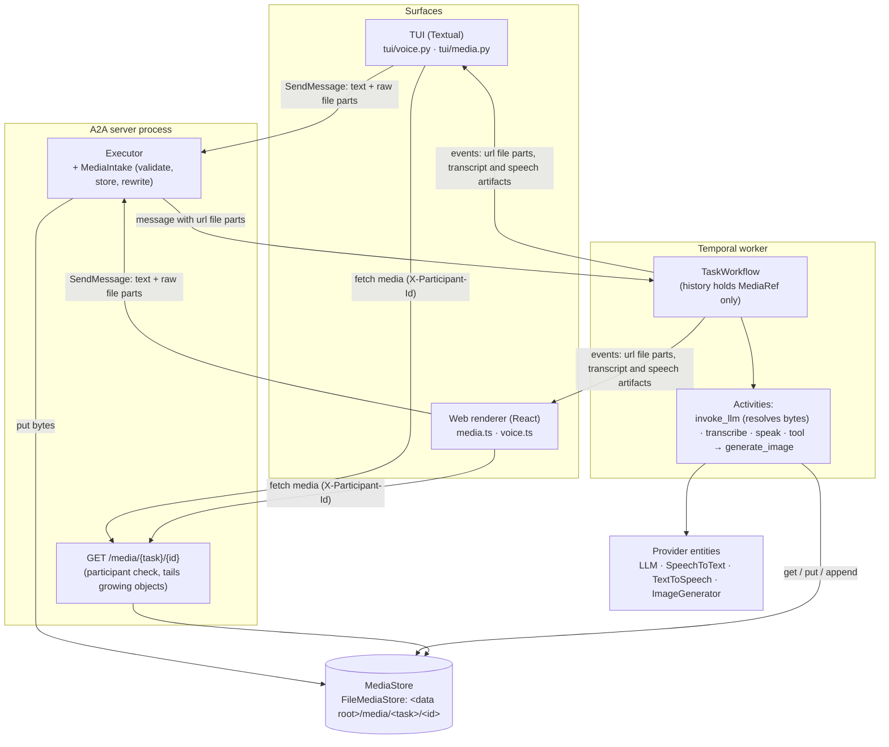

<!-- Written per the `the-loop:writing` skill: front-load each section's
     conclusion, draw it rather than describe it (3+ named parts -> a mermaid
     diagram), and keep the formal registers formal (EARS, abuse cases,
     RFC-2119, API contracts, schema descriptions). -->

# Design: multi-modal input and output, with a voice mode, in the TUI and the web renderer

> Phase 2 of 3 (requirements → design → tasks). Derives from the approved
> [`requirements.md`](requirements.md). Ticket:
> [MadaraUchiha-314/tiny-harness#38](https://github.com/MadaraUchiha-314/tiny-harness/issues/38);
> discussion on [PR #39](https://github.com/MadaraUchiha-314/tiny-harness/pull/39).

## Overview

**Media bytes live in one task-scoped media store; everything else — the A2A events, the
workflow history, the `LLMRequest` — carries a reference.** That one rule keeps image and
audio bytes out of Temporal history (2 MB payload limit), out of the redactor and out of
the logs, and lets both surfaces fetch any media of a task by one URL.

The server does all provider work, so no surface holds a key:

| What | Where it happens | Provider interface (OpenAI implementation) |
|------|------------------|--------------------------------------------|
| Attach image or audio | Surface sends an A2A `raw` file part; the A2A executor validates it, stores it and rewrites the part to a media URL **before** the message enters the workflow | — |
| Image to the model | `invoke_llm` activity reads the bytes and the adapter sends them as image input | `LLM` (`input_image` / `image_url` / `image` block) |
| Audio to the model | `transcribe` activity, unless the model takes audio natively | `SpeechToText` (`audio.transcriptions`, `gpt-4o-mini-transcribe`) |
| Image from the agent | `generate_image` intrinsic tool, run as a tool activity | `ImageGenerator` (`images.generate`, `gpt-image-2`) |
| Spoken reply | `speak` activity streams PCM into the media store; the media route streams it out while it grows | `TextToSpeech` (`audio.speech`, `gpt-4o-mini-tts`, `pcm`) |

The surfaces gain an attach control, an inline media view and a push-to-talk control. The
TUI does audio through PortAudio (`sounddevice`) and inline images through
`textual-image`, both optional extras. The web renderer uses only browser APIs
(`MediaRecorder`, Web Audio).

**Resolved open questions of the requirements:**

1. **Native audio or STT.** Speech-to-text by default. Native audio is used only WHERE the
   model's `input_modalities` include `audio` **and** the adapter can send that format. In
   the installed OpenAI SDK (3.28) only Chat Completions takes `input_audio`, and only as
   `wav` or `mp3`; the Responses API's message content takes text, image and file. So the
   demo (Responses, `gpt-6.1-sol`) runs the STT path, and the native path is proved with a
   fake model.
2. **TTS streaming.** On the server, as **a growing media object** read through the media
   route, not as A2A artifact chunks. A2A events sit in the workflow's event log, which is
   in Temporal history, so audio chunks there would break the rule above. The A2A event
   is one artifact with a URL; the audio flows over plain HTTP.
3. **TUI long-press.** Space held on an empty composer, detected by auto-repeat, with
   release events where Textual reports them. `F5` toggles recording.
4. **Demo.** A new `examples/multimodal`.

## Architecture



The server and the worker share the media store through the file system, as they already
share the SQLite store's directory. A multi-host deployment needs a shared `MediaStore`
implementation (object storage); the interface admits one, and this work item ships only
the file one.

### A voice turn end to end

```mermaid
sequenceDiagram
    autonumber
    actor U as User
    participant S as Surface
    participant X as Executor + MediaIntake
    participant W as Workflow
    participant A as Activities
    participant M as MediaStore
    U->>S: hold Space / mic button, speak, release
    S->>X: SendMessage(file part raw=wav|webm, metadata voice=true; message metadata speak=true)
    X->>X: check type, signature, size, duration
    X->>M: put → MediaRef m1
    X->>W: message with file part url=/media/t/m1
    W->>A: transcribe(m1)
    A->>M: get m1
    A-->>W: "What is in the photo I sent?"
    W-->>S: artifact transcript:m1 (text)
    W->>A: invoke_llm (refs resolved to bytes inside the activity)
    A-->>W: reply text
    W->>A: open_speech(s1)
    A->>M: create s1 (open)
    W-->>S: artifact speech:s1 (url=/media/t/s1, audio/L16;rate=24000)
    W-->>S: status INPUT_REQUIRED + reply message  [final status last: the stream may end here]
    W->>A: speak(s1, reply text)  [tracked speech job, does not block the mailbox]
    S->>X: GET /media/t/s1 (streamed)
    A->>M: append PCM chunks … close
    M-->>S: chunks as they are written → plays at once
```

**Order matters.** The response stream of `SendMessage` ends at the first final status
(`bridge.py:99`), so the speech artifact is emitted **before** the reply's
`INPUT_REQUIRED`/`COMPLETED` status. After that, speech progress needs no A2A event: the
media stream ends cleanly when speech is done and aborts when it fails or is interrupted
(below), and the surface shows that. A status note "speech unavailable" is also emitted;
a surface that resubscribed (`SubscribeToTask` follows a parked task) shows it, and one
that did not still learns it from the aborted stream.

## Components & interfaces

This section is the module and interface inventory that Requirement 9 asks for. New
modules are **bold** in the tree; the rest are existing modules this design changes.

```text
tiny_harness/
  config.py                         MediaConfig, SpeechToTextConfig, TextToSpeechConfig,
                                    ImageGenerationConfig; OpenAIConfig.input_modalities
  harness/
    media/                          ── NEW package: provider-neutral media handling
      __init__.py                   public exports
      models.py                     MediaRef, MediaKind, MediaAttachment, AudioFormat, ACCEPTED
      sniff.py                      signature, image size, audio duration and track checks (stdlib)
      store.py                      MediaStore (ABC), FileMediaStore
      intake.py                     MediaIntake: validate + store + rewrite A2A file parts
      render.py                     media → model content, media → text for compaction/summary
    models/
      llm.py                        MessageItem.media, LLMModelInfo.input_modalities
      openai_adapter.py, openai_chat.py, anthropic_adapter.py   map image/audio content
      speech.py                     ── NEW: SpeechToText, TextToSpeech, Transcript (+ fakes)
      images.py                     ── NEW: ImageGenerator, GeneratedImage (+ fake)
      openai_media.py               ── NEW: OpenAISpeechToText, OpenAITextToSpeech, OpenAIImageGenerator
    tools/intrinsics.py             generate_image intrinsic; ContentPart kind "media"
    commands/builtins.py            /attach (surface command), CommandSpec.runs_on
    core/context.py, compaction.py  media in the turn, in token estimates, in summaries
    entities/base.py                EntityKind: speech_to_text, text_to_speech, image_generator, media_store
  service/
    a2a/executor.py                 MediaIntake before redaction; reject url file parts
    a2a/media_routes.py             ── NEW: GET /media/{task_id}/{media_id}
    a2a/app.py, card.py, middleware.py   route, modes + media extension, size cap
    durable/activities.py           transcribe, open_speech, speak; invoke_llm resolves media
    durable/workflows.py            ingest media, transcript/speech/image artifacts
    runtime.py, harness.py          build and pass the new entities (SDK seams)
  interaction/
    surface.py, renderer.py         Modality.IMAGE/AUDIO; RenderItem kind "media"
    tui/app.py, client.py           attachments, media entries, voice keys; send(parts)
    tui/media.py                    ── NEW: MediaEntry (inline image or path line), AudioEntry
    tui/voice.py                    ── NEW: HoldDetector, Recorder (WAV), PcmPlayer
renderers/web/src/
  a2a.ts, model.ts, App.tsx         file parts, media items, voice state
  media.ts                          ── NEW: filePart, fetchMedia (blob cache), accepted types
  voice.ts                          ── NEW: Recorder (MediaRecorder), PcmStreamPlayer (Web Audio)
  components/Composer.tsx           attach, paste, drop, mic, speaker toggle
  components/Attachments.tsx        ── NEW: pending attachment chips
  components/MicButton.tsx          ── NEW: hold-to-talk + toggle button
  components/MediaItem.tsx          ── NEW: image / audio / speech rendering in the stream
examples/multimodal/                ── NEW: the demo (R7)
docs/a2a/ext/media/v1.md + media.json   ── NEW: the media extension contract
```

### Media model — `harness/media/models.py` (R1.4, R1.5, R6)

```python
class MediaKind(StrEnum):
    IMAGE = "image"
    AUDIO = "audio"

ACCEPTED: Final[Mapping[str, MediaKind]] = {
    "image/png": IMAGE, "image/jpeg": IMAGE, "image/webp": IMAGE, "image/gif": IMAGE,
    "audio/wav": AUDIO, "audio/mpeg": AUDIO, "audio/mp4": AUDIO, "audio/ogg": AUDIO,
    "audio/webm": AUDIO,
}
# Server-produced only (speech output); never accepted as input:
PCM_MEDIA_TYPE: Final = "audio/L16;rate=24000;channels=1"

class MediaRef(BaseModel, frozen=True):
    id: str                  # secrets.token_urlsafe(18): 144 random bits, not guessable
    task_id: str
    kind: MediaKind
    media_type: str          # a key of ACCEPTED, or PCM_MEDIA_TYPE
    size: int                # bytes; 0 while a growing object is open
    name: str = ""           # original file name, sanitised (basename, ≤ 120 chars)
    duration_ms: int | None = None   # audio, when known
    width: int | None = None         # image
    height: int | None = None
    voice: bool = False      # recorded by a voice control (drives transcript display and speak)

class MediaAttachment(BaseModel, frozen=True):
    ref: MediaRef
    transcript: str | None = None    # filled once by the transcribe activity
    data: bytes | None = None        # ONLY inside an activity; never in workflow state

    def url(self, base: str) -> str: ...   # f"{base}/media/{task_id}/{id}"

@dataclass(frozen=True)
class AudioFormat:
    encoding: Literal["pcm_s16le"]
    sample_rate: int
    channels: int
    @property
    def media_type(self) -> str: ...       # "audio/L16;rate=24000;channels=1"
```

`MediaAttachment.data` has a validator that refuses serialisation with data set
(`model_serializer` raises), so a resolved attachment cannot reach a workflow payload by
mistake (abuse case 8, NFR durability).

### Media store — `harness/media/store.py` (R1.5, R4.2, R6.2, R6.4)

```python
class MediaStore(Entity):
    kind = EntityKind.MEDIA_STORE

    async def put(self, task_id: str, data: bytes, *, media_type: str, name: str = "",
                  **meta: Any) -> MediaRef: ...
    async def get(self, ref: MediaRef) -> bytes: ...
    async def lookup(self, task_id: str, media_id: str) -> MediaRef | None: ...
    # growing objects (speech): created open, then one fenced writer per generation
    async def create(self, task_id: str, media_id: str, *, media_type: str) -> MediaRef: ...
    async def begin(self, ref: MediaRef) -> SpeechWriter: ...   # new generation; fences older ones
    def read_stream(self, ref: MediaRef, *, poll: float = 0.05,
                    idle_timeout: float = 30.0) -> AsyncIterator[bytes]: ...

class SpeechWriter:
    generation: int
    async def append(self, chunk: bytes) -> None: ...      # raises MediaFenced when superseded
    async def close(self, *, failed: bool = False) -> None: ...
    async def delete_task(self, task_id: str) -> int: ...
    async def sweep(self, older_than: datetime) -> int: ...

class FileMediaStore(MediaStore):
    def __init__(self, ref: EntityRef, root: Path) -> None: ...
```

- Layout: `<root>/<task_id>/<media_id>` holds the bytes; `<media_id>.json` holds the
  `MediaRef`. Writes go to a temp file and `os.replace`, so a reader never sees half a
  `put`.
- Growing objects are **generation-fenced** (design critic 3). `begin` increments
  `<media_id>.gen` (atomic replace) and writes only to its own immutable
  `<media_id>.g<n>`; `<media_id>.state` (`open` / `done:<n>` / `failed:<n>`) is replaced
  atomically. Every `append` and `close` first re-reads `.gen` and raises `MediaFenced`
  when a newer generation exists, so two overlapping activity attempts never write the
  same file and a stale attempt stops at its next chunk. The completed object is
  `.g<n>` of the `done:<n>` state, served as `<media_id>` from then on.
- `root` is `[media] dir`, else `<sqlite dir>/media[-<agent>]`, beside the existing
  `plugin-data` default (`runtime.default_data_root`).
- `task_id` and `media_id` are validated against `[A-Za-z0-9_-]{1,128}` before they touch
  a path (path traversal, abuse case 4).
- `read_stream` follows **one** generation: it yields `.g<n>` as it grows, ends cleanly
  on `done:<n>`, and raises `MediaInterrupted` when `.gen` moves past `n` (a retry
  started), `MediaFailed` on `failed:<n>`, or `MediaInterrupted` after `idle_timeout` with
  no growth. The route turns either exception into an aborted chunked response; the
  surface marks the speech *interrupted* and offers **Replay**, which re-requests the URL
  and reads the newest generation from its start.
- Retention: the existing retention sweep calls `sweep(older_than=now - [retention] media)`
  (new key, default 30 days, like the other kinds) and `delete_task` when a task's record is
  deleted.

### Media intake — `harness/media/intake.py` (R1.3–R1.5, abuse cases 1–3, 7)

```python
class MediaRejected(HarnessError):
    code: Literal["too_large", "message_too_large", "type_not_accepted", "type_mismatch",
                  "url_not_accepted", "image_too_large", "audio_too_long", "media_off"]

class MediaIntake:
    def __init__(self, store: MediaStore, config: MediaConfig, *, base_url: str) -> None: ...
    async def extract(self, message: Message, *, task_id: str) -> Message:
        """Validate every file part, store its bytes and return the message with each
        raw part replaced by a url part (/media/<task>/<id>, same media_type and filename,
        part metadata += {"mediaId", "size", "durationMs"?, "width"?, "height"?}).
        All-or-nothing: on any rejection nothing stays stored (stored refs are deleted)."""
```

Checks, in order, per part: (1) a `url` file part → `url_not_accepted`; (2) media off →
`media_off`; (3) declared `media_type` (parameters stripped, lower-cased) in `ACCEPTED`;
(4) `len(raw) ≤ max_file_bytes` and the running sum `≤ max_message_bytes`;
(5) `sniff.detect(raw)` equals the declared type (`type_mismatch` otherwise); (6) images:
`sniff.image_size(raw)` read from the header, `w*h ≤ max_image_pixels`, without decoding;
(7) audio (design critic 6): `sniff.audio_info(raw, media_type)` returns the container's
tracks and duration, `≤ max_audio_seconds`; a file with any non-audio track, an
unsupported codec, or a duration that cannot be determined is rejected
(`not_audio_only`, `audio_too_long`, `audio_duration_unknown`). Surfaces also cap
recordings, but the server does not rely on it.

`sniff.py` is stdlib only, and every parser is **bounded**: it hops from header to header
(frame, page, box or element) without decoding, never recurses past depth 8, and stops
— rejecting — as soon as the running duration passes `max_audio_seconds` or the hop count
passes the most a capped file could need. Audio duration is **counted from what is
there**, not taken from a header that could understate it; bytes the walk cannot account
for (beyond a 256 KiB trailing tag area) reject the file. Images read only the header.

| Type | Signature | Dimensions / duration | Audio-only check |
|------|-----------|-----------------------|------------------|
| PNG | `\x89PNG\r\n\x1a\n` | IHDR width × height | — |
| JPEG | `FF D8 FF` | first SOF0–SOF15 marker | — |
| GIF | `GIF87a` / `GIF89a` | logical screen size | — |
| WebP | `RIFF....WEBP` | VP8 / VP8L / VP8X header | — |
| WAV | `RIFF....WAVE` | `data` size ÷ (`fmt` byte rate) | format tag PCM / IEEE float |
| MP3 | `ID3` (skipped by its size) then frame sync `FF Ex` | sum of every frame's samples ÷ rate, walking frame headers | MPEG audio frames only; trailing ID3v1/APE ≤ 256 KiB |
| MP4 / M4A | `....ftyp` | the larger of `mvhd`, the audio `mdhd`, and the `stts` sample-delta sum, ÷ timescale | every `trak/mdia/hdlr` is `soun` |
| Ogg | `OggS` | walk every page; granule positions must not decrease; last granule ÷ sample rate (48 kHz for Opus, from the `vorbis` id header otherwise) | first packet is `OpusHead` or `\x01vorbis`; one logical stream |
| WebM | `1A 45 DF A3`, DocType `webm` | walk every `Cluster`: the larger of `Info/Duration` and the last cluster `Timecode` + its last block offset, × `TimecodeScale` (Chrome's `MediaRecorder` omits `Duration`) | every `Tracks/TrackEntry/TrackType` is 2 (audio) |

### LLM types — `harness/models/llm.py` (R1.6, R1.7, R5.1, R5.2)

```python
class MessageItem(BaseModel, frozen=True):
    kind: Literal["message"] = "message"
    role: Role
    text: str
    source: str | None = None
    media: tuple[MediaAttachment, ...] = ()          # NEW

Modality = Literal["text", "image", "audio"]

class LLMModelInfo(BaseModel, frozen=True):
    ...                                               # existing fields
    input_modalities: frozenset[Modality] = frozenset({"text"})   # NEW
    output_modalities: frozenset[Modality] = frozenset({"text"})  # NEW (R5.2; every adapter today: text)
    audio_input_formats: frozenset[str] = frozenset()             # NEW, e.g. {"audio/wav","audio/mpeg"}
```

- `input_modalities` comes from `[openai] input_modalities` (default `["text", "image"]`
  with `api = "responses"`, `["text"]` with `chat_completions`, so a local Ollama model is
  not sent images unasked). `audio_input_formats` is the adapter's own constant: empty for
  Responses and Anthropic, `{"audio/wav", "audio/mpeg"}` for Chat Completions.
- Adapter mapping, done only for attachments whose `data` is set:

| Content | OpenAI Responses | OpenAI Chat Completions | Anthropic Messages |
|---------|------------------|-------------------------|--------------------|
| text | `input_text` | `text` part | `text` block |
| image | `input_image`, `image_url = data:<type>;base64,…`, `detail="auto"` | `image_url` part (data URL) | `image` block, `source.type="base64"` |
| audio (native) | not sent (STT path) | `input_audio` `{data, format: wav\|mp3}` | not sent (STT path) |
| audio transcript | `input_text` `[transcript of <name>] …` | same | same |

  A message with no media keeps today's plain-string `content`, so text-only requests stay
  byte-identical (prompt caching unaffected).

- An attachment whose `data` is `None` when an adapter needs it raises
  `ProviderError("media not resolved")` — a programming error, never a silent drop.

### Speech and image interfaces — `harness/models/speech.py`, `images.py` (R5.3, R5.4)

```python
class Transcript(BaseModel, frozen=True):
    text: str
    language: str | None = None
    duration_ms: int | None = None

class SpeechToText(Entity):
    kind = EntityKind.SPEECH_TO_TEXT
    info: SpeechModelInfo            # provider, model, endpoint
    async def transcribe(self, audio: bytes, *, media_type: str, name: str = "audio",
                         language: str | None = None) -> Transcript: ...

class TextToSpeech(Entity):
    kind = EntityKind.TEXT_TO_SPEECH
    info: SpeechModelInfo
    format: AudioFormat              # what stream() yields; OpenAI: pcm_s16le 24 kHz mono
    def stream(self, text: str, *, voice: str | None = None,
               instructions: str | None = None) -> AsyncIterator[bytes]: ...

class GeneratedImage(BaseModel, frozen=True):
    data: bytes
    media_type: Literal["image/png", "image/jpeg", "image/webp"]
    width: int
    height: int
    revised_prompt: str | None = None

class ImageGenerator(Entity):
    kind = EntityKind.IMAGE_GENERATOR
    info: ImageModelInfo
    async def generate(self, prompt: str, *, size: str | None = None) -> GeneratedImage: ...
```

Each has a scripted fake (`FakeSpeechToText`, `FakeTextToSpeech`, `FakeImageGenerator`) for
tests, like `FakeLLM`.

`openai_media.py` implements the three over one `AsyncOpenAI` client built by the
existing client factory (`max_retries=0`, explicit `base_url`, redirects refused):
`audio.transcriptions.create(model, file=(name, bytes, media_type))`,
`audio.speech.with_streaming_response.create(model, voice, input, response_format="pcm",
instructions)` iterated with `iter_bytes()`, and `images.generate(model, prompt, size,
output_format="png")` decoding `b64_json`. Errors map to `RetryableProviderError` /
`ProviderError` with the same table as the LLM adapter (R5.7).

### Configuration — `config.py` (R5.5)

```toml
[openai]
input_modalities = ["text", "image"]   # NEW; add "audio" only for a Chat Completions audio model

[media]                                # NEW; absent = media off (text-only, as today)
max_file_bytes = 20_971_520            # 20 MiB
max_message_bytes = 26_214_400         # 25 MiB
max_image_pixels = 40_000_000
max_audio_seconds = 120
dir = ""                               # default <sqlite dir>/media[-<agent>]
speech_drain = "PT120S"                # wait for spoken replies before rollover or completion

[speech_to_text]                       # NEW; absent = no STT (audio goes native or is refused)
provider = "openai"                    # uses [openai] api_key and base_url
model = "gpt-4o-mini-transcribe"

[text_to_speech]                       # NEW; absent = no spoken replies
provider = "openai"
model = "gpt-4o-mini-tts"
voice = "coral"
instructions = ""                      # optional speaking style

[image_generation]                     # NEW; absent = no generate_image tool
provider = "openai"
model = "gpt-image-2"
size = "1024x1024"

[retention]
media = "P30D"                         # NEW
```

- `provider` is a `Literal["openai"]` today; a new provider adds a literal and a factory in
  `runtime.build_media_entities`. SDK users bypass config entirely by passing instances:
  `Harness(settings, speech_to_text=…, text_to_speech=…, image_generator=…,
  media_store=…)` and the same keywords on `build_runtime` — the seam `llm=` already is.
- Validation: `[speech_to_text]`, `[text_to_speech]` and `[image_generation]` require
  `[media]`; `provider = "openai"` requires an `[openai]` key or `base_url` (the existing
  rule). No new secret: they reuse `OPENAI_API_KEY`.
- Effective request cap: WHEN `[media]` is set THEN `LimitsMiddleware` uses
  `max(max_request_bytes, ceil(max_message_bytes * 4 / 3) + 65_536)` (base64 + JSON
  envelope); `max_request_bytes` alone still governs a text-only instance.

### A2A surface: executor, media route, card — `service/a2a/` (R1.3, R2.2, R5.5, R5.6)

- **Executor.** In `execute`, after the access-policy check and **before**
  `redact_message`: `message = await intake.extract(message, task_id=context.task_id)`.
  A `MediaRejected` answers the request with an A2A `InvalidParams` error carrying the code
  and the limit (no task is started or updated). The redactor therefore never scans base64,
  and the workflow mailbox — Temporal history — receives only URLs.
- **Every other ingress** (design critic 5). One function,
  `media.intake.guard(message, *, allow: Literal["extract", "refuse", "drop"])`, runs
  before redaction on every path that turns an external A2A message into workflow input,
  and a unit test enumerates those paths so a new one cannot skip it:

  | Ingress | Mode | File parts become |
  |---------|------|-------------------|
  | `HarnessExecutor.execute` (`SendMessage`, new turn) | `extract` | stored, rewritten to media URLs |
  | `HarnessExecutor.control` (complete, cancel and other controls) | `refuse` | `InvalidParams` "controls carry no files" |
  | push receive `/a2a/push/{task_id}` and remote-agent follow results | `drop` | removed, with a note "[remote agent sent a <type> file; files from remote agents are not supported]" |
  | channel deliveries | `drop` | removed, with the same note |

  Remote-agent media is out of scope; dropping it keeps the 64 KiB push cap and the
  history rule intact.
- **Media route** `GET /media/{task_id}/{media_id}` (`media_routes.py`), mounted with the
  harness's own routes (and under `RouteOptions.media: bool = True`):
  1. resolve the participant exactly as the A2A routes do (the `X-Participant-Id` header or
     the host's `ParticipantResolver`), and require `AccessPolicy.allows(participant,
     task)`; otherwise `404` (not `403`, so ids of other tasks are not confirmable);
  2. `lookup` the ref; unknown → `404`;
  3. respond with `Content-Type: <ref.media_type>` (always an `ACCEPTED` type or
     `PCM_MEDIA_TYPE`), `X-Content-Type-Options: nosniff`,
     `Content-Disposition: inline; filename="<sanitised>"`, `Cache-Control: private,
     max-age=3600` (closed objects) or `no-store` (growing), and
     `Content-Security-Policy: default-src 'none'`;
  4. a growing object streams `read_stream` with chunked transfer; a closed one is a
     `FileResponse`.
- **Card** (design critic 9). The instance's **effective** media capabilities are
  computed once at start by `media.capabilities(model_info, stt, tts, image_generator,
  config)`, and the card, the intake allow-list and the surfaces all read that one value:
  - input images: the `ACCEPTED` image types, always — R1.7 wants an image the model
    cannot see accepted and noted, and `/model` may switch to one that can see it;
  - input audio: the `ACCEPTED` audio types WHEN `[speech_to_text]` is set, else only
    `audio_input_formats` WHEN `audio ∈ input_modalities`, else none;
  - output: `image/png` WHEN an image generator exists, `PCM_MEDIA_TYPE` WHEN TTS exists,
    plus the model's own `output_modalities` (text today).

  `MediaIntake` refuses an input type outside the effective set (`type_not_accepted`), so
  no audio is accepted that nothing can process. `default_input_modes` / `default_output_modes`
  list exactly these types, and the card declares the media extension:

```json
{ "uri": "https://madarauchiha-314.github.io/tiny-harness/a2a/ext/media/v1",
  "params": { "input": ["image/png", "…"], "output": ["image/png", "audio/L16;rate=24000;channels=1"],
              "maxFileBytes": 20971520,
              "maxMessageBytes": 26214400, "maxAudioSeconds": 120,
              "speechToText": true, "textToSpeech": true, "imageGeneration": true,
              "mediaPath": "/media" } }
```

  Surfaces read it to show or hide the attach, mic and speaker controls (R5.5).

- **Message and part metadata** (documented in `docs/a2a/ext/media/v1.md`, keys under the
  extension URI): part `voice: true` and `durationMs` on a recording; message
  `speak: true|false` — the surface's speaker toggle at send time (R4.1).
- **Events the workflow emits**, all A2A-native:

| Event | Shape | Surfaces show |
|-------|-------|---------------|
| user media (echo) | the user message as stored: text + `url` file parts | the image / audio in the user's bubble |
| transcript | `TaskArtifactUpdateEvent`, artifact `transcript:<mediaId>`, one text part, metadata `mediaId` | the transcript inside the voice turn's bubble |
| agent image | `TaskArtifactUpdateEvent`, artifact `image:<mediaId>`, name = alt text, one `url` file part | the image in the agent's turn |
| spoken reply | `TaskArtifactUpdateEvent`, artifact `speech:<mediaId>`, one `url` file part `audio/L16;…` | streamed playback; a "speaking" marker with Stop |

### Workflow and activities — `service/durable/` (R1.6, R3.4, R4, R6)

- **Intake activity.** `IntakeOut` gains `media: tuple[MediaRef, ...]`, built from the
  message's url file parts whose path matches `/media/<this task>/<id>` and whose id
  `lookup`s in the store (anything else is ignored and logged at WARNING). The workflow
  builds `MessageItem(role=USER, text=…, media=tuple(MediaAttachment(ref=r) for r in
  out.media))`.
- **`transcribe` activity** `TranscribeIn{task, ref} → Transcript`. The workflow runs it
  for each audio attachment of the new message WHEN NOT (the model's `input_modalities`
  has `audio` AND `ref.media_type in audio_input_formats`). It needs `[speech_to_text]`;
  without it the audio is answered with a status note "audio was not given to the model:
  no speech-to-text is configured" and the turn goes on with the text (R1.7 pattern).
  The transcript is stored on the attachment in history and emitted as the
  `transcript:<id>` artifact.
- **`invoke_llm`.** Before calling the engine, the activity resolves attachments:
  images → `data = await store.get(ref)` WHEN `image in input_modalities`, else the
  attachment is replaced by the text `[image <name> not shown: the model takes no image
  input]` and the workflow emits that once as a status note (R1.7); native audio → `data`;
  transcribed audio → text. The `LLMRequest` that crosses into the activity carries refs;
  the resolved one never leaves it.
- **Media in the turn.** `context.py` sends the media of every history entry still in
  the window (R6.1). `_chars` counts media so `over_budget` and compaction see it
  (design critic 7): an image as `IMAGE_TOKEN_ESTIMATE * 4` characters
  (`IMAGE_TOKEN_ESTIMATE = 1_100`, a 1024×1024 image at `detail=auto`); transcribed
  audio as its transcript; **native** audio by duration, `ceil(duration_ms / 1000 *
  AUDIO_TOKENS_PER_SECOND) * 4` (`AUDIO_TOKENS_PER_SECOND = 10`, OpenAI's audio input
  rate), overridable per model with `[openai] audio_tokens_per_second`. The estimate is
  corrected by `last_usage.input_tokens` after each turn, as text already is.
- **Compaction** (R6.2, design critic 7). The summarise request **carries the media** of
  the entries it folds (resolved inside the activity, like a turn) WHERE the model accepts
  that modality, and its prompt requires one line per media item — `[image <id>
  "<name>": <one-sentence description>]`, `[audio <id> "<name>": <transcript, or a
  one-sentence description>]` — which `compaction.py` checks is present for every folded
  id (a missing line is appended as `[image <id> "<name>": not described]` so the summary
  still names it). Media the model cannot take is rendered as text first:
  `[image: <name>, <w>×<h>, media <id>]`, `[audio: <name>, <s> s, transcript: "<…>"]`;
  native audio with no transcript is transcribed before compaction WHEN `[speech_to_text]`
  is set. The bytes stay in the store until retention.
- **`speak` activity** `SpeakIn{task, media_id, text, voice} → MediaRef`. WHEN a reply's
  triggering message has `speak: true` AND `[text_to_speech]` is set THEN the workflow
  (1) creates the id with `workflow.uuid4()`-derived token, (2) **awaits the short
  `open_speech` activity** (`OpenSpeechIn{task, media_id} → MediaRef`), which `create`s
  the open object, so the URL never points at nothing (design critic 2), (3) emits the
  `speech:<id>` artifact **before the reply's final status** (design critic 1), (4) starts
  `speak` as a workflow coroutine so the mailbox keeps draining (the
  user can speak again at once). The activity `append`s each
  chunk of `tts.stream(text)`, then `close`s it; on error it `close(failed=True)` and the
  workflow emits a status note "speech unavailable" (R4.5). A retry after a worker crash
  calls `begin` again: a new generation, written from the start, fencing the old attempt;
  a listener on the old generation gets an interrupted stream and can replay. The reply text is spoken without markdown
  (stripped by a small `speakable_text` function) and capped at 4 096 characters (the
  provider's input limit), the rest left to the text.
- **Speech jobs and the workflow lifecycle** (design critic 4). A workflow coroutine is
  not an update handler, so `all_handlers_finished` does not wait for it. The workflow
  therefore keeps `self.speech_jobs: dict[str, SpeechJob]` (media id → reply text, voice,
  state) and:
  - `maybe_continue_as_new` waits `wait_condition(lambda: not self.speech_jobs,
    timeout=speech_drain)` (default 120 s, `[media] speech_drain`) before rolling over;
    a job still running then is cancelled, its object closed `failed`, and the status
    note emitted — a rollover never silently abandons one;
  - `complete` (any terminal state) waits the same bounded drain, so a final spoken reply
    plays out; `cancel` cancels the jobs at once (activity cancellation → the writer
    closes `failed`);
  - the snapshot carries no speech job: only finished or failed ones may remain, and the
    stream of a failed one has already aborted.
- **`generate_image` intrinsic** (`tools/intrinsics.py`, registered only when an
  `ImageGenerator` exists): input `{prompt: string ≤ 4000, size?: "1024x1024" |
  "1536x1024" | "1024x1536", alt: string ≤ 200}`. The tool activity calls `generate`,
  `put`s the bytes and returns a `ToolResult` with a `ContentPart(kind="media",
  media=ref)` and the text `image <id> shown to the user`. The workflow then emits the
  `image:<id>` artifact and appends an agent note `MessageItem(role=USER, source="agent",
  text="[image generated: <alt>]", media=(attachment,))` so later turns can see it (R2.5).
  Its JSON schema is `docs/a2a/ext/intrinsics/generate_image.json`, like the other
  intrinsics.

### Commands — `harness/commands/` (R1.2, R4.1)

The project's rule is that commands come from the built-in command registry, not from a
client. `/attach` must read a file **on the surface's machine**, so the registry gains a
**surface command** kind instead of the TUI special-casing it:

```python
class CommandSpec(BaseModel, frozen=True):
    name: str
    description: str
    argument_hint: str = ""
    runs_on: Literal["agent", "surface"] = "agent"     # NEW
```

- `attach` is registered in `builtins.py` with `runs_on="surface"`, `argument_hint="<path>"`.
  The card lists it like any command (commands extension v1 gains the optional `runsOn`).
- A surface that implements a listed surface command runs it locally and sends nothing; one
  that does not sends the text, and the server's handler for a surface command answers
  "/attach runs in your client; this client cannot attach files". The TUI implements
  `attach`; the web renderer maps `/attach` to opening its file picker.
- The speaker on/off is a **surface setting** carried per message as `speak` (above), not
  a server command: it decides whether this surface wants this reply spoken.

### TUI — `interaction/tui/` (R1.2, R2.4, R3, R4, R8)

| Control | Key / command | Behaviour |
|---------|---------------|-----------|
| attach | `/attach <path>` (path completion) | reads the file, checks type and size against the card, adds a chip above the composer; `Backspace` on an empty composer removes the last chip |
| hold to talk | hold `Space` on an empty composer | records while held; release sends |
| toggle talk | `F5` | press to start, press to stop and send |
| spoken replies | `F6` | toggles `speak` for the next messages; shown in the footer and top bar |
| stop speaking | `Escape` while speaking | stops playback |

- `tui/voice.py`:

```python
class HoldDetector:
    """Turns a stream of Space key events into press / hold-start / hold-end.
    A first Space on an empty composer is held back. A second Space within `repeat_window`
    (default 0.6 s, `--hold-ms`) is auto-repeat: hold starts. Each further Space resets a
    `release_gap` timer (0.25 s); its expiry is the release. A lone Space whose window
    expires is typed as a space. WHERE Textual delivers key-release events (kitty keyboard
    protocol), the release event ends the hold at once."""
    def __init__(self, *, repeat_window: float = 0.6, release_gap: float = 0.25,
                 clock: Callable[[], float] = time.monotonic) -> None: ...
    def key_down(self, now: float) -> Literal["hold", "start", "repeat"]: ...
    def key_up(self, now: float) -> Literal["end"] | None: ...
    def tick(self, now: float) -> Literal["type-space", "end"] | None: ...

class Recorder:     # sounddevice.RawInputStream, 16 kHz mono int16 → WAV via stdlib wave
    def start(self) -> None: ...
    def stop(self) -> bytes | None: ...        # None when shorter than 0.3 s or silent (RMS)
    level: float                               # for the recording meter

class PcmPlayer:    # sounddevice.RawOutputStream fed from an async byte stream
    async def play(self, chunks: AsyncIterator[bytes], fmt: AudioFormat) -> None: ...
    def stop(self) -> None: ...
```

  The detector is pure (clock injected) so its timing is unit-tested without a terminal.
  The first held-back Space costs at most `repeat_window` of latency on a typed space at
  the start of an empty line; spaces inside text are never held back.

- `tui/media.py`: `MediaEntry` fetches the media through the client (`get_media(url)`,
  with the participant header), saves it to
  `~/.cache/tiny-harness/media/<task_id>/<media_id><ext>` (design critic 8): both ids are
  validated against `[A-Za-z0-9_-]{1,128}` and taken from the URL the TUI itself parsed,
  `<ext>` comes from the media type (`.png`, `.wav`, …), the directory is created `0700`,
  and the file is written to a temp name with `O_NOFOLLOW | O_EXCL` then `os.replace`d,
  so neither a file name nor a planted symlink steers the write and two `photo.png`
  attachments never collide. The original file name is display text only. It then shows
  it inline with `textual-image` WHERE that extra is installed and the terminal
  reports kitty, iTerm2 or sixel support; otherwise one line: `image · photo.png ·
  1024×768 · saved to ~/.cache/tiny-harness/media/9c41…/Qm3x…k2.png` (R2.4). `AudioEntry` shows name, duration and
  transcript, and `Enter` on it plays it. The `AudioPlayer` A2UI placeholder stays (A2UI
  is out of scope here).
- `client.py`: `A2AClientPort.send(parts: Sequence[Part], *, task_id, context_id,
  speak: bool = False)` replaces `send(text, …)`; `user_message(text, *, files=(), …)`
  builds `Part(raw=…, media_type=…, filename=…)`; new `get_media(url) ->
  AsyncIterator[bytes]`. `ScriptedClient` follows.
- No microphone, no `sounddevice` or no PortAudio → `F5`/hold show "voice input
  unavailable: install tiny-harness[voice] (PortAudio)" and typing works (R3.5).

### Web renderer — `renderers/web/src/` (R1.1, R2.3, R3, R4, R8)

- `media.ts`: `filePart(bytes: Uint8Array, mediaType, filename): Part` (`raw`),
  `fetchMedia(url, participant): Promise<string>` (fetch with `X-Participant-Id` → blob URL,
  cached per URL, revoked when the task view goes), `ACCEPTED`, and `checkFile(file,
  limits)` mirroring the server checks it can make (type, size) for early feedback.
- `voice.ts`:
  - `Recorder` over `MediaRecorder` (`audio/webm;codecs=opus`, else `audio/mp4` on
    Safari), with an `AnalyserNode` level meter, a 120 s cap and the 0.3 s / silence
    discard.
  - `PcmStreamPlayer.play(response: Response, fmt)` reads the body stream, converts
    `Int16` little-endian to `Float32` and schedules `AudioBufferSourceNode`s
    back-to-back on one `AudioContext` (≈ 100 ms of look-ahead); `stop()` stops all
    queued sources. Playback starts from a user gesture (the send or the mic release
    unlocks the `AudioContext`).
- `Composer` gains a paperclip button + hidden `<input type=file multiple accept=…>`,
  drop on the form, paste of image files, the `Attachments` chips (thumbnail or name ·
  duration, remove ×), the `MicButton` and a speaker toggle. `onSend(text, files)`
  replaces `onSend(text)`.
- `MicButton`: `pointerdown` starts, `pointerup`/`pointercancel`/`pointerleave` stops
  and sends (hold); `Space`/`Enter` toggle (keyboard); `aria-pressed`, accessible name
  "Hold to talk", an `aria-live` region announcing "Recording" / "Sent". Hidden when the
  card's effective input lists no audio type.
  **Acquisition race** (design critic 10): `Recorder.start()` is asynchronous
  (`getUserMedia` may wait on a permission prompt). The button keeps `want: boolean` and
  a monotonically increasing `generation`; `start` captures the generation, and when
  `getUserMedia` resolves it checks `want && generation === captured && mounted` — if not,
  it stops every track of the stream at once and discards it, so the microphone is never
  live after a release, a `pointercancel`, a toggle-off or an unmount. Recording (and the
  indicator) begins only after that check passes; a release before it passes sends
  nothing. Unmount bumps the generation and stops any live tracks.
- `model.ts` items gain `media{role, kind: "image"|"audio", url, name, mediaType,
  transcript?}` and `speech{url, state: "streaming"|"done"|"failed"}`; `messageItems`
  turns `url` file parts with an `ACCEPTED` or PCM type into them instead of
  `placeholder`; the transcript artifact attaches its text to the matching item.
- `MediaItem` renders only via `` / `<audio src=blob:…>`, never
  `innerHTML`, and only for raster `ACCEPTED` types (no SVG). Images fit the column
  (`max-width:100%`) and open full size in a dialog.

### Demo — `examples/multimodal/` (R7)

`python -m examples.multimodal [CONFIG]` starts `serve` on `127.0.0.1:8080` with the web
renderer at `/ui`, embedded Temporal by default (no Temporal account needed) and OpenAI
for the model, STT, TTS and images, and prints how to start the TUI. A small plugin adds a
prompt that makes the agent an "interior design helper": the user sends a photo of a room
and a voice note, the agent describes the room, answers by voice, generates a mock-up
image of a suggested change, and a later turn ("make the sofa in the first photo green")
refers back to the first image. Fixtures: `fixtures/room.jpg`, `fixtures/question.wav`,
`fixtures/followup.wav` (recorded TTS output, so no personal voice is committed).

## UI/UX design

Two self-contained prototypes extend issue-25's (same tokens, layout and type). The work
item's sole collaborator holds the reviewer role and signs off on the rendered output at
the `design-approval` gate.

| Artifact | Type | Location / link | Covers (screen · requirement) | Status |
|----------|------|-----------------|-------------------------------|--------|
| `design/web-multimodal.html` | html-prototype | `docs/specs/issue-38/design/web-multimodal.html` (open in a browser) | Web: attach (picker, drop, paste), chips, image and audio in turns, transcript, hold-to-talk mic, speaker toggle, speaking marker with Stop, agent image · R1–R4, R8 | draft |
| `design/tui-multimodal.html` | html-prototype | `docs/specs/issue-38/design/tui-multimodal.html` (open in a browser) | TUI: `/attach` + chips, inline image and the path-line fallback, hold-Space recording bar, F5/F6, speaking line · R1–R4, R8 | draft |

- **Flows and states.** Both walk the same states: (1) attach a photo, chip shown; (2) send
  it with text; (3) the agent replies; (4) hold to talk — recording with a level meter and
  timer; (5) release — the voice turn shows "transcribing…", then the transcript; (6) the
  reply streams as speech, with a speaking marker and Stop; (7) the agent's generated
  image; (8) an error state (file too large).
- **Design system and tokens.** issue-25's prototype tokens, shared with the built web
  renderer's shadcn theme. The mic uses the primary button style; while recording it
  turns the error colour with a pulsing ring (static under `prefers-reduced-motion`).
- **Accessibility and responsiveness.** All controls are `<button>`s with names and
  visible focus; the mic works by keyboard (toggle); recording state is announced by an
  `aria-live` region; images carry alt text; the layout collapses to one column below
  820 px. In the TUI every action has a key.
- **Evidence.** Light and dark screenshots of both prototypes under `design/screenshots/`
  once the gate locks them.

## Data models

- `MediaRef`, `MediaAttachment`, `AudioFormat`, `Transcript`, `GeneratedImage` — above.
- `MessageItem.media` (default `()`) and `LLMModelInfo.input_modalities` /
  `audio_input_formats` — additive with defaults, so stored states and workflow histories
  from 0.8.0 deserialise unchanged (no migration).
- `ContentPart.kind` gains `"media"` with `media: MediaRef | None`.
- `IntakeOut.media`, `TranscribeIn`, `SpeakIn` — new activity payloads; refs only.
- On disk: `<media root>/<task_id>/<media_id>` + `.json` (+ `.open` / `.failed`).
- `EntityKind` gains `speech_to_text`, `text_to_speech`, `image_generator`, `media_store`.
- `Modality` (`interaction/surface.py`) gains `IMAGE` and `AUDIO`; `ItemKind` gains
  `"media"` and `RenderItem` an optional `url` and `name`.

## Error handling

| Failure | Response | Surfaces |
|---------|----------|----------|
| Rejected attachment (`MediaRejected`) | A2A `InvalidParams` with code and limit; nothing stored, no task change | error line naming the file and the limit; chips stay so the user can remove one |
| Model takes no images | image replaced by a text note in the turn; one status note | note under the turn |
| No STT and audio not native | status note; turn continues on the text | note |
| STT/TTS/image provider 429/5xx/timeout | `RetryableProviderError` → Temporal retries per `[retries]` | "transcribing…" / "speaking…" persists |
| STT provider other error | `ProviderError` → transcript "(transcription failed)", status note, turn continues | note |
| TTS fails | object closed `failed`, status note "speech unavailable", text already shown (R4.5) | speaking marker → "speech unavailable" |
| `generate_image` fails | `ToolResult(is_error=True)` to the model, as any tool error | agent explains |
| Media route: no access / unknown id | `404` | broken-media placeholder naming the file |
| Growing object idle 30 s, or a retry starts a new generation | stream aborted | marker → "speech interrupted" with Replay |
| No microphone / permission denied / no PortAudio | control disabled with the reason | text input unaffected (R3.5) |
| Recording < 0.3 s or silent | discarded locally | brief "nothing recorded" hint (R3.6) |

New spans, each like `chat`: `transcribe {model}`, `speech {model}` and `image {model}`
(`gen_ai.operation.name` = `transcription` / `speech` / `image_generation`), with model,
endpoint, input bytes or characters, output bytes, audio duration, `tiny_harness.media.id`;
plus a `media.intake` span on the executor with count, bytes and the rejection code. The
spans and log lines carry ids and sizes, never bytes, base64 or transcripts (transcripts
follow the message-text rule: they reach the trace only where message text already does).

## Security design

Each trust boundary of the requirements' Security considerations, and what enforces it:

- **(a) File parts → media store → provider.**
  - *Input validation:* `media.intake.guard` runs on **every** message ingress (the table
    under *A2A surface*) before anything else touches the message: only `execute`
    accepts media, through `MediaIntake`; it enforces the allow-list, the declared-vs-sniffed
    type match, per-file and per-message size, image pixel count from the header (no
    decode), audio duration counted from the container and audio-only tracks.
    `LimitsMiddleware` caps the body before parsing.
  - *Injection surfaces:* **path** — ids are validated against `[A-Za-z0-9_-]{1,128}` and
    the file name is never used in a path (stored only, sanitised to a basename for
    `Content-Disposition`); **SSRF** — `url` file parts from clients are refused, and the
    server fetches no URL at all for media; **prompt** — media content reaches the model
    as user content of the sending participant, exactly like typed text: no new tool,
    permission or setting is keyed off media (abuse case 5), and an agent note carrying a
    generated image is marked `source="agent"` and rendered as untrusted like today.
- **(b) Media store → surface.**
  - *AuthZ:* the media route applies the same participant resolution and
    `AccessPolicy.allows` as `GetTask`; it fails closed (no participant, or not on the
    task → `404`). Ids carry 144 random bits.
  - *Rendering:* the route only ever serves allow-listed raster images and audio with
    `nosniff`, `Content-Disposition: inline` with a sanitised name and a `default-src
    'none'` CSP; the web renderer shows media only through `` / `<audio>` on a blob
    URL and refuses any type outside `ACCEPTED` (no SVG, no HTML) (abuse case 6).
- **(c) Provider keys.** Unchanged and server-only: STT, TTS and images reuse
  `OPENAI_API_KEY` from the environment through the existing client factory (explicit
  `base_url`, no redirects); no surface talks to a provider; the card exposes booleans,
  not endpoints.
- **(d) Microphone audio (personal data).** Recorded only while the control is held or
  toggled on, with a visible indicator and an announced state; sent only to the agent's
  own server; stored task-scoped and deleted by the retention sweep; never logged.
- **Least privilege.** The media root is the only new path the server and worker write;
  the TUI writes only under `~/.cache/tiny-harness/media/`. The microphone is opened by the
  surface on demand and closed after each recording.
- **Fail closed.** Unknown type, unreadable size or header, a provider not configured, an
  unresolvable media id, or a media URL that does not point into the same task each
  refuse the operation with a stated error; nothing passes the raw file through.
- **Logs.** Media is removed from the message before `redact_message`, so the redactor
  sees no base64; spans and logs carry ids and sizes only (abuse case 8).

| Abuse case (requirements) | Mechanism | Negative test |
|---------------------------|-----------|---------------|
| 1 oversize file / message | `MediaIntake` size checks; `LimitsMiddleware` body cap | `test_media_intake.py::test_rejects_oversize_file`, `::test_rejects_oversize_message`; integration: 413 / `InvalidParams` and nothing stored |
| 2 type not accepted / mismatched | allow-list + `sniff.detect` | `::test_rejects_svg`, `::test_rejects_png_declared_as_jpeg`, `::test_rejects_html_named_png` |
| 3 file part by URI | `url_not_accepted`; no fetch code path | `::test_rejects_url_part` (asserts no outbound request with `respx`) |
| 4 media of another task / guessing | route participant check; 404; random ids; id regex | `test_media_route.py::test_other_participant_404`, `::test_cross_task_id_404`, `::test_traversal_id_404` |
| 5 instructions inside media | media is user content only; nothing keyed off it | `test_media_context.py::test_media_grants_nothing` (a transcript asking for a tool not in the allow-list does not get it) |
| 6 script through a received file | type allow-list at the route and in `MediaItem`; nosniff; CSP | web unit `MediaItem.test.tsx::refuses_svg`; route test asserts headers |
| 7 decompression bomb | header-only pixel count | `::test_rejects_huge_dimensions` (a 100 KB PNG declaring 50 000 × 50 000) |
| 8 bytes / keys in logs | extract before redaction; spans carry ids; serialiser refuses `data` | `test_media_o11y.py::test_no_media_bytes_in_trace_or_log`; `::test_attachment_with_data_not_serialisable` |

## Testing strategy

Unit tests cover the pure parts: `sniff` against a fixture per type and per forged file,
`MediaIntake` rules, `FileMediaStore` (atomic put, growing objects, sweep), each adapter's
content mapping (golden request bodies; text-only requests byte-identical to 0.8.0), the
OpenAI media implementations against `respx`, `HoldDetector` timing with a fake clock,
`speakable_text`, and the web `model.ts` fold, `PcmStreamPlayer` scheduling and
`Composer` / `MicButton` behaviour. Integration tests run the workflow on the
time-skipping Temporal test server with the fakes: `Scenario: an image and a question
reach the model`, `Scenario: a voice turn is transcribed, answered and spoken`,
`Scenario: a model without image input gets a note`, `Scenario: native audio skips
speech-to-text`, `Scenario: generate_image shows an image and a later turn sees it`,
`Scenario: media survives a worker restart`, `Scenario: compaction names the media`,
plus the A2A-level media route and intake tests over `streaming_asgi.py` (an open media
stream does not deliver through `httpx.ASGITransport`). TUI Pilot and snapshot tests and
Playwright visual and a11y tests cover the new states. The demo e2e test drives R7.2
with real OpenAI calls and skips without `OPENAI_API_KEY`. `testing-plan.md` holds the
matrix, environment and evidence.

## Trade-offs & decisions

- **References everywhere, bytes in one store.** Costs a new store and a route, and a
  shared file system between server and worker processes. Buys: Temporal history stays
  small (a 5 MB photo inline would fail the 2 MB payload limit outright), the redactor
  scans no base64, both surfaces share one fetch path, and retention is one sweep.
  Recorded as a decision record (`docs/decisions/decision-010.md`) when this is approved.
- **Speech over a media URL, not A2A artifact chunks.** A2A `append` chunks would be the
  protocol-native stream, but here every event lives in workflow history. The cost: a
  non-A2A HTTP stream a third-party A2A client must know about (documented in the media
  extension); a plain A2A client still sees the artifact and its URL.
- **PCM, not MP3/Opus, for speech.** No decoder on either surface (Web Audio takes floats;
  PortAudio takes int16) and no container framing to wait for, at 48 KB/s — fine for a
  local or LAN server.
- **`generate_image` as an intrinsic tool, not the Responses API's hosted
  `image_generation` tool.** Provider-agnostic (works with Chat Completions and Anthropic
  models too) and the bytes land in our store through our tool path. Cost: one extra
  model round-trip versus the hosted tool.
- **STT by default, native audio by capability.** The installed SDK's Responses API takes
  no audio input, so "native when OpenAI supports it" is honoured through the
  `input_modalities` switch rather than assumed.
- **Long-press by auto-repeat.** Works in every terminal but costs up to 0.6 s on a space
  typed into an empty composer, and depends on the OS repeat delay (`--hold-ms` adjusts
  it); `F5` is the reliable path. Release events are used where Textual reports them.
- **`/attach` as a surface command in the registry.** Keeps the "commands come from the
  built-in registry" rule; costs one new `runs_on` field in the commands extension.
- **New dependencies (minimalism ladder).** Server: none — `openai` already has audio and
  images; image and audio checks are stdlib header parsing, not Pillow. TUI:
  `sounddevice` (PortAudio; no stdlib audio I/O exists) as extra `voice`, and
  `textual-image` (terminal graphics protocols; pulls Pillow) as extra `images`. Web: none
  (`MediaRecorder`, Web Audio, `fetch` streams are native).
- **Single-host media store.** Multi-host needs object storage; out of scope, interface
  ready.

## Open questions

None blocking. Two choices the reviewer may want to change at this gate:

1. The demo persona ("interior design helper" with a room photo). Any scenario that uses
   one photo, one audio file, one voice turn, one generated image and one back-reference
   satisfies R7.2.
2. The TUI keys `F5` (record toggle) and `F6` (spoken replies). Both are free today
   (`tab`, `f2`, `f4`, `ctrl+c`, `ctrl+d`, `q` are taken).

## Review comments

> Appended by the-loop's `record-feedback` hook when a human gate approves with
> comments (issue-109). Append-only and attributed: an approval never silently
> discards a reviewer's suggestions, and the feedback travels with the document
> it concerns rather than living in a side-channel tracker.
