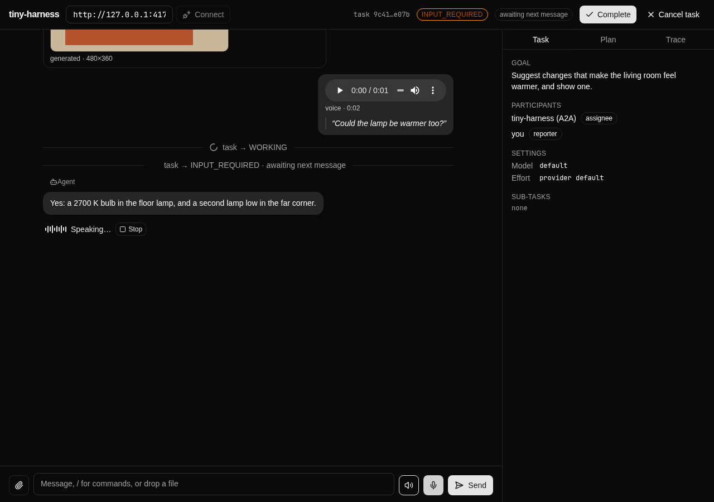
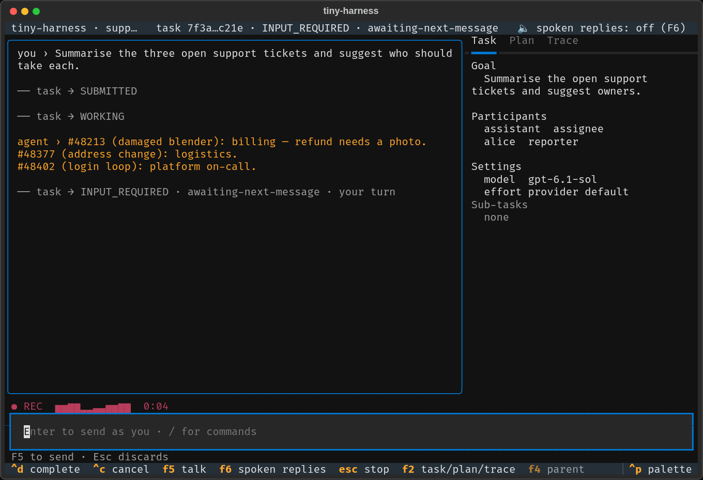

# T5, T6 — UI: the web renderer and the TUI

Work item issue-38, activities T5 (UI / visual) and T6 (TUI snapshots).

2026-10-22, branch `issue-38-multimodal`: web at `ec5f6b8`, TUI at `22701e9`; Python 3.14.7, Bun with the
Playwright Chromium. The web build serves the `?fixture=media` states, which match the
locked prototype; Chromium runs with a fake microphone (`--use-fake-device-for-media-stream`).

## T5 web: `cd renderers/web && bun run build && bun x playwright test --project=visual`

`bun install --frozen-lockfile` and `bun run build` exited 0 (the only build output is
Vite's existing "chunks larger than 500 kB" note).

```text
Running 28 tests using 1 worker
  ✓   1 [visual] › e2e/visual.spec.ts:26:3 › prototype state renders (light) (436ms)
  ✓   2 [visual] › e2e/visual.spec.ts:26:3 › prototype state renders (dark) (361ms)
  ✓   3 [visual] › e2e/visual.spec.ts:26:3 › prototype state renders (phone) (339ms)
  ✓   4 [visual] › e2e/visual.spec.ts:43:1 › the plan tab shows the DAG (386ms)
  ✓   5 [visual] › e2e/visual.spec.ts:65:3 › task controls render (light) (321ms)
  ✓   6 [visual] › e2e/visual.spec.ts:65:3 › task controls render (dark) (325ms)
  ✓   7 [visual] › e2e/visual.spec.ts:65:3 › task controls render (phone) (297ms)
  ✓   8 [visual] › e2e/visual.spec.ts:76:1 › typing / opens the command listbox (338ms)
  ✓   9 [visual] › e2e/visual.spec.ts:88:1 › a sub-task opens in place and links back to its parent (559ms)
  ✓  10 [visual] › e2e/visual.spec.ts:107:3 › complete leaves the task COMPLETED with both controls disabled (light) (373ms)
  ✓  11 [visual] › e2e/visual.spec.ts:107:3 › complete leaves the task COMPLETED with both controls disabled (dark) (353ms)
  ✓  12 [visual] › e2e/visual.spec.ts:107:3 › complete leaves the task COMPLETED with both controls disabled (phone) (352ms)
  ✓  13 [visual] › e2e/visual.spec.ts:136:3 › media turns render: image, voice turn, transcript, agent image (light) (462ms)
  ✓  14 [visual] › e2e/visual.spec.ts:146:3 › attachment chips render (light) (473ms)
  ✓  15 [visual] › e2e/visual.spec.ts:160:3 › a refused file is named and its chip stays (light) (572ms)
  ✓  16 [visual] › e2e/visual.spec.ts:136:3 › media turns render: image, voice turn, transcript, agent image (dark) (454ms)
  ✓  17 [visual] › e2e/visual.spec.ts:146:3 › attachment chips render (dark) (455ms)
  ✓  18 [visual] › e2e/visual.spec.ts:160:3 › a refused file is named and its chip stays (dark) (556ms)
  ✓  19 [visual] › e2e/visual.spec.ts:136:3 › media turns render: image, voice turn, transcript, agent image (phone) (407ms)
  ✓  20 [visual] › e2e/visual.spec.ts:146:3 › attachment chips render (phone) (408ms)
  ✓  21 [visual] › e2e/visual.spec.ts:160:3 › a refused file is named and its chip stays (phone) (489ms)
  ✓  22 [visual] › e2e/visual.spec.ts:171:1 › a sent image shows at once, then from the media route; it opens full size (1.5s)
  ✓  23 [visual] › e2e/visual.spec.ts:188:3 › hold to talk: recording, then the voice turn and its spoken reply (light) (3.0s)
  ✓  24 [visual] › e2e/visual.spec.ts:208:3 › a spoken reply that breaks off is interrupted, with Replay (light) (1.3s)
  ✓  25 [visual] › e2e/visual.spec.ts:188:3 › hold to talk: recording, then the voice turn and its spoken reply (dark) (2.9s)
  ✓  26 [visual] › e2e/visual.spec.ts:208:3 › a spoken reply that breaks off is interrupted, with Replay (dark) (1.3s)
  ✓  27 [visual] › e2e/visual.spec.ts:188:3 › hold to talk: recording, then the voice turn and its spoken reply (phone) (2.9s)
  ✓  28 [visual] › e2e/visual.spec.ts:208:3 › a spoken reply that breaks off is interrupted, with Replay (phone) (1.3s)
  28 passed (24.4s)
exit=0
```

### Strict pixel comparison

The spec compares against the baselines under `renderers/web/e2e/__snapshots__/` only
with `TINY_HARNESS_VISUAL_STRICT=1` (the baselines were made on this machine; CI asserts
the elements only). Run again with it set:

```text
$ TINY_HARNESS_VISUAL_STRICT=1 bun x playwright test --project=visual
Running 28 tests using 1 worker
  28 passed (26.2s)
exit=0
```

Every screenshot matched its baseline within `maxDiffPixelRatio: 0.02`. The images below
are those baselines.

### Web states (light, dark, phone)

| State | Light | Dark | Phone |
|-------|-------|------|-------|
| Media turns: image, voice turn with transcript, agent image | [light](ui/web-turns-light.png) | [dark](ui/web-turns-dark.png) | [phone](ui/web-turns-phone.png) |
| Pending attachment chips | [light](ui/web-chips-light.png) | [dark](ui/web-chips-dark.png) | [phone](ui/web-chips-phone.png) |
| Rejection error, chip kept | [light](ui/web-rejected-light.png) | [dark](ui/web-rejected-dark.png) | [phone](ui/web-rejected-phone.png) |
| Recording: mic pressed, meter | [light](ui/web-recording-light.png) | [dark](ui/web-recording-dark.png) | [phone](ui/web-recording-phone.png) |
| Speaking marker with Stop | [light](ui/web-speaking-light.png) | [dark](ui/web-speaking-dark.png) | [phone](ui/web-speaking-phone.png) |
| Interrupted with Replay | [light](ui/web-interrupted-light.png) | [dark](ui/web-interrupted-dark.png) | [phone](ui/web-interrupted-phone.png) |
| Image opened full size | [light](ui/web-dialog.png) | | |



### The voice flow, animated

[`ui/web-voice-flow.gif`](ui/web-voice-flow.gif): hold to talk → recording with the
meter → release → the voice turn and its transcript → the reply → "Speaking…" → Stop.
Recorded with Playwright's video capture against `vite preview` of the same build
(`?fixture=media`, light, 1000 × 640, fake microphone), converted with ffmpeg to an 800 px,
8 fps GIF (1.1 MB, 9.9 s).


## T5 TUI: `uv run pytest tests/ui/test_tui_keys.py -v`

`ScriptedClient` and fake audio devices; hold-Space runs on a fake clock.

```text
tests/ui/test_tui_keys.py::test_enter_sends_and_the_reply_streams_in PASSED
tests/ui/test_tui_keys.py::test_f2_cycles_the_side_panes_and_tab_moves_focus PASSED
tests/ui/test_tui_keys.py::test_a2ui_button_sends_the_action_with_the_chosen_value PASSED
tests/ui/test_tui_keys.py::test_ctrl_c_cancels_the_task_and_q_quits PASSED
tests/ui/test_tui_keys.py::test_the_top_bar_shows_the_state_and_the_sub_state PASSED
tests/ui/test_tui_keys.py::test_ctrl_d_completes_the_open_task PASSED
tests/ui/test_tui_keys.py::test_the_controls_need_an_open_task PASSED
tests/ui/test_tui_keys.py::test_a_message_to_a_terminal_task_is_not_sent PASSED
tests/ui/test_tui_keys.py::test_a_refused_cancel_shows_the_reason PASSED
tests/ui/test_tui_keys.py::test_a_refused_completion_shows_the_reason PASSED
tests/ui/test_tui_keys.py::test_slash_suggests_commands_and_the_hint_lists_them PASSED
tests/ui/test_tui_keys.py::test_sub_task_reply_adds_a_row_enter_opens_it_and_f4_returns PASSED
tests/ui/test_tui_keys.py::test_a_remote_sub_task_does_not_open_here PASSED
tests/ui/test_tui_keys.py::test_a_sub_task_that_cannot_be_followed_is_fetched_once PASSED
tests/ui/test_tui_keys.py::test_another_surface_completing_the_task_shows_without_a_reload PASSED
tests/ui/test_tui_keys.py::test_cancel_applies_the_canceled_task PASSED
tests/ui/test_tui_keys.py::test_sub_task_rows_follow_the_parent_stream_without_polling PASSED
tests/ui/test_tui_keys.py::test_a_replayed_status_draws_nothing_new PASSED
tests/ui/test_tui_keys.py::test_attach_adds_a_chip_and_enter_sends_the_file PASSED
tests/ui/test_tui_keys.py::test_attach_runs_only_when_the_card_lists_it PASSED
tests/ui/test_tui_keys.py::test_attach_refuses_what_the_card_does_not_accept PASSED
tests/ui/test_tui_keys.py::test_attach_backspace_on_empty_composer_removes_the_last_chip PASSED
tests/ui/test_tui_keys.py::test_attach_tab_completes_the_path PASSED
tests/ui/test_tui_keys.py::test_attach_rejected_by_the_server_keeps_the_chips PASSED
tests/ui/test_tui_keys.py::test_attach_echo_stores_the_own_image_without_fetching_it PASSED
tests/ui/test_tui_keys.py::test_attach_agent_image_shows_the_fallback_line PASSED
tests/ui/test_tui_keys.py::test_attach_agent_image_draws_inline_with_graphics PASSED
tests/ui/test_tui_keys.py::test_attach_a_missing_medium_names_the_file PASSED
tests/ui/test_tui_keys.py::test_attach_audio_and_another_participants_echo PASSED
tests/ui/test_tui_keys.py::test_voice_hold_space_records_and_release_sends PASSED
tests/ui/test_tui_keys.py::test_voice_a_lone_space_is_typed PASSED
tests/ui/test_tui_keys.py::test_voice_f5_toggles_and_a_short_recording_is_discarded PASSED
tests/ui/test_tui_keys.py::test_voice_escape_discards_a_recording PASSED
tests/ui/test_tui_keys.py::test_voice_quitting_while_recording_closes_the_microphone PASSED
tests/ui/test_tui_keys.py::test_voice_without_portaudio_names_the_extra_and_typing_works PASSED
tests/ui/test_tui_keys.py::test_voice_controls_hide_without_media PASSED
tests/ui/test_tui_keys.py::test_voice_f6_speaks_replies_and_escape_stops_them PASSED
tests/ui/test_tui_keys.py::test_voice_a_new_recording_or_message_stops_the_reply[record] PASSED
tests/ui/test_tui_keys.py::test_voice_a_new_recording_or_message_stops_the_reply[send] PASSED
tests/ui/test_tui_keys.py::test_voice_an_interrupted_reply_offers_replay PASSED
tests/ui/test_tui_keys.py::test_voice_a_spoken_reply_waits_when_spoken_replies_are_off PASSED
tests/ui/test_tui_keys.py::test_voice_enter_on_a_wav_entry_plays_it PASSED
42 passed in 31.37s
exit=0
```

The `test_attach_*` and `test_voice_*` tests (24) are new for issue-38. The 18 existing
key tests are unchanged: the file's diff against 0.8.0 only adds tests and replaces two
import lines. `test_voice_quitting_while_recording_closes_the_microphone` was added in
verification with the fix `22701e9` (see `regression.md`); this run is at that commit.

## T6: `uv run pytest tests/ui/test_tui_snapshots.py -v`

```text
tests/ui/test_tui_snapshots.py::test_conversation_state PASSED
tests/ui/test_tui_snapshots.py::test_plan_pane PASSED
tests/ui/test_tui_snapshots.py::test_trace_pane PASSED
tests/ui/test_tui_snapshots.py::test_empty_state PASSED
tests/ui/test_tui_snapshots.py::test_task_id_in_topbar PASSED
tests/ui/test_tui_snapshots.py::test_input_required_with_sub_state PASSED
tests/ui/test_tui_snapshots.py::test_slash_completion_and_hint PASSED
tests/ui/test_tui_snapshots.py::test_sub_task_row PASSED
tests/ui/test_tui_snapshots.py::test_sub_task_open PASSED
tests/ui/test_tui_snapshots.py::test_completed_state PASSED
tests/ui/test_tui_snapshots.py::test_attachment_chips PASSED
tests/ui/test_tui_snapshots.py::test_image_fallback_line PASSED
tests/ui/test_tui_snapshots.py::test_attachment_rejected PASSED
tests/ui/test_tui_snapshots.py::test_recording_bar PASSED
tests/ui/test_tui_snapshots.py::test_voice_transcript PASSED
tests/ui/test_tui_snapshots.py::test_speaking_line PASSED
15 snapshots passed.
16 passed in 12.01s
exit=0
```

The six media snapshots (`pytest-textual-snapshot` SVGs under
`tests/ui/__snapshots__/test_tui_snapshots/`) rendered to PNG with headless
`/usr/bin/chromium` at the SVG's own size (1360 × 929):

| State | PNG |
|-------|-----|
| Attachment chips | [tui-attachment-chips.png](ui/tui-attachment-chips.png) |
| Image fallback line (no terminal graphics) | [tui-image-fallback-line.png](ui/tui-image-fallback-line.png) |
| Rejection | [tui-attachment-rejected.png](ui/tui-attachment-rejected.png) |
| Recording bar | [tui-recording-bar.png](ui/tui-recording-bar.png) |
| Voice transcript | [tui-voice-transcript.png](ui/tui-voice-transcript.png) |
| Speaking line | [tui-speaking-line.png](ui/tui-speaking-line.png) |


