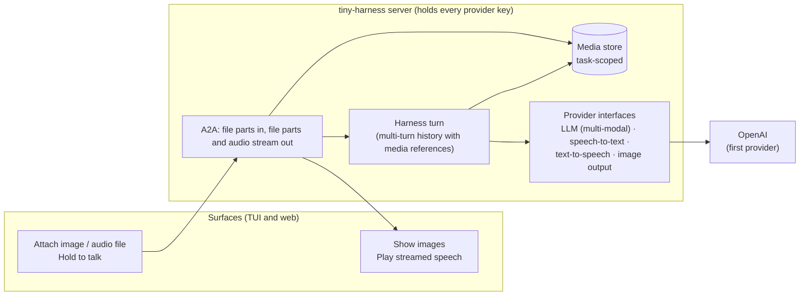

<!-- Written per the `the-loop:writing` skill: front-load each section's
     conclusion, draw it rather than describe it (3+ named parts -> a mermaid
     diagram), and keep the formal registers formal (EARS, abuse cases,
     RFC-2119, API contracts, schema descriptions). -->

# Requirements: multi-modal input and output, with a voice mode, in the TUI and the web renderer

> Phase 1 of 3 (requirements → design → tasks), following the Kiro spec approach
> (<https://kiro.dev/docs/specs/>). Ticket:
> [MadaraUchiha-314/tiny-harness#38](https://github.com/MadaraUchiha-314/tiny-harness/issues/38).

## Introduction

tiny-harness is text-only end to end. An `LLMRequest` carries text messages, tool calls
and tool results; the A2A server reads only the text parts of a message; the TUI and the
web renderer send and show only text. The only media anywhere is the A2UI `Image` and
`AudioPlayer` components, which an agent can emit by URL and which the TUI shows as a
placeholder.

This work item makes a conversation carry **images and audio in both directions**, on
**both surfaces**, through **provider-agnostic interfaces**, and adds a **voice mode**: the
user speaks, the agent hears it, and the agent's reply is spoken back as a stream. OpenAI is
the first and only provider implemented; the interfaces admit others. A runnable demo
proves it, as `examples/demo` proved issue-3.

**Who reads this:** the issue's author, who approves the scope here and, at the design gate,
the **new modules and their interfaces** (the issue asks to review those during design,
Requirement 9).

## Requirements

### Requirement 1 — Send images and audio files with a message

**User story:** As a user of either surface, I want to attach images and audio files to a
message, so that the agent can answer about what I show it or let it hear.

#### Acceptance criteria (EARS)

1. The web renderer SHALL let the user attach one or more files to the next message by a
   file picker, by drag and drop onto the composer, and by pasting an image from the
   clipboard, and SHALL show each pending attachment (a thumbnail for an image, the file
   name and duration for audio) with a control that removes it before sending.
2. The TUI SHALL let the user attach one or more local files to the next message by a slash
   command that takes a path (working name `/attach <path>`), SHALL list the pending
   attachments above the input and SHALL let the user remove them before sending.
3. WHEN a message is sent with attachments THEN the surface SHALL send each one as an A2A
   file part carrying its bytes and its media type, in the same message as the text part (a
   message MAY carry attachments and no text).
4. The system SHALL accept as input images of the types `image/png`, `image/jpeg`,
   `image/webp` and `image/gif`, and audio of the types `audio/wav`, `audio/mpeg`,
   `audio/mp4` (m4a), `audio/ogg` and `audio/webm`.
5. WHEN the server receives a file part THEN it SHALL store the bytes in a task-scoped
   media store and SHALL keep in the task's conversation history a reference to the stored
   media (an id, the media type, the size and the original file name), not the bytes.
6. WHEN the turn is built for the model THEN the harness SHALL give each image to the
   model as image input, and SHALL give each audio file to the model either as audio input
   (WHERE the configured model accepts audio) or as the transcript from the speech-to-text
   interface of Requirement 5, labelled as a transcript of the named file.
7. WHERE the configured model accepts no image input THEN the harness SHALL tell the user
   in the reply's status that the image was not given to the model, and SHALL NOT fail the
   task.

### Requirement 2 — Images in the agent's output

**User story:** As a user of either surface, I want the agent to reply with images it
generates, so that it can show me as well as tell me.

#### Acceptance criteria (EARS)

1. The system SHALL let an agent produce an image through a provider-agnostic image
   output interface; the OpenAI implementation SHALL use OpenAI's image generation.
2. WHEN the agent produces an image THEN the server SHALL store it in the task's media
   store and SHALL deliver it to the surfaces as an A2A file part (media type and either
   the bytes or a task-scoped URL) of the agent's message or artifact.
3. The web renderer SHALL show an image it receives inline in the conversation, scaled to
   the column width, and SHALL open it at full size on activation.
4. The TUI SHALL show an image it receives inline WHERE the terminal supports a graphics
   protocol (kitty, iTerm2 or sixel); otherwise it SHALL show a line naming the image, its
   size and a local file path the image was saved to.
5. An image the agent produced SHALL be part of the conversation history like an image the
   user sent, so that a later turn can refer to it.

### Requirement 3 — Voice input (voice mode)

**User story:** As a user of either surface, I want to hold a control, speak, and release,
so that my speech is sent as my message without typing.

#### Acceptance criteria (EARS)

1. The web renderer SHALL show a microphone button, separate from the send button, beside
   the composer. WHILE the button is held (pointer or keyboard) the renderer SHALL record
   from the microphone and show that it is recording; WHEN it is released THEN the
   renderer SHALL send the recording as the message's audio.
2. The TUI SHALL start recording WHEN the user long-presses the space key while the input
   is empty, SHALL show that it is recording WHILE it records, and SHALL stop and send the
   recording WHEN the key is released. Because most terminals report no key release, the
   TUI SHALL detect the release as the end of the key's auto-repeat, and SHALL use real
   release events WHERE the terminal reports them (kitty keyboard protocol). A short press
   of space SHALL type a space as today.
3. Each surface SHALL also offer a toggle (press once to start, once to stop) for users who
   cannot hold a control: the web button's keyboard activation and a TUI key binding.
4. WHEN a recording is sent THEN the server SHALL turn it into the user's message by the
   speech-to-text interface, or SHALL give it to the model as audio input WHERE the
   configured model accepts audio (preferred, per the issue); in both cases the surface
   SHALL show the user's turn as its transcript once one exists.
5. IF the microphone is unavailable or permission is denied THEN the surface SHALL say so
   and SHALL keep text input working.
6. IF a recording is shorter than a minimum length (working value 0.3 s) or silent THEN
   the surface SHALL discard it and SHALL send nothing.

### Requirement 4 — Spoken replies, streamed

**User story:** As a user in voice mode, I want the agent's reply spoken to me as it is
generated, so that I hear the start of the answer without waiting for the whole of it.

#### Acceptance criteria (EARS)

1. WHEN the user's message came from voice input THEN the agent's text reply SHALL also be
   spoken, through the text-to-speech interface; the user SHALL be able to turn spoken
   replies on or off on each surface.
2. The server SHALL stream the reply's audio to the surface in chunks, and the surface
   SHALL start playing before the reply's audio is complete. The text reply SHALL still be
   shown as today.
3. WHEN the user starts a new recording or sends a message while a reply is being spoken
   THEN the surface SHALL stop the playback.
4. The web renderer SHALL play the stream in the browser; the TUI SHALL play it on the
   local audio output of the machine the TUI runs on.
5. IF text-to-speech fails THEN the text reply SHALL still be delivered and the surface
   SHALL say that speech is unavailable; the task SHALL NOT fail.

### Requirement 5 — Provider-agnostic interfaces

**User story:** As an SDK user, I want every new modality behind an interface with OpenAI
as one implementation, so that I can add another provider without changing the harness.

#### Acceptance criteria (EARS)

1. The LLM request SHALL carry content parts — text, image and audio — in the per-turn
   input items, and each existing adapter (OpenAI Responses, OpenAI Chat Completions,
   Anthropic Messages) SHALL map the parts its API accepts.
2. `LLMModelInfo` (or its successor) SHALL state which input and output modalities the
   configured model supports, and the harness SHALL decide Requirements 1.6, 1.7 and 3.4
   from it, not from the provider's name.
3. The SDK SHALL define a speech-to-text interface (audio in, text out) and a
   text-to-speech interface (text in, a stream of audio chunks out, with the audio format
   stated), each as an entity like the LLM, with an OpenAI implementation of each.
4. The SDK SHALL define the image output interface of Requirement 2.1 with an OpenAI
   implementation.
5. The provider, model and voice for each interface SHALL be configuration (TOML), like
   `[openai]` today; an interface with no provider configured SHALL be off, and the
   surfaces SHALL hide the controls that need it (the agent card or a capability the
   surface reads says which are on).
6. The agent card's input and output modes SHALL list the media types the configured
   instance accepts and produces, and the surface `Modality` SHALL gain the image and
   audio modalities; a renderer that cannot show a received media type SHALL still show
   the placeholder naming it, as today.
7. Every provider call SHALL keep the existing provider contract: no client-side retries,
   429/5xx/timeouts raised as retryable, other errors as not retryable, and the configured
   `base_url` as the only host.

### Requirement 6 — Multi-turn with media

**User story:** As a user, I want to keep talking about an image or a recording across
turns, so that multi-modal input behaves like text in a conversation.

#### Acceptance criteria (EARS)

1. WHEN a later turn is built THEN the harness SHALL include the earlier turns' media, as
   their references resolved to content parts (or transcripts), within the context window
   budget.
2. WHEN compaction summarises older turns THEN the summary SHALL name the media those
   turns held (kind, file name, and the transcript or a description), and the media SHALL
   remain in the media store until the task's retention ends.
3. A conversation SHALL be able to mix text, attached files and voice turns in any order,
   on either surface, and a task started on one surface SHALL show its media on the other.
4. WHEN the worker restarts mid-task THEN the media of the task SHALL still be available
   (durable execution keeps working as today).

### Requirement 7 — The multi-modal demo

**User story:** As someone evaluating tiny-harness, I want one command that starts a demo
where I can show the agent an image, talk to it and get a picture back, so that I can see
multi-modal support working.

#### Acceptance criteria (EARS)

1. The repository SHALL ship a runnable multi-modal demo (working name
   `examples/multimodal`) started by one command, serving the web renderer and printing how
   to start the TUI, configured for OpenAI.
2. The demo's scenario SHALL exercise, in one conversation: an image attached by the user,
   an audio file attached by the user, a voice turn, a spoken streamed reply and an image
   produced by the agent, followed by a turn that refers back to an earlier image.
3. An end-to-end test SHALL drive that scenario through the A2A client with recorded audio
   and image fixtures and assert each step; it SHALL skip with the variable's name WHEN
   `OPENAI_API_KEY` is absent, like the existing e2e tests.
4. The demo SHALL be documented for the CLI user and the SDK user per the project's
   docs-writing skill.

### Requirement 8 — Feature parity of the two surfaces

**User story:** As the issue's author, I want every feature above on both the TUI and the
web, so that neither surface is second class.

#### Acceptance criteria (EARS)

1. Requirements 1 to 4 and 6 SHALL each be met on the TUI and on the web renderer; where a
   terminal cannot do something (inline images, key release), the TUI SHALL use the
   fallback stated in that requirement.

### Requirement 9 — Package structure reviewed at design

**User story:** As the issue's author, I want to review the new modules and their
interfaces during design, so that the package structure stays what I want.

#### Acceptance criteria (EARS)

1. `design.md` SHALL list every new or changed module of the `tiny_harness` package and of
   `renderers/web`, with a diagram of where each sits, and SHALL give each public interface
   its signatures (protocols, classes and their methods, config keys, A2A message shapes).

## Non-functional requirements

- **Latency.** In voice mode the first audio of a spoken reply SHALL start playing within
  1.5 s of the first text of the reply reaching the server (excluding the model's own
  time to first token), measured in the demo.
- **Durability limits.** Media bytes SHALL NOT be written into Temporal workflow history or
  activity payloads; only media references are (Temporal's payload limit is 2 MB).
- **Size limits.** The server SHALL accept an attachment up to a configured maximum (working
  value 20 MB per file, 25 MB per message) and a recording up to a configured maximum
  duration (working value 120 s); the A2A request size limit SHALL admit them.
- **Observability.** STT, TTS and image calls SHALL each produce a span like the `chat`
  span, with model, sizes, duration and token or character usage, and SHALL log at the same
  levels in development and at runtime.
- **Accessibility.** The web microphone button SHALL be operable by keyboard, SHALL have an
  accessible name and SHALL announce the recording state; images the agent produces SHALL
  carry alt text (the prompt or a description).
- **Dependencies.** New dependencies (audio capture and playback for the TUI, terminal
  image rendering) SHALL be optional extras so that a text-only install does not need
  PortAudio or image libraries.

## Security considerations

- **Actors & trust:** the user of a surface and any A2A peer that can send a message are
  untrusted sources of file parts. The content of an image or audio file is untrusted
  data: text drawn in an image or spoken in a recording reaches the model with the same
  trust as typed text. Generated images and transcripts come from a third-party provider
  and are untrusted when rendered.
- **Trust boundaries & data:** (a) file parts crossing from the A2A request into the media
  store and on to the provider; (b) media served back from the store to a surface; (c) the
  provider API keys (`OPENAI_API_KEY`), which stay on the server — no surface ever holds a
  key or calls a provider; (d) microphone audio, which is personal data, captured on the
  user's machine and sent to the server and to the provider.
- **Abuse cases (EARS):**
  1. WHEN a file part's bytes exceed the per-file or per-message limit THEN the system
     SHALL reject the message with an error naming the limit and SHALL store nothing.
  2. WHEN a file part's declared media type is not on the accepted list, or its bytes do
     not match the declared type (checked by content signature) THEN the system SHALL
     reject it.
  3. WHEN a client sends a file part by URI instead of bytes THEN the system SHALL reject
     it and SHALL NOT fetch the URI (no server-side request forgery).
  4. WHEN a participant requests media of a task it cannot read THEN the system SHALL refuse
     it as it refuses that task today, and media ids SHALL NOT be guessable.
  5. WHEN an image or audio contains instructions to the agent THEN the system SHALL treat
     them as user content only — no tool, permission or configuration is reachable through
     media that is not reachable through typed text.
  6. WHEN the web renderer shows a received image THEN it SHALL show only the accepted
     raster types (no SVG, no HTML) from the task's own media URL or bytes, so that a file
     cannot run script in the renderer.
  7. WHEN a decompression-bomb image (small file, huge dimensions) is received THEN the
     system SHALL reject it before decoding it fully.
  8. WHEN logs, traces or evidence are written THEN they SHALL carry no media bytes, no
     base64 of media and no provider key; transcripts follow the same policy as message
     text.
- **Fail closed:** an unknown media type, a size that cannot be read, a provider that is
  not configured or a media id that does not resolve SHALL each refuse the operation with a
  clear error, never pass the raw file through. The microphone SHALL record only while the
  user holds (or has toggled on) the control, with a visible indicator.

## Out of scope

- Video input or output, and A2UI `Video`.
- Speech-to-speech realtime sessions (OpenAI Realtime API over WebSocket/WebRTC) and
  barge-in by voice activity detection; voice mode is push-to-talk.
- Image editing (in-painting) and multi-image generation controls beyond what the image
  interface's first implementation needs.
- Providers other than OpenAI (interfaces only).
- Arbitrary document files (PDF and others) as input.

## Open questions

Assumptions taken so the work can continue; each can be overturned in review of this file.

1. **Native audio input or STT first.** The issue prefers a model that takes voice
   directly. Assumed: the harness uses native audio input when `LLMModelInfo` says the
   model accepts it, else OpenAI speech-to-text; the demo's model decides which path runs,
   and the e2e test covers both with a fake.
2. **Where TTS runs and how audio streams.** Assumed: on the server, streamed to the
   surface as A2A artifact chunks (append) of an audio artifact, so that keys stay on the
   server and both surfaces share one path.
3. **TUI long-press.** Assumed: long-press space on an empty input (auto-repeat detection,
   kitty release events where available), plus a toggle key. A different key can be chosen
   in design.
4. **Demo shape.** Assumed: a new `examples/multimodal` rather than extending the support
   demo, so the issue-3 e2e tests stay unchanged.

## Review comments

> Appended by the-loop's `record-feedback` hook when a human gate approves with
> comments (issue-109). Append-only and attributed: an approval never silently
> discards a reviewer's suggestions, and the feedback travels with the document
> it concerns rather than living in a side-channel tracker.

### 2026-10-22 — approved

**@MadaraUchiha-314** wrote:

approved
