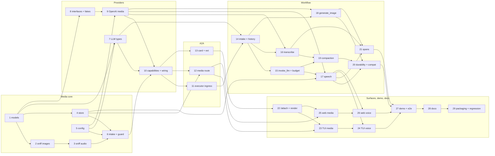

<!-- Written per the `the-loop:writing` skill: front-load each section's
     conclusion, draw it rather than describe it (3+ named parts -> a mermaid
     diagram), and keep the formal registers formal (EARS, abuse cases,
     RFC-2119, API contracts, schema descriptions). -->

# Tasks: multi-modal input and output, with a voice mode, in the TUI and the web renderer

> Derived from the approved [`requirements.md`](requirements.md), [`design.md`](design.md)
> and [`testing-plan.md`](testing-plan.md). One repository (this one), one pull request
> ([#39](https://github.com/MadaraUchiha-314/tiny-harness/pull/39)).

**The work splits into five tracks that meet at the workflow.** First the media core
(models, sniffing, store, intake). Then three tracks that can run side by side: the
provider interfaces and adapters, the A2A surface, and the workflow changes that depend
on both. The two surfaces and the demo come last. Tests come first in every task: no
production code without a failing test that motivates it. Each commit records the
red→green run.

## Task list

### Track A — media core

- [x] 1. Media models and entity kinds
  - `harness/media/models.py`: `MediaKind`, `ACCEPTED`, `PCM_MEDIA_TYPE`, `MediaRef`,
    `MediaAttachment` (its serialiser refuses `data`), `AudioFormat`. `EntityKind` gains
    `speech_to_text`, `text_to_speech`, `image_generator` and `media_store`.
  - _Depends on:_ none
  - _Requirements:_ R1.4, R1.5, NFR durability, abuse case 8
  - _Test:_ T1 — `tests/unit/media/test_models.py` (id format, `data` not serialisable); T3 — entities API snapshot
- [x] 2. `sniff`: signatures and image sizes
  - Signature detection for every accepted type. Image dimensions read from the header
    only.
  - _Depends on:_ 1
  - _Requirements:_ R1.4, abuse cases 2, 7
  - _Test:_ T1/T8 — `tests/unit/media/test_sniff_images.py` (one per type; SVG, HTML named `.png`, PNG declared JPEG, a bomb PNG)
- [x] 3. `sniff`: audio duration and track checks
  - Bounded walkers for WAV, MP3 (frame walk), MP4 (`hdlr`, `mvhd`/`mdhd`/`stts`), Ogg
    (page walk, `OpusHead`/vorbis) and WebM (tracks, `Info/Duration` or the cluster walk),
    each with a hop budget. Over the cap, indeterminate, or not audio only → reject.
  - _Depends on:_ 2
  - _Requirements:_ R1.4, NFR size limits, design critic 6
  - _Test:_ T1/T8 — `tests/unit/media/test_sniff_audio.py` (a valid file per type; MP4 and WebM with video; a low-bitrate MP3 over the cap; an Ogg with a lying granule; WebM without `Duration`; truncated files; budget exhaustion)
- [x] 4. `FileMediaStore`
  - `put`, `get`, `lookup`, `delete_task`, `sweep`, id validation, atomic writes. Growing
    objects: `create`, `begin` → `SpeechWriter` (generation fencing), and `read_stream`
    (done, failed, interrupted, idle).
  - _Depends on:_ 1
  - _Requirements:_ R1.5, R4.2, R6.2, R6.4, abuse case 4, design critic 3
  - _Test:_ T1 — `tests/unit/media/test_store.py` (traversal ids refused, a stale writer gets `MediaFenced`, a reader is interrupted on a new generation, an appended chunk reaches the reader within 2 × `poll`)
- [x] 5. Configuration
  - `MediaConfig`, `SpeechToTextConfig`, `TextToSpeechConfig`, `ImageGenerationConfig`.
    `[openai] input_modalities` and `audio_tokens_per_second`, `[retention] media`,
    `[media] speech_drain`. Validation: the other three sections need `[media]`; the
    provider-key rule. The effective request cap in `LimitsMiddleware`.
  - _Depends on:_ none
  - _Requirements:_ R5.5, NFR size limits
  - _Test:_ T1 — `tests/unit/test_config_media.py`; T3 — `settings.schema.json` and the config API snapshot
- [x] 6. `MediaIntake` and `guard`
  - `extract` (checks in order, all-or-nothing rollback, url-part rewrite and part
    metadata). `guard` with the `extract` / `refuse` / `drop` modes.
  - _Depends on:_ 3, 4, 5
  - _Requirements:_ R1.3–R1.5, abuse cases 1–3, 7, design critic 5
  - _Test:_ T1/T8 — `tests/unit/media/test_intake.py` (oversize file and message, type not accepted, url part with no outbound request, rollback leaves nothing stored)

### Track B — provider interfaces

- [x] 7. LLM types and adapter content mapping
  - `MessageItem.media`. `LLMModelInfo.input_modalities`, `output_modalities` and
    `audio_input_formats`. Responses, Chat Completions and Anthropic map every row of
    the design's table. An unresolved attachment raises `ProviderError`.
  - _Depends on:_ 1, 5
  - _Requirements:_ R1.6, R5.1, R5.2
  - _Test:_ T1 — `tests/unit/models/test_media_content.py` (golden bodies; **text-only bodies byte-identical to 0.8.0**); T3 — models API snapshot
- [x] 8. Speech and image interfaces, plus fakes
  - `speech.py` (`SpeechToText`, `TextToSpeech`, `Transcript`), `images.py`
    (`ImageGenerator`, `GeneratedImage`), and the three scripted fakes.
  - _Depends on:_ 1
  - _Requirements:_ R5.3, R5.4
  - _Test:_ T1 — `tests/unit/models/test_speech_fakes.py`; T3 — models API snapshot
- [x] 9. OpenAI media implementations
  - `openai_media.py` over the existing client factory: transcriptions, streamed `pcm`
    speech, and `images.generate`. Error mapping. `base_url` is the only host.
  - _Depends on:_ 5, 8
  - _Requirements:_ R5.3, R5.4, R5.7
  - _Test:_ T1 — `tests/unit/models/test_openai_media.py` against `respx` (request shapes, `max_retries=0`, 429/5xx retryable, no `OPENAI_BASE_URL`)
- [x] 10. Effective capabilities and runtime wiring
  - `media.capabilities(...)`. `build_runtime` and `Harness` build the media store, the
    STT/TTS/image entities and the intake from config, or take them as keyword seams.
  - _Depends on:_ 6, 7, 9
  - _Requirements:_ R5.5, design critic 9
  - _Test:_ T1 — `tests/unit/media/test_capabilities.py` (audio advertised only with STT or native formats); T3 — service API snapshot

### Track C — A2A surface

- [x] 11. Executor intake at every ingress
  - `execute` extracts media before `redact_message`; `control` refuses file parts; push
    and remote-agent results and channel deliveries drop them with the note. A test
    enumerates the ingress paths.
  - _Depends on:_ 6, 10
  - _Requirements:_ R1.3, abuse cases 1–3, 8, design critic 5
  - _Test:_ T8 — `tests/security/test_media.py::test_control_with_file_refused`, `::test_push_file_parts_dropped`, `::test_every_ingress_guarded`; T2 — rejection reaches the client as `InvalidParams`
- [x] 12. Media route
  - `GET /media/{task_id}/{media_id}`: participant resolution and `AccessPolicy`, 404 on
    no access, response headers, `FileResponse` for closed objects and a streamed body for
    growing ones (aborted on failure or interruption). `RouteOptions.media`.
  - _Depends on:_ 4, 10
  - _Requirements:_ R2.2, R4.2, R6.3, abuse cases 4, 6
  - _Test:_ T8 — `tests/security/test_media.py::test_other_participant_404`, `::test_cross_task_id_404`, `::test_traversal_id_404`, `::test_route_headers`; T2 — streaming over `streaming_asgi.py`
- [ ] 13. Card, media extension and commands extension
  - Effective input and output modes, and the media extension params. JSON schemas
    `docs/a2a/ext/media.json` and `intrinsics/generate_image.json`. Pages
    `docs/a2a/ext/media/v1.md` and the `runsOn` addition to commands v1.
  - _Depends on:_ 10
  - _Requirements:_ R5.5, R5.6, R1.2
  - _Test:_ T3 — `tests/contract/test_agent_card.py` (unchanged without `[media]`), `test_ext_schemas.py`, `test_intrinsic_schemas.py`

### Track D — workflow

- [ ] 14. Intake activity and media in history
  - `IntakeOut.media` from the message's own media URLs, checked against the store.
    `MessageItem(..., media=...)`. The user's message echo carries the url parts.
  - _Depends on:_ 7, 11
  - _Requirements:_ R1.5, R6.3
  - _Test:_ T2 — `Scenario: media sent from one surface is fetched by another participant on the task`
- [ ] 15. `invoke_llm` resolves media; context budget
  - Resolve images and native audio inside the activity, and transcripts to text. The
    R1.7 note when the model takes no images. `_chars` for image, transcript and native
    audio.
  - _Depends on:_ 14
  - _Requirements:_ R1.6, R1.7, R6.1, design critic 7
  - _Test:_ T2 — `Scenario: an image and a question reach the model`, `Scenario: a model without image input gets a note and the task continues`; T1 — `tests/unit/core/test_context_media.py`
- [ ] 16. `transcribe` activity and transcript artifact
  - Native-or-STT decision. Transcript stored on the attachment and emitted as
    `transcript:<id>`. The note when there is no STT. STT failure handling.
  - _Depends on:_ 9, 14
  - _Requirements:_ R1.6, R3.4
  - _Test:_ T2 — `Scenario: native audio skips speech-to-text`, `Scenario: audio with no speech-to-text configured gets a note`
- [ ] 17. Spoken replies: `open_speech`, `speak` and speech jobs
  - Speech artifact before the final status. `speakable_text` and the 4 096-character
    cap. Generation per attempt. `speech_jobs` drained at rollover and completion, and
    cancelled on cancel. Status note on failure.
  - _Depends on:_ 4, 9, 15
  - _Requirements:_ R4.1, R4.2, R4.5, design critic 1–4
  - _Test:_ T2 — `Scenario: a voice turn is transcribed, answered and spoken`, `Scenario: the speech artifact arrives before the final status`, `Scenario: a retry during speech starts a new generation and the reader is told`, `Scenario: speech that fails leaves the text and a note`, `Scenario: rollover and completion wait for speech; cancel stops it`
- [ ] 18. `generate_image` intrinsic
  - The tool, `ContentPart(kind="media")`, the `image:<id>` artifact, and the agent note
    with media for later turns.
  - _Depends on:_ 9, 14
  - _Requirements:_ R2.1, R2.2, R2.5
  - _Test:_ T2 — `Scenario: generate_image shows an image and a later turn sees it`
- [ ] 19. Compaction with media
  - The summarise request carries media. One description line per folded item is
    enforced, with the fallback line. Native audio is transcribed first when STT exists.
  - _Depends on:_ 15, 16
  - _Requirements:_ R6.2, design critic 7
  - _Test:_ T2 — `Scenario: compaction names every media item`; T1 — `tests/unit/core/test_compaction_media.py`
- [ ] 20. Durability, retention and compatibility
  - Retention sweep for media. Worker restart with media and mid-speech. Replay of 0.8.0
    histories and states. Abuse case 5 (a transcript grants nothing). No media bytes in
    trace or log.
  - _Depends on:_ 17, 18, 19
  - _Requirements:_ R6.4, NFR durability, NFR observability, abuse cases 5, 8
  - _Test:_ T2 — `Scenario: media survives a worker restart`; T10 — `tests/integration/media/test_compat.py`; T8 — `::test_media_grants_nothing`, `::test_no_media_bytes_in_trace_or_log`
- [ ] 21. Spans for intake, STT, TTS and images
  - `media.intake`, `transcribe {model}`, `speech {model}` and `image {model}` spans with
    ids and sizes only.
  - _Depends on:_ 16, 17, 18
  - _Requirements:_ NFR observability
  - _Test:_ T1 — `tests/unit/o11y/test_media_spans.py`

### Track E — surfaces, demo, docs

- [ ] 22. Surface command `/attach` and `Modality`/`RenderItem` changes
  - `CommandSpec.runs_on`, the `attach` builtin and its server reply. `Modality.IMAGE`
    and `Modality.AUDIO`. The `RenderItem` kind `media`, and `plan_message` for url
    file parts.
  - _Depends on:_ 13
  - _Requirements:_ R1.2, R5.6
  - _Test:_ T1 — `tests/unit/commands/test_surface_commands.py`, `tests/unit/interaction/test_plan_media.py`; T3 — commands and interaction API snapshots
- [ ] 23. TUI client, attachments and media entries
  - `send(parts, …, speak)`, `get_media`, `ScriptedClient`. `/attach` with path
    completion, chips, Backspace removal and limits from the card. `MediaEntry` with
    `textual-image` or the path line, and the id-keyed no-follow cache. `AudioEntry`.
    The `images` extra.
  - _Depends on:_ 12, 22
  - _Requirements:_ R1.2, R2.4, R6.3, R8, design critic 8
  - _Test:_ T5 — `tests/ui/test_tui_keys.py::test_attach_*`; T6 — snapshots (chips, image fallback line, rejection); T8 — `::test_tui_cache_refuses_symlink`
- [ ] 24. TUI voice: hold, record, play
  - `HoldDetector`, `Recorder`, `PcmPlayer`. Hold-Space, `F5`, `F6` and `Escape`, the
    recording bar, the speaking line, interrupted and Replay. The no-PortAudio reason.
    The `voice` extra.
  - _Depends on:_ 17, 23
  - _Requirements:_ R3.2, R3.3, R3.5, R3.6, R4.1, R4.3, R4.4, R4.5, R8
  - _Test:_ T1 — `tests/unit/tui/test_hold_detector.py`, `test_recorder.py`, `test_pcm_player.py`; T5 — `test_tui_keys.py::test_voice_*`; T6 — snapshots (recording bar, transcript, speaking line)
- [ ] 25. Web: attachments and media items
  - `media.ts`. Composer attach via picker, drop and paste, and chips.
    `onSend(text, files)`. `model.ts` media and speech items, plus the transcript.
    `MediaItem` (blob URLs, raster only, full-size dialog). Fixture states for
    Playwright.
  - _Depends on:_ 12, 22
  - _Requirements:_ R1.1, R1.3, R2.3, R6.3, R8, abuse case 6
  - _Test:_ T8 — `MediaItem.test.tsx::refuses_svg`; web unit `model.test.ts`, `Composer.test.tsx`; T5 — visual states (chips, image, audio, agent image, rejection); T9 — axe
- [ ] 26. Web voice: mic and streamed speech
  - `voice.ts` (`Recorder`, `PcmStreamPlayer`). `MicButton` with hold and toggle, the
    activation generation, and the live region. Speaker toggle → `speak`. Speaking
    marker with Stop, interrupted with Replay.
  - _Depends on:_ 17, 25
  - _Requirements:_ R3.1, R3.3, R3.5, R3.6, R4.1–R4.5, R8, design critic 10
  - _Test:_ T8 — `MicButton.test.tsx::late_grant_stops_tracks`; web unit `voice.test.ts` (PCM scheduling, stop); T5 — visual states (recording, speaking, interrupted); T9 — keyboard flow
- [ ] 27. `examples/multimodal` and its e2e test
  - Package, config (embedded Temporal, OpenAI), plugin prompt, fixtures (`room.jpg`, and
    TTS-generated `question.wav` and `followup.wav`), README. `test_demo_multimodal.py`
    with the latency measurement.
  - _Depends on:_ 20, 21, 24, 26
  - _Requirements:_ R7.1–R7.3, NFR latency
  - _Test:_ T4 — `uv run pytest tests/e2e/test_demo_multimodal.py`; T7 — first-chunk latency recorded
- [ ] 28. User docs and capability docs
  - Docs-writing skill: the configuration page for media and voice, the TUI keys and
    `/attach`, the web voice controls, the multimodal example (CLI and SDK personas), and
    the SDK seams. Capability docs: new `media.md`; update `models`,
    `surfaces-and-renderers`, `tools`, `demo` and `configuration`. Decision record
    `decision-010` (references, not bytes).
  - _Depends on:_ 27
  - _Requirements:_ R7.4
  - _Test:_ T15 — `cd docs && bun run docs:build`; T13 — markdownlint
- [ ] 29. Packaging and the full regression
  - The `voice` and `images` extras. The wheel without them. The whole suite and static
    checks green.
  - _Depends on:_ 28
  - _Requirements:_ NFR dependencies, R8
  - _Test:_ T12 — `tests/integration/test_package.py`; T11 — full suite; T13 — `uv run pre-commit run --all-files`, `bun run typecheck`

## Dependency graph (DAG)

## Checkpoints

- After **6** (media core): `uv run pytest tests/unit/media tests/unit/test_config_media.py`.
- After **10**, **13** (providers, A2A): `uv run pytest tests/unit tests/contract`.
- After **20** (workflow): `uv run pytest tests/integration/media tests/security/test_media.py`
  and the existing integration suite (`uv run pytest tests/integration`), because the
  workflow changed.
- After **24** and **26** (surfaces): `uv run pytest tests/ui`;
  `cd renderers/web && bun run build && bun run test && bun x playwright test`.
- After **29**: the whole of `testing-plan.md` runs at the `verification` node. Then come
  the self and critic rounds and the security review gate (`evidence/security-review.md`).

Each task's commit carries its red→green test run. The pre-commit hook (ruff, pyright,
pytest unit, markdownlint, commitizen) runs on every commit.

## Review comments

> Appended by the-loop's `record-feedback` hook when a human gate approves with
> comments (issue-109). Append-only and attributed: an approval never silently
> discards a reviewer's suggestions, and the feedback travels with the document
> it concerns rather than living in a side-channel tracker.
